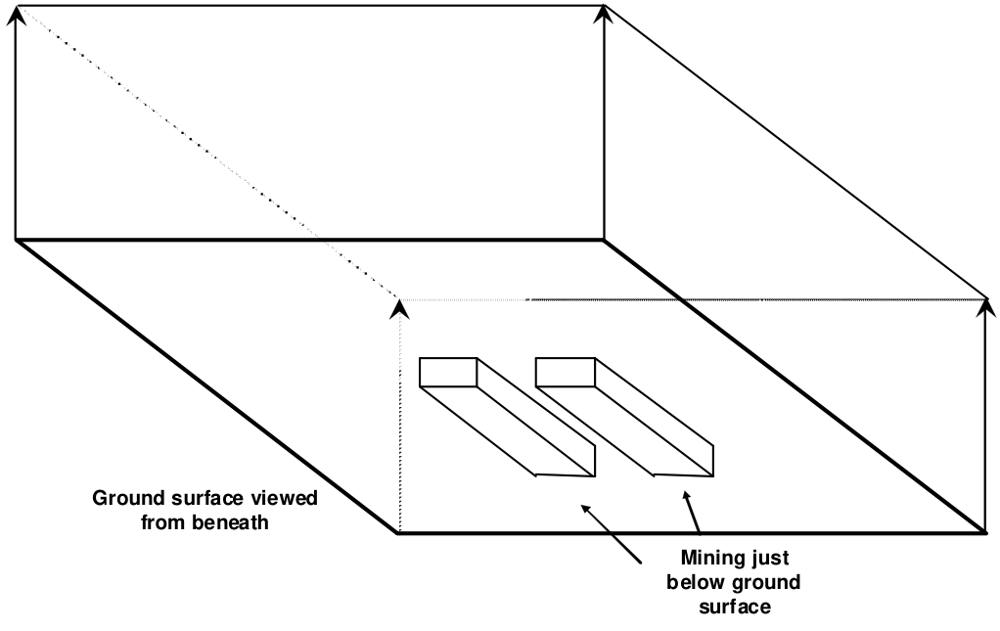

定义地表的最佳方法是使用一个大型 FF 区，以其下表面作为地表。为这些单元指定材料代码零后，Map3D 将确保这些表面上的法向应力和剪应力均为零，从而模拟自由面。

只有当开采开挖体埋深较浅时（即开采深度小于开采横向范围的约两倍时），才需要定义地表。在这种情况下，自由面在各个方向上的延伸范围应至少为开采横向范围的两倍。

除非绝对必要，否则不应将场点网格延伸到自由面附近或穿过自由面，因为这会导致自由面被离散为大量边界单元。
