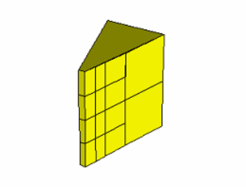
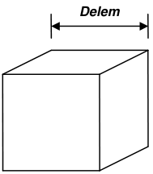
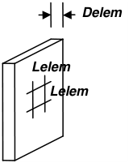
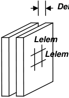
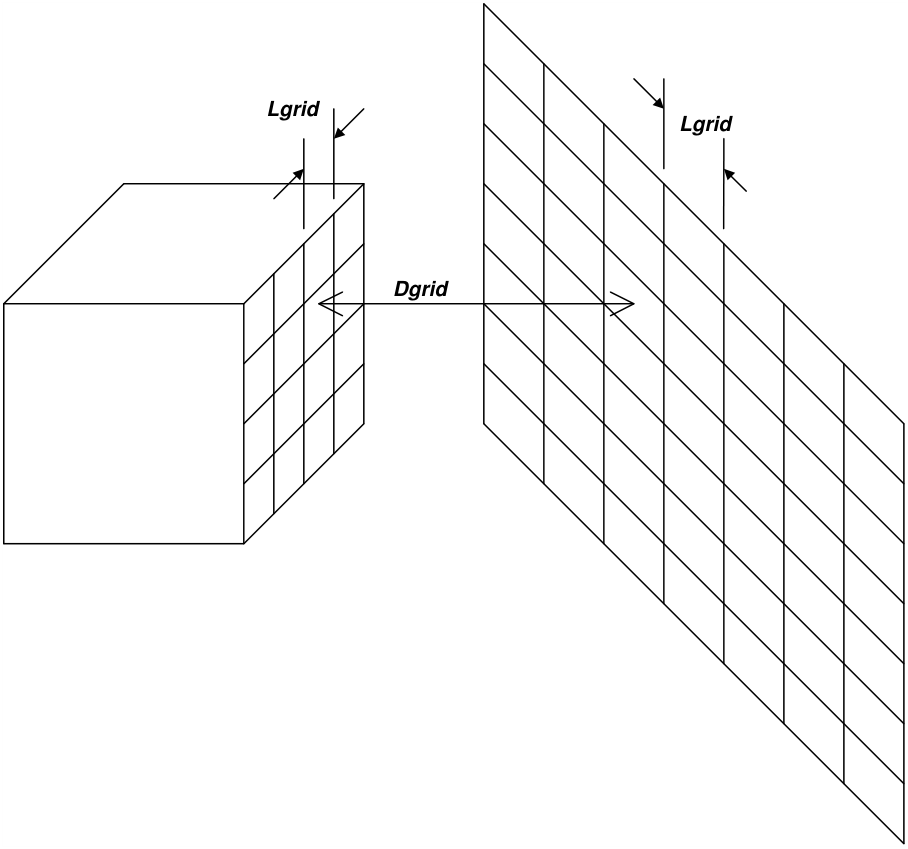
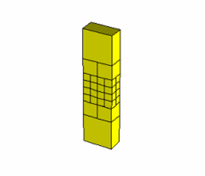
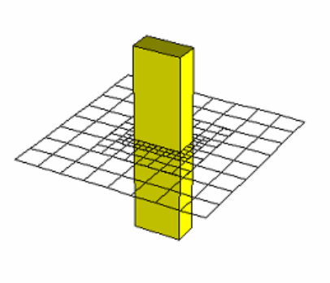
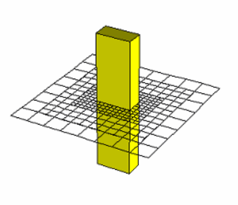
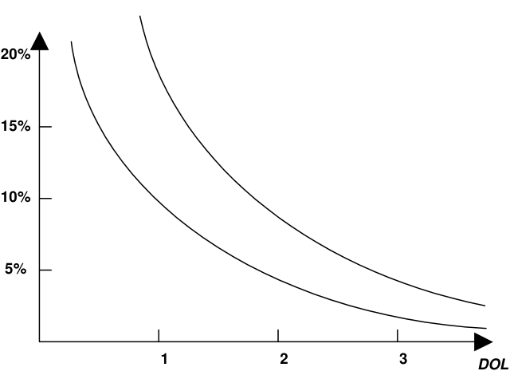
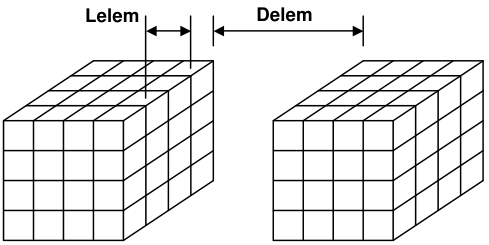

Map3D 采用几种不同但相互补充的策略，以支持超大规模问题的分析。离散化过程经过控制，只在需要的位置使用边界单元。随后采用多种形式的集总来减少分析时间和磁盘空间需求。这些功能结合在一起，使 Map3D 能够在个人计算机上处理超大规模问题（超过 2,000,000 个单元）。

如果不进行集总，一个 64000 个单元的问题将占用 147 GB 磁盘空间；采用集总后，可减少到 1 GB 以下，分析所需时间也大致按相同比例缩短。这使用户能够详细地定义现有开采几何形状，并根据需要添加新的开采。这大大减少了建立和运行分析所需的工作量，并能在必要时考虑整个矿山。

所有离散化和集总参数都以"距离与长度之比"的形式表示。在所有情况下，距离均在两个关注点之间测量（例如从一个单元到另一个单元，或从一个单元到最近的网格点）。该比值中的长度是其中一个关注点处的单元尺寸或网格间距。

离散化和集总参数的建议值如下：

- _AL_ 应设为最小矿柱或采场宽度的两倍。使用与坐标相同的单位（例如米或英尺）。

- _AG_ 应设为最小关注尺寸。使用与坐标相同的单位（例如米或英尺）。

- _DON_ =0.5, _DOL_ = _DOC_ =1, _DOE_ = _DOG_ =2，误差为 10-20%

- _DON_ =0.5, _DOL_ = _DOC_ =2, _DOE_ = _DOG_ =4，误差为 5-10%

- _DON_ =1.0, _DOL_ = _DOC_ =4, _DOE_ = _DOG_ =8，误差 &lt; 5%

这些参数在 CAD > Properties > Control Parameters 对话框中设置。

下文将详细介绍如何使用这些参数控制离散化和集总。

**_DON_ 和** **_AL_ —— 矩阵条件**

在离散化过程中，所有模型表面（FF 块体和 DD 平面的表面）都被细分为边长为

_Lelem_ = _Delem_ / _DON_

的边界单元，其中 _Delem_ 是 Map3D 确定的相邻模型表面之间的最小距离。由于在某些位置距离 _Delem_ 可能为零，因此必须指定最小单元边长 _AL_。

_AL_ 应设为最小矿柱或采场宽度的两倍。应使用与坐标相同的单位（例如米或英尺）。

除开挖体或矿柱非常窄的问题外，_DON_ 取 0.5 通常足以满足所有问题的需要。对于后一种情况，建议 _DON_ 取 1.0。

虽然较大的 _DON_ 值会生成更多边界单元，从而延长运行时间，但对于非常窄的开挖体或矿柱，这对于获得条件良好、可求解的问题是必要的。

_DON_ 控制块体表面离散为边界单元的方式。该参数与 _AL_ 一起，用于确保边界元分析生成条件良好、可求解的系数矩阵。

矩阵条件与 _DON_ 的大小直接相关。使用较大的 _DON_ 值（接近 1）可以保证矩阵条件良好、易于求解。

_DON_ = 0.5

#### _DON_ = 1.0

这些参数控制彼此靠近的表面的离散精细程度。例如，比较 _DON_ 为 0.5 和 1.0 的示例可以看出，较大的 _DON_ 值会在采场所在位置生成更小的边界单元。

从分析的角度看，问题可分为三种基本类型。最容易求解的是使用大块三维形体、表面之间间距较大的问题。

对于这类问题，总能生成条件良好的系数矩阵，_DON_ 和 _AL_ 的影响并不重要。

求解难度次之的是定义了窄采场的问题。在这种情况下，距离 _Delem_（即一个单元到另一个单元的最小距离）就是采场宽度。由于单元边长 _Lelem_ 可根据 _DON_ 比值计算为

#### _Lelem_ = _Delem_ / _DON_

且 _Lelem_ 不小于 _AL_，因此较小的 _DON_ 值只会在采场较窄的位置附近生成小单元。离开这些区域后，单元尺寸会迅速增大。使用虚拟力单元构建这类板状开挖体时，除非 _DON_ 取约 0.5，否则可能产生条件不良的矩阵。当然，还必须同时设置足够小的 _AL_ 值，以便能够生成小单元。

_AL_ 通常应设为最窄矿柱或采场的宽度，或上盘与下盘之间的最小距离。这样，离散化程序就可以根据需要使用足够小的单元，以确保矩阵条件良好。

最难求解的是定义了窄矿柱或使用了间距很小的节理的问题。与上面一样，_Delem_ 是采场或矿柱的宽度，单元边长同样可以根据 _DON_ 比值计算。但对于这类开挖体彼此非常接近、形成窄矿柱的问题，除非 _DON_ 取约 1，否则将生成条件不良、无法求解的矩阵。当然，还必须同时设置足够小的 _AL_ 值，以便能够生成小单元。

对于窄采场问题，_DON_ 的建议值为 0.5；对于窄矿柱问题，建议值为 1。

_AL_ 通常应设为最窄矿柱的宽度或上盘与下盘之间的最小距离。这样，离散化程序就可以根据需要使用足够小的单元，以确保矩阵条件良好。

总之，_AL_ 应设为最窄矿柱的宽度或上盘与下盘之间的最小距离。如果生成的单元过多，可能需要更大的值。对于普通问题，_DON_ 应设为 0.5；对于定义了窄矿柱的问题，应设为 1.0。

在离散化过程中，Map3D 会尝试使所有单元都满足指定的 _DON_ 比值。离散时，任何块体或板片的边最多可划分为 256 个边界单元。如果达到这一细分数量后仍未满足指定的 _DON_ 比值，Map3D 将发出警告消息，提示用户将块体或板片细分为更小的部分。

离散化完成后，可使用以下命令绘制距离 _Delem_

Plot > Miscellaneous > Delem Distance to nearest element on surfaces

可使用以下命令绘制 _Delem/Lelem_ 比值

Plot > Miscellaneous > Delem/Lelem _DON_ ratio on surfaces

_DON_ 较小（小于 0.5）的位置可能导致求解过程不收敛。

请注意，如有需要，可以通过为每个单元指定最大宽度，逐个单元地覆盖这一行为

#### CAD > Edit > Entity Properties > Maximum Width

#### _DOL_ 和 _AG_ —— 求解精度

在离散化过程中，块体和 DD 平面被细分为边长为 _Lgrid_ 的边界单元。单元尺寸根据到最近场点网格平面的最小距离 _Dgrid_，按以下关系确定

_Lgrid_ = _Dgrid_ / _DOL_

由于在某些位置距离 _Dgrid_ 可能为零，因此还必须指定最小单元边长 _AG_。

同样的关系也用于将网格平面细分为计算场应力、应变和位移的点。最小网格间距为 _AG_ 的一半。

_AG_ 参数应设为最小关注尺寸。为获得较为准确的结果，_AG_ 应设为采场或矿柱宽度的约四分之一。例如，如果用户希望查看 2 m 宽矿柱上的应力分布，_AG_ 取 0.5 即可提供足够的场点，以绘制准确的等值线。

应使用与坐标相同的单位（例如米或英尺）。

除需要更高精度的问题外，建议所有问题的 _DOL_ 都取 1.0。取 1.0 时，预计误差为 10-20%；取 2.0 时误差约为 5-10%；取 4.0 时误差应小于 2%。

虽然较大的 _DOL_ 值会生成更多单元，但这对于提高精度是必要的。

_DOL_ 控制网格和块体表面的细分方式。该参数与 _AG_ 一起，用于控制结果所需的细节精度。

_AG_ 的选择应反映关注的尺寸。例如，如果只需要在开挖面附近 1 米范围内了解应力分布细节，则 _AG_ 应设为 1 米。

场点间距和单元边长 _Lgrid_ 根据指定的 _DOL_ 比值确定。_Dgrid_ 为给定单元到最近网格的最小距离。由于 _Lgrid_ 可根据 _DOL_ 比值计算为

_Lgrid_ = _Dgrid_ / _DOL_

且 _Lgrid_ 不小于 _AG_，因此较小的 _DOL_ 值只会在网格靠近采场的位置附近生成小单元和小网格间距。离开这些区域后，单元尺寸会迅速增大。

_DOL_ = 1

_DOL_ = 2

_DOL_ = 1

#### _DOL_ = 2

较小的 _DOL_ 值（1 或更小）只会在网格与块体相交或非常靠近块体的位置附近生成小场点间距和小单元。离开这些区域后，场点间距和单元边长会迅速增大。较大的 _DOL_ 值（2 或更大）会扩大场点间距和单元边长保持较小的范围。

#### 误差

结果精度与 _DOL_ 的大小直接相关。_DOL_ 接近 1 时误差约限制在 10-20%，接近 2 时约为 5-10%。这些数值只是近似值，因此对于需要高精度的问题，建议使用接近 4 的 _DOL_ 值。对于只需要较低精度的问题，_DOL_ 接近 1 即可。不建议将 _DOL_ 设为小于 1。

请注意，较大的 _DOL_ 值和较小的 _AG_ 值会增加单元数量和运行时间，但精度更高。

总之，_AG_ 应设为关注的分辨率（采场宽度的一部分）。对于粗略分析结果，_DOL_ 应设为 1；对于详细分析结果，应设为 2；需要非常高的精度时，应设为 4。

在离散化过程中，Map3D 会尝试使所有单元和网格都满足指定的 _DOL_ 比值。离散时，任何块体或板片的边最多可划分为 256 个边界单元，任何网格的边最多也可划分为 256 个场点。如果达到这一细分数量后仍未满足指定的 _DOL_ 比值，Map3D 将发出警告消息，提示用户将块体、板片或网格细分为更小的部分。

离散化完成后，可使用以下命令在模型表面上绘制距离 _Dgrid_

Plot > Miscellaneous > Dgird Distance to nearest grid on surfaces

或在网格上绘制

Plot > Miscellaneous > Dgrid Distance to nearest element on grids

可使用以下命令在模型表面上绘制 _Dgrid_ / _Lgrid_ 比值

Plot > Miscellaneous > Dgrid/Lgrid _DOL_ ratio on surfaces

或在网格上绘制

Plot > Miscellaneous > Dgrid/Lgrid _DOL_ ratio on grids

请注意，如有需要，可以通过为每个网格指定最大宽度，逐个网格地覆盖这一行为

CAD > Edit > Entity Properties > Maximum Width

#### _DOR_ —— 单元长宽比

_DOR_ 控制单元的最大长宽比。如果确定某个单元的边长之比超过 _DOR_，则该单元将被细分。_DOR_ 的建议值为 5。如果发现结果不稳定，应将 _DOR_ 减小到 2。请注意，较小的 _DOR_ 值会生成更多单元、延长运行时间，但精度更高。

在离散化过程中，Map3D 会尝试使所有单元都满足指定的 _DOR_ 比值。离散时，任何块体或板片的边最多可划分为 256 个边界单元。如果达到这一细分数量后仍未满足指定的 _DOR_ 比值，Map3D 将发出警告消息，提示用户将块体或板片细分为更小的部分。

#### _DOC_ —— 矩阵集总

在矩阵组装过程中，程序会检查各组块体与 DD 平面之间的距离 _Delem_，以确定它们能否为计算和存储目的而集总在一起。集总程度取决于边长为 _Lelem_ 的区域内能容纳多少个单元，_Lelem_ 由以下关系确定

#### _Lelem_ = _Delem_ / _DOC_

除需要更高精度的问题外，建议所有问题的 _DOC_ 都取 1.0。取 1.0 时，预计误差为 10-20%；取 2.0 时误差约为 5-10%；取 4.0 时误差应小于 5%。

虽然较大的 _DOC_ 值会增大问题规模，但这对于提高精度是必要的。

_DOC_ 控制矩阵组装过程中单元的集总方式。如果到受影响单元的距离 _Delem_ 超过所需的 _DOC_ 比值，则合并边长为 _Lelem_ 的单元将被集总。如果采场之间的距离较大，就可以集总许多单元。

较小的 _DOC_ 值（1 或更小）可实现最大程度的集总，但开挖面附近应力的精度会下降，矩阵条件也会变差。较大的 _DOC_ 值（2 或更大）集总程度较低，但能保持精度和良好的矩阵条件。

对于粗略分析结果，_DOC_ 应设为 1；对于详细分析结果，应设为 2；需要非常高的精度时，应设为 4。请注意，较大的 _DOC_ 值会增大矩阵规模、延长运行时间，但精度更高。

#### _DOE_ —— 单元集总

在计算场点（即网格组装）的过程中，程序会检查这些点与各组块体和 DD 平面之间的距离 _Dgrid_，以确定这些组能否为计算目的而集总在一起。集总程度取决于边长为 _Lgrid_ 的区域内能容纳多少个单元，_Lgrid_ 由以下关系确定

#### _Lgrid_ = _Dgrid_ / _DOE_

除需要更高精度的问题外，建议所有问题的 _DOE_ 都取 2.0。取 2.0 时，预计误差为 10-20%；取 4.0 时误差约为 5-10%；取 8.0 时误差应小于 5%。

虽然较大的 _DOE_ 值会延长分析时间，但这对于提高精度是必要的。

_DOE_ 控制场点计算过程中单元的集总方式。如果到场点的距离 _Dgrid_ 超过所需的 _DOE_ 比值，则合并边长为 _Lgrid_ 的单元将被集总。较小的 _DOE_ 值（2 或更小）可实现最大程度的集总，但开挖面附近应力分布的精度会下降并变得不稳定。较大的 _DOE_ 值（4 或更大）集总程度较低，但能确保精度和平滑的应力分布。

对于粗略分析结果，_DOE_ 应设为 2；对于详细分析结果，应设为 4；需要非常高的精度时，应设为 8。请注意，较大的 _DOE_ 值会增大矩阵规模、延长运行时间，但精度更高。

#### _DOG_ —— 网格集总

在计算场点（即网格组装）的过程中，程序会检查这些点与各组块体和 DD 平面之间的距离 _Dgrid_，以确定这些场点能否为计算目的而集总在一起。集总程度取决于边长为 _Lgrid_ 的区域内能容纳多少个场点，_Lgrid_ 由以下关系确定

_Lgrid_ = _Dgrid_ / _DOG_

除需要更高精度的问题外，建议所有问题的 _DOG_ 都取 2.0。取 2.0 时，预计误差为 10-20%；取 4.0 时误差约为 5-10%；取 8.0 时误差应小于 5%。

虽然较大的 _DOG_ 值会延长分析时间，但这对于提高精度是必要的。

_DOG_ 控制场点计算过程中场点的集总方式。如果到影响单元的距离 _DOG_ 超过所需的 _DOG_ 比值，则合并间距为 _Lgrid_ 的场点将被集总。较小的 _DOG_ 值（2 或更小）可实现最大程度的集总，但开挖面附近应力分布的精度会下降并变得不稳定。较大的 _DOG_ 值（4 或更大）集总程度较低，但能确保精度和平滑的应力分布。

对于粗略分析结果，_DOG_ 应设为 2；对于详细分析结果，应设为 4；需要非常高的精度时，应设为 8。请注意，较大的 _DOG_ 值会增大矩阵规模、延长运行时间，但精度更高。
