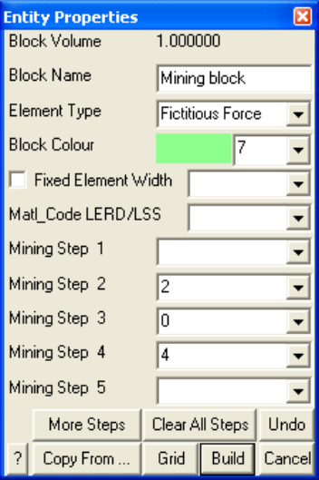

只需在所需的开采步骤中指定相应的材料代码，即可定义开采步骤顺序。材料代码表示块体内部材料的编号。默认情况下，围岩为 1 号材料。任何与围岩性质（初始应力、弹性响应或强度）不同的区域，只需指定一个正的材料代码，以表示与各组块体相关联的性质。

材料代码 0 表示该单元的表面应力为零。这是默认值，通常用于开挖面、地表和露天坑壁。

材料代码 -M（例如 -2）表示该单元的表面应力等于 M 号材料所对应的应力状态。这适用于模拟承压开挖或随深度变化的应力（例如充填体）。

材料代码 +M（例如 2）表示所包围的区域将具有 M 号材料的性质。此代码用于指定性质与围岩不同的区域（例如矿石、岩墙、充填体等）。

在建模过程中，可使用以下命令指定材料代码

CAD > Build > Block CAD > Build > DD Loop CAD > Build > FF Loop

也可以随时使用以下命令指定材料代码

CAD > Edit > Entity Properties

系统将显示如下提示

在此示例中，所选块体在第 1 步中未被使用；在第 2 开采步骤中被赋予 2 号材料的性质；在第 3 开采步骤中被开挖；最后在第 4 开采步骤中用 4 号材料充填。

此方法可与虚拟力单元配合使用，定义具有不同应力和材料性质的三维区域（例如刚性岩墙、软弱矿带或屈服区）；也可与位移不连续单元配合使用，定义具有不同应力和材料性质的平面区域（例如含断层泥的断层、板状开采中的屈服矿柱）。

每个开采步骤都可以指定不同的材料代码。如果未指定材料代码（即材料代码留空），该块体将保持非活动状态。

务必牢记"材料编号（材料代码）越大，优先级越高"这一约定。采用这一约定是为了消除多个不同构造相交时的歧义，例如断层与岩墙相交，或在采场的一部分中放置充填体。为避免出现问题，建议为充填体使用最大的材料编号。

在模拟拱架、钢支架、支柱、厚衬砌、木垛、高强度充填体等刚性支护系统时，需要先模拟支护安装之前的地层移动，然后以无应力/无应变状态或以规定的预应力插入支护单元。为此，必须先将所需的支护单元（三维 FF 块体或 DD 平面）开挖至所需的预应力状态（使用材料代码零表示零应力，或使用负材料编号表示规定的应力状态），然后在后续开采步骤中插入支护材料（为此使用正材料编号）。勾选 Analysis > Options > Zero Strain Support Placement 选项后，Map3D 会在当前开采步骤执行必要的计算，以无应力/无应变状态或以规定的预应力放置支护单元。先开挖至零应力或规定应力状态、再插入替代材料的操作，会提示 Map3D 执行所需的计算。

此方法对于模拟结构支护单元特别有用，并支持支护的安装、属性修改以及必要时的后续拆除。此选项适用于三维 FF 块体和/或 DD 平面。

如果不使用此选项，所有材料都将以开采前的变形状态放置。这可能会导致错误的高应力，尤其是在刚性支护单元中。

在 Map3D 图形模式下，只需使用以下命令在各开采步骤之间切换，即可查看所实现的开采顺序

File > Mining Step
