为了演示如何利用数字化矿山平面图构建模型，我们来构建一个简单的 VRM 大规模开采几何模型。

构造线用于定义开挖体、接触面、构造等井下要素的详细位置。Map3D 模型通常建立在这些构造线数据之上。

矿山平面图事先已使用 Map3D

#### CAD > Digitizer Setup

或其他 CAD 程序完成数字化。这些平面图可以保存为以下任一格式：

点文件格式是一种通用的 ASCII 数据文件，扩展名为".PNT"。此格式便于与其他 CAD 软件交换原始构造线数据。

AutoCAD-DXF 格式是一种常用的图形交换文件，扩展名为".DXF"。此格式便于与其他 CAD 软件交换构造线数据。

我们希望从空白状态开始，因此选择

#### File > New (Model)

开始之前请注意，将鼠标悬停在任意按钮上即可显示说明该按钮功能的工具提示。此外，右键单击任意项目即可获得该功能的详细帮助。

#### 导入数字化矿山平面图

首先必须打开包含数字化矿山平面图的文件，方法是使用

#### File > Open (Construction Lines)

本例中构造线以 DXF 格式保存，因此请将"Files of Type"更改为 *.dxf

文件"BULK.dxf"随 Map3D 安装程序提供，应可直接导入。

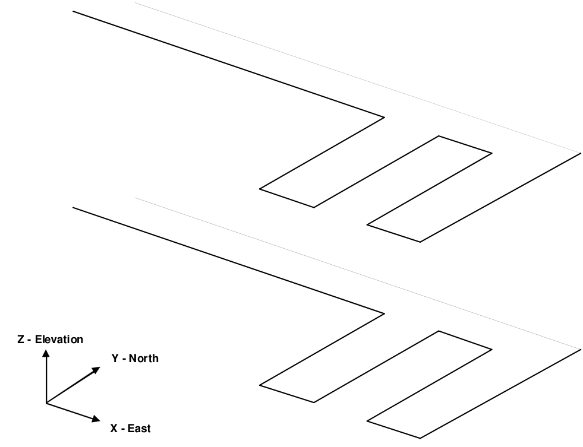

通道巷道宽约 5 m、高约 5 m，中段间距为 25 m。

#### 调整视图

在构建块体期间或任何其他时候，用户都可以自由调整几何体的位置（平移、旋转或缩放），以便于观察。可以通过多种方式轻松实现（参见"旋转模型"和"平移模型"）。最简单的旋转方法是按住鼠标左键并在屏幕上拖动光标。按住鼠标右键可进行平移。同时按住两个鼠标按钮可放大或缩小模型。

调整视图，使构造线清晰可见。

#### 构建下盘通道巷道和横巷

构建这些实体的方法有很多。本教程将演示几种不同的技术。

#### 逐个构建块体

最简单（但最耗时）的方法是逐个构建一系列具有 8 个角点的块体。

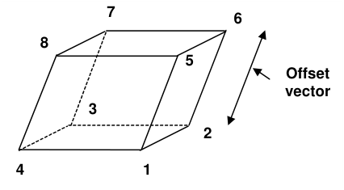

使用 CAD > Build > FFLoop 构建第一个块体。可以按如下方式从 CAD 工具栏中选择此功能（如果 CAD 工具栏不可见，请使用 Tools > CAD Toolbar 激活）：

在 CAD 工具栏中选择 CAD > Build

将显示构建功能子菜单

现在选择

#### CAD > Build > FFLoop

由于需要捕捉到构造线，必须设置捕捉模式，方法是使用 CAD > Snap > Nearest Edge。可以从 Build Entity 工具栏中选择此功能

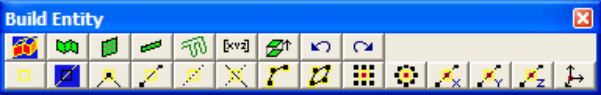

要激活最近边捕捉，请选择

#### CAD > Snap > Nearest Edge

（仅当最近边捕捉按钮尚未高亮显示时才需要执行此操作）。

在此模式下，十字准线的交点处将显示一个拾取框。

**将选中该边上最近的点**

当前光标位置的坐标显示在状态栏上。如果拾取框位于构造线的角点上，则选中该角点；否则选中拾取框下方构造线边上最近的点。无论哪种情况，3 个坐标值（x、y 和 z）都是唯一确定的。

您将看到 FFLoop 构建程序在状态栏上提示您输入块体的第一个角点

Input: Select Point 1

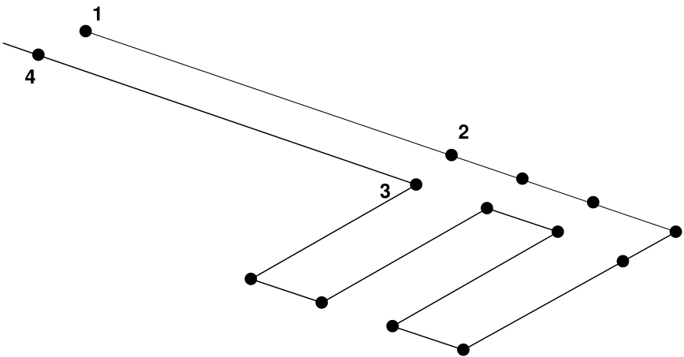

移动光标找到点 1，单击鼠标左键一次选中该点。

接下来系统会提示您输入下一个角点

#### Input: Select Point 2

移动光标时，您会看到显示屏左下角不仅显示当前光标位置，还显示当前点相对于上一个选中点的偏移量（即从点 1 到点 2 的偏移向量）。选中点 2，然后对点 3 和点 4 重复此选择过程。

如果某个点选错了位置，只需使用撤销按钮

CAD > Build > Undo Point 撤销该选择，然后重试。

最后，再次选择第一个点（即点 1）。

再次选中第一个点后，块体的底面即完全形成。系统将显示以下消息

Loop complete: Start next loop.

为完成块体的构建，我们将对前 4 个角点加上偏移量，生成其余 4 个点。为此，请在 Build Entity 工具栏中选择偏移功能

#### CAD > Build > Extrude/Offset Remaining

系统将按如下方式提示您输入偏移向量

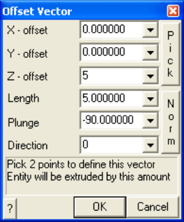

输入偏移量：

X-offset > 0 Y-offset > 0 Z-offset > 5

点 5、6、7 和 8 将分别由点 1、2、3 和 4 的坐标加上偏移值生成。

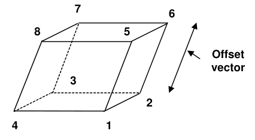

块体构建完成后，系统将自动提示您输入块体属性 (CAD > Build > FFLoop)

输入以下内容：

Block Name: Intersection Element Type: Fictitious Force Block Colour: 1

此交叉口块体应在第 1 开采步骤开挖，方法是指定 Mining Step 1: 0

至此完成，按下

按钮即可构建该块体。

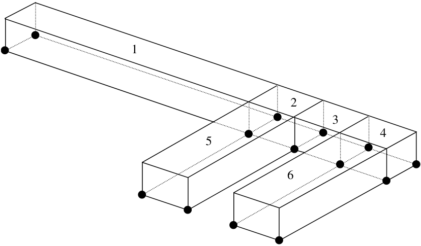

重复上述 FFLoop 构建过程，即可将整个中段构建为一系列块体。

#### 构建复杂块体

现在我们来构建形状更复杂的块体。

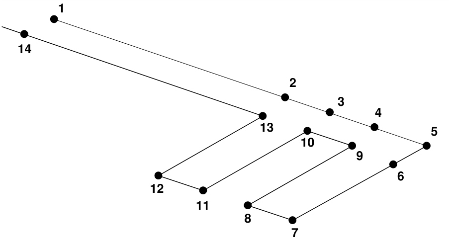

可以使用上述相同的 FFLoop 构建技术，只是这次选择全部 14 个点作为平面轮廓。选中点 14 后，必须再次选择点 1 以完成块体底面。系统将显示以下消息

#### Loop complete: Start next loop.

与之前一样，在 Build Entity 工具栏中选择偏移功能以完成块体的构建。

#### CAD > Build > Extrude/Offset Remaining

这一构建过程将创建一个覆盖整个平面轮廓的大型连续块体。如有需要，用户也可以按点序列 1-2-3-4-5-6-9-10-13-14-1 构建上盘巷道块体，然后按 13-10-11-12 和 9-6-7-8 将横巷构建为单独的块体。如果横巷与上盘巷道在不同的开采步骤中开采，则宜采用后一种方法。

现在使用相同的方法构建下部中段的通道巷道。

#### 构建 VRM 盘区

现在可以构建 VRM 盘区，使用具有 8 个角点的 FFLoop 块体构建。

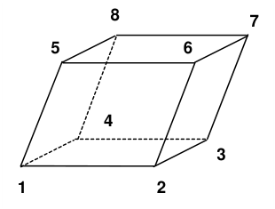

要开始构建，请选择

#### CAD > Build > FFLoop

由于需要捕捉到先前构建块体的角点，必须将捕捉模式设为 CAD > Snap > Nearest Corner。可以从 Build Entity 工具栏中选择此功能

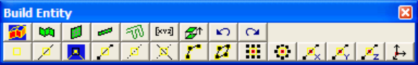

要激活最近角点捕捉，请选择

#### CAD > Snap > Nearest Corner

（仅当相应按钮尚未高亮显示时才需要执行此操作）。

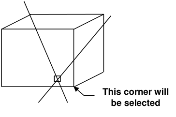

在角点捕捉模式下，十字准线的交点处将显示一个拾取框。拾取框下方实体或构造线上最近的角点将被选中（捕捉），因此 3 个坐标值（x、y 和 z）都是唯一确定的。

实际上这里也可以使用边捕捉模式

#### CAD > Snap > Nearest Edge

因为只要角点位于拾取框内，块体的角点无论如何都会被选中。不过，使用角点捕捉可以让选择不必那么精确，因为只会选中角点。

按下图所示选择前 4 个点。记得再次选择点 1，以完成底面轮廓环的构建。

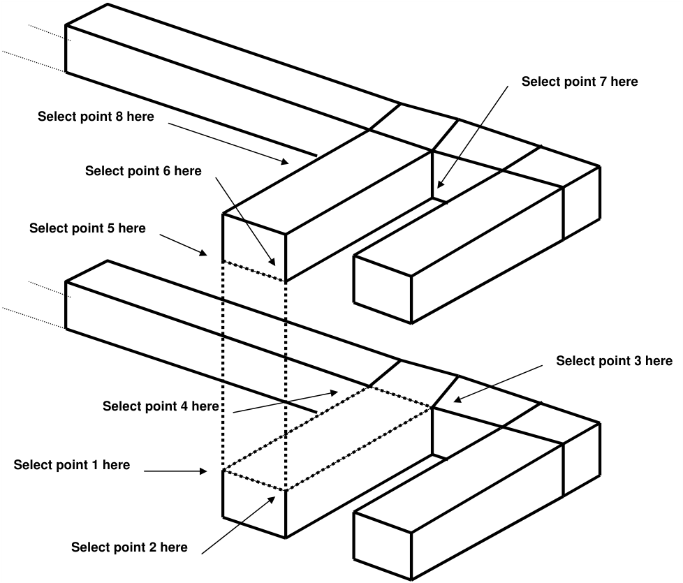

要选择点 5 至 8，需要旋转模型，以便从下往上看。只需按住鼠标左键并在屏幕上向上拖动光标即可。

按下图所示选择点 5 至 8。记得再次选择点 5，以完成顶面轮廓环的构建。

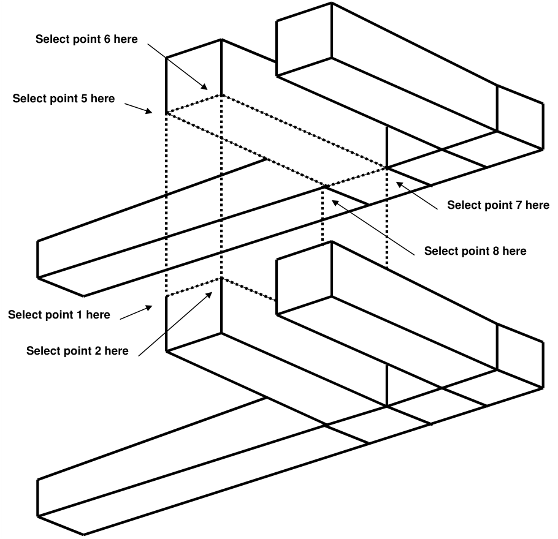

与之前一样，系统将显示以下消息

Loop complete: Start next loop.

要完成块体的构建，请在 Build Entity 工具栏中选择构建按钮

块体构建完成后，系统将自动提示您输入块体属性 (CAD > Build > FFLoop)

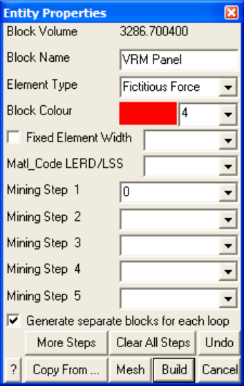

输入以下内容：

Block Name: VRM Panel Element Type: Fictitious Force Block Colour: 4

该块体在第 1 步中不开采，在第 2 步中开挖。设置方法如下

Mining Step 1:（此字段留空）Mining Step 2: 0

至此完成，即可构建该块体。相邻盘区可使用相同方法构建，从而得到最终的几何模型。

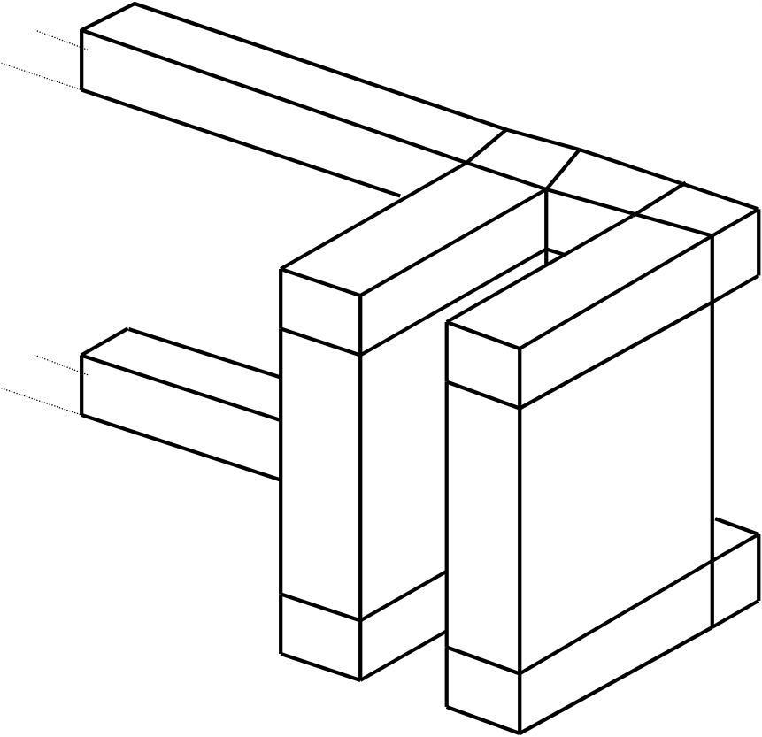

#### 保存几何模型

至此，我们已构建了下盘通道巷道和两个 VRM 盘区。在继续之前，最好先保存目前已构建的模型。为此选择

File > Save Model As

以"VRM.INP"为名保存

#### 构建网格平面

现在需要确定在哪里计算结果。本例中我们关注两个 VRM 盘区之间形成的矿柱中的应力，因此将定义一个穿过矿柱半高处的水平网格平面。

我们将使用捕捉网格功能。可以现在设置，也可以在启动网格平面构建功能后再设置。如要现在设置，请在 CAD 工具栏中选择相应按钮

由于将进行手绘，必须设置捕捉网格，方法是使用 CAD > Snap > Rectangular Grid Snap。可以从 Snap 工具栏中选择此功能

要激活捕捉网格，请选择

#### CAD > Snap > Rectangular Grid Snap

（仅当网格捕捉按钮尚未高亮显示时才需要执行此操作）。

当前光标位置的坐标显示在状态栏上。您会注意到，移动光标时 x 和 y 值会变化，但 z 值不变。要设置当前 z 值，请单击 CAD > Snap > Cursor/Grid Setup，系统将显示如下提示：

我们使用 Pick 功能以图形方式拾取该位置。

由于希望捕捉基准位于 VRM 盘区的半高处，请将捕捉模式改为线段中点

#### CAD > Snap > Midpoint of Line

继续之前，必须确认已设置正确的捕捉模式：可以检查 CAD > Snap > Midpoint of Line 菜单项是否已勾选，或中点捕捉按钮是否已高亮显示

在 VRM 盘区的竖直边上选择光标/捕捉基准原点 (Cursor/Snap Base Origin)。

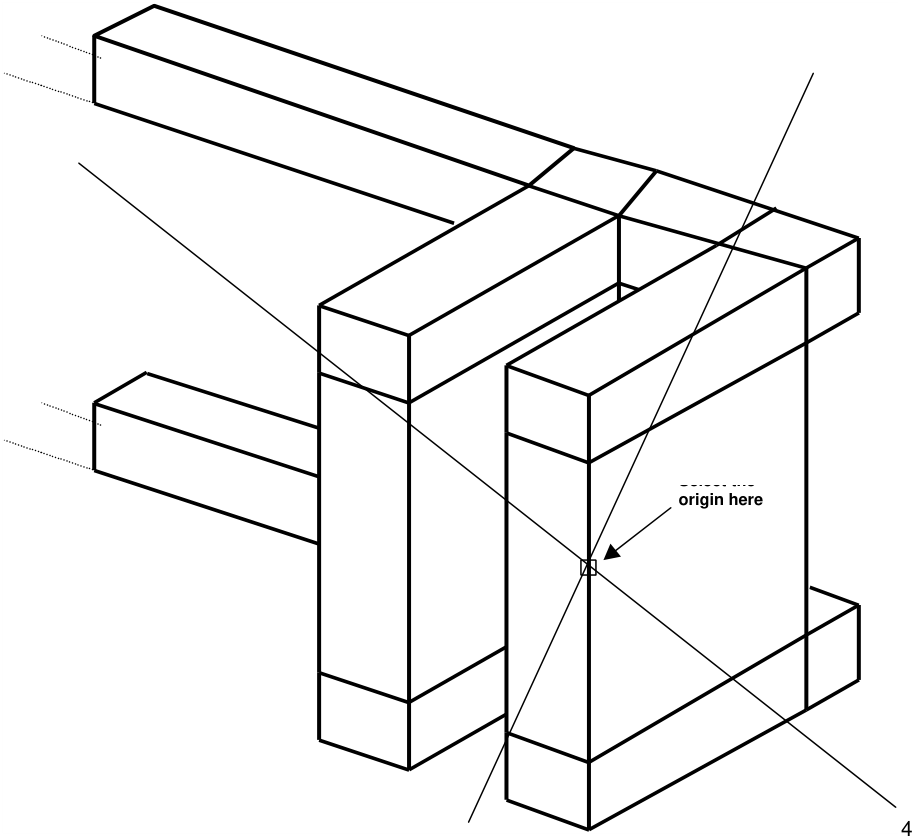

该边半高处的点将被选中。z 值应显示为

Z Origin: 1012.5

还应设置

Snap Spacing: 10

以便于选点。

如果光标十字准线不在 x-y 平面内移动，请选择

按钮。

开始构建网格平面之前，应先将几何体调整为平面视图，方法是使用

#### View > View XY Plane

现在开始构建网格平面。

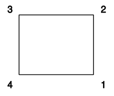

网格平面将由一个具有 4 个角点的平面构成。要构建该平面，请选择网格构建菜单功能

#### CAD > Build > Grid Plane

也可以按如下方式从 CAD 工具栏中选择此功能：

在 CAD 工具栏中选择 CAD > Build

将显示构建功能子菜单

现在选择

#### CAD > Build > Grid Plane

由于将进行手绘，必须确保已启用 CAD > Snap > Rectangular Grid Snap。可以从 Build Entity 工具栏中选择此功能

要激活捕捉网格，请选择

#### CAD > Snap > Rectangular Grid Snap

（仅当网格捕捉按钮尚未高亮显示时才需要执行此操作）。

您将看到网格平面构建程序提示您输入平面的第一个角点

Input: Select Point 1

选择平面的四个角点。

**3**

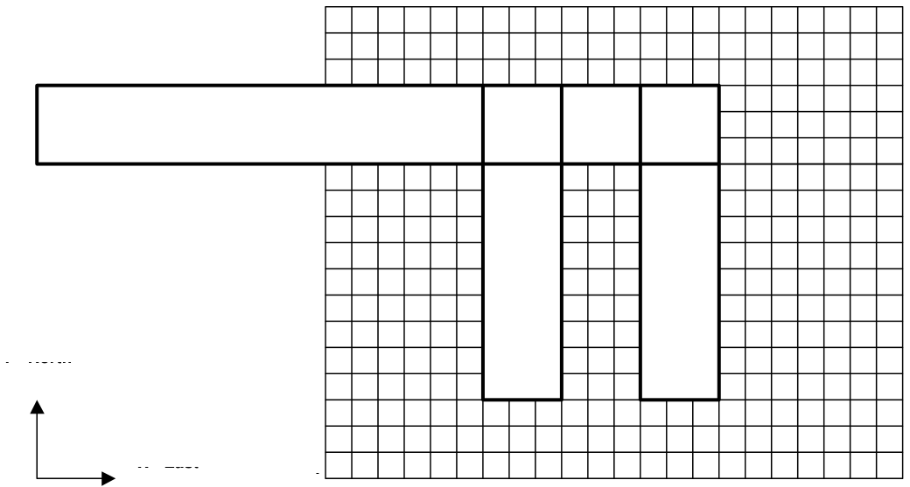

选中第 4 个点后，系统将自动提示您指定网格平面属性 (

#### CAD > Build > Grid Plane)。

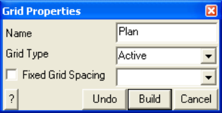

为网格平面输入一个描述性名称 (Name)，确认 Grid Type 为 Active，并保持 Fixed Grid Spacing 复选框未勾选。

#### 指定围岩岩体的材料属性

现在必须指定围岩材料的属性，使用材料属性功能输入

#### CAD > Properties > Material Properties

选择此项将打开与编辑材料属性相关的子菜单。请注意，1 号材料按定义为围岩材料。其他材料编号用于定义矿石、断层泥、充填体等替代材料区。系统首先提示用户输入要编辑的材料编号。首先定义围岩材料的属性

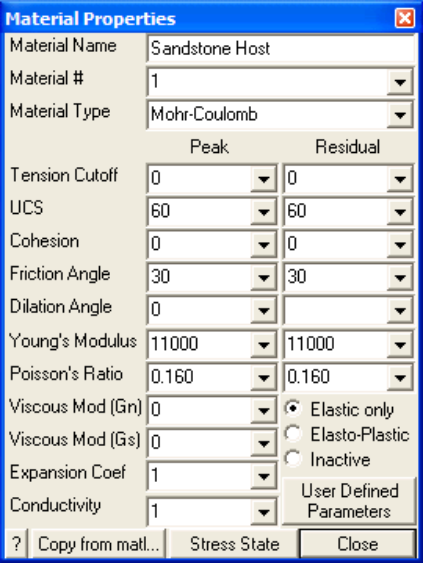

输入以下内容：

Material Name: Sandstone Host Material # : 1 Young's (deformation) Modulus: 60000 MPa Poisson's Ratio: 0.25

黏性模量可以设为零，因为它们仅用于在非线性分析中模拟蠕变响应。

这里我们希望使用 Mohr-Coulomb 准则，为此设置

Material Type: Mohr-Coulomb UCS: 60 MPa

本例中不使用黏聚力参数，因此可以设为零。

Friction Angle: 30°

本例中不使用剪胀角，因此可以设为零。

现在可以指定开采前的应力状态

CAD > Properties > Material Properties > Stress State

本模型适用的远场应力状态为

sa constant:  30 MPa sb constant:  20 MPa sc constant:  20 MPa

应力随深度的变化设为

Dsa variation:  -0.027 MPa/m Dsb variation:  -0.013 MPa/m Dsc variation:  -0.013 MPa/m

此外，应力方向（倾向和倾伏角）应设为零，从而将 sa 和 sb 定义为水平方向，sc 定义为竖直方向。

基准面 (Datum) 可设为 1000 米，按下式定义随深度的变化

s + Ds ( _z_ - _Datum_ )

按此定义，应力 sa 在深度 z 为 1000 m 处等于 30 MPa，并以每米深度 0.027 MPa 的速率增加。

#### 指定控制参数

现在必须指定控制模型离散化和求解的参数，使用控制参数功能输入

#### CAD > Properties > Control Parameters

选择此项将打开包含控制参数的对话框

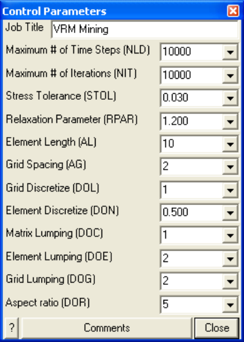

输入以下内容：

Job Title: VRM Mining

除应力容差、单元长度和网格间距外，所有参数均可保留默认值。

Stress Tolerance: 0.03 MPa

应设为远场应力状态的约 0.1%。这可确保在求解过程中，表面应力的计算数值精度为 0.03 MPa。

#### Element Length: 10

应设为巷道高度或矿柱宽度的两倍。该参数用于控制在窄矿层或窄矿柱所在位置使用的最小边界单元尺寸，从而确保建立条件良好、易于求解的问题。

#### Grid Spacing: 2

应设为矿柱宽度的约一半。该参数用于控制网格平面靠近或穿过模型的位置所使用的最小边界单元尺寸和网格平面上的最小间距。在距模型表面仅为该间距一半的位置也能获得准确的结果。该参数还能确保在矿柱内计算足够数量的应力点，以生成平滑的等值线。

用户可以自由选择更大的网格间距值。这将减小问题规模，从而缩短运行时间。但边界单元较大时，结果精度会降低，尤其是在模型表面附近；而且网格间距较大时，无法生成平滑的等值线。

离散化和集总参数的建议值如下：

_DON_ =0.5, _DOL_ = _DOC_ =1, _DOE_ = _DOG_ =2，误差为 10-20%

_DON_ =0.5, _DOL_ = _DOC_ =2, _DOE_ = _DOG_ =4，误差为 5-10%；_DON_ =1.0, _DOL_ =DOC=4, _DOE_ = _DOG_ =8，误差 &lt; 5%

除需要更高精度的问题外，建议所有问题都使用粗略分析结果的设置。在此设置下，应力预测的数值误差预计为 10-20%。详细分析结果的设置可提供 5-10% 的数值误差，高精度设置的数值误差小于 5%。用户可以为这些参数指定更高精度的设置，但这会增大问题规模，从而延长运行时间。

#### 运行 Map3D 分析

至此，模型构建已经完成，可以开始分析。如果使用 Map3D Fault-Slip，将获得该问题的弹性解；如果使用 Map3D NonLinear，将进行完整的非线性分析。

分析从主菜单执行。

选择以下命令即可运行完整分析

#### BEM Analysis

这里我们将分阶段进行，因此首先选择

#### Discretization

如果自上次保存以来修改过模型，系统将提示您保存这些修改。

求交和离散化分析完成后，选择

#### Analysis > Graphics

在图形模式下，应选择离散化视图选项

#### View > Render > Discretize

这样可以看到块体表面是如何被离散为边界单元的。必须打开轮廓线显示才能看到各个单元

#### View > Render > Block Outlines

要查看网格的离散情况（如果等值线工具栏不可见，请使用 Tools > CAD Toolbar 激活），必须从等值线工具栏中选择

#### Plot > Grid Selection > Grid #1

可以使用不同的网格间距、离散化和集总参数值，根据需要多次重复离散化分析，直到获得所需的边界单元和网格点密度。

满意后，可以从主菜单中选择

#### Analysis

然后选择

#### BEM Analysis

进入 BEM 分析（矩阵组装和求解）。分析完成后，选择

#### Analysis > Graphics

在图形模式下，可以对任何所需参数绘制等值线。例如，要显示最大主应力等值线，请选择

#### Plot > Stress > S1 Major Principal Stress

这将在网格平面上生成等值线图。

此处不讨论结果的解释。
