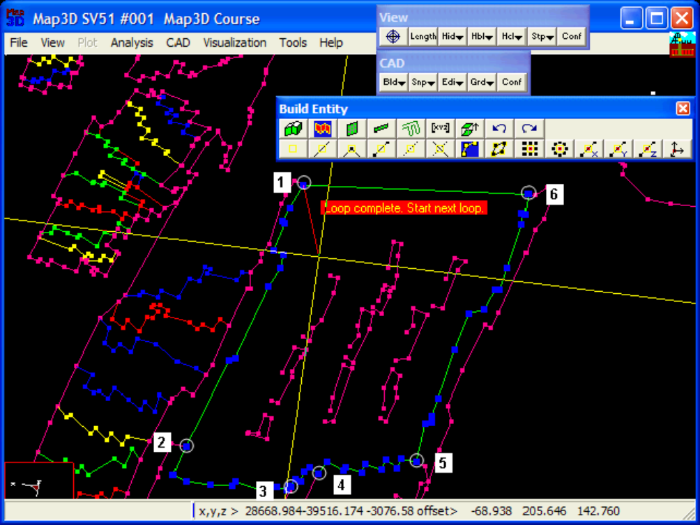
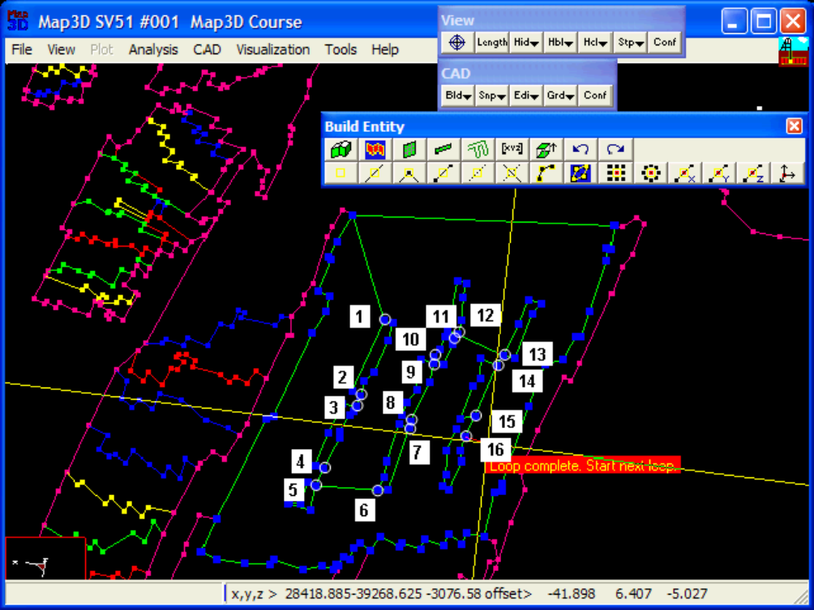
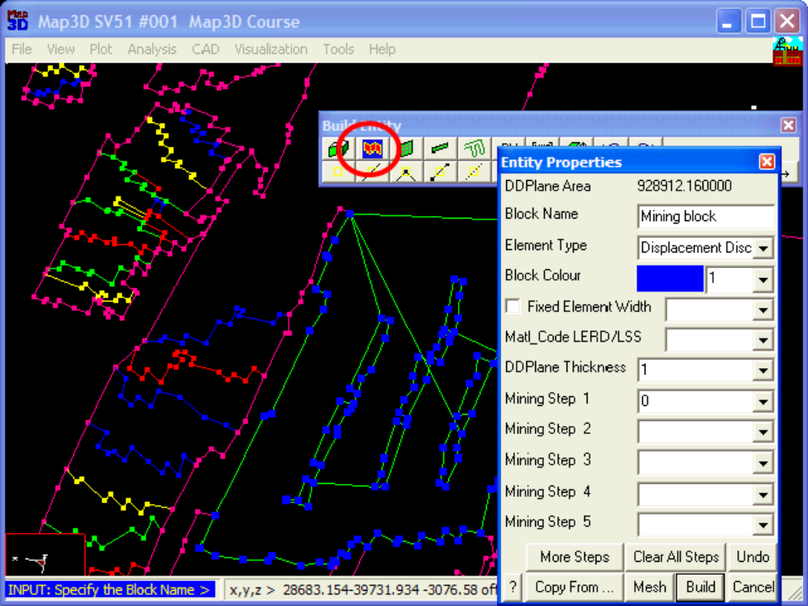
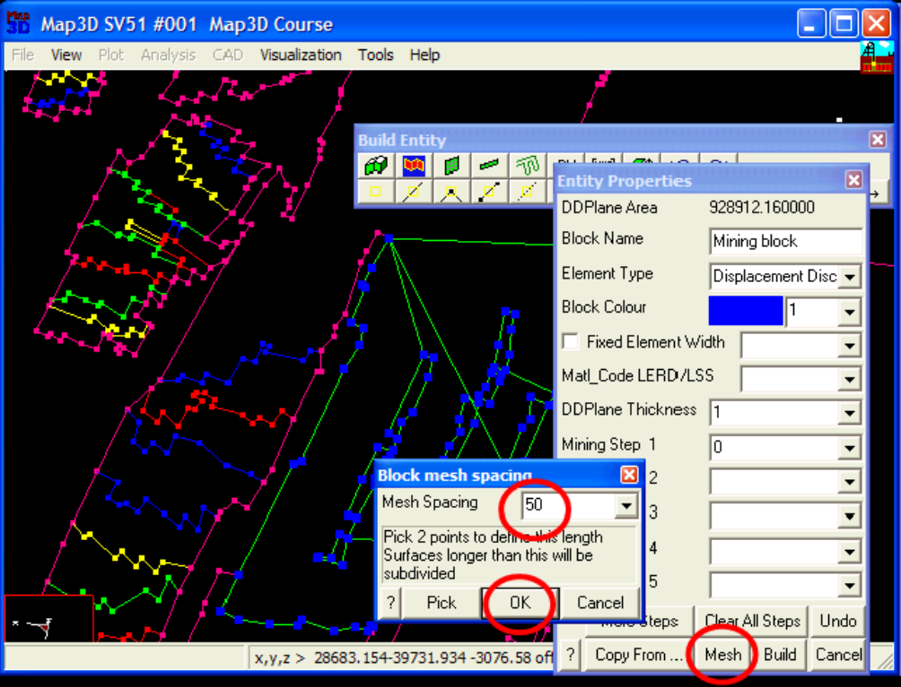
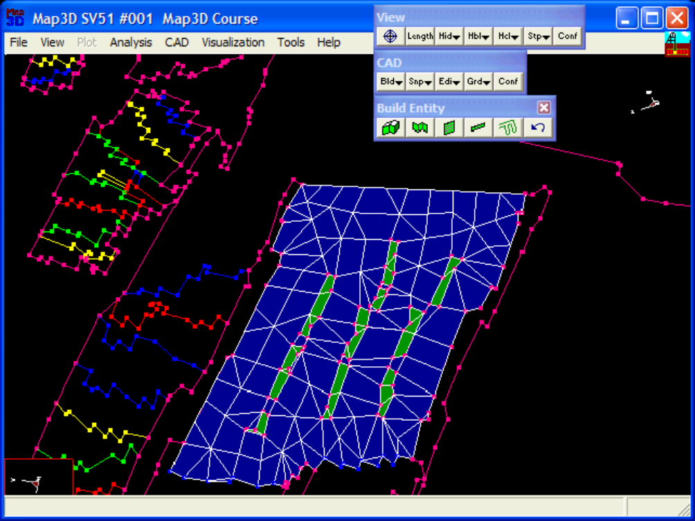

**步骤 1：导入数字化矿山平面图。**

- 本示例的平面图位于名为"t.pnt"的文件中。

- 使用 File > Open Construction Lines 命令导入。

**步骤 2：启动 DDLoop 程序并设置 Cline 捕捉模式。**

- 选择 (CAD > Build > DDLoop) 即可启动 DDLoop。

- 选择 (CAD > Snap > Trace Cline) 即可设置 Cline 捕捉模式。

**步骤 3：构建外环。**

- 通过选择所需构造线段的端点来构建外环。

- 这里我们依次拾取点 1-2-3-4-5-6-1

- 在序列末尾拾取点 1 以闭合环，从而完成外环的构建。

**步骤 4：将捕捉模式设为 CLoop，然后构建内环。**

- 选择 (CAD > Snap > Trace CLoop) 即可设置 CLoop 捕捉模式。

- 通过拾取每个环的入口点和出口点来定义内环。

- 第 1 个环由点 1 和 2 定义。

- 第 2 个环由点 3 和 4 定义。

- 第 3 个环由点 5 定义。

- 第 4 个环由点 6 和 7 定义。

- 第 5 个环由点 8 和 9 定义。

- 第 6 个环由点 10 和 11 定义。

- 第 7 个环由点 12 定义。

- 第 8 个环由点 13 定义。

- 第 9 个环由点 14 和 15 定义。

- 第 10 个环由点 16 定义。

**步骤 5：表示构建完成。**

- 定义所有环之后，再次选择 (CAD > Build > DDLoop) 以表示构建完成。

- 也可以再次拾取最后一个点（即点 16）来表示完成。

**步骤 6：构建 DDLoop。**

- 虽然可以使用该功能构建 DDLoop，但这里我们将使用另一功能。

- 后一种功能生成的单元形状更好。

- 系统将提示您输入所需的网格间距。

- 将其设为 50 米。

#### 步骤 7：构建完成。

- 至此，带矿柱的板状开采构建完成。

- 您可能需要编辑矿柱的实体属性，为其指定合适的属性和开采顺序。

