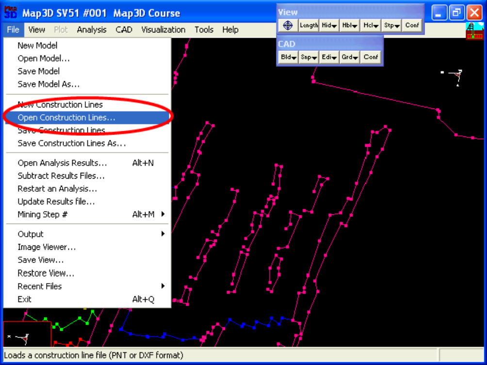
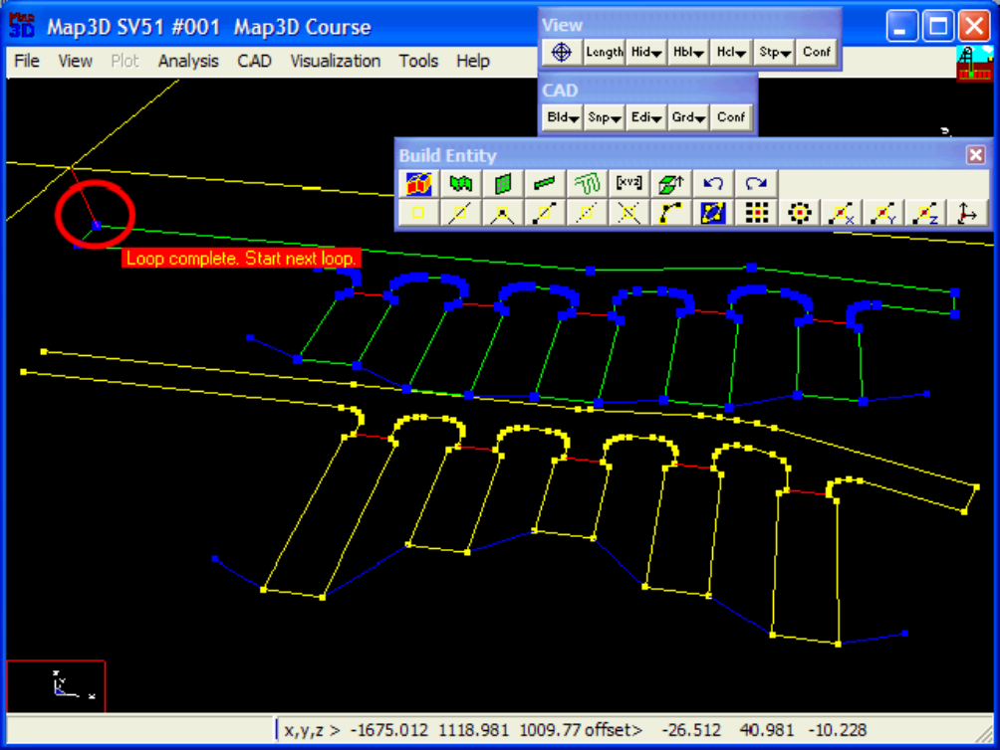
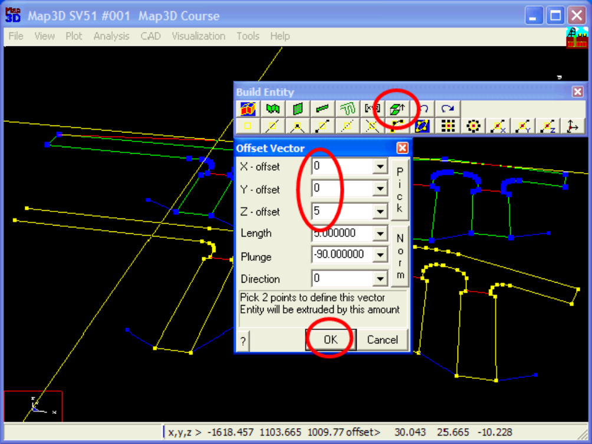
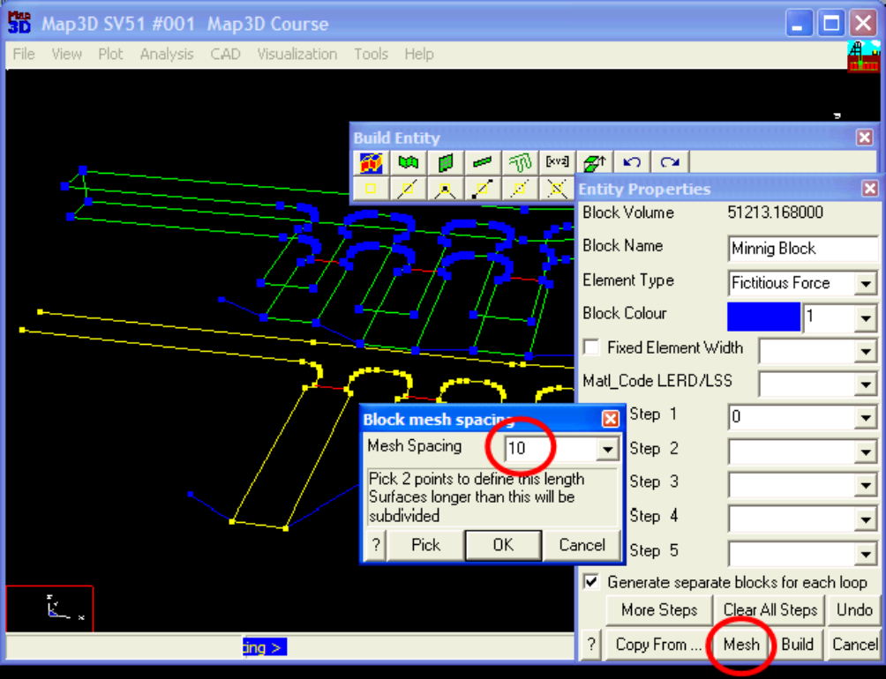
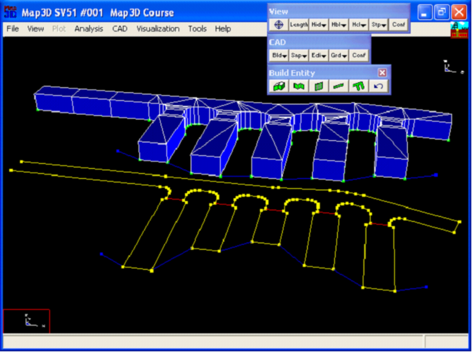

#### 步骤 1：导入数字化矿山平面图。

- 本示例的平面图位于名为"bulk.dxf"的文件中。

- 使用 File > Open Construction Lines 命令导入。

#### 步骤 2：启动 FFLoop 程序并设置 CLoop 捕捉模式。

- 选择 (CAD > Build > FFLoop) 即可启动 FFLoop。

- 选择 (CAD > Snap > Trace CLoop) 即可设置 CLoop 捕捉模式。

**步骤 3：构建 FFLoop。**

- 通过选择所需构造线上的一个点来构建 FFLoop。

**步骤 4：将平面图拉伸为三维巷道。**

- 此时我们已经构建了巷道的平面图。

- 现在可以选择 (CAD > Build > Offset/Extrude) 将其拉伸为三维形体。

- 将偏移向量设为 (0 0 5)。

**步骤 5：构建巷道。**

- 现在可以使用该功能构建 FFLoop。

- 将网格间距 (Mesh Spacing) 指定为 10，然后按 OK。

**步骤 6：构建完成。**

- 至此，巷道构建完成。

