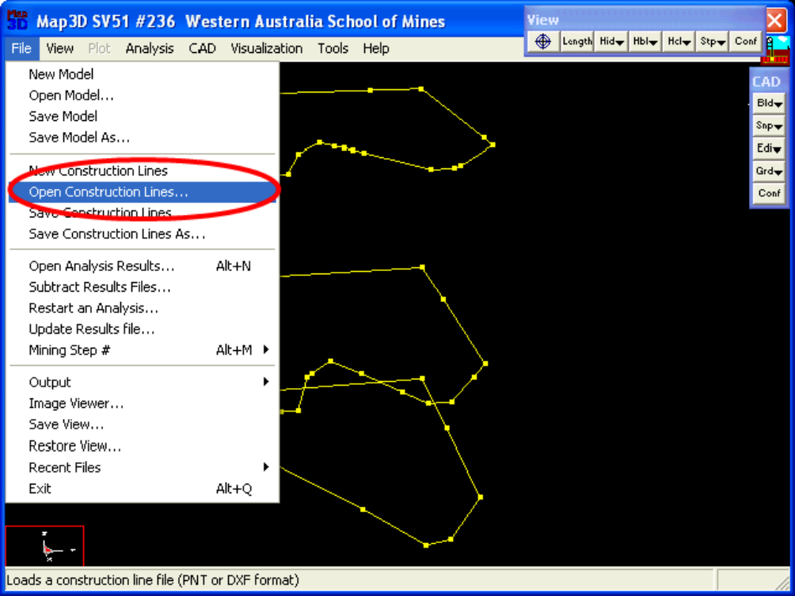
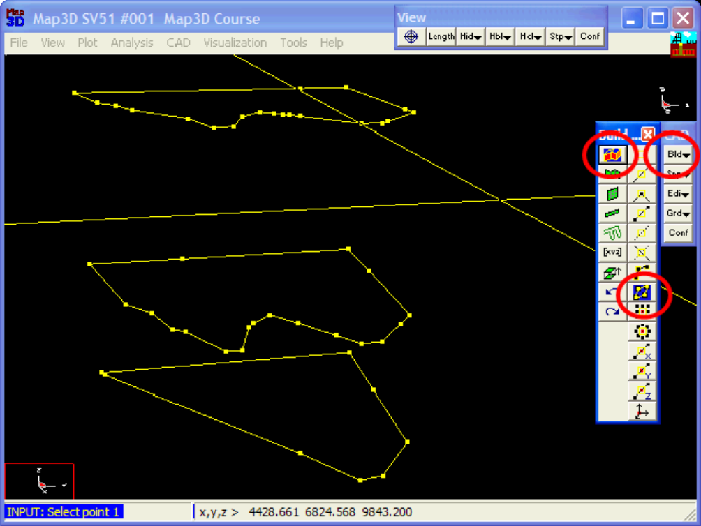
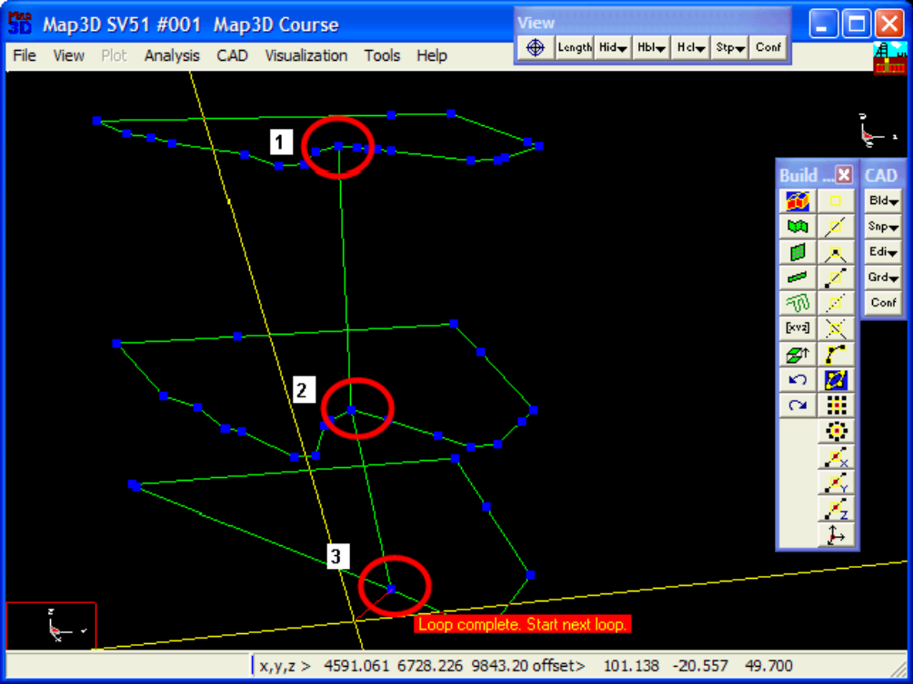
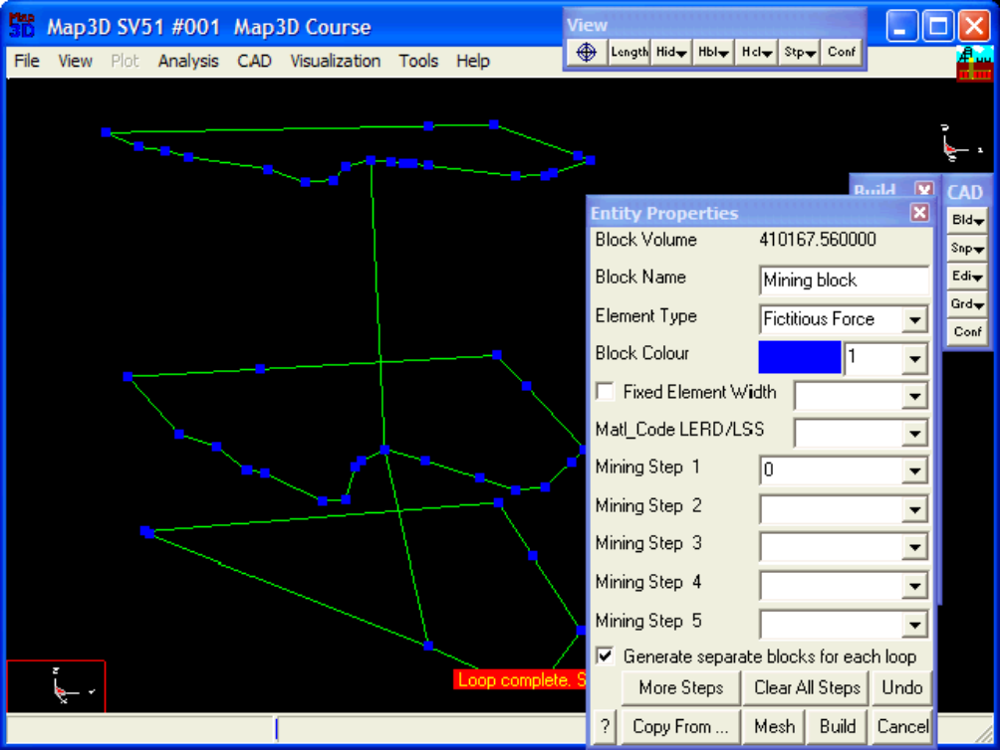
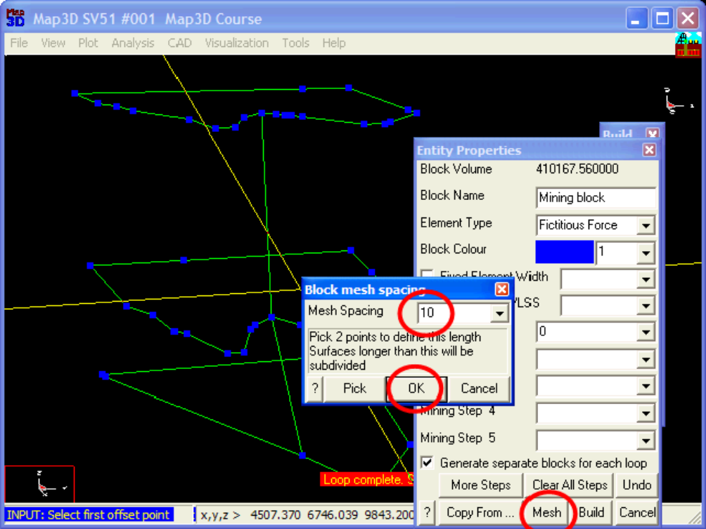
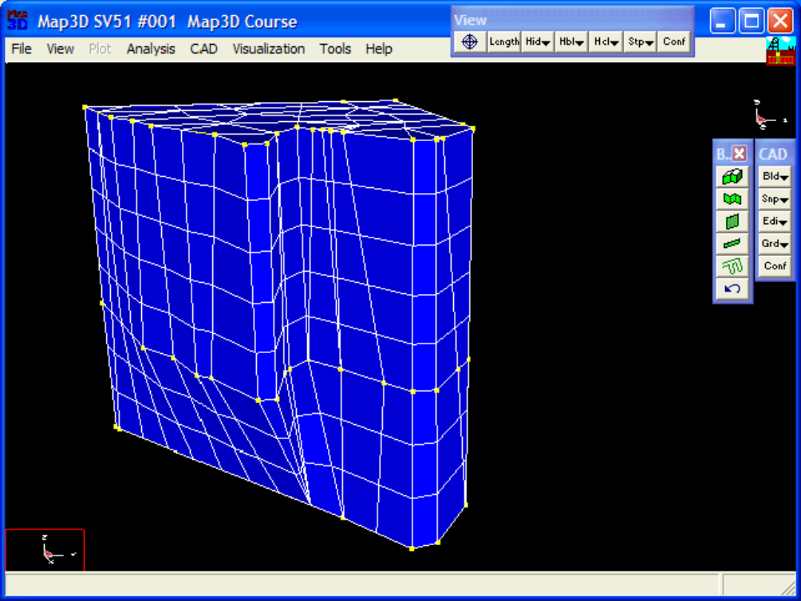

#### 步骤 1：导入数字化矿山平面图。

- 本示例的平面图位于名为"bulk.dxf"的文件中。

- 使用 File > Open Construction Lines 命令导入。

**步骤 2：启动 FFLoop 程序并设置 CLoop 捕捉模式。**

- 选择 (CAD > Build > FFLoop) 即可启动 FFLoop。

- 选择 (CAD > Snap > Trace CLoop) 即可设置 CLoop 捕捉模式。

#### 步骤 3：构建 FFLoop。

- 通过在每条构造线上各选择一个点来构建 FFLoop。

- 请注意，程序会沿长边每隔 10 m 自动生成点

- 最好选择位于尖角或折弯处的点，因为环之间的连线将引导构建过程。

#### 步骤 4：表示构建完成。

- 定义所有环之后，再次选择 (CAD > Build > FFLoop) 以表示构建完成。

- 也可以再次拾取最后一个点（即点 3）来表示完成。

**步骤 5：构建采场。**

- 现在可以使用该功能构建 FFLoop。

- 将网格间距 (Mesh Spacing) 指定为 10，然后选择 OK。

**步骤 6：构建完成。**

- 至此，采场构建完成。

