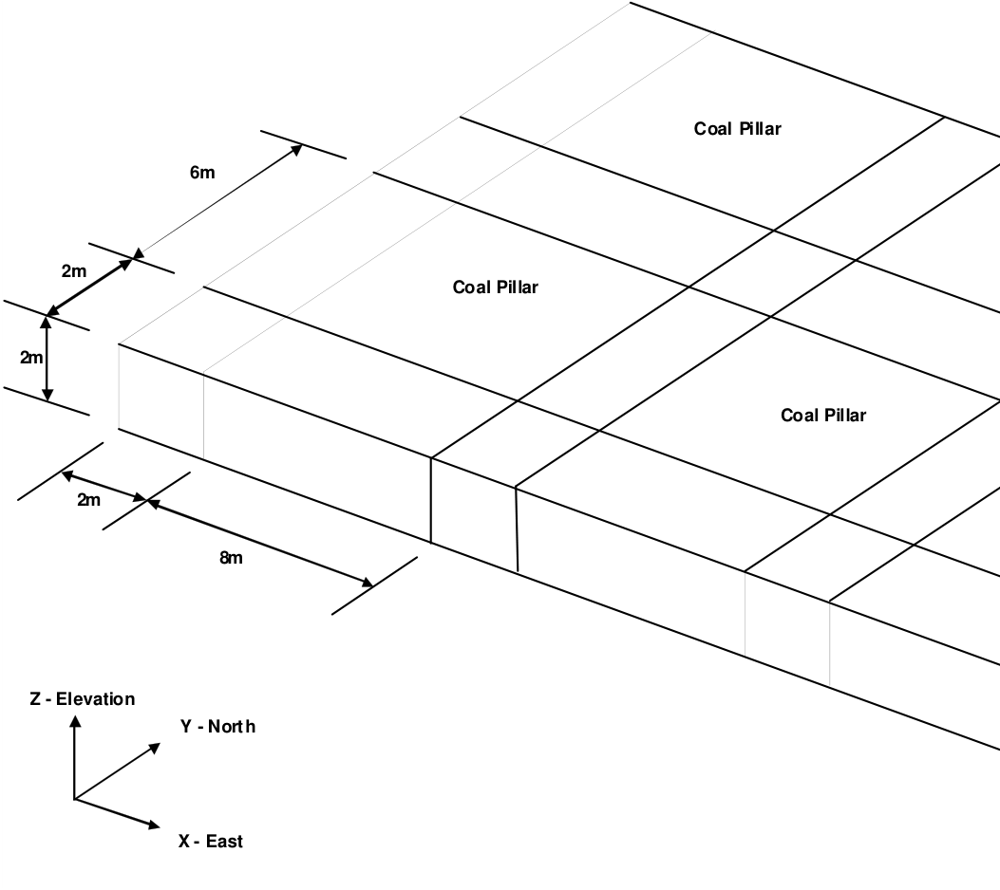

为了演示手绘技术，我们首先构建一个简单的房柱式采煤几何模型。巷道宽 2 m、高 2 m，煤柱东西方向分别为 6 m 和 4 m。

我们希望从空白状态开始，因此选择

File > New Model

开始之前请注意，将鼠标悬停在任意按钮上即可显示说明该按钮功能的工具提示。此外，右键单击任意项目即可获得该功能的详细帮助。

#### 构建交叉口

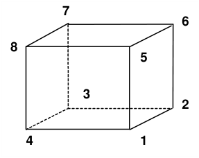

首先构建一个交叉口，使用具有 8 个角点的块体构建。使用 CAD > Build > FFLoop 构建第一个块体。可以按如下方式从 CAD 工具栏中选择此功能（如果 CAD 工具栏不可见，请使用 Tools > CAD Toolbar 激活）：

#### 在 CAD 工具栏中选择 CAD > Build

将显示构建功能子菜单

现在选择

#### CAD > Build > FFLoop

由于将进行手绘，必须设置捕捉网格，方法是使用 CAD > Snap > Rectangular Grid Snap。可以从 Build Entity 工具栏中选择此功能

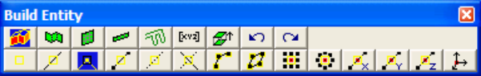

要激活捕捉网格，请选择

#### CAD > Snap > Rectangular Grid Snap

（仅当网格捕捉按钮尚未高亮显示时才需要执行此操作）。

当前光标位置的坐标显示在状态栏上。您会注意到，移动光标时 x 和 y 值会变化，但 z 值不变。要设置当前 z 值，请单击 CAD > Snap > Cursor/Grid Setup，系统将显示如下提示：

按如下方式设置原点和捕捉间距：

X-Origin > 0 Y-Origin > 0 Z-Origin > 0 Snap spacing > 1

如果光标十字准线不在 x-y 平面内移动，请选择

按钮。

这会将捕捉模式设为网格。在此模式下，十字准线交点处不显示拾取框，光标移动将被限制在指定的网格间距上。在显示屏上移动光标时，光标会按网格间距（本例为 1 米）逐格跳动。

您将看到 FFLoop 构建程序在状态栏上提示您输入块体的第一个角点

Input: Select Point 1

移动光标找到第一个点

x,y,z >  0  0  0

单击鼠标左键一次选中该点。

接下来系统会提示您输入下一个角点

Input: Select Point 2

移动光标时，您会看到显示屏左下角不仅显示当前光标位置，还显示当前点相对于上一个选中点的偏移量（即从点 1 到点 2 的偏移向量）。在以下位置选择点 2

x,y,z >  2  0  0

对点 3 重复此选择过程

x,y,z >  2  2  0

以及点 4

x,y,z >  0  2  0

如果某个点选错了位置，只需使用撤销按钮撤销该选择

#### CAD > Build > Undo Point，然后重试。

最后，再次选择第一个点

x,y,z >  0  0  0

再次选中第一个点后，块体的底面即完全形成。系统将显示以下消息

Loop complete: Start next loop.

要完成块体的构建，可以更改标高后选择其余 4 个点（即点 5、6、7 和 8），也可以对前 4 个角点加上偏移量来生成这些点。如要使用后一种方法，请在 Build Entity 工具栏中选择偏移功能

#### CAD > Build > Extrude/Offset Remaining

系统将按如下方式提示您输入偏移向量

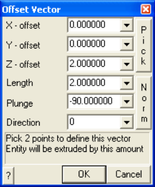

输入偏移量：

X-offset > 0 Y-offset > 0 Z-offset > 2

点 5、6、7 和 8 将分别由点 1、2、3 和 4 的坐标加上偏移值生成。

块体构建完成后，系统将自动提示您输入块体属性 (CAD > Build > FFLoop)

输入以下内容：

Block Name: Intersection Element Type: Fictitious Force Block Colour: 1

此交叉口块体应在第 1 开采步骤开挖，方法是指定

Mining Step 1: 0

至此完成，按下

按钮即可构建该块体。

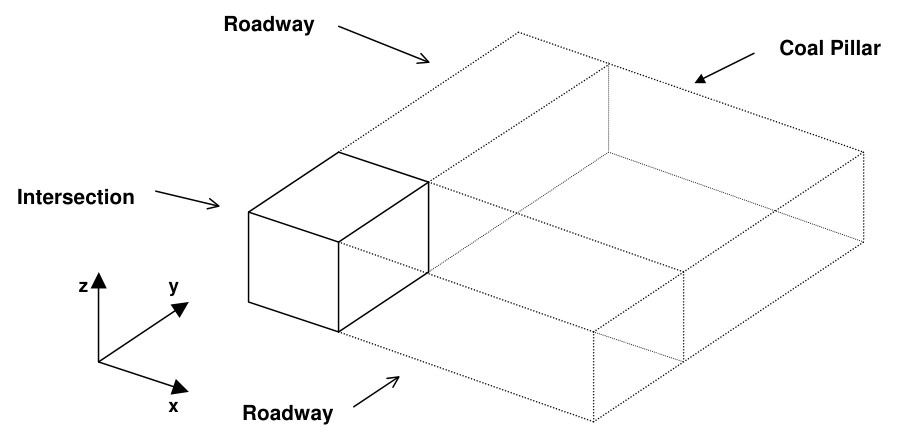

#### 调整视图

在构建块体期间或任何其他时候，用户都可以自由调整几何体的位置（平移、旋转或缩放），以便于观察。可以通过多种方式轻松实现（参见"旋转模型"和"平移模型"）。

#### 构建巷道 1

再次选择 FFLoop 构建功能即可构建更多块体

#### CAD > Build > FFLoop

我们在第一个块体旁边构建下一个块体。在以下位置选择点 1

x,y,z >  2  0  0

我们希望在以下位置选择点 2

x,y,z >  8  0  0

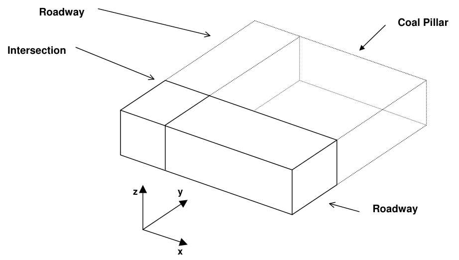

但该位置超出了显示范围。要解决这个问题，只需缩小视图即可（参见"平移模型"）。

现在可以轻松选择点 2。

在以下位置选择点 3

x,y,z >  8  2  0

在以下位置选择点 4

x,y,z >  2  2  0

最后，再次选择第一个点

x,y,z >  2  0  0

再次选中第一个点后，块体的底面即完全形成。与之前一样，系统将显示以下消息

Loop complete: Start next loop.

现在使用偏移功能生成此块体的其余点

#### CAD > Build > Extrude/Offset Remaining

系统将按如下方式提示您输入偏移向量

输入偏移量：

X-offset > 0 Y-offset > 0 Z-offset > 2

块体构建完成后，系统将自动提示您输入实体属性 (CAD > Build > FFLoop)

输入以下内容：

Block Name: Roadway

Element Type: Fictitious Force Block Colour: 1

此巷道块体应在第 1 开采步骤开挖，方法是指定 Mining Step 1: 0

至此完成，按下按钮即可构建该块体。

#### 构建巷道 2

我们来构建第三个块体

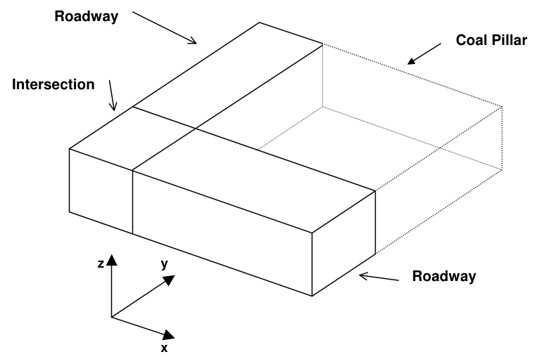

在以下位置选择点 1

x,y,z >  2  2  0

在以下位置选择点 2

x,y,z >  2  6  0

在以下位置选择点 3

x,y,z >  0  6  0

在以下位置选择点 4

x,y,z >  0  2  0

再次选择第一个点以完成底面

x,y,z >  2  0  0

然后与之前一样偏移生成其余点

CAD > Build > Extrude/Offset Remaining

至此，巷道构建完成。

#### 构建煤柱

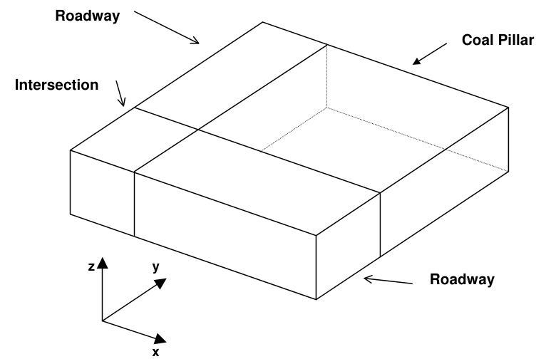

现在您应该已完成一个交叉口和两条巷道的构建。接下来构建一个煤柱。

#### CAD > Build > FFLoop

在以下位置选择点 1

x,y,z >  2  2  0

在以下位置选择点 2

x,y,z >  8  2  0

在以下位置选择点 3

x,y,z >  8  6  0

在以下位置选择点 4

x,y,z >  2  6  0

再次选择第一个点以完成底面

x,y,z >  2  2  0

然后与之前一样偏移生成其余点

CAD > Build > Extrude/Offset Remaining

至此，煤柱构建完成。

块体构建完成后，系统将自动提示您输入块体属性 (CAD > Build > FFLoop)。必须指定该块体为煤柱，而不是开挖体（默认值）。系统将显示如下提示：

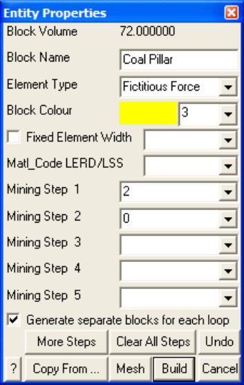

输入以下内容：

Block Name: Coal Pillar Element Type: Fictitious Force Block Colour: 3

必须指定该块体具有煤的材料属性，方法是在第 1 开采步骤中将煤定义为 2 号材料。具体指定为

Mining Step 1: 2

指定以下材料代码即可在第 2 步开采同一矿柱

Mining Step 2: 0

至此完成，即可构建该块体。

#### 保存几何模型

至此，我们已构建了所需开采几何模型的一小角。在继续之前，最好先保存目前已构建的模型。为此选择

#### File > Save Model As

以"COAL.INP"为名保存

#### 扩展几何模型

目前构建的模型仅代表最终模型的一小部分。通过多次复制，可以轻松重复这一布置模式。为此需要选择复制功能

CAD > Edit > Copy Entities

也可以按如下方式从 CAD 工具栏中选择此功能：

在 CAD 工具栏中选择 CAD > Edit

将显示编辑功能子菜单

要激活复制功能，请选择

#### CAD > Edit > Copy Entities

此时系统会提示您创建要复制的实体列表

按住 Shift 键并拖出选择窗口（也可以选择交叉窗口功能）。

**窗口的第二个角点**

选择窗口内的所有实体（即交叉口、巷道和煤柱）都应高亮显示。

现在单击复制按钮即可复制所选实体

系统将按如下方式提示您输入复制偏移向量：

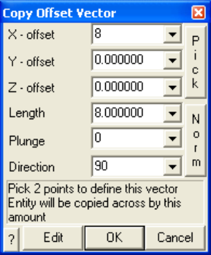

选择复制偏移向量的方法有很多。可以直接输入所需偏移量 (8  0 0)。

也可以通过拾取两个点来定义向量，以图形方式轻松完成。首先将捕捉模式设为

#### CAD > Snap > Rectangular Grid Snap

（仅当网格捕捉按钮尚未高亮显示时才需要执行此操作）。

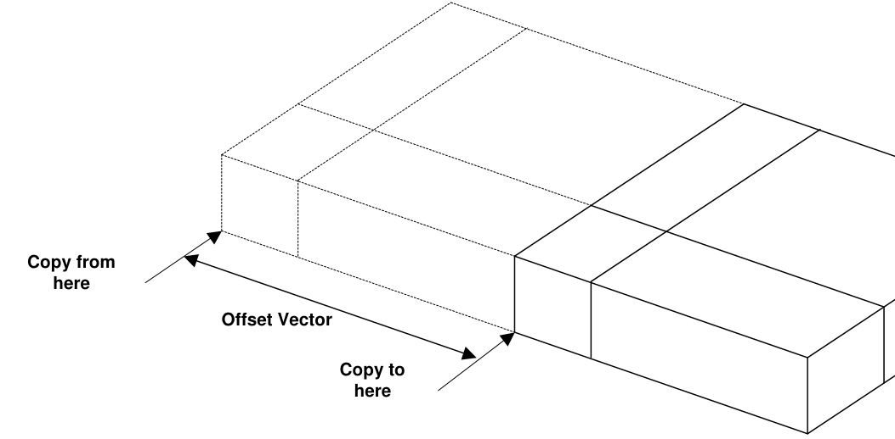

系统将（在屏幕顶部）提示您拾取偏移向量的起点

INPUT: Select first offset point

在以下位置选择该点

x,y,z >  0  0  0

然后系统会提示您拾取偏移向量的终点

INPUT: Select second offset point

在以下位置选择该点

x,y,z >  8  0  0

对话框中将显示偏移量 (8  0  0)。

现在按 OK，所选实体将在所有坐标上加上偏移向量而被复制。

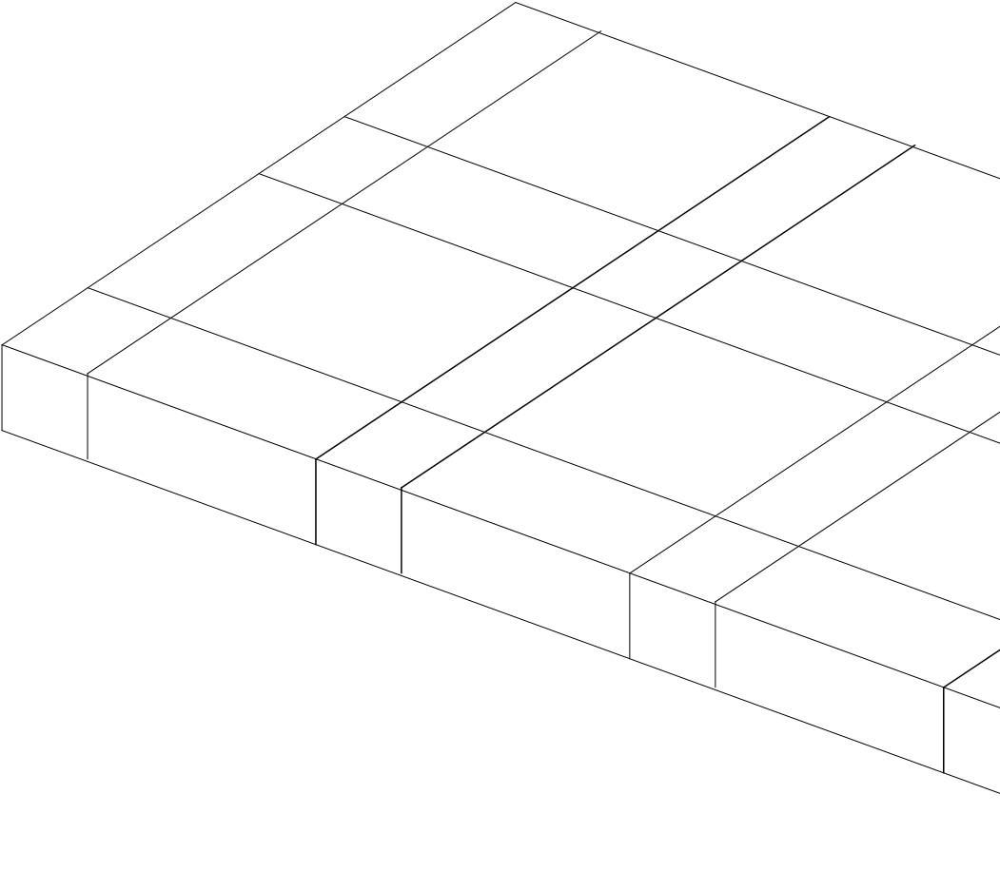

要重复此复制操作，可以重新创建选择集，或恢复上一个选择集，然后再次选择复制功能复制所选实体

#### CAD > Edit > Copy Entities

如有需要，可以多次重复此复制过程，在 x 和 y 方向上复制开采布置模式。

至此，几何模型可以视为完成。接下来必须定义计算结果的网格平面位置，并指定材料属性。

#### 构建网格平面

**3 2 4 1**

现在需要确定在哪里计算结果。本例中我们关注煤柱中的应力，因此将定义一个穿过其中一个矿柱中心的横截面网格平面。网格平面将由一个具有 4 个角点的平面构成。要构建该平面，请选择网格构建菜单功能

#### CAD > Build > Grid Plane

也可以按如下方式从 CAD 工具栏中选择此功能：

在 CAD 工具栏中选择 CAD > Build

将显示构建功能子菜单

现在选择

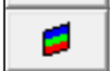

#### CAD > Build > Grid Plane

由于将进行手绘，必须设置捕捉网格，方法是使用 CAD > Snap > Rectangular Grid Snap。可以从 Build Entity 工具栏中选择此功能

要激活捕捉网格，请选择

#### CAD > Snap > Rectangular Grid Snap

（仅当网格捕捉按钮尚未高亮显示时才需要执行此操作）。

当前光标位置的坐标显示在状态栏上。要设置当前 z 值，请单击 CAD > Snap > Cursor/Grid Setup，系统将显示如下提示：

按如下方式设置原点和捕捉间距：

X-Origin > 0 Y-Origin > 0 Z-Origin > -2 Snap spacing > 1

如果光标十字准线不在 x-y 平面内移动，请选择

按钮。

您将看到网格平面构建程序提示您输入平面的第一个角点

INPUT: Select point 1

移动光标找到所需的点

x,y,z >  9  4  -2

单击鼠标左键一次选中该点。

接下来系统会提示您输入下一个角点

INPUT: Select point 2

在以下位置选择点 2

x,y,z >  17  4  -2

如果某个点选错了位置，只需撤销该选择

CAD > Build > Undo Point

然后重试。

选中点 2 后，平面的一条边即完全形成。要完成平面的构建，可以更改标高后选择其余 2 个点（即点 3 和 4），也可以对前 2 个角点加上偏移量来生成这些点。如要使用后一种方法，请在 Build Entity 工具栏中选择偏移功能

CAD > Build > Offset Remaining

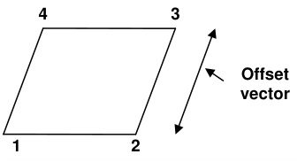

系统将按如下方式提示您输入偏移向量

输入偏移量：

X-offset > 0 Y-offset > 0 Z-offset > 6

点 3 和 4 将分别由点 2 和 1 的坐标加上偏移值生成。

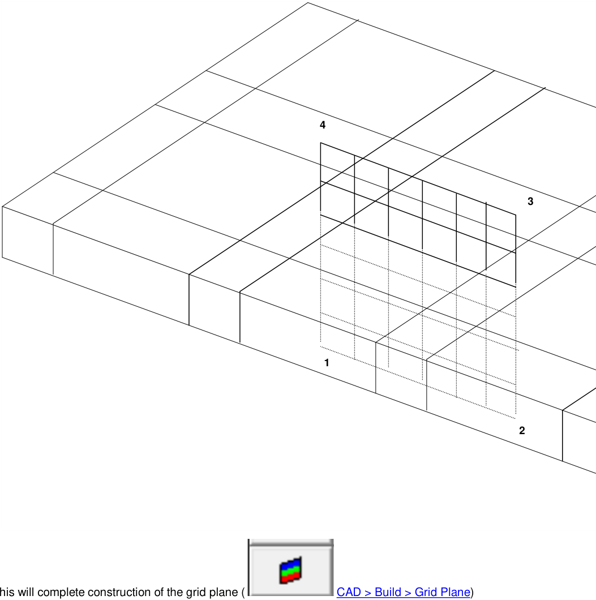

至此，网格平面构建完成 (

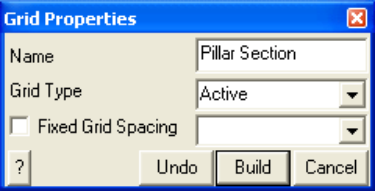

为网格平面输入一个描述性名称，并保持 Fixed Grid Spacing 复选框未勾选。

#### 指定砂岩围岩的材料属性

现在必须指定围岩材料的属性，使用材料属性功能输入

#### CAD > Properties > Material Properties.

选择此项将打开与编辑材料属性相关的子菜单。请注意，1 号材料按定义为围岩材料。其他材料编号用于定义煤、断层泥、充填体等替代材料区。系统首先提示用户输入要编辑的材料编号。首先定义围岩材料的属性

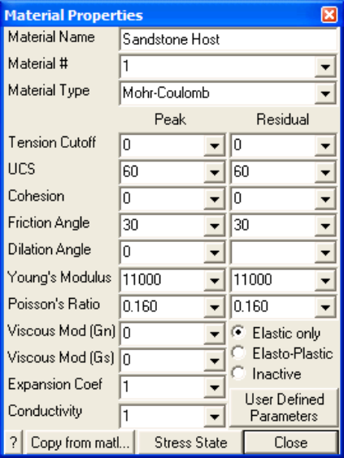

输入以下内容：

Material Name: Sandstone Host Material # : 1 Young's (deformation) Modulus: 11000 MPa Poisson's Ratio: 0.16

黏性模量可以设为零，因为它们仅用于在非线性分析中模拟蠕变响应。

这里我们希望使用 Mohr-Coulomb 准则，为此设置

Material Type: Mohr-Coulomb UCS: 60 MPa

本例中不使用黏聚力参数，因此可以设为零。

Friction Angle: 30°

本例中不使用剪胀角，因此可以设为零。

现在可以指定开采前的应力状态

CAD > Properties > Material Properties > Stress State

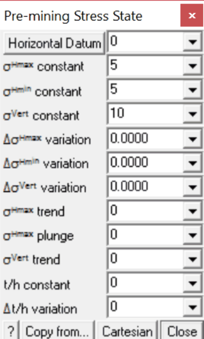

本模型适用的远场应力状态为

sHmax constant:  5 MPa sHmin constant:  5 MPa sVert constant: 10 MPa

应力随深度的变化设为零

DsHmax variation:  0 MPa/m DsHmin variation:  0 MPa/m DsVert variation:  0 MPa/m

此外，应力方向（倾向和倾伏角）应设为零，从而将 sa 和 sb 定义为水平方向，sc 定义为竖直方向。

基准面 (Datum) 也可以设为零，因为它仅用于定义随深度的变化。

#### 指定煤层的材料属性

现在必须指定煤层的属性，使用材料属性功能输入

#### CAD > Properties > Material Properties

选择此项将打开与编辑材料属性相关的子菜单。回想一下，在构建煤柱时，我们已指定该块体使用 2 号材料。

将 Material # 设为 2。

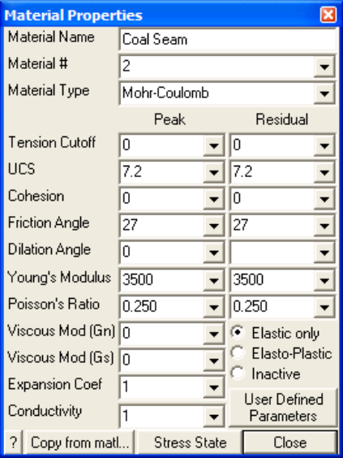

输入以下内容：

Material Name: Coal Seam Young's  (deformation) Modulus: 3500 MPa Poisson's Ratio: 0.25

黏性模量可以设为零，因为它们仅用于在非线性分析中模拟蠕变响应。

这里我们希望使用 Mohr-Coulomb 准则，为此设置

Material Type: Mohr-Coulomb UCS: 7.2 MPa

本例中不使用黏聚力参数，因此可以设为零。

Friction Angle: 27°

本例中不使用剪胀角，因此可以设为零。

现在可以指定开采前的应力状态

#### CAD > Properties > Material Properties > Stress State

我们希望煤中的初始应力与砂岩围岩相同，因此使用 Copy 从 1 号材料复制。

#### 指定控制参数

现在必须指定控制模型离散化和求解的参数，使用控制参数功能输入

#### CAD > Properties > Control Parameters

选择此项将打开包含控制参数的对话框

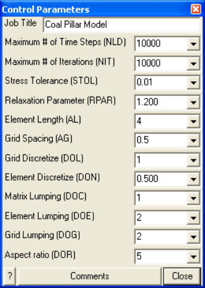

输入以下内容：

Job Title: Coal Pillar Model

除应力容差、单元长度和网格间距外，所有参数均可保留默认值。

Stress Tolerance: 0.01 MPa

应设为远场应力状态的约 0.1%。这可确保在求解过程中，表面应力的计算数值精度为 0.01 MPa。

Element Length: 4

应设为煤层厚度的两倍。该参数用于控制在窄矿层或窄矿柱所在位置使用的最小边界单元尺寸，从而确保建立条件良好、易于求解的问题。

Grid Spacing: 0.5

应设为煤层厚度的约四分之一。该参数用于控制网格平面靠近或穿过模型的位置所使用的最小边界单元尺寸和网格平面上的最小间距。在距模型表面仅为该间距一半的位置也能获得准确的结果。该参数还能确保在矿柱内计算足够数量的应力点，以生成平滑的等值线。

用户可以自由选择更大的网格间距值。这将减小问题规模，从而缩短运行时间。但边界单元较大时，结果精度会降低，尤其是在模型表面附近；而且网格间距较大时，无法生成平滑的等值线。

离散化和集总参数的建议值如下：

_DON_ =0.5, _DOL_ = _DOC_ =1, _DOE_ = _DOG_ =2，误差为 10-20%；_DON_ =0.5, _DOL_ = _DOC_ =2, _DOE_ = _DOG_ =4，误差为 5-10%；_DON_ =1.0, _DOL_ =DOC=4, _DOE_ = _DOG_ =8，误差 &lt; 5%

除需要更高精度的问题外，建议所有问题都使用粗略分析结果的设置。在此设置下，应力预测的数值误差预计为 10-20%。详细分析结果的设置可提供 5-10% 的数值误差，高精度设置的数值误差小于 5%。用户可以为这些参数指定更高精度的设置，但这会增大问题规模，从而延长运行时间。

#### 运行 Map3D 分析

至此，模型构建已经完成，可以开始分析。如果使用 Map3D Fault-Slip，将获得该问题的弹性解；如果使用 Map3D NonLinear，将进行完整的非线性分析。

分析从主菜单执行。

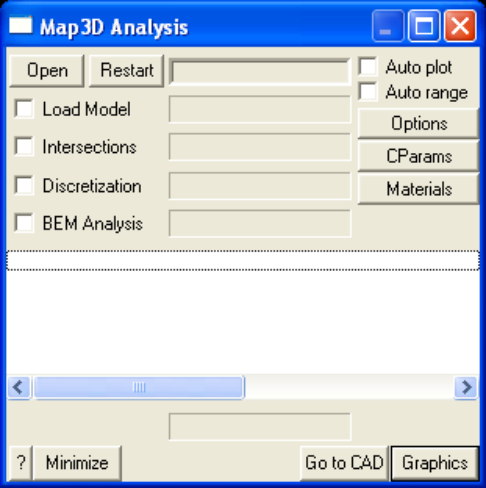

选择以下命令即可运行完整分析

#### BEM Analysis

这里我们将分阶段进行，因此首先选择

#### Discretization

如果自上次保存以来修改过模型，系统将提示您保存这些修改。

求交和离散化分析完成后，选择

#### Analysis > Graphics

在图形模式下，应选择离散化视图选项

#### View > Render > Discretize

这样可以看到块体表面是如何被离散为边界单元的。必须打开轮廓线显示才能看到各个单元

#### View > Render > Block Outlines

要查看网格的离散情况（如果等值线工具栏不可见，请使用 Tools > CAD Toolbar 激活），必须从等值线工具栏中选择

#### Plot > Grid Selection > Grid #1

可以使用不同的网格间距、离散化和集总参数值，根据需要多次重复离散化分析，直到获得所需的边界单元和网格点密度。

满意后，可以从主菜单中选择

#### Analysis

然后选择

#### BEM Analysis

进入 BEM 分析（矩阵组装和求解）。分析完成后，选择

#### Analysis > Graphics

在图形模式下，可以对任何所需参数绘制等值线。例如，要显示最大主应力等值线，请选择

Plot > Stress > S1 Major Principal Stress

这将在网格平面上生成等值线图。

此处不讨论结果的解释。
