本示例演示如何为多步板状开采构建模型。

构造线用于定义开挖体、接触面、构造等井下要素的详细位置。Map3D 模型通常建立在这些构造线数据之上。

矿山平面图事先已使用 Map3D

#### CAD > Digitizer Setup

或其他 CAD 程序完成数字化。这些平面图可以保存为以下任一格式：

点文件格式是一种通用的 ASCII 数据文件，扩展名为".PNT"。此格式便于与其他 CAD 软件交换原始构造线数据。

AutoCAD-DXF 格式是一种常用的图形交换文件，扩展名为".DXF"。此格式便于与其他 CAD 软件交换构造线数据。

我们希望从空白状态开始，因此选择

#### File > New Model

开始之前请注意，将鼠标悬停在任意按钮上即可显示说明该按钮功能的工具提示。此外，右键单击任意项目即可获得该功能的详细帮助。

#### 导入数字化矿山平面图

首先必须打开包含数字化矿山平面图的文件，方法是使用

#### File > Open Construction Lines

本例中构造线以 PNT 格式保存。文件"TAB.pnt"随 Map3D 安装程序提供，应可直接导入。

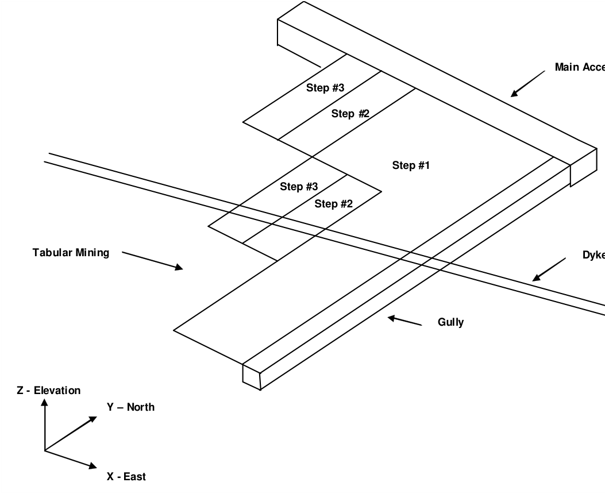

#### 调整视图

在构建块体期间或任何其他时候，用户都可以自由调整几何体的位置（平移、旋转或缩放），以便于观察。可以通过多种方式轻松实现（参见"旋转模型"和"平移模型"）。最简单的旋转方法是按住鼠标左键并在屏幕上拖动光标。按住鼠标右键可进行平移。同时按住两个鼠标按钮可放大或缩小模型。

调整视图，使构造线清晰可见。

#### 构建第 1 开采步骤

现在构建板状开采的第 1 步。该步骤将使用由开采区边界定义的位移不连续单元构建。

使用 CAD > Build > DDLoop 构建第一个块体。可以按如下方式从 CAD 工具栏中选择此功能（如果 CAD 工具栏不可见，请使用 Tools > CAD Toolbar 激活）：

在 CAD 工具栏中选择 CAD > Build

将显示构建功能子菜单

现在选择

#### CAD > Build > DDLoop

由于需要捕捉到构造线，必须设置捕捉模式，方法是使用 CAD > Snap > Nearest Edge。可以从 Build Entity 工具栏中选择此功能

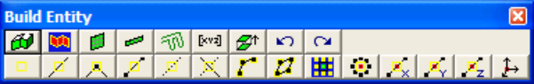

要激活最近边捕捉，请选择

#### CAD > Snap > Nearest Edge

（仅当最近边捕捉按钮尚未高亮显示时才需要执行此操作）。

在此模式下，十字准线的交点处将显示一个拾取框。当前光标位置的坐标显示在状态栏上。如果拾取框位于构造线的角点上，则选中该角点；否则选中拾取框下方构造线边上最近的点。无论哪种情况，3 个坐标值（x、y 和 z）都是唯一确定的。

您将看到 DDLoop 构建程序在状态栏上提示您输入块体的第一个角点

Input: Select Point 1

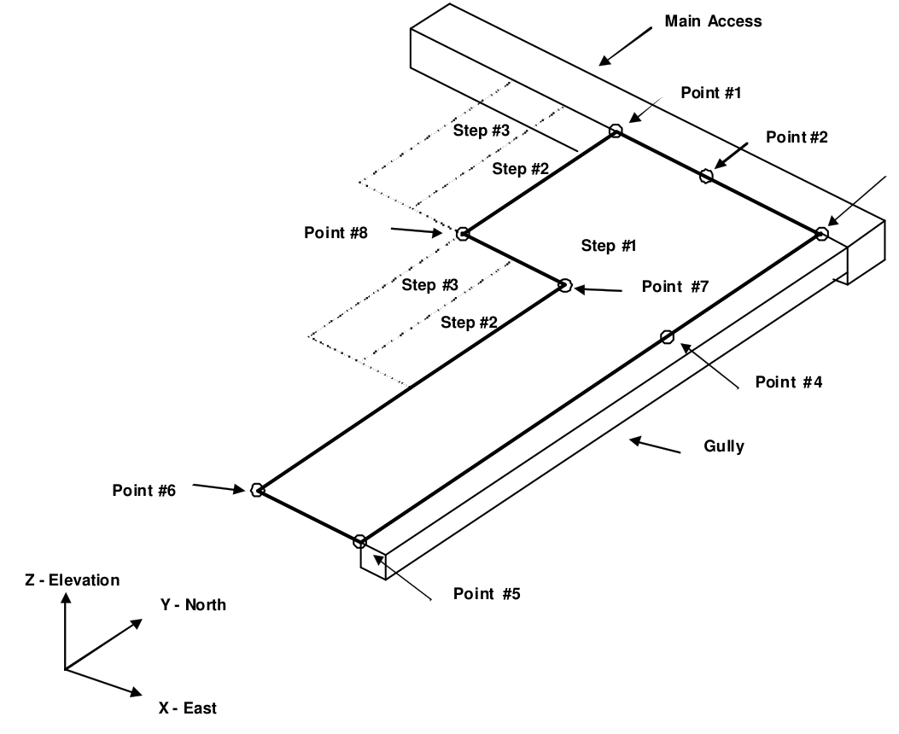

按图所示选择点 1 至 8。

请注意，除点 2 和点 4 外，所有点实际上都可以使用角点捕捉模式

#### CAD > Snap > Nearest Corner

如果某个点选错了位置，只需撤销该选择

#### CAD > Build > Undo Point

然后重试。

点 2 和点 4 是可选的，选择它们只是为了让模型看起来更整齐。

选中点 8 后，平面轮廓即告完成。要完成 DDLoop 的构建，请再次选择点 1 或单击相应按钮。

系统将自动提示您输入块体属性 (CAD > Build > DDLoop)

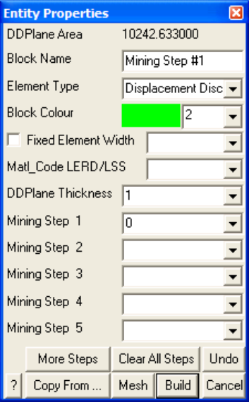

输入以下内容：

Block Name: Mining Step #1 Element Type: Displacement Discontinuity Block Colour: 2 DDPlane Thickness: 1

DDPlane Thickness 应设为开采厚度。

该板状开采应在第 1 开采步骤开挖，方法是指定

Mining Step 1: 0

至此完成，按下按钮即可构建该块体。

#### 构建第 2 开采步骤

现在构建板状开采的第 2 步。该步骤同样使用由开采区边界定义的位移不连续单元构建。开始构建时请选择

CAD > Build > DDLoop

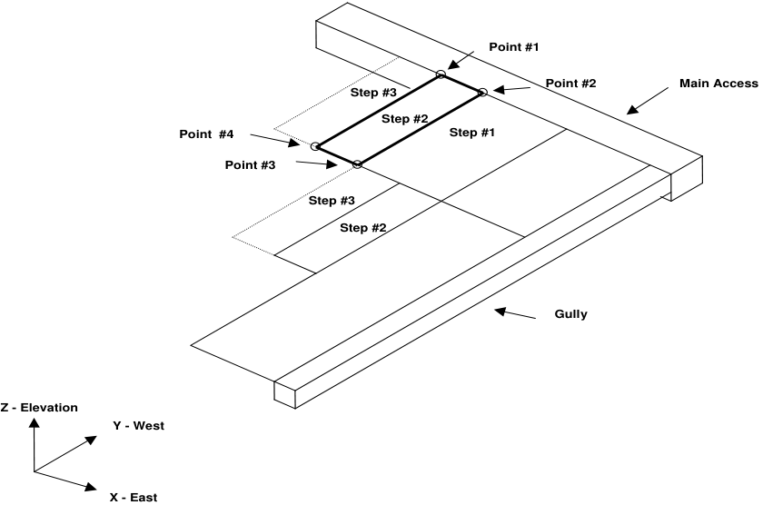

按图所示选择 4 个点。

选中点 4 后，平面轮廓即告完成。要完成 DDLoop 的构建，请再次选择点 1 或单击相应按钮。

系统将自动提示您输入块体属性 (

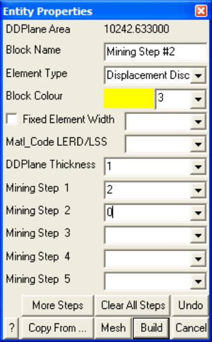

输入以下内容：

Block Name: Mining Step #2 Element Type: Displacement Discontinuity Block Colour: 3 DDPlane Thickness: 1

DDPlane Thickness 应设为开采厚度。

该板状开采应在第 1 开采步骤被赋予矿石（2 号材料）的属性，然后在第 2 开采步骤开挖。具体指定为

Mining Step 1: 2 Mining Step 2: 0

至此完成，按下按钮即可构建该块体。

现在使用相同的方法构建第 2 步的另一部分。

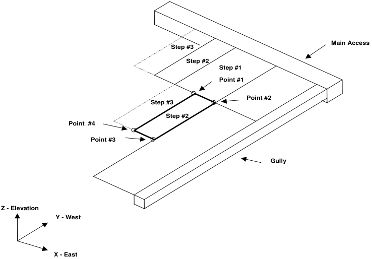

#### 构建第 3 开采步骤

该步骤的开采可按与第 2 步相同的方法构建，不同之处在于：该板状开采应在第 1 和第 2 开采步骤均被赋予矿石（2 号材料）的属性，然后在第 3 开采步骤开挖。

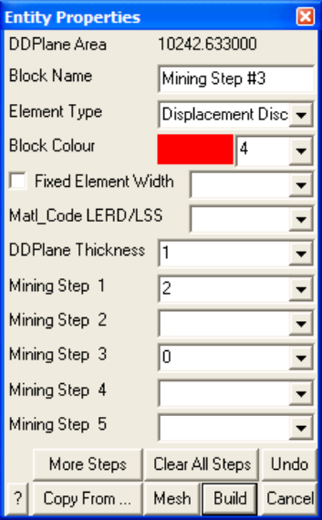

#### 获取结果

虽然已经定义了开采几何形状，但仍需指定在哪里获取应力预测结果。默认情况下，会在所有未开采的 DD 平面上计算。如果还需要矿层以外或开采区前方的应力，则必须在这些位置布置 DD 平面或网格平面。网格平面是一种经济得多（就分析时间而言）的选择。

本例中我们选择仅在 DD 平面上获取结果。我们将使用 Fixed Element Width 参数，强制将这些平面离散为合适的单元尺寸。为此，请使用 CAD > Edit > Properties > Entity Properties。可以按如下方式从 CAD 工具栏中选择此功能（如果 CAD 工具栏不可见，请使用 Tools > CAD Toolbar 激活）：

在 CAD 工具栏中选择 CAD > Edit

将显示编辑功能子菜单

现在选择

CAD > Edit > Entity Properties

这将打开实体编辑工具栏

启动此程序时，系统首先会提示您创建要编辑的实体列表。按住 Shift 键并拾取代表各开采步骤的所有 DD 平面。

选中所有开采体后，可以再次选择

#### CAD > Edit > Entity Properties

或双击任一实体，打开 Entity Properties 对话框。

如果对话框中某个字段显示"Variable"，说明所选块体中有些块体该字段的属性不同。如果希望保持这些属性不变（即各块体不同），请保留该字段为"Variable"。如果希望为所有所选块体统一修改该字段的值，请输入所需的值。

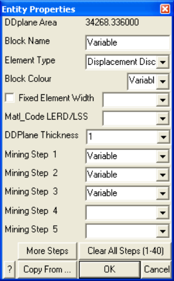

本例中唯一需要修改的字段是

Fixed Element Width:  20

将该值设为 20，然后选择 OK。

这将强制 Map3D 在离散化过程中将开采区细分为宽度为 20 米的均匀单元。如果需要更精细的离散化，之后可以减小此参数。

#### 保存几何模型

在本示例中，假定目前定义的几何模型已令人满意。由于最终几何形状和开采顺序均已完成，应保存模型。为此选择

#### File > Save Model As

以"TAB.INP"为名保存

#### 构建岩墙

为增加一点复杂性，现在来构建岩墙。使用 CAD > Build > FFLoop 构建岩墙。可以按如下方式从 CAD 工具栏中选择此功能（如果 CAD 工具栏不可见，请使用 Tools > CAD Toolbar 激活）：

在 CAD 工具栏中选择 CAD > Build

将显示构建功能子菜单

现在选择

#### CAD > Build > FFLoop

由于需要捕捉到构造线的角点，必须设置捕捉模式，方法是使用 CAD > Snap > Nearest Corner。可以从 Build Entity 工具栏中选择此功能

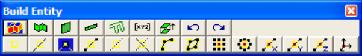

要激活最近角点捕捉，请选择

#### CAD > Snap > Nearest Corner

（仅当 Nearest Corner Snap 按钮尚未高亮显示时才需要执行此操作）。

实际上这里也可以使用边捕捉模式

#### CAD > Snap > Nearest Edge

因为只要角点位于拾取框内，构造线的角点无论如何都会被选中。不过，使用角点捕捉可以让选择不必那么精确，因为只会选中角点。

按图所示拾取全部四个点。

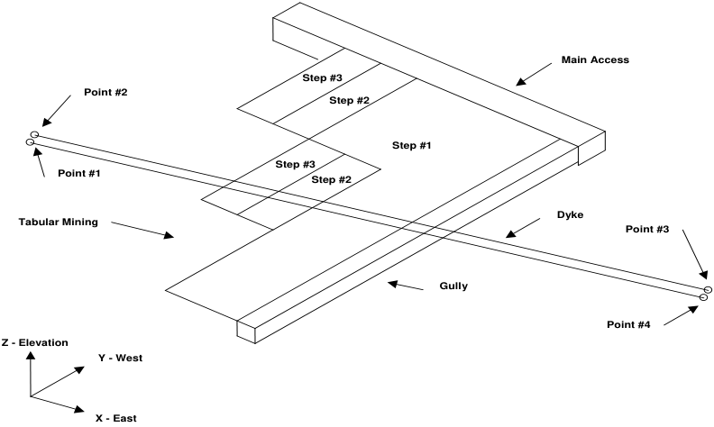

如果某个点选错了位置，只需使用撤销按钮撤销该选择

#### CAD > Build > Undo Point，然后重试。

最后，再次选择第一个点（即点 1）。

再次选中第一个点后，块体的底面即完全形成。系统将显示以下消息

#### Loop complete: Start next loop.

为完成块体的构建，我们将对前 4 个角点加上偏移量，生成其余 4 个点。为此，请在 Build Entity 工具栏中选择偏移功能

#### CAD > Build > Extrude/Offset Remaining

系统将按如下方式提示您输入偏移向量

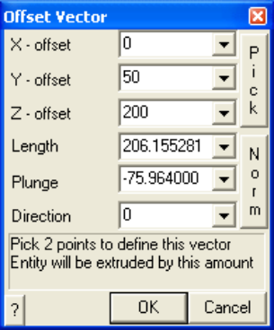

输入偏移量：

X-offset > 0 Y-offset > 50 Z-offset > 200

点 5、6、7 和 8 将分别由点 1、2、3 和 4 的坐标加上偏移值生成。

块体构建完成后，系统将自动提示您输入块体属性 (CAD > Build > FFLoop)

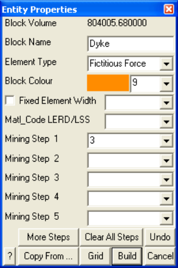

输入以下内容：

Block Name: Dyke Element Type: Fictitious Force Block Colour: 9

取消勾选 Fixed Element Width 以禁用此功能

该岩墙应在第 1 开采步骤被赋予 3 号材料，方法是指定

Mining Step 1: 3

至此完成，按下

按钮即可构建该块体。

我们还需要将岩墙延伸到开采体下方，可以将该块体复制到开采体下方。为此，请在 CAD 工具栏中选择

CAD > Edit

这将打开编辑工具栏

要复制实体，请选择

CAD > Edit > Copy Entities

这将打开实体复制工具栏

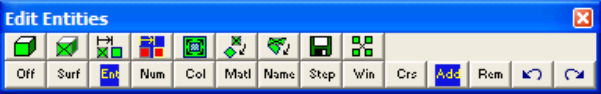

启动此程序时，系统首先会提示您创建要编辑的实体列表。单击岩墙，将打开复制偏移向量对话框

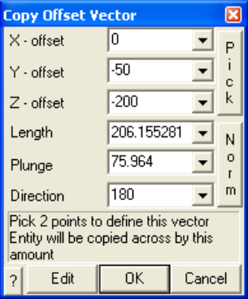

我们使用 Pick 功能以图形方式拾取该位置。

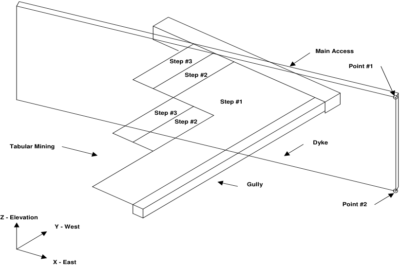

这将定义偏移向量

X - offset: 0

Y - offset: -50

Z - offset: -200

现在选择 OK。岩墙将被复制到开采体下方。

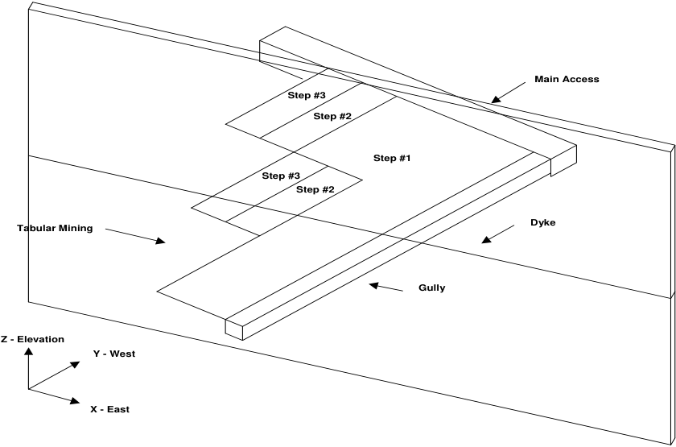

至此，模型构建完成。

#### 指定围岩岩体的材料属性

现在必须指定围岩材料的属性，使用材料属性功能输入

#### CAD > Properties > Material Properties

选择此项将打开与编辑材料属性相关的子菜单。请注意，1 号材料按定义为围岩材料。其他材料编号用于定义矿石、断层泥、充填体等替代材料区。系统首先提示用户输入要编辑的材料编号。首先定义围岩材料的属性

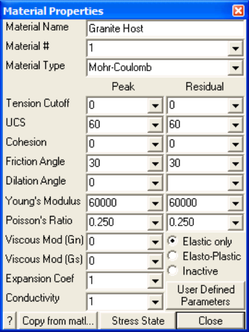

输入以下内容：

Material Name: Granite Host Material #: 1 Young's (deformation) Modulus: 60000 MPa Poisson's Ratio: 0.25

黏性模量可以设为零，因为它们仅用于在非线性分析中模拟蠕变响应。

这里我们希望使用 Mohr-Coulomb 准则，为此设置

Material Type: Mohr-Coulomb UCS: 60 MPa

本例中不使用黏聚力参数，因此可以设为零。

Friction angle: 30°

本例中不使用剪胀角，因此可以设为零。

选择 Stress State 打开应力状态对话框

本模型适用的远场应力状态为

sa constant:  30 MPa sb constant:  20 MPa sc constant:  20 MPa

应力随深度的变化设为

Dsa variation:  -0.027 MPa/m Dsb variation:  -0.013 MPa/m Dsc variation:  -0.013 MPa/m

此外，应力方向（倾向和倾伏角）应设为零，从而将 sa 和 sb 定义为水平方向，sc 定义为竖直方向。

基准面 (Datum) 可设为 1000 米，按下式定义随深度的变化

s + Ds ( _z_ - _Datum_ )

按此定义，应力 sa 在深度 z 为 1000 m 处等于 30 MPa，并以每米深度 0.027 MPa 的速率增加。

#### 指定矿石的材料属性

现在必须指定矿石的属性，使用材料属性功能输入

#### CAD > Properties > Material Properties

选择此项将打开与编辑材料属性相关的子菜单。请注意，1 号材料按定义为围岩材料。其他材料编号用于定义矿石、断层泥、充填体等替代材料区。系统首先提示用户输入要编辑的材料编号。

将 Material # 设为 2。

所有参数均可根据需要设置。由于该材料被插入 DD 平面，用户在此需特别注意。这些构造可能表现出非线性行为，在压缩和剪切作用下发生屈服（参见"DD 平面中的 Mohr-Coulomb"一节）。

选择 Stress State 打开应力状态对话框

我们希望矿石中的初始应力与围岩相同，因此使用 Copy 从 1 号材料复制。

#### 指定岩墙的材料属性

现在必须指定岩墙的属性，使用材料属性功能输入

#### CAD > Properties > Material Properties

选择此项将打开与编辑材料属性相关的子菜单。请注意，1 号材料按定义为围岩材料。其他材料编号用于定义矿石、断层泥、充填体等替代材料区。系统首先提示用户输入要编辑的材料编号。

将 Material # 设为 3。

所有参数均可根据需要设置。如果使用 Map3D Non-Linear，用户在此需特别注意，因为该构造可能表现出非线性行为，在压缩和剪切作用下发生屈服（参见"3D FF 块体中的 Mohr-Coulomb"一节）。

务必选择 Stress State 打开应力状态对话框，并将岩墙中的应力状态设为与围岩相同（从 1 号材料 Copy）。

#### 指定控制参数

现在必须指定控制模型离散化和求解的参数，使用控制参数功能输入

#### CAD > Properties > Control Parameters

选择此项将打开包含控制参数的对话框

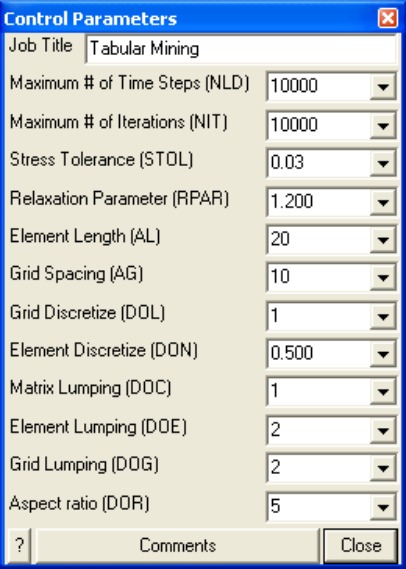

输入以下内容：

Job Title: Tabular Mining

除应力容差、单元长度和网格间距外，所有参数均可保留默认值。

Stress Tolerance: 0.03 MPa

应设为远场应力状态的约 0.1%。这可确保在求解过程中，表面应力的计算数值精度为 0.03 MPa。

Element Length: 20

应设为岩墙厚度的两倍（岩墙厚 10 米），因为这是本模型中最窄的构造。该参数用于控制在窄矿层或窄矿柱所在位置使用的最小边界单元尺寸，从而确保建立条件良好、易于求解的问题。

由于未定义任何场点网格，因此不使用网格间距 (Grid Spacing)。

离散化和集总参数的建议值如下：

_DON_ =0.5, _DOL_ = _DOC_ =1, _DOE_ = _DOG_ =2，误差为 10-20%；_DON_ =0.5, _DOL_ = _DOC_ =2, _DOE_ = _DOG_ =4，误差为 5-10%；_DON_ =1.0, _DOL_ =DOC=4, _DOE_ = _DOG_ =8，误差 &lt; 5%

除需要更高精度的问题外，建议所有问题都使用粗略分析结果的设置。在此设置下，应力预测的数值误差预计为 10-20%。详细分析结果的设置可提供 5-10% 的数值误差，高精度设置的数值误差小于 5%。用户可以为这些参数指定更高精度的设置，但这会增大问题规模，从而延长运行时间。

#### 运行 Map3D 分析

至此，模型构建已经完成，可以开始分析。如果使用 Map3D Fault-Slip，将获得该问题的弹性解；如果使用 Map3D NonLinear，将进行完整的非线性分析。

分析从主菜单执行。

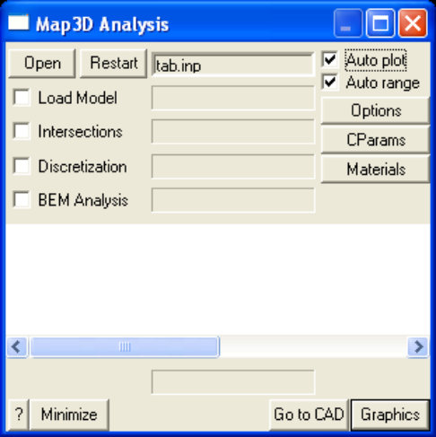

选择以下命令即可运行完整分析

#### BEM Analysis

这里我们将分阶段进行，因此首先选择

#### Discretization

如果自上次保存以来修改过模型，系统将提示您保存这些修改。

求交和离散化分析完成后，选择

#### Analysis > Graphics

在图形模式下，应选择离散化视图选项

#### View > Render > Discretize

这样可以看到块体表面是如何被离散为边界单元的。必须打开轮廓线显示才能看到各个单元

#### View > Render > Block Outlines

要查看网格的离散情况，必须选择

#### Plot > Grid Selection > Grid #1

如果一切满意，可以从主菜单中选择

#### Analysis

然后选择

#### BEM Analysis

进入 BEM 分析（矩阵组装和求解）。分析完成后，选择

#### Analysis > Graphics

在图形模式下，可以对任何所需参数绘制等值线。例如，要显示板状开采上的法向位移（收敛），请选择

#### Plot > Surface Components > Dn Normal Displacement (Closure)

这将在 DD 平面上生成等值线图。

#### 构建主通道

主通道的构建方法是：先用 DDLoop 绘制平面轮廓，再将其拉伸为三维块体。

为此，必须在分析对话框中选择

#### Analysis > Go to CAD

返回 Map3D 分析的 CAD 阶段。然后选择

#### Analysis > Graphics

首先选择 DDLoop 构建菜单功能

#### CAD > Build > DD Loop

将捕捉模式设为最近边（或最近角点）

#### CAD > Snap > Nearest Edge

（仅当边捕捉按钮尚未高亮显示时才需要执行此操作）。

您将看到 DDLoop 构建程序在状态栏上提示您输入块体的第一个角点

Input: Select Point 1

按图所示拾取前两个点。

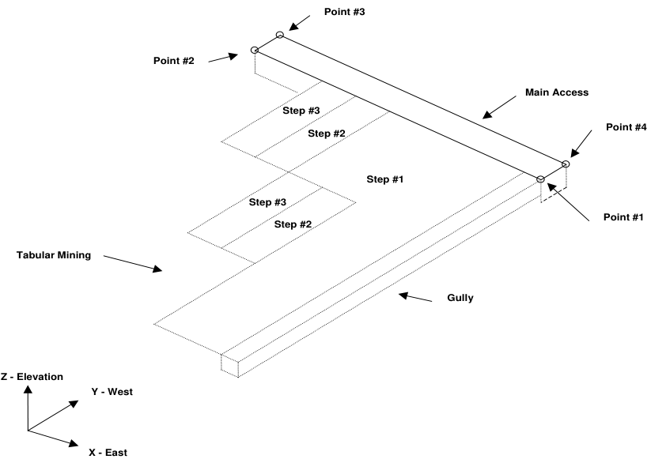

点 3 和 4 将通过从点 1 和 2 所定义的直线偏移生成。为此，请在构建工具栏中选择

#### CAD > Build > Offset Remaining

系统将提示您输入偏移向量。

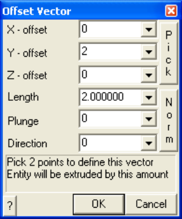

输入偏移量

X - offset: 0

Y - offset: 2

#### Z - offset: 0

这将生成点 3 和 4，并完成 DDLoop 的构建。

系统将自动提示您输入块体属性

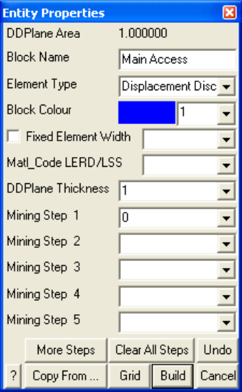

输入以下内容：

#### Block Name: Main Access

#### Element Type: Fictitious Force

此时系统将提示您输入用于拉伸块体的偏移向量。

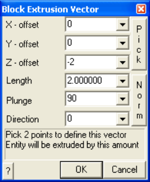

输入偏移量：

X - offset: 0 Y - offset: 0 Z - offset: -2

Block Colour: 1 Fixed Element Width:  （保持未勾选）

该通道应在第 1 开采步骤开挖，方法是指定

Mining Step 1: 0

至此完成，即可构建该块体。

#### 构建 Gully（溜道）

现在使用上述相同的方法构建 gully。

按图所示拾取前两个点。

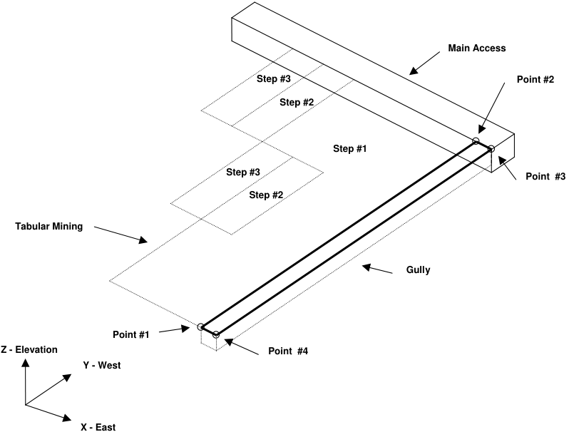

点 3 和 4 将通过从点 1 和 2 所定义的直线偏移生成。为此，请在构建工具栏中选择

CAD > Build > Offset Remaining

系统将提示您输入偏移向量。

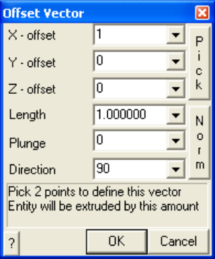

输入偏移量：

- X - offset: 1

- Y - offset: 0

- Z - offset: 0

这将生成点 3 和 4，并完成 DDLoop 的构建。

系统将自动提示您输入块体属性

#### 输入以下内容：

#### Block Name: Gully

#### Element Type: Fictitious Force

此时系统将提示您输入用于拉伸块体的偏移向量。

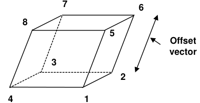

输入偏移量：

X - offset: 0 Y - offset: 0 Z - offset: -1

Block Colour: 1

Fixed Element Width:  （保持未勾选）

该通道应在第 1 开采步骤开挖，方法是指定

Mining Step 1: 0

至此完成，即可构建该块体。

#### 讨论

在继续分析之前，必须修改控制参数 Element Length ( _AL_ )，以正确考虑模型中新增的这些部分

#### CAD > Properties > Control Parameters

AL 应设为 gully 厚度的两倍（gully 厚 1 米），因为这是本模型中最窄的构造。

如果现在对模型进行离散化

#### Analysis > Discretization

仔细观察可以发现，gully 和主通道相邻区域的离散使用了大量边界单元。这些构造显然会大大增加分析时间。如果它们不是重要的影响因素，将其从分析中移除可以显著节省分析工作量，方法是将这些构造设为非活动状态。

为此，请在分析对话框中选择

#### Analysis > Go to CAD

然后选择

Analysis > Graphics

现在从 CAD 工具栏中选择

相应按钮

这将打开编辑工具栏

要编辑实体，请选择

CAD > Edit > Entity Properties

这将打开实体编辑工具栏

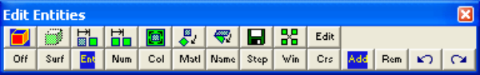

启动此程序时，系统首先会提示您创建要编辑的实体列表。按住 Shift 键，然后拾取 Gully 和 Main Access。不要拾取板状开采体或岩墙。

选中这些构造后，可以再次选择

CAD > Edit > Entity Properties

或双击 Gully 或 Main Access，打开 Entity Properties 对话框。

如果对话框中某个字段显示"Variable"，说明所选块体中有些块体该字段的属性不同。如果希望保持这些属性不变（即各块体不同），请保留该字段为"Variable"。如果希望为所有所选块体统一修改该字段的值，请输入所需的值。

本例中唯一需要修改的字段是 Element Type 参数，将其设为 Inactive Fictitious Force

Element Type: Inactive Fictitious Force

然后选择 OK。

现在可以选择以下命令重新开始 BEM 分析

BEM Analysis

