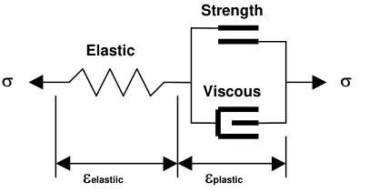

Führt eine elasto-viskoplastische Kriechanalyse durch.

Diese Funktion wird nur in nichtlinearen Analysen verwendet (3D-FF-Blöcke in Map3D Non-Linear und DD-Ebenen in Map3D Fault-Slip). Das Kriechmodell kann einfach als Technik zur Dämpfung der nichtlinearen Verformungen oder, wenn diese Kriechoption aktiviert ist, für eine zeitabhängige Kriechsimulation in Echtzeit verwendet werden.

Bei jedem Kriechschritt wird der Spannungszustand aller fließenden Elemente (Elemente, in denen die Spannung die Festigkeit überschreitet) als Festigkeit plus Kriechwiderstand berechnet. Dadurch wird die Größe des plastischen Kriechinkrements Deplastic an jedem fließenden Element begrenzt

s = _Strength_ + _C_ Deplastic /D _t_

_C_ = _G_ D _t_

wobei der Kriechwiderstand als Kriechkoeffizient _C_ mal plastische Dehnungsrate Deplastic /D _t_ bestimmt wird. Beachten Sie, dass der Benutzer sowohl den Kriechkoeffizienten _C_ als auch die Zeitschrittgröße D _t_ wählen und deren Quotienten anschließend als viskosen Modul _G_ angeben muss. Der Beitrag des Kriechinkrements zur Spannung s ist die Überschussspannung, gegeben durch

Ds  = _C_ Deplastic /D _t_

Die maximale Überschussspannung aller fließenden Elemente wird angezeigt durch Plot > Surface Components > Ferr

Ist diese Kriechoption aktiviert, führt Map3D für jeden Abbauschritt nur ein Kriechinkrement aus. Die verstrichene Zeit ergibt sich somit als Produkt aus der aktuellen Zeitschrittnummer _is_ (Analysis Dialogue) und der vom Benutzer festgelegten Zeitschrittgröße D _t_.

Gesamte verstrichene Zeit = _is_ D _t_

Der Benutzer kann mehrere Abbauschritte wiederholen, ohne neuen Abbau hinzuzufügen, damit das Modell über eine kontrollierte Anzahl von Schritten kriechen kann.

Ist diese Kriechoption nicht aktiviert, führt Map3D so viele Kriechinkremente aus, wie erforderlich sind, um _fer_ unter die Spannungstoleranz _STOL_ zu senken, bevor mit dem nächsten Abbauschritt fortgefahren wird.

In beiden Fällen ergibt sich die akkumulierte plastische Dehnung eplastic als Summe der plastischen Kriechinkremente Deplastic aller Kriechschritte.

Verwandte Themen:

Plot > Surface Components > DTs Excess Shear Stress

Plot > Surface Components > DEs Incremental Shear Strain

Plot > Surface Components > Ts Shear Stress

Plot > Surface Components > Es Shear Strain

Diese Funktion muss aktiviert sein, bevor die Map3D-BEM-Analyse durchgeführt wird

Analysis > BEM Analysis
