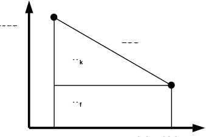
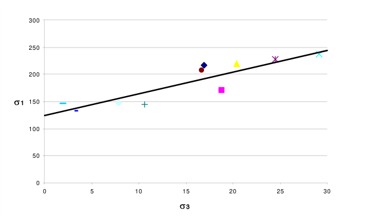
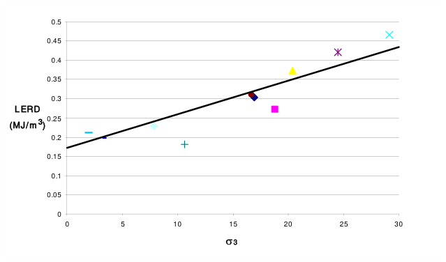
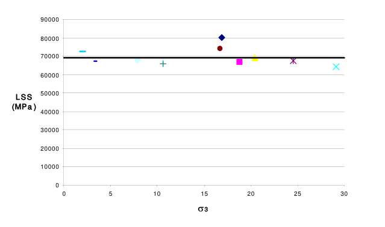

Berechnet die Energiefreisetzungsrate und die Steifigkeit des Belastungssystems – während der Map3D-BEM-Analyse.

Mit dieser Routine kann der Benutzer die Energiefreisetzungsrate ( _ERR_ ) an jeder gewünschten Stelle berechnen; sie bietet ein breites Spektrum an Flexibilität bei der Steuerung der Berechnung. Eine alternative

Methode, mit der _ERR_ nur vor einer Abbaufront berechnet wird, ist verfügbar: Plot > Surface Components > ERR

Wenn Sie LERD/LSS auswählen, werden Sie nach einem Dateinamen für die Datei gefragt, in die die Ergebnisse der LERD/LSS-Berechnungen geschrieben werden. Die Standarderweiterung dieser Datei lautet „.ERR“.

Die Ergebnisse werden in dieser Datei im folgenden Format geschrieben:

Wenn der Testblock als 3D-Block (mit FF-Elementen) aufgebaut ist

**Block# Volume Area   Wk  Wf  Ev  LSS   x y z** s **1  t1  p1** s **2  t2  p2** s **3  t3  p3**

wobei s **i  ti  pi** eine Hauptspannungskomponente, ihre Streichrichtung und ihr Abtauchen darstellen.

Wenn der Testblock als ebenes Objekt (mit DD-Elementen) aufgebaut ist

**Block# Volume Area   Wk  Wf  Ev  LSS   x y z** t **s  ts  ps** s **n  tn  pn**

wobei t **s  ts  ps** die maximale Schubspannung in der Ebene, ihre Streichrichtung und ihr Abtauchen darstellen und s **n  tn  pn** die Normalspannung, ihre Streichrichtung und ihr Abtauchen.

In beiden Fällen sind **x y z** die Koordinaten des Mittelpunkts des Testblocks, an dem die Spannungen berechnet werden.

**Wk  Wf** und **LSS** sind weiter unten definiert.

**Ev** ist die Volumenänderung, die während der LERD/ERR-Berechnung auftritt.

Zusätzlich wird auch die gesamte Energiefreisetzung berechnet, die mit neuen Hohlräumen verbunden ist, die im aktuellen Abbauschritt entstehen. Beachten Sie, dass für diese Berechnung keine Testblöcke angegeben werden müssen. Die Ergebnisse werden wie folgt ausgegeben:

#### Stp# Volume Area Wk Wf Ev LSS

Nützliche Indikatoren für die Art der beim Nachgeben (Fließen) zu erwartenden Reaktion sind die Steifigkeit des Belastungssystems ( _LSS_ ) und die lokale Energiefreisetzungsdichte ( _LERD_ ). An verschiedenen Stellen eines Modells ist zu erwarten, dass sich diese Indikatoren aufgrund geometrischer Effekte ändern. An Stellen, an denen die _LSS_ steifer ist als das Nachbruchverhalten des nachgebenden Gesteins, ist ein kontrolliertes Versagen zu erwarten, das im Takt mit dem fortschreitenden Abbau voranschreitet. An Stellen, an denen die _LSS_ dagegen weicher ist als das Nachbruchverhalten des nachgebenden Gesteins, sind unkontrollierte Brüche zu erwarten. Die Menge an verfügbarer Überschussenergie korreliert erwartungsgemäß mit der Stärke des Ereignisses.

Um die _LSS_ oder die _LERD_ in einem numerischen Modell zu bestimmen, ist es notwendig, das Modell zu „beugen“ (anzuregen) und die Reaktion des Belastungssystems zu beobachten. Dies geschieht durch Festlegen des Materialcodes für die LERD/LSS-Berechnung mit

#### CAD > Edit > Entity Properties > Matl Code LERD/LSS

Dieser spezielle Materialcode wird verwendet, um die Materialeigenschaften oder Randbedingungen im Testbereich vorübergehend so zu verändern, dass sich das Modell in irgendeiner Weise verformt.

Da die _LSS_ erwartungsgemäß von Ort zu Ort variiert, muss dies an allen interessierenden Stellen erfolgen. Durch sorgfältige Beobachtung der Reaktion des Belastungssystems während dieser Verformung lassen sich die _LSS_ und die verschiedenen übertragenen Energiemengen berechnen.

Betrachten Sie das einfache Beispiel einer Störungsebene, die durch eine Abbauzone verläuft, und stellen Sie sich die Frage: „Wie würde diese Störung reagieren, wenn sie nachgeben würde?“ Man könnte einfach einen niedrigeren Reibungswinkel ansetzen und beobachten, wie sich das Gebirge verformt. Nennen wir „Stufe I“ das Modell mit der Störung bei ihrem normalen Reibungswinkel und „Stufe II“ dasselbe Modell, aber mit der Störung bei einem verringerten Reibungswinkel. An einer bestimmten Stelle der Störungsebene ist die folgende Art von Reaktion zu erwarten.

Die _LSS_ ist einfach die Steigung der Last-Verformungs-Kurve. Die maximale Energiemenge, die als kinetische Energie freigesetzt werden kann, ist die Fläche des oberen Dreiecks mit der Bezeichnung Wk (es ist zu erwarten, dass sie mit der beobachteten Ereignisstärke korreliert). Die minimale Energiemenge, die bei der Reibungsverformung der Störung dissipiert werden kann, ist die Fläche des unteren Rechtecks mit der Bezeichnung Wf (es ist zu erwarten, dass sie mit dem am Ereignisherd beobachteten Schaden korreliert). Diese Berechnung muss an allen Stellen der Störungsebene durchgeführt werden, um die insgesamt übertragene Energie infolge der Verringerung des Reibungswinkels zu erhalten. Beachten Sie, dass es je nach Einrichtung der Materialeigenschaften Normalverformungen geben kann (Dilatation, die mit der Scherreaktion auftritt), die in die Energieberechnungen einbezogen werden müssen.

Dieselben Berechnungen lassen sich für einen Pfeiler zwischen zwei Strecken durchführen. Nennen wir in diesem Fall „Stufe I“ das Modell mit intaktem Pfeiler. Um das Modell zu „beugen“, könnten wir ein anderes Material in den Pfeiler einsetzen und dies „Stufe II“ nennen. Alle oben beschriebenen Berechnungen und Deutungen für Wk und Wf lassen sich dann erneut durchführen. Beachten Sie, dass, wie oben, sowohl Normal- als auch Scherkomponenten zu den Energieberechnungen beitragen.

Da Map3D die auf die Randelemente wirkenden Spannungen berechnet, lässt sich der gesamte Energietransfer als Integral der Spannungen über ihre Verformungen über alle Elemente berechnen. Wenn wir im obigen Pfeilerbeispiel den Pfeiler tatsächlich ausbrechen, um Stufe II zu erhalten, und dann Wk durch das Volumen des Pfeilers dividieren, erhalten wir die lokale Energiefreisetzungsdichte ( _LERD_ ). Es hat sich gezeigt, dass diese sehr gut mit gewaltsamen Versagensereignissen korreliert. (Beachten Sie, dass Sie im Fall des flözartigen Abbaus (Tabular Mining) die klassische Energiefreisetzungsrate _ERR_ erhalten, wenn Sie Wk durch die Fläche (in der Abbauebene) dividieren.)

Um dieses Konzept zu untermauern, betrachten wir ein reales Beispiel. Betrachten Sie mehrere Pfeilerbrüche (Pfeilerschläge), die über mehrere Jahre des Abbaus aufgetreten sind. Für jedes Versagen wurde ein numerisches Modell berechnet, um den Spannungszustand zum Zeitpunkt und am Ort des Versagens zu bestimmen. Wenn wir alle diese Spannungsprognosen in einem Diagramm mit den Achsen s **1** gegen s **3** auftragen, erhalten wir Folgendes:

Diese Abbildung zeigt, dass eine starke Korrelation zwischen dem Spannungszustand zum Zeitpunkt jedes Bruchs und einem linearen Festigkeitskriterium besteht. Der Korrelationskoeffizient dieser Daten beträgt 0,90. Anders ausgedrückt beträgt der mittlere Fehler bei der Prognose von s **1** etwa 17 MPa. Das ergibt einen Variationskoeffizienten von nur 9 %.

Auch die _LERD_ zum Zeitpunkt des Bruchs an jeder Stelle zeigt eine starke Korrelation zwischen dem Spannungszustand zum Zeitpunkt jedes Bruchs und einem linearen Kriterium. Der Korrelationskoeffizient dieser Daten beträgt 0,88.

Anders ausgedrückt beträgt der mittlere Fehler bei der Prognose der _LERD_ etwa 0,045 MPa/mª. Das ergibt einen Variationskoeffizienten von nur 14 %.

Während sich die Komponenten Wk und Wf auf diese Weise leicht berechnen lassen, ist die Definition der _LSS_ nicht so einfach. Eine repräsentative _LSS_ lässt sich jedoch wie folgt bestimmen:

Legen Sie einen repräsentativen Bereich fest, für den die _LSS_ bestimmt werden soll. Dazu bauen Sie einen Testblock auf, der die erwartete Fließzone umschließen sollte.

Sie konstruieren den Testblock wie jedes andere Objekt, kennzeichnen diesen Block jedoch als „Testblock“, indem Sie den gewünschten Materialcode für die LERD/LSS-Berechnung festlegen mit

#### CAD > Edit > Entity Properties > Matl Code LERD/LSS

Der Materialcode für die Abbauschritte sollte so festgelegt werden, wie diese Zone während der Abbaufolge behandelt werden soll. Diese Blöcke können als alternative Materialzonen verwendet und bei Bedarf ausgebrochen werden.

Es wird angenommen, dass dieser Testblock mit einem fiktiven Material gefüllt ist, dessen Nachbruchsteifigkeit genau der Reaktion des Belastungssystems entspricht, und dass sich das Verhalten des Testblocks beschreiben lässt durch

s **1 =** **_LSS_** e **1** s **2 =** **_LSS_** e **2** s **3 =** **_LSS_** e **3**

Die Energiedichte lässt sich berechnen als

**½ (** s **1** e **1 +** s **2** e **2 +** s **3** e **3 )**

Die mittlere Energiedichte lässt sich schätzen als

**( Wk + Wf ) /** **_Volume_**

Daher lässt sich die Steifigkeit des Belastungssystems bestimmen aus

**_LSS_ = ½ (** s **1² +** s **2² +** s **3² )** **_Volume_ / ( Wk + Wf )**

Wenn wir diese Berechnung für die oben dargestellten Daten durchführen, erhalten wir das folgende Diagramm.

Die _LSS_ zum Zeitpunkt des Bruchs an jeder Stelle zeigt einen stark spannungsunabhängigen Wert. Der mittlere Fehler bei der Prognose der _LSS_ beträgt etwa 4730 MPa. Das ergibt einen Variationskoeffizienten von nur 7 %.

Diese _LSS_-Berechnung ist nur dann repräsentativ, wenn die Spannungen gleichmäßig über den gesamten Testblock verteilt sind. Ist dies nicht der Fall, ergibt sich eine schlechte Korrelation mit der _LSS_.

#### Hinweise

Diese Funktion muss vor der Durchführung der Diskretisierungsanalyse aktiviert werden

Analysis > Discretization
