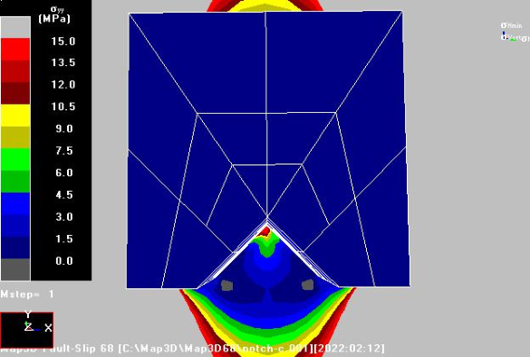

Verwendet Randelemente höherer Ordnung – während der Map3D-BEM-Analyse.

Die Randelementmethode verwendet eine numerische Näherung dafür, wie die Intensität der Oberflächenkomponenten von Spannung oder Verschiebungsdiskontinuität über die Ränder verteilt ist. Die einfachste Annahme besteht darin, dass diese Oberflächenkomponenten über jedes Randelement gleichmäßig verteilt sind. Die Erfahrung mit Map3D hat gezeigt, dass diese Näherung für alle Probleme außer einer begrenzten Klasse mit erheblichen Biegeeffekten genaue Ergebnisse liefert. Selbst bei dieser letzteren Problemart werden an allen Stellen außer in der Nähe der Begrenzungsflächen weiterhin genaue Ergebnisse erzielt.

Um in der Nähe der Ränder von Problemen mit erheblichen Biegeeffekten genaue Ergebnisse zu erhalten, müssen Randelemente höherer Ordnung verwendet werden. Biegeeffekte werden normalerweise bei Problemen mit großen, unregelmäßig geformten Spannweiten wichtig. Das gilt insbesondere in der Nähe von Knicken im Rand, die durch Verschneidungen zwischen verschiedenen Objekten entstehen können.

Wenn weder **linear** noch **quad** aktiviert ist, wird die Intensität der Oberflächenkomponenten von Spannung oder Verschiebungsdiskontinuität als **konstante** Werte verteilt.

Wenn die Option **linear** aktiviert ist, wird die Intensität der Oberflächenkomponenten von Spannung oder Verschiebungsdiskontinuität mithilfe einer Polynomverteilung linearer Ordnung über die Randelemente verteilt. Für Dreiecke wird die folgende Verteilung verwendet

_a + b x + c y_

Für Vierecke wird die folgende Verteilung verwendet

_a + b x + c y + d xy_

Wenn die Option **quad** aktiviert ist, wird die Intensität der Oberflächenkomponenten von Spannung oder Verschiebungsdiskontinuität mithilfe einer Polynomverteilung quadratischer Ordnung über die Randelemente verteilt. Für Dreiecke wird die folgende Verteilung verwendet

_a + b x + c y + d x_ ² _+ e xy + f y_ ²

Für Vierecke wird die folgende Verteilung verwendet

_a + b x + c y + d x_ ² _+ e xy + f y_ ² _+ g x_ ²y _+ h x_ ² _y_ ² _+ i y_ ²x

Hinweise:

Diese Funktion muss vor der Durchführung der Map3D-BEM-Analyse aktiviert werden

#### Analysis > BEM Analysis

Diese Option vergrößert das Problem und erhöht daher die Analysezeit, da Elemente höherer Ordnung mehr Interpolationsknoten auf den Begrenzungsflächen benötigen.

Wenn Sie unsicher sind, wie empfindlich Ihr Modell auf diese Näherung reagiert, empfiehlt es sich, eine Teilmenge des tatsächlichen Modells zum Vergleich mit und ohne lineare Elemente zu berechnen.

Im folgenden Beispiel ist ein Hohlraum mit einer Kerbe dargestellt. Die Vertikalspannung ist für die drei Fälle konturiert: weder **linear** noch **quad**, dann **linear**, dann **quad**. Beachten Sie die anomale Spannungskonzentration an der Spitze der Kerbe bei konstanter Verteilung. Dieser Effekt wird mit der **linearen** Verteilung beseitigt und mit der **quad**-Verteilung weiter verringert.

#### Lineare Verteilung

**quad**-Verteilung

