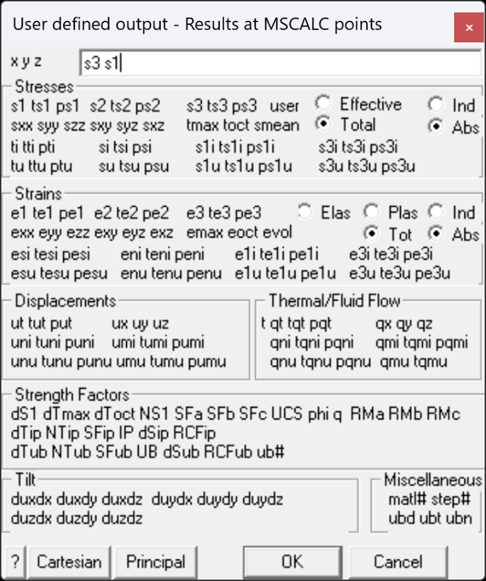

Berechnet Ergebnisse an benutzerdefinierten Punkten – während der Map3D-BEM-Analyse.

Analyseergebnisse können an benutzerdefinierten Koordinatenpositionen berechnet werden.

Wenn Sie MSCALC auswählen, werden Sie nach einem Datendateinamen und dem gewünschten Ausgabeformat gefragt, wie folgt.

#### Datendateiformat:

Die Datendatei ist einfach eine Textdatei (*.txt) mit einer Liste der Koordinatenpositionen, an denen die Ergebnisse berechnet werden sollen.

Das Format dieser Datei erfordert einen Koordinatensatz pro Zeile

x1 y1 z1 x2 y2 z2 x3 y3 z3 x4 y4 z4 ...

wobei x y z die Koordinaten jedes Punkts darstellen.

Falls gewünscht, können Sie x y z dipub ddrub angeben. Darüber hinaus können Sie auch x y z dipub ddrub so phi angeben

Dabei stehen dipub ddrub für Fallwinkel (Dip) bzw. Fallrichtung (Dip Direction) der gewünschten UB-Ebene

- diese werden nur verwendet, wenn Sie bestimmte UB-Komponenten wie su tu berechnen

so und phi stehen für die Kohäsion bzw. den Reibungswinkel

- diese werden nur verwendet, wenn Sie bestimmte UB-Festigkeitsparameter wie sfu rcfu dsu ntu berechnen

#### Ausgabedateiformat:

Die Ergebnisse werden in dieselbe Datendatei zurückgeschrieben, mit den x y z-Koordinaten gefolgt von den vom Benutzer angegebenen Parametern.

#### Spannungen:

s1 ts1 ps1 größte Hauptspannung s1, ihre Streichrichtung und ihr Abtauchen. s2 ts2 ps2 mittlere Hauptspannung s2, ihre Streichrichtung und ihr Abtauchen. s3 ts3 ps3 kleinste Hauptspannung s3, ihre Streichrichtung und ihr Abtauchen. user Benutzerdefinierter Wert. sxx syy szz sxy syz sxz Kartesische Spannungskomponenten. tmax maximale Schubspannung tmax=½ ( s1 - s3 ) toct oktaedrische Schubspannung toct=¹/3 [( s1 - s2 )² + ( s2 - s3 )² +( s3 - s1 )²]1/2 smean mittlere Spannung smean=¹/3 ( s1 + s2 + s3 ) ti tti pti maximale Schubspannung in der Rasterebene, ihre Streichrichtung und ihr Abtauchen. si tsi psi Normalspannung in der Rasterebene, ihre Streichrichtung und ihr Abtauchen. s1i ts1i ps1i maximale Spannung tangential zur Rasterebene, ihre Streichrichtung und ihr Abtauchen. s3i ts3i ps3i minimale Spannung tangential zur Rasterebene, ihre Streichrichtung und ihr Abtauchen. tu ttu ptu maximale Schubspannung in der ubiquitären Ebene, ihre Streichrichtung und ihr Abtauchen. su tsu psu Spannung normal zur ubiquitären Ebene, ihre Streichrichtung und ihr Abtauchen. s1u ts1u ps1u maximale Spannung tangential zur ubiquitären Ebene, ihre Streichrichtung und ihr Abtauchen. s3u ts3u ps3u minimale Spannung tangential zur ubiquitären Ebene, ihre Streichrichtung und ihr Abtauchen. Die Orientierung der ubiquitären Ebene wird festgelegt in

Plot > Strength Factors > Ubiquitous Parameters Effective/Total effektive Spannung oder Gesamtspannungskomponenten. Diese Optionen werden nur in Map3D Thermal-Fluid Flow verwendet, da dieser Code die Berechnung stationärer Porendruckverteilungen ermöglicht. Induced/Absolute Induzierte Spannung ist die Spannung ohne den Beitrag der Primärspannung vor dem Abbau. Sie stellt die Spannungsänderung gegenüber dem Zustand vor dem Abbau dar. Absolute Spannung ist die Spannung einschließlich des Beitrags der Primärspannung vor dem Abbau.

#### Dehnungen:

e1 te1 pe1 größte Hauptdehnung e1, ihre Streichrichtung und ihr Abtauchen. e2 te2 pe2 mittlere Hauptdehnung e2, ihre Streichrichtung und ihr Abtauchen. e3 te3 pe3 kleinste Hauptdehnung e3, ihre Streichrichtung und ihr Abtauchen. exx eyy ezz exy eyz exz Kartesische Dehnungskomponenten. emax maximale Scherdehnung emax=½ ( e1 - e3 ) eoct oktaedrische Scherdehnung eoct=¹/3 [( e1 - e2 )² + ( e2 - e3 )² +( e3 - e1 )²]1/2 evol Volumendehnung evol=( e1 + e2 + e3 ) esi tesi pesi maximale Scherdehnung in der Rasterebene, ihre Streichrichtung und ihr Abtauchen. eni teni peni Normaldehnung in der Rasterebene, ihre Streichrichtung und ihr Abtauchen. e1i te1i pe1i maximale Dehnung tangential zur Rasterebene, ihre Streichrichtung und ihr Abtauchen. e3i te3i pe3i minimale Dehnung tangential zur Rasterebene, ihre Streichrichtung und ihr Abtauchen. esu tesu pesu maximale Scherdehnung in der ubiquitären Ebene, ihre Streichrichtung und ihr Abtauchen. enu tenu penu Dehnung normal zur ubiquitären Ebene, ihre Streichrichtung und ihr Abtauchen. e1u te1u pe1u maximale Dehnung tangential zur ubiquitären Ebene, ihre Streichrichtung und ihr Abtauchen. e3u te3u pe3u minimale Dehnung tangential zur ubiquitären Ebene, ihre Streichrichtung und ihr Abtauchen. Elastic/Plastic/Total elastische, plastische oder Gesamtdehnungskomponenten. Diese Optionen werden nur in Map3D Non-Linear verwendet, da dieser Code die Berechnung nichtlinearer Dehnungen ermöglicht. Induced/Absolute Induzierte Dehnung ist die Dehnung ohne den Beitrag vor dem Abbau. Sie stellt die Dehnungsänderung gegenüber dem Zustand vor dem Abbau dar. Absolute Dehnung ist die Dehnung einschließlich des Beitrags der Dehnung vor dem Abbau.

#### Verschiebungen:

ut tut put Gesamtverschiebung, ihre Streichrichtung und ihr Abtauchen. ux uy uz Kartesische Verschiebungskomponenten. uni tuni puni Verschiebung normal zur Rasterebene, ihre Streichrichtung und ihr Abtauchen. umi tumi pumi maximale Verschiebung tangential zur Rasterebene, ihre Streichrichtung und ihr Abtauchen. unu tunu punu Verschiebung normal zur ubiquitären Ebene, ihre Streichrichtung und ihr Abtauchen. umu tumu pumu maximale Verschiebung tangential zur ubiquitären Ebene, ihre Streichrichtung und ihr Abtauchen.

#### Strömung:

t Temperatur/Standrohrspiegelhöhe (Head).

qt tqt pqt Gesamtströmung, ihre Streichrichtung und ihr Abtauchen. qx qy qz Kartesische Strömungskomponenten.

qni tqni pqni Verschiebung normal zur Rasterebene, ihre Streichrichtung und ihr Abtauchen.

qmi tqmi pqmi maximale Verschiebung tangential zur Rasterebene, ihre Streichrichtung und ihr Abtauchen. qnu tqnu pqnu Verschiebung normal zur ubiquitären Ebene, ihre Streichrichtung und ihr Abtauchen. qmu tqmu pqmu maximale Verschiebung tangential zur ubiquitären Ebene, ihre Streichrichtung und ihr Abtauchen.

#### Festigkeit:

- ds1 Überschuss der größten Hauptspannung Ds1 = s1 - ( _UCS_ + _q_ s3 )

- dtmax Überschuss der maximalen Schubspannung Dtmax = ½(s1 - s3) - [ _UCS_ + ½(s1+s3) ( _q_ -1) ]/( _q_ +1) = [s1 - ( _UCS_ + _q_ s3) ]/( _q_ +1)

- dtoct Überschuss der oktaedrischen Schubspannung Dtoct = toct - [ _UCS_ + ( _q_ –1) smean ] Ö(2) /( _q_ +2)

- NS1 Wahrscheinlichkeit unter Verwendung der Normalverteilung N(Ds1 /std)

- SF-A Festigkeit/Spannung lässt sich bestimmen als ( _UCS_ + _q_ s3 )/ s1

- SF-B Festigkeit/Spannung lässt sich bestimmen als ( _UCS_ + _q_ s3 - s3 )/(s1 - s3)

- SF-C Festigkeit/Spannung lässt sich bestimmen als [ _UCS_ + ½(s1+s3) ( _q_ -1) ]/[ ½(s1 - s3)( _q_ +1) ]

- dTip Überschuss der Schubspannung in der Ebene Dtip = tip - [ Cohesion + sip tan(j) ]

- NTip Wahrscheinlichkeit unter Verwendung der Normalverteilung N(Dtip /std)

- SFip Festigkeit/Spannung lässt sich bestimmen als [ Cohesion + sip tan(j) ] / tip

- dSip Überschuss der Wandspannung in der Ebene Dsip = [ 3 s1i - s3i ] - UCS

- RCFip Gebirgszustandsfaktor (Rock Condition Factor) für die Wandspannung in der Ebene RCFip = [ 3 s1i - s3i ]/UCS

- dTub Überschuss der Schubspannung in der ubiquitären Ebene Dtub

- NTub Wahrscheinlichkeit unter Verwendung der Normalverteilung N(Dtub /std)

- SFub Festigkeit/Spannung lässt sich bestimmen als [ Cohesion + sub tan(j) ] / tub

- dSub Überschuss der Wandspannung in der UB-Ebene Dsub = [ 3 s1ub - s3ub ] - UCS

- RCFub Gebirgszustandsfaktor für die Wandspannung in der UB-Ebene RCFip = [ 3 s1ub - s3ub ]/UCS

- UB# Stellt die Nummer des UB-Satzes (1, 2 oder 3) mit dem größten Wert von Dtub dar

#### Sonstiges:

matl# die Nummer des Materials, in dem der Punkt liegt. Das Wirtsgestein ist Material Nummer 1. Bei Problemen mit mehreren Materialien können Ergebnisse in einer alternativen Materialzone berechnet werden.

step# die Nummer des Abbauschritts.

ubd, ubt, ubn stehen für Fallwinkel, Fallrichtung bzw. Normale der ubiquitären Ebene.

#### Weitere:

Cartesian   konfiguriert die Ausgabe kartesischer Spannungskomponenten. Principal   konfiguriert die Ausgabe von Hauptspannungskomponenten.

#### Hinweise:

Diese Funktion muss vor der Durchführung der Diskretisierungsanalyse aktiviert werden

Analysis > Discretization.

Es kann eine beliebige Anzahl von Punkten angegeben werden.

Das Modell wird entsprechend den Positionen der angegebenen Punkte diskretisiert.
