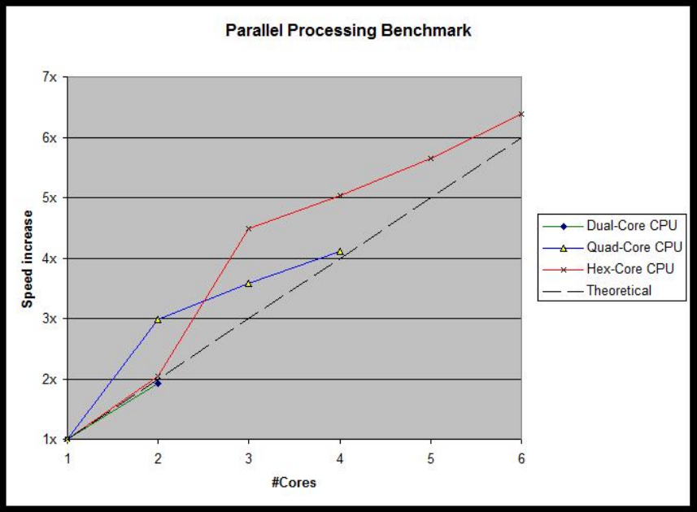

Zeigt die Anzahl der aktiven Kerne/Threads an.

Map3D unterstützt die parallele Verarbeitung und paralleles Festplatten-E/A mit der Multiprozessor-/Multilaufwerk-Option vollständig.

Wenn Sie zur Nutzung der Multiprozessor-/Multilaufwerk-Option lizenziert sind, führt Map3D alle Analyseverfahren parallel verteilt auf alle verfügbaren Prozessoren aus.

**CPU:** Aktuelle CPUs sind inzwischen als Dual-, Quad- und Hexa-Core-Modelle erhältlich. Map3D V58 unterstützt nun die parallele Verarbeitung, die höhere Rechengeschwindigkeiten ermöglicht. Dadurch verkürzen sich die Zeiten für den Matrixaufbau und den Rasteraufbau um mehr als das Sechsfache. Computer mit mehreren CPUs wären noch schneller.

Der folgende Benchmark zur parallelen Verarbeitung zeigt deutlich, dass Sie bei Dual-Core-CPUs mehr als die doppelte Geschwindigkeit,

bei Quad-Core-CPUs mehr als die vierfache Geschwindigkeit und bei Hexa-Core-CPUs mehr als die sechsfache Geschwindigkeit erwarten können. Bei CPUs mit aktiviertem Hyper-Threading werden 2 Rechen-Threads auf demselben Kern überlagert. Deshalb erreicht Map3D-MP tatsächlich eine bessere Leistung als das theoretische Maximum.

Um diese Leistungsgewinne zu erzielen, müssen die Rechenleistung und/oder die Festplatten-E/A-Rate verbessert werden Analysis > Options > Drive #.
