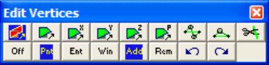

Diese Routine lässt sich entweder durch Auswahl einer beliebigen Bearbeitungsfunktion (z. B. einer Schaltfläche) oder einfach durch Rechtsklick auf einen beliebigen Eckpunkt starten.

Beim Start einer Routine zur Objektbearbeitung werden Sie zunächst aufgefordert, eine Liste der Eckpunkte zu erstellen, die Sie bearbeiten möchten.

   - Wenn Tools > Shift-key Selection aktiviert ist, müssen Sie für Mehrfachauswahlen die Umschalttaste gedrückt halten.

   - Standardmäßig werden ausgewählte Objekte zur Liste hinzugefügt. Wenn Sie jedoch die Strg-Taste gedrückt halten, werden ausgewählte Objekte aus der Liste entfernt.

   - Während Sie die Umschalttaste oder die Strg-Taste gedrückt halten, können Sie ein Auswahlfenster aufziehen.

   - Durch Drücken der Leertaste wird automatisch die zuletzt verwendete Bearbeitungsfunktion aktiviert.

- Wenn Sie beim Rechtsklick die Alt-Taste gedrückt halten, wird die zuletzt verwendete Bearbeitungsfunktion automatisch wiederholt.

Diese Symbolleiste steuert die verschiedenen Funktionen zum Erstellen der Liste.

Bricht die Bearbeitung ab.

Wählt Eckpunkte aus, indem jeweils einer angeklickt wird.

Wählt Eckpunkte gruppenweise aus.

Schließt alle Objekte innerhalb des ausgewählten Fensters ein.

- Objekte werden nur ausgewählt, wenn das gesamte Objekt innerhalb des Fensters liegt.

- Diese Funktion lässt sich auch aktivieren, indem Sie die Umschalttaste oder die Strg-Taste gedrückt halten und ein Kreuzungsfenster aufziehen.

Ausgewählte Objekte werden zur Liste hinzugefügt.

Ausgewählte Objekte werden aus der Liste entfernt.

Macht die letzte Auswahl rückgängig.

Stellt die letzte Auswahl wieder her.

Sobald Sie die gewünschten Objekte ausgewählt haben, können Sie eine der Bearbeitungsschaltflächen wählen:

CAD > Edit > Stretch Vertices

CAD > Edit > Move Vertices to Point

CAD > Edit > Move Vertices to X CAD > Edit > Move Vertices to Y CAD > Edit > Move Vertices to Z CAD > Edit > Move Vertices to Plane CAD > Edit > Smooth Construction Lines CAD > Edit > Remove Construction Vertex CAD > Edit > Subdivide Construction Lines

- Doppelklicken Sie auf einen beliebigen Eckpunkt, um die hervorgehobene Funktion auszuführen,

- klicken Sie mit der rechten Maustaste, um eine Liste mit Optionen anzuzeigen.

Nach Abschluss eines Bearbeitungsvorgangs haben Sie eine Möglichkeit, die Änderungen rückgängig zu machen, indem Sie

#### Undo

auswählen. Sie können auch dieselbe Auswahl wiederherstellen und dieselben Objekte erneut bearbeiten, indem Sie

Redo

auswählen. Die Doppelklickzeit lässt sich einstellen mit

Tools > Double Click Time
