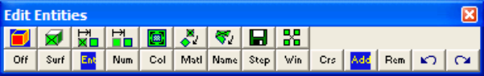
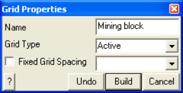

Bearbeitet den Namen und den maximalen Abstand des Rasters.

Beim Start dieser Routine werden Sie zunächst aufgefordert, eine Liste der Objekte zu erstellen, die Sie bearbeiten möchten

- Wenn Tools > Shift-key Selection aktiviert ist, müssen Sie für Mehrfachauswahlen die Umschalttaste gedrückt halten.

- Die Verwendung dieser Symbolleiste ist ausführlich beschrieben unter Build A List of Entities for Editing

- Durch Drücken der Leertaste wird automatisch die zuletzt verwendete Bearbeitungsfunktion aktiviert.

Sobald Sie die gewünschten Objekte ausgewählt haben, können Sie eine der Bearbeitungsschaltflächen wählen:

CAD > Edit > Entity Properties Bearbeitet Blocktyp, Farbe, Abbaufolge, CAD > Edit > Erase Entities Löscht ausgewählte Objekte, CAD > Edit > Move Entities Verschiebt ausgewählte Objekte, CAD > Edit > Copy Entities Kopiert ausgewählte Objekte, CAD > Edit > Scale Entities Skaliert ausgewählte Objekte, CAD > Edit > Rotate Azimuth Dreht den Azimut ausgewählter Objekte, CAD > Edit > Rotate Dip Dreht das Einfallen ausgewählter Objekte, CAD > Edit > Dump to File Schreibt ausgewählte Objekte in eine Datei, CAD > Edit > Group Fasst ausgewählte Objekte zu einem einzelnen Block zusammen,

- Doppelklicken Sie auf einen beliebigen Eckpunkt, um die hervorgehobene Funktion auszuführen,

- klicken Sie mit der rechten Maustaste, um eine Liste mit Optionen anzuzeigen.

Wenn ein Feld im Dialogfeld "Variable" anzeigt, haben einige der ausgewählten Blöcke für dieses Feld unterschiedliche Eigenschaften. Wenn Sie diese Eigenschaften unverändert lassen möchten (d. h. für jeden Block unterschiedlich), belassen Sie das Feld auf "Variable". Wenn Sie den Wert dieses Felds für alle ausgewählten Blöcke ändern möchten, geben Sie den gewünschten Wert ein.

Name - legt einen beschreibenden Namen für das Raster fest.

Grid Type - legt fest, ob das Raster aktiv (in der Spannungsanalyse verwendet) oder inaktiv (in der Spannungsanalyse nicht verwendet) sein soll.

Maximum Spacing - legt den maximal zulässigen Abstand fest.

- Dieser Parameter kann verwendet werden, um eine feine, gleichmäßige Diskretisierung auf ausgewählten Rastern zu erzwingen. Beim Festlegen dieses Werts ist äußerste Vorsicht geboten, da ein kleiner Wert leicht zu einer enormen Problemgröße führen kann.

- Im Allgemeinen sollte dieser Parameter leer bleiben (d. h. nicht verwendet werden), und die Diskretisierung sollte dem Parameter _AG_ überlassen bleiben. Dieser setzt Elemente nur dort dicht, wo Analyseergebnisse angefordert werden, wodurch die Elemente optimal genutzt und die Problemgröße minimiert werden.

CAD > Properties Control Parameters.

- Bleibt dieses Feld leer, wird der Parameter nicht verwendet.

OK - schließt die Bearbeitung der Blöcke ab und übernimmt alle geänderten Eigenschaften.

Cancel - bricht die Bearbeitung der Objekte ab.

Nach Abschluss eines Bearbeitungsvorgangs haben Sie eine Möglichkeit, die Änderungen rückgängig zu machen, indem Sie

Undo

auswählen. Sie können auch dieselbe Auswahl wiederherstellen und dieselben Objekte erneut bearbeiten, indem Sie

Redo

auswählen. Die Doppelklickzeit lässt sich einstellen mit

Tools > Double Click Time
