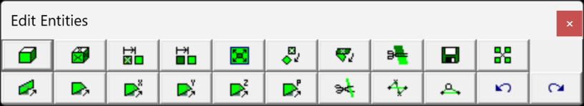

Aktiviert die Symbolleiste Edit.

Diese Symbolleiste bietet schnellen Zugriff auf die Bearbeitungsfunktionen, die in der Phase des Modellaufbaus und der Modellbearbeitung der Map3D-BEM-Analyse verwendet werden Analysis > Go to CAD

Die Bearbeitungsfunktionen sind in zwei Abschnitte gegliedert, je nachdem, ob Sie Blöcke oder Koordinaten ändern möchten.

#### Blöcke ändern:

CAD > Edit > Entity Properties Bearbeitet Blocktyp, Farbe, Abbaufolge usw. CAD > Edit > Erase Entities Löscht ausgewählte Objekte. CAD > Edit > Move Entities Verschiebt ausgewählte Objekte. CAD > Edit > Copy Entities Kopiert ausgewählte Objekte. CAD > Edit > Scale Entities Skaliert ausgewählte Objekte.

CAD > Edit > Rotate Azimuth Dreht den Azimut ausgewählter Objekte.

CAD > Edit > Rotate Dip Dreht das Einfallen ausgewählter Objekte. CAD > Edit > Slice Entities Schneidet ausgewählte Objekte.

CAD > Edit > Dump to File Schreibt ausgewählte Objekte in eine Datei. CAD > Edit > Group Fasst ausgewählte Objekte zu einem einzelnen Block zusammen.

#### Koordinaten ändern:

CAD > Edit > Stretch Vertices Streckt ausgewählte Eckpunkte. CAD > Edit > Move Vertices to Point Verschiebt ausgewählte Eckpunkte zu einem Punkt. CAD > Edit > Move Vertices to X Verschiebt die x-Koordinate ausgewählter Eckpunkte. CAD > Edit > Move Vertices to Y Verschiebt die y-Koordinate ausgewählter Eckpunkte. CAD > Edit > Move Vertices to Z Verschiebt die z-Koordinate ausgewählter Eckpunkte. CAD > Edit > Move Vertices to Plane Verschiebt ausgewählte Eckpunkte auf eine Ebene.

CAD > Edit > Subdivide Construction Lines Unterteilt eine Konstruktionslinie.

CAD > Edit > Smooth Construction Lines Glättet Konstruktionslinien. CAD > Edit > Remove Construction Vertex Entfernt einen Konstruktionseckpunkt.

#### Rückgängig - Wiederherstellen

Nach Abschluss eines Bearbeitungsvorgangs haben Sie eine Möglichkeit, die Änderungen rückgängig zu machen, indem Sie

#### Undo

auswählen. Sie können auch dieselbe Auswahl wiederherstellen und dieselben Objekte erneut bearbeiten, indem Sie

Redo

auswählen.

Durch Drücken der Leertaste wird automatisch die zuletzt verwendete Bearbeitungsfunktion aktiviert.
