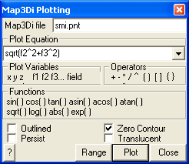

Diese Option ermöglicht die Visualisierung von Map3Di-Daten.

#### Map3Di File:

Die Map3Di-Datendatei ist einfach eine ASCII-Datendatei mit der Standarderweiterung ".PNT".

Einzelheiten zum Datenformat finden Sie unter CAD > Properties > Map3Di.

Einzelheiten zum Datenformat finden Sie unter Visualization > Plane > Make Map3Di File.

#### Plot Equation:

Definiert den Parameter, der dargestellt wird.

Im Dropdown-Fenster lassen sich bis zu 20 verschiedene Gleichungen speichern. Diese bleiben zwischen Map3D-Sitzungen in der Datei map3d.ini gespeichert.

#### Plot Variables:

f1 f2 f3… - Datenfelder in der Ereignisdatei.

#### Functions:

sin() cos() tan() - trigonometrische Funktionen Sinus, Kosinus und Tangens. asin() acos() atan() - Umkehrfunktionen der trigonometrischen Funktionen. sqrt() - Quadratwurzelfunktion. log() - natürliche Logarithmusfunktion. abs() - Absolutwert.

exp() - Exponentialfunktion (Antilogarithmus).

#### Location:

x y z - Koordinate des Rasterpunkts.

#### Operators:

+ - * / ^   Operatoren für Addition, Subtraktion, Multiplikation, Division und Potenzierung. Beachten Sie, dass zuerst Potenzen berechnet werden, dann Multiplikation und Division und zuletzt Addition und Subtraktion.

() [] &#123;&#125;   Klammerarten. Klammerpaare müssen zusammenpassen.

>   Maximalwert. Wird die Darstellungsgleichung zum Beispiel als f1 > 10 angegeben, wird der größere der Werte f1 und 10 dargestellt.

&lt;   Minimalwert. Wird die Darstellungsgleichung zum Beispiel als f1 &lt; 10 angegeben, wird der kleinere der Werte f1 und 10 dargestellt.

#### Point Plotting Options:

Outlined – Die Map3Di-Datenflächen werden umrandet dargestellt.

#### Other:

Persist – Wenn aktiviert, werden die Punkte jedes Mal neu dargestellt, wenn das Modell neu ausgerichtet, verschoben oder gezoomt wird. Da dies bei großen Modellen zeitaufwendig sein kann, ist diese Option nicht immer erwünscht. Translucent - stellt die Punkte als durchscheinende Kugeln dar.

Zero Contour - Wenn deaktiviert, werden Isolinien unterhalb des minimalen Isolinienbereichs nicht gezeichnet. Das ist nützlich, um Isolinien darzustellen, bei denen nur der obere Teil des Bereichs von Bedeutung ist. Range – legt Minimum, Maximum und Intervall für die Radiusskalierung und die Isolinien fest.

Plot - erzeugt die Darstellung neu. Diese Schaltfläche kann entweder in der Symbolleiste View (Tools > View Toolbar Configure) oder in der Symbolleiste Contour (Tools > Contour Toolbar Configure) platziert werden.
