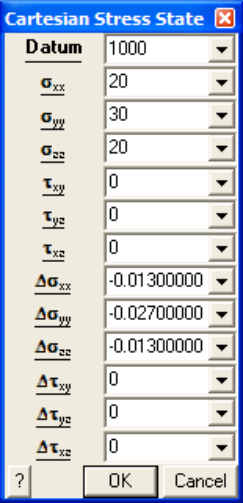

Der Spannungszustand vor dem Abbau wird als lineare Variation mit der Tiefe entweder in kartesischen Komponenten oder in Hauptkomponenten angegeben.

Die Variation jeder kartesischen Komponente wird als lineare Variation mit der Tiefe beschrieben (zum Beispiel für die Komponente sxx)

- sxx + Dsxx ( _z_ - _Datum_ )

Um geeignete Werte für diese Komponenten zu bestimmen, müssen Sie zunächst eine Tiefe wählen

- ( _z_ = _Datum_ )

in der die Spannungen bekannte Werte haben. Diese Werte sind die

sxx  syy  szz  txy  tyz  txz

konstanten Werte.

Die Variation jeder Komponente mit der Tiefe kann dann angegeben werden als

Dsxx  Dsyy  Dszz  Dtxy  Dtyz  Dtxz

Variationswerte. Wenn Sie Ihr Koordinatensystem mit _z_ positiv nach oben eingerichtet haben, müssen die Variationen als negative Größen angegeben werden, damit die Spannungen mit der Tiefe zunehmen.

Wenn Sie zum Beispiel wissen, dass die Komponente sxx bei

_z_ = -1000m den Wert 30 MPa hat

und sich wie folgt verändert ( _z_ ist positiv nach oben)

- 0.027 MPa/m

geben Sie Folgendes an

Datum = -1000 sxx = 30 Dsxx = -0.027
