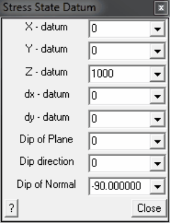

Die Variation jeder Spannungskomponente wird als lineare Variation entweder in Haupt- oder in kartesischen Komponenten beschrieben.

Auf Wunsch lässt sich dies als Variation in x-, y- und z-Richtung angeben, indem ein geneigtes Bezugsniveau definiert wird. Dies ist für Standorte gedacht, an denen die Topografie eine dominante Neigung aufweist.

Um ein geneigtes Bezugsniveau zu definieren, müssen Sie einen Punkt auf der Ebene angeben, die das Bezugsniveau darstellt ( _X-datum_ , _Y-datum_ und _Z-datum_ ),

sowie die Neigung der Ebene. Die Neigung wird als Gradient in X-Richtung ( _dx-datum_ ) und Y-Richtung ( _dydatum_ ) angegeben.

Zur Vereinfachung kann die Neigung der Ebene entweder über das "Dip" (Einfallen) und die "Dip direction" (Einfallsrichtung) der Ebene oder über die "Dip direction" und das "Dip of the Normal" (Einfallen der Normalen) der Ebene angegeben werden. Die Gradienten werden aus diesen Werten automatisch wie folgt bestimmt:

_dx-datum_ = -sin(q) sin(j) _dy-datum_ = -cos(q) sin(j)

daraus folgt

tan(q)= _dx/dy_ tan(j)=sqrt( _dx_ ^2+ _dy_ ^2)

Auf diese Weise definiert, variieren die Spannungen sowohl mit der Tiefe als auch mit der horizontalen Position.
