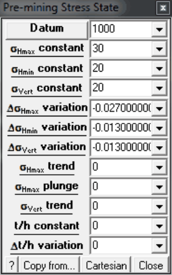
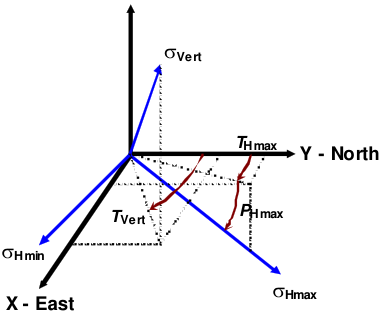

Datum - Der Spannungszustand vor dem Abbau wird als lineare Variation mit der Tiefe entweder in Haupt- oder in kartesischen Komponenten angegeben.

Copy from... - ermöglicht es, den Spannungszustand von einem anderen Material zu kopieren.

- Es wird nur der Spannungszustand kopiert.

- Die übrigen Materialeigenschaften bleiben unverändert.

Cartesian - Der Spannungszustand vor dem Abbau wird als lineare Variation mit der Tiefe entweder in Haupt- oder in kartesischen Komponenten angegeben.

Die drei Hauptspannungskomponenten werden als _Hmax_ -, _Hmin_ - und _Vert_ -Komponente bezeichnet.

- sHmax ist die maximale (nahezu) horizontale Spannung.

- sHmin ist die minimale (nahezu) horizontale Spannung.

- sVert ist die (nahezu) vertikale Spannung.

Diese Spannungskomponenten stehen senkrecht aufeinander.

Die horizontalen und vertikalen Komponenten müssen nicht exakt horizontal oder vertikal sein. Streichrichtung und Abtauchen von sHmax lassen sich mit _THmax_ und _PHmax_ anpassen. Die Streichrichtung von sVert lässt sich mit _TVert_ anpassen.

Die Variation jeder dieser Komponenten wird als lineare Variation mit der Tiefe beschrieben (zum Beispiel für die Komponente sHmax)

sHmax + DsHmax ( _z_ - _Datum_ )

Um geeignete Werte für diese Komponenten zu bestimmen, müssen Sie zunächst eine Tiefe _z_ wählen, in der die Spannungen bekannte Werte haben.

_Datum_ sollte auf diesen Wert _z_ gesetzt werden.

Die Größe der Spannung in dieser Tiefe wird durch die folgenden konstanten Werte angegeben

sHmax sHmin sVert

Die Variation jeder Komponente mit der Tiefe kann dann durch die folgenden Variationswerte angegeben werden

DsHmax DsHmin DsVert

Wenn Sie Ihr Koordinatensystem mit _z_ positiv nach oben eingerichtet haben, müssen die Variationen als negative Größen angegeben werden, damit die Spannungen mit der Tiefe zunehmen.

Wenn Sie zum Beispiel wissen, dass die Komponente _Hmax_ bei

_z_ = 1000m den Wert 30 MPa hat

und sich wie folgt verändert ( _z_ ist positiv nach oben)

0.027 MPa/m

geben Sie Folgendes an

Datum = 1000 sa = 30 Dsa = -0.027

Schließlich definieren die Streichrichtung und das Abtauchen der Komponente _Hmax_ sowie die Streichrichtung der Komponente _Vert_ die Orientierung des Spannungszustands eindeutig.

Die Parameter

_t/h_ constant

D _t/h_ variation

beziehen sich auf die Umgebungstemperatur bzw. die Standrohrspiegelhöhe (Druckhöhe) und werden auf dieselbe Weise angegeben wie die Spannungen.
