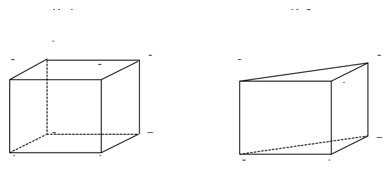
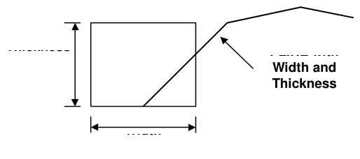
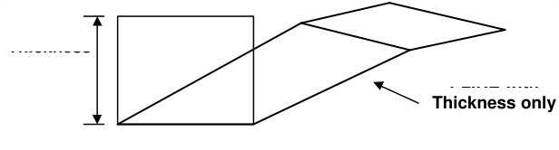
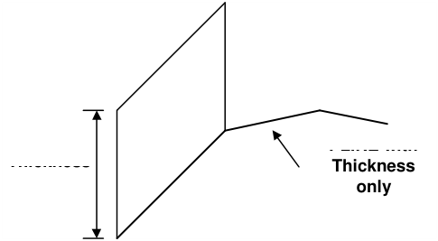
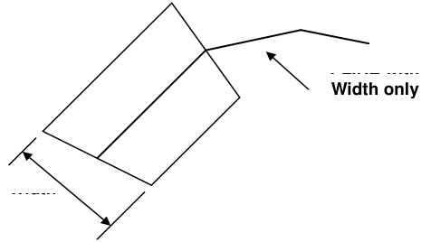
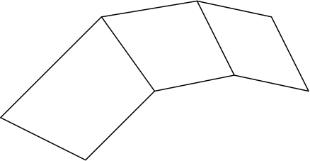
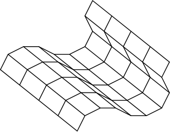

Das DXF-Format ist eine AutoCAD-Zeichnungsaustauschdatei mit der Erweiterung ".DXF".

Dieses Format eignet sich für den Austausch von Modelldaten mit anderer CAD-Software.

#### Dreidimensionale AutoCAD-Objekte vom Blocktyp

Die zuverlässigste Methode zur Erzeugung von Map3D-kompatiblen Daten ist die Verwendung dreidimensionaler AutoCAD-Objekte. Dieser Objekttyp erzeugt Blöcke, die identisch zu den 3D-FF-Blöcken von Map3D aufgebaut sind und daher direkt an Map3D übergeben werden können. Bei Verwendung dieses Befehls ist der Schluss aller Oberflächen garantiert, da jedes dreidimensionale Objekt einen geschlossenen Block definiert. Es gibt viele Möglichkeiten, solche Objekte in AutoCAD zu erzeugen, wie unten beschrieben.

#### 3DMESH

Die empfohlene Methode zur Definition dreidimensionaler AutoCAD-Objekte ist der Befehl 3DMESH, wobei AutoCAD THICKNESS und WIDTH auf null gesetzt werden. Diese 3DMESH-Objekte lassen sich mit beliebigen Werten für M und N angeben. Wird N auf 3 oder 4 gesetzt, werden diese Objekte als Blöcke in Map3D importiert. Dieser Ansatz ist der allgemeinste, aber auch der aufwendigste, da sowohl die Sohle als auch die Firste des Streckenvortriebs über seine Länge definiert werden müssen.

#### PLINE, POLYLINE oder ELLIPSE mit WIDTH und THICKNESS

Die einfachste Technik zur Erzeugung eines Streckenvortriebs oder Abbaus mit regelmäßigem rechteckigem Querschnitt und gleichmäßiger Höhe ist der AutoCAD-Befehl PLINE. Dazu definieren Sie zunächst ein AutoCAD-UCS (Benutzerkoordinatensystem) für den Streckenvortrieb und anschließend mit dem AutoCAD-Befehl PLINE die Mittellinie auf Sohlenhöhe des Streckenvortriebs. Die Breite des Streckenvortriebs wird dann mit dem AutoCAD-Befehl PEDIT festgelegt. Dabei kann entweder eine konstante Breite oder eine an jedem Eckpunkt wechselnde Breite angegeben werden. Die AutoCAD-Farbe COLOUR (Map3D-Blocknummer) und die AutoCAD-Höhe THICKNESS (Höhe des Streckenvortriebs) werden mit dem AutoCAD-Befehl CHANGE PROPERTIES festgelegt. Auch mit den AutoCAD-Befehlen POLYLINE und ELLIPSE lassen sich Streckenvortriebe mit angegebener AutoCAD-WIDTH und THICKNESS erzeugen.

#### PLINE, POLYLINE oder SOLID nur mit THICKNESS

Eine weitere einfache Methode zur Definition von Streckenvortrieben oder Abbauen mit rechteckigem Querschnitt ist die Verwendung der AutoCAD-Befehle PLINE, POLYLINE oder SOLID mit angegebener AutoCAD-THICKNESS (Höhe des Streckenvortriebs) und AutoCAD-WIDTH gleich null (siehe Figure 32). Obwohl dieser Ansatz allgemeiner ist als PLINE, ist er auch aufwendiger, da der Grundriss des Streckenvortriebs über seine Länge definiert werden muss. Bei Verwendung der AutoCAD-Befehle PLINE oder POLYLINE muss eine geschlossene Schleife mit 3 oder 4 Liniensegmenten gebildet werden.

#### Weitere dreidimensionale AutoCAD-Objekte

AutoCAD stellt Routinen zur Erzeugung mehrerer dreidimensionaler Körper bereit, darunter Kugeln, Tori, Quader, Kegel usw. Diese lassen sich bei Bedarf alle verwenden. Der Benutzer ist dafür verantwortlich, die offenen Enden von Formen wie Halbkugeln und Kegeln zu schließen.

#### Zweidimensionale AutoCAD-Objekte vom Plattentyp

Map3D-kompatible Daten lassen sich auch über zweidimensionale AutoCAD-Objekte angeben. Diese Technik ist weniger zuverlässig als die oben beschriebenen Methoden, da der Schluss aller Oberflächen nicht mehr garantiert ist. Der Benutzer muss Hohlräume durch eine Reihe von Oberflächenplatten (alle mit derselben AutoCAD-Farbnummer) definieren, die an ihren Kanten aneinander anschließen und den Hohlraum vollständig mit einer durchgehenden Oberflächenhaut umhüllen müssen. Diese Oberflächen sind identisch zu den Oberflächenplatten von Map3D aufgebaut. Bei dieser Methode ist der Schluss aller Oberflächen nicht garantiert, da der Benutzer eine Oberflächenfläche auslassen und damit ein Loch in der Hohlraumoberfläche erzeugen kann. Der Benutzer muss darauf achten, alle Platten so zu platzieren, dass sich alle Oberflächen vollkommen schließen.

#### LINE, PLINE, 3DPOLY, POLYLINE und ELLIPSE - nur THICKNESS

Diese Objekte können zur Definition zweidimensionaler Platten verwendet werden. Dazu definieren Sie zunächst ein AutoCAD-UCS (Benutzerkoordinatensystem) für die Platte und anschließend mit einem der AutoCAD-Befehle LINE, PLINE, 3DPOLY, POLYLINE oder ELLIPSE den Rand der Platte. Die AutoCAD-Farbe COLOUR (Map3D-Blocknummer) und die AutoCAD-Höhe THICKNESS (Plattenbreite) werden mit dem AutoCAD-Befehl CHANGE PROPERTIES festgelegt. Die AutoCAD-WIDTH muss auf null gesetzt werden.

#### LINE, PLINE, 3DPOLY, POLYLINE und ELLIPSE nur mit WIDTH

Mit diesen Objekten definieren Sie die Mittellinie der Platte mit einem der AutoCAD-Befehle LINE, PLINE, 3DPOLY, POLYLINE oder ELLIPSE. Die Breite wird dann mit dem AutoCAD-Befehl PEDIT festgelegt. Dabei kann entweder eine konstante Breite oder eine an jedem Eckpunkt wechselnde Breite angegeben werden. Die AutoCAD-THICKNESS muss auf null gesetzt werden.

#### 3DFACE, POLYLINE oder LWPOLYLINE

Zweidimensionale Oberflächen lassen sich auch mit dem AutoCAD-Befehl 3DFACE erzeugen. Diese Methode ist allgemeiner, aber auch aufwendiger, da alle Ecken der AutoCAD-3DFACE angegeben werden müssen.

#### 3DMESH

Komplexe zweidimensionale Oberflächen lassen sich mit 3DMESH-Typen mit N größer als 4 erzeugen (z. B. Rulesurf, Tabsurf, Revsurf usw.). Für diese Formen erstellt die DXF-Konvertierungsroutine eine Reihe von 3DFACEs, um die Hohlraumoberfläche zu beschreiben. Diese Oberflächen sind identisch zu den Oberflächenplatten von Map3D aufgebaut. Der Schluss der Oberfläche lässt sich in diesen Fällen aufgrund der regelmäßigen Konstruktion recht einfach sicherstellen.

#### Nicht unterstützte AutoCAD-Objekte

Es gibt eine Reihe nicht unterstützter AutoCAD-Objekte, das heißt, Map3D wurde nicht dafür ausgelegt, diese so zu rekonstruieren, wie sie in AutoCAD erscheinen. Dazu gehören die Objekte CIRCLE, ARC und DOUGHNUT. Diese Objekte werden möglicherweise in künftigen Map3D-Updates unterstützt. Beachten Sie, dass sich die meisten Formen auch anders erzeugen lassen, nämlich mit dem AutoCAD-Befehl ELLIPSE oder dem Befehl 3DMESH.

#### AutoCAD DXF EXTENDED ENTITY DATA

DXF EXTENDED ENTITY DATA (EED) ist Teil der DXF-Spezifikation. Mit EED können Sie jedes DXF-ENTITY mit benutzerdefinierten Datenattributen versehen. Nachfolgend finden Sie eine Liste der von Map3D unterstützten EEDs.

Die meisten CAD-Systeme erlauben es, diese EEDs zu Ihrer DXF-Datei hinzuzufügen. Deswik bezeichnet sie beispielsweise als "Attribute". In Deswik können Sie daher nun Map3D-Geometrien erzeugen, einschließlich der Angabe von Map3D-Blocknamen, -Farben und -Abbaufolge:

- Exportieren Sie jeden Block mit DXF-POLYLINE/POLYFACEMESH - dies ist die Standardeinstellung von Deswik.

- Es wird empfohlen, DXF-3DFACE nicht zu verwenden.

- In Deswik werden Attribute als AutoCAD Extended Entity Data in die DXF-Datei exportiert.

- Die Attributnamen (Groß- und Kleinschreibung spielt bei Attributnamen keine Rolle) sind wie folgt definiert: `o` MAP3D_BLOCKNAME - Name des Blocks (Standard ist leer).

   - MAP3D_BLOCKCOLOR oder MAP3D_BLOCKCOLOUR - Map3D-Farbnummer (Standard ist die in Deswik definierte Farbnummer).

   - MAP3D_BLOCKTYPE - 1 für FF, 2 für DD, 98 für inaktive FF, 99 für inaktive DD, 0 für Rasterebene (Standard ist 1 für FF).

   - MAP3D_MSTEP# - # ist die Nummer des Abbauschritts (Standard ist Abbau in Schritt 1).

   - Ø Um zum Beispiel in Abbauschritt 2 abzubauen, erstellen Sie ein Attribut namens MAP3D_MSTEP2 und geben Sie 0 (Abbau) als Attributwert an.

   - Ø Um zum Beispiel in Abbauschritt 3 zu versetzen, erstellen Sie ein Attribut namens MAP3D_MSTEP3 und geben Sie 4 an (wobei die Materialnummer für den Versatz steht) als Attributwert.

   - MAP3D_BLOCKNUMBER - eindeutige Blockkennnummer (Standard ist eine andere eindeutige Nummer für jede DXF-POLYLINE/POLYFACEMESH bzw. jede DXF-3DFACE).

- Bei Attributnamen wird nicht zwischen Groß- und Kleinschreibung unterschieden.

- Alle Attribute können als Zeichenfolgen (Gruppencode 1000), Ganzzahlen (Gruppencode 1070 oder 1071) oder reelle Zahlen (Gruppencode 1040) definiert werden.

- Alle Attribute sind optional - Standardwerte werden wie oben angegeben bereitgestellt.

- Beachten Sie: Wenn keine von Map3D definierten Attribute angegeben sind, wird die DXF-Datei erfolgreich eingelesen, sofern Sie DXF-POLYLINE/POLYFACEMESH verwenden.

- Map3D geht dann einfach davon aus, dass jede DXF-POLYLINE/POLYFACEMESH ein separater Block ist.

- Wenn Sie mehrere DXF-3DFACEs verwenden, kann es für Map3D schwierig sein, diese zu Blöcken zu gruppieren.

- Probleme treten dabei nur auf, wenn benachbarte Blöcke ihre Ecken gemeinsam haben und denselben Namen tragen.

- MAP3D_BLOCKNUMBER kann verwendet werden, um die DXF-3DFACEs zu identifizieren, die zu separaten Blöcken gehören.
