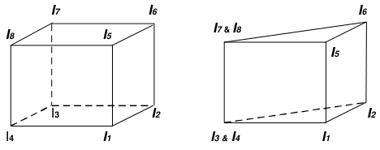
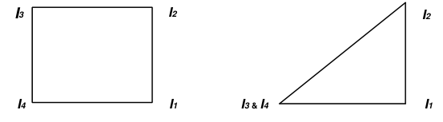
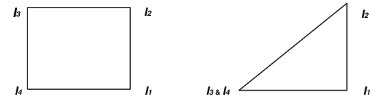
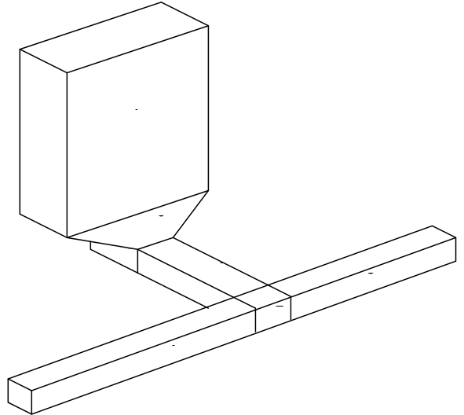
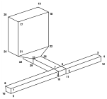
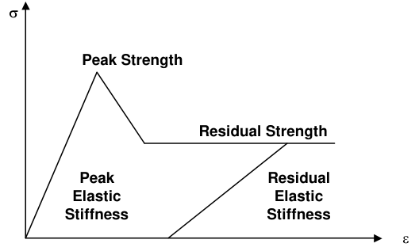

Das INP-Format ist eine bearbeitbare ASCII-Datendatei mit der Erweiterung ".INP".

Dies ist das empfohlene Map3D-Modellformat. Mit diesem Format werden alle Funktionen von Map3D unterstützt.

Die Datei ist in 7 Abschnitte gegliedert:

1. Job Title

2. Control Parameters

3. Block Specification

4. Coordinate Specification

5. Material Property Specification

6. Grid Specification

7. Mining Step Specification

Kommentarzeilen müssen in Spalte 1 mit einem Sternchen "*" beginnen.

Leerzeilen werden übersprungen.

Die maximale Zeilenlänge beträgt 256 Zeichen.

Datenfelder können durch Kommas oder Leerzeichen getrennt werden.

#### 1. Job Title

In diesem Abschnitt kann der Benutzer einen beschreibenden Projekttitel angeben: Es muss 1 Datenzeile angegeben werden. Anführungszeichen sind nicht erforderlich. Es werden nur die ersten 70 Zeichen verwendet.

#### 2. Control Parameters

In diesem Abschnitt kann der Benutzer die Steuerparameter für die Berechnung angeben.

#### _NLD,NIT,NPS RPAR,STOL AL,AG DOL,DON DOC,DOE,DOG,DOR_

Es muss 1 Datenzeile angegeben werden. Alle Parameter müssen in einer Zeile stehen.

Nur die ersten 7 Parameter ( **_NLD,NIT,NPS  RPAR,STOL  AL,AG_** ) müssen angegeben werden. Den übrigen Parametern werden Standardwerte zugewiesen, die für Ihre Anwendung geeignet sein können oder auch nicht.

Eine ausführliche Beschreibung der Parameter finden Sie unter CAD > Properties > Control Parameters

**_NPS_** Dieser Eintrag gibt die Anzahl der Symmetrieebenen an, die in der Analyse verwendet werden. Normalerweise werden keine Symmetrieebenen verwendet. Wird Symmetrie verwendet, müssen die Fernfeldspannungen (Stress State) an der Symmetrieachse ausgerichtet sein.

**_NPS_** =0   keine Symmetrie **_NPS_** =1 _x_ &lt;=> _-x_ , die Geometrie wird an der Ebene _y-z_ gespiegelt **_NPS_** =2 _x_ &lt;=> _-x_ und _y_ &lt;=> _-y_ , die Geometrie wird an den Ebenen _y-z_ und _x-z_ gespiegelt **_NPS_** =3 _x_ &lt;=> _-x, y_ &lt;=> _-y_ und _z_ &lt;=> _-z_ , die Geometrie wird an den Ebenen _y-z_ , _x-z_ und _x-y_ gespiegelt

**_RPAR_** Während des Matrixlösungsprozesses wird der Relaxationsparameter vom Programm fortlaufend angepasst, um mit möglichst wenigen Iterationen Konvergenz zu erreichen. Dieser Parameter begrenzt den maximal verwendeten Wert. Für gut konditionierte Probleme wird der vorgeschlagene Wert 1.2 empfohlen. Für sehr schlecht konditionierte Probleme sollte ein Wert von 0.8 verwendet werden.

#### 3. Block Specification

In diesem Abschnitt kann der Benutzer die Modellgeometrie definieren. Hier werden 3D-FF-Blöcke und DD-Ebenen aufgebaut.

**_N  'Block_Name' I_ 1** **_,I_ 2** **_,I_ 3** **_,I_ 4** **_I_ 5** **_,I_ 6** **_,I_ 7** **_,I_ 8** **_Type  Thickness,Width_**

Pro Block muss 1 Datenzeile angegeben werden.

Alle Parameter müssen in einer Zeile stehen. Nur die ersten 5 Parameter ( **_N I_ 1** **_,I_ 2** **_,I_ 3** **_,I_ 4** ) müssen angegeben werden. Mit **_N_** =0 wird die Liste der Blöcke beendet. Eine ausführliche Beschreibung der Parameter finden Sie unter

CAD > Build > Block

CAD > Build > FF Loop

#### CAD > Build > DD Loop

- **_N_** legt die Blockfarbnummer fest. Sie dient dazu, diesen Block beim Festlegen von Materialcodes zu identifizieren, und bestimmt außerdem die Farbe des Blocks in der grafischen Darstellung. Für logische Gruppierungen von Blöcken (z. B. für verschiedene Sohlen, Schnitte oder logische Abbaueinheiten wie Vortrieb, Abbau usw.) sollten unterschiedliche Farbnummern verwendet werden. Möglichst viele Blöcke sollten dieselbe Blockkennnummer verwenden.

Für die Anzeige stehen insgesamt 10 Farben zur Verfügung. Sie sind nummeriert mit

1 bis 10, 11 bis 20, 21 bis 30 usw.,

sodass für die Nummern

1, 11, 21...,

- 2, 22, 32...,

3, 23, 33... usw.

dieselbe Farbe angezeigt wird.

- **_'Block_Name'_** legt einen beschreibenden Namen für den Block fest (z. B. 4540 stope). Das Programm verwendet diesen Namen, wenn es Informationen zum Blockvolumen, zu Fehlern und zu Warnungen ausgibt. Der Blockname ist optional, muss aber, falls verwendet, in einfachen Anführungszeichen stehen. Es werden nur die ersten 20 Zeichen eines Blocknamens verwendet.

- **_I_ 1** **_,I_ 2** **_,I_ 3** **_,I_ 4** **_I_ 5** **_,I_ 6** **_,I_ 7** **_,I_ 8** stehen für die Nummern der Koordinatenpunkte, die die Blockecken bilden. Diese werden unten ausführlich beschrieben.

- **_Type_** legt fest, welcher Typ von Randelement verwendet wird. Inaktive Elemente (98 für inaktive FF und 99 für inaktive DD) können verwendet werden, um Objekte anzuzeigen, die nur zu Visualisierungszwecken enthalten sind und nicht für die eigentliche Spannungsanalyse verwendet werden sollen.

- Für dreidimensionale Merkmale wie Hohlräume, Zonen mit abweichendem Material, versetzte Abbaue usw. sollten Elemente vom Typ **_Type_** =1 (Fictitious Force) verwendet werden.

- Die ersten 4 Ecken ( **_I_ 1** **_,I_ 2** **_,I_ 3** **_,I_ 4** ) stehen für Koordinatennummern, die eine Seite (z. B. die Basis) eines 6-seitigen Blocks definieren. Die nächsten 4 Ecken ( **_I_ 5** **_,I_ 6** **_,I_ 7** **_,I_ 8** ) definieren die gegenüberliegende Seite des Blocks (z. B. die Oberseite). Die Ecken können im oder gegen den Uhrzeigersinn eingegeben werden. Jede der Ecken kann wiederholt werden, um dreiseitige Formen und Keile zu definieren. Blöcke lassen sich zu größeren, komplexeren Hohlraumformen verbinden, indem für benachbarte Blöcke gemeinsame Koordinatennummern verwendet werden.

- Auf Wunsch lassen sich Oberflächen aus 3- oder 4-seitigen Flächen aufbauen, indem nur die ersten 4 Ecken ( **_I1,I2,I3,I4_** ) verwendet werden. Die nächsten 4 Ecken ( **_I5,I6,I7,I8_** ) sollten als Nullen angegeben werden. Die Ecken können im oder gegen den Uhrzeigersinn eingegeben werden. Jede der Ecken kann wiederholt werden, um dreiseitige Formen und Keile zu definieren.

- Diese Oberflächen lassen sich zu größeren, komplexeren Hohlraumformen verbinden, indem für benachbarte Platten gemeinsame Koordinatennummern verwendet werden. Der Benutzer muss darauf achten, vollständig geschlossene Oberflächen ohne Löcher oder fehlende Platten aufzubauen.

- Für tabulare Abbauhohlräume, Brüche und Störungsflächen sollten Elemente vom Typ **_Type_** =2 (Displacement Discontinuity) verwendet werden.

- Oberflächen werden aus 3- oder 4-seitigen Flächen aufgebaut, indem nur die ersten 4 Ecken ( **_I_ 1** **_,I_ 2** **_,I_ 3** **_,I_ 4** ) verwendet werden. Die nächsten 4 Ecken ( **_I_ 5** **_,I_ 6** **_,I_ 7** **_,I_ 8** ) sollten als Nullen angegeben werden. Die Ecken können im oder gegen den Uhrzeigersinn eingegeben werden. Jede der Ecken kann wiederholt werden, um dreiseitige Formen und Keile zu definieren.

- Diese Oberflächen lassen sich zu größeren, komplexeren Formen verbinden, indem für benachbarte Oberflächen gemeinsame Koordinatennummern verwendet werden.

- **_Thickness_** Dieser Parameter wird nur für Elemente vom Typ 2 (Displacement Discontinuity) verwendet. Er legt die scheinbare Dicke des Füllmaterials fest (d. h. Störungsletten, Flözmächtigkeit, Abbaumächtigkeit oder Pfeilerhöhe). Die Normalverschiebung (Konvergenz) dieses verfüllten Merkmals wird auf diese Dicke begrenzt. Außerdem werden die Normalverschiebung (Konvergenz) und die Scherverschiebung (Versatz) durch die _Thickness_ geteilt, um die im Füllmaterial auftretende Dehnung zu bestimmen. Dieser Parameter sollte in denselben Einheiten angegeben werden, die für die Koordinatenpositionen verwendet werden (d. h. Meter oder Fuß).

- **_Width_** legt die maximal zulässige Breite fest.

- Dieser Parameter kann verwendet werden, um eine gleichmäßige Diskretisierung auf ausgewählten Objekten zu erzwingen. Beim Festlegen dieses Werts ist äußerste Vorsicht geboten, da ein kleiner Wert leicht zu einer enormen Problemgröße führen kann.

- Im Allgemeinen sollte dieser Parameter leer bleiben (d. h. nicht verwendet werden), und die Diskretisierung sollte den Parametern **_AL_** und **_AG_** überlassen bleiben. Diese setzen Elemente nur dort dicht, wo Analyseergebnisse angefordert werden, wodurch die Elemente optimal genutzt und die Problemgröße minimiert werden.

- Ein Beispiel für die Verwendung dieses Parameters finden Sie unter Tabular Mining Example.

#### Ein einfaches Beispiel

Um den Modellaufbau mit dreidimensionalen Bausteinen zu veranschaulichen, betrachten wir die Konstruktion einer einfachen Aufgabestelle (Drawpoint). Dieses Modell besteht aus 7 Blöcken. Die Blöcke 1, 2 und 3 bilden die Abzugsstrecke, Block 4 bildet den Querschlag, die Blöcke 5 und 6 stellen die Aufgabestelle dar, und Block 7 stellt den Abbau dar. Map3D erkennt die Oberflächen, die benachbarten Blöcken gemeinsam sind, und löscht sie.

Viele Blöcke können dieselbe Blocknummer (Farbe) haben, sodass sich mit einer Gruppe von Blöcken komplexe Hohlraumformen aufbauen lassen. Dabei ist zu beachten, dass möglichst wenige Blocknummern verwendet werden sollten, da alle Oberflächen zwischen Blöcken mit unterschiedlichen Blocknummern in der Datenbank erhalten bleiben.

Die Koordinatennummern für dieselbe Aufgabestelle werden benötigt, wenn das Modell mit der Map3D-Eingabedateispezifikation aufgebaut werden soll. Die Blöcke würden wie folgt nummeriert:

- Block Specification

- N 'Block Name' I1,I2,I3,I4 I5,I6,I7,I8 Type,Thic,Width

- 1 'Block 1' 1 2 7 8 9 10 15 16 1 0 0

- 1 'Block 2' 2 3 6 7 10 11 14 15 1 0 0

- 1 'Block 3' 3 4 5 6 11 12 13 14 1 0 0

- 1 'Block 4' 7 6 26 25 15 14 30 29 1 0 0

- 2 'Block 5' 25 26 27 28 29 30 31 32 1 0 0

- 2 'Block 6' 21 22 23 24 25 26 27 28 1 0 0

- 2 'Block 7' 17 18 19 20 21 22 23 24 1 0 0

0

#### 4. Coordinate Specification

In diesem Abschnitt kann der Benutzer die Koordinatenpositionen angeben, die zur Definition der Ecken von Blöcken, DD-Ebenen und Rasterebenen verwendet werden.

#### _M X,Y,Z_

Pro Koordinatenpunkt muss 1 Datenzeile angegeben werden. Alle Parameter müssen in einer Zeile stehen. Alle 4 Parameter ( **_M X,Y,Z_** ) müssen angegeben werden. Mit N=0 wird die Liste der Koordinaten beendet.

**_M_** Dieser Parameter ist die Koordinatennummer. Koordinaten können in beliebiger Reihenfolge eingegeben werden.

- **_X,Y,Z_** Diese Parameter stehen für die Koordinatenposition. Es wird empfohlen, **_X_** für Ost, **_Y_** für Nord und **_Z_** für die Höhe (positiv nach oben) zu verwenden. Die Werte sollten in Längeneinheiten (Meter oder Fuß) angegeben werden.

#### 5. Material Property Specification

In diesem Abschnitt kann der Benutzer die Eigenschaften jedes im Modell verwendeten Materials angeben. Die Eigenschaften jedes Materials werden in Gruppen von drei Zeilen definiert, die jeweils den Spannungszustand, die konstitutiven Parameter und die Festigkeitsparameter angeben.

**_M_ sa, sb, sc   Dsa, Dsb, Dsc** **_Ta,Pa,Tc   Datum   t/h_ ,D** **_t/h Mt   E_ p** **_,E_ r** **_v_ p** **_,v_ r** **_G_ n** **_,G_ s** **_A,C   'Material Name'_**

#### _Mf T_ o p , _T_ o r _UCS_ p , _UCS_ r _Cohesion_ p , _Cohesion_ r fp , fr fi

Eine ausführliche Beschreibung der Parameter finden Sie unter CAD > Properties > Material Properties

- Pro Material müssen 3 Datenzeilen angegeben werden, mit _N=0_ wird die Liste beendet.

#### Material Property Specification - Zeile 1 - Spannungszustand

Diese Datenzeile legt den Anfangsspannungszustand für die Materialnummer **_N_** fest. Die Materialnummer 1 ist für das Wirtsgebirge reserviert.

**_M_ sa, sb, sc   Dsa, Dsb, Dsc** **_Ta,Pa,Tc   Datum   t/h_ ,D** **_t/h_**

Pro Material muss 1 Zeile mit numerischen Daten angegeben werden. Alle Parameter müssen in einer Zeile stehen. Nur die ersten 4 Parameter ( **_M_ sa, sb, sc** ) müssen angegeben werden. Eine ausführliche Beschreibung der Parameter finden Sie unter Stress State

#### Material Property Specification - Zeile 2 - Konstitutive Eigenschaften

Konstitutive Eigenschaften lassen sich auf fünf verschiedene Arten angeben,

**_Mt_ =1** **_E_ p** **_,E_ r** **_v_ p** **_,v_ r** **_G_ n** **_,G_ s** **_0,0   A,C   'Material Name'_**

- wobei **_E_ p** **_,E_ r** **_v_ p** **_,v_ r** jeweils den Spitzen- und den Restwert für den Elastizitätsmodul (Gebirgsmaßstab - Verformung) und die Poissonzahl darstellen

#### _E_ = 9 _BS_ /(3 _B_ + _S_ )

#### _v_ = (3 _B_ -2 _S_ )/(6 _B_ +2 _S_ )

**_G_ n** **_,G_ s** stehen jeweils für den viskosen Normal- und den viskosen Schubmodul,

- **_A,C_** stehen jeweils für den Ausdehnungskoeffizienten und die Leitfähigkeit (nur in Map3D Thermal-Fluid Flow verwendet).

Weitere Einzelheiten finden Sie unter

**Mohr-Coulomb in 3D FF Blocks**

**Mohr-Coulomb in DD Planes**

- **_Mt_ =2** **_B_ p** **_,B_ r** **_S_ p** **_,S_ r** **_G_ n** **_,G_ s** **_0,0   A,C   'Material Name'_**

   - wobei **_B_ p** **_,B_ r** **_S_ p** **_,S_ r** jeweils den Spitzen- und den Restwert für den Kompressions- und den Schubmodul darstellen,

**_B_ =** **_E_ (1-2** **_v_ )/3**

**_S_ =** **_E_ / [ 2(1+** **_v_ ) ]**

**_G_ n** **_,G_ s** stehen jeweils für den viskosen Normal- und den viskosen Schubmodul,

   - **_A,C_** stehen jeweils für den Ausdehnungskoeffizienten und die Leitfähigkeit (nur in Map3D Thermal-Fluid Flow verwendet).

- **_Mt_ =3** **_Kn_ p** **_,Kn_ r** **_Ks_ p** **_,Ks_ r** **_G_ n** **_,G_ s** **_0,0   A,C   'Material Name'_**

   - wobei **_Kn_ p** **_,Kn_ r** **_Ks_ p** **_,Ks_ r** jeweils den Spitzen- und den Restwert für die Normal- und die Schubsteifigkeit darstellen,

#### _K_ n = _N/Thickness K_ s = _S/Thickness_

**_G_ n** **_,G_ s** stehen jeweils für den viskosen Normal- und den viskosen Schubmodul,

- **_A,C_** stehen jeweils für den Ausdehnungskoeffizienten und die Leitfähigkeit (nur in Map3D Thermal-Fluid Flow verwendet).

Dieser Materialtyp kann nur in DD-Ebenen verwendet werden.

**_Mt_ =4** **_N_ p** **_,N_ r** **_S_ p** **_,S_ r** **_G_ n** **_,G_ s** **_B,Et   A,C   'Material Name'_**

- wobei **_N_ p** **_,N_ r** **_S_ p** **_,S_ r** jeweils den Spitzen- und den Restwert für den Normal- und den Schubmodul darstellen,

- **_G_ n** **_,G_ s** stehen jeweils für den viskosen Normal- und den viskosen Schubmodul,

- **_A,C_** stehen jeweils für den Ausdehnungskoeffizienten und die Leitfähigkeit (nur in Map3D Thermal-Fluid Flow verwendet).

Dieser Materialtyp kann nur in DD-Ebenen verwendet werden.

Weitere Einzelheiten finden Sie unter **Fault-Gouge in DD planes**

**_Mt_ =5** **_N_ p** **_,N_ r** **_S_ p** **_,S_ r** **_G_ n** **_,G_ s** **_B,Et   A,C   'Material Name'_**

- wobei **_N_ p** **_,N_ r** **_S_ p** **_,S_ r** jeweils den Spitzen- und den Restwert für den Normal- und den Schubmodul darstellen,

- **_G_ n** **_,G_ s** stehen jeweils für den viskosen Normal- und den viskosen Schubmodul,

- **_B,Et_** stehen jeweils für die Kompressionsgrenze und die Übergangsdehnung,

- **_A,C_** stehen jeweils für den Ausdehnungskoeffizienten und die Leitfähigkeit (nur in Map3D Thermal-Fluid Flow verwendet).

Dieser Materialtyp kann nur in DD-Ebenen verwendet werden. Weitere Einzelheiten finden Sie unter **Backfill-Hyperbolic in DD planes**

Für das Wirtsgebirge und für inhomogene Zonen, die von FF-Elementen eingeschlossen sind, muss der Wert für **_Mt_** 1 oder 2 sein. Für Füllmaterial in DD-Elementen kann jeder Wert von **_Mt_** verwendet werden.

Bei der elastischen Analyse wird nur der Spitzenwert verwendet. Bei der nichtlinearen Analyse (Störungsgleiten oder Fließen des Materials in Map3D Non-Linear) wird der Restwert erst verwendet, nachdem das Material fließt.

#### Material Property Specification - Zeile 3 - Festigkeitsparameter

Pro Material muss 1 Zeile mit numerischen Daten angegeben werden.

Alle Parameter müssen in einer Zeile stehen.

Alle Parameter müssen angegeben werden, wenn **_Mf_** ungleich null ist. Festigkeitsparameter lassen sich auf vier verschiedene Arten angeben:

#### _Mf_ =0

Es wird kein Bruchkriterium verwendet.

**_Mf_ =1** **_To_ p** **_,To_ r** **_UCS_ p** **_,UCS_ r** **_Cohesion_ p** **_,Cohesion_ r wp** **_,_ wr wi**

Diese Parameter sind ausführlich definiert unter

**Mohr-Coulomb in 3D FF Blocks**

**Mohr-Coulomb in DD Planes**

**_Mf_ =2** **_To_ p** **_,To_ r sc p** **_,_ sc r** **_m_ p** **_,m_ r** **_s_ p** **_,s_ r** Diese Parameter sind ausführlich definiert unter

**Hoek-Brown in 3D FF Blocks**

#### _Mf_ =3 _To_ p _,To_ r _UCS_ p _,UCS_ r _Cohesion_ p _,Cohesion_ r wp _,_ wr

Diese Parameter sind ausführlich definiert unter

**Drucker-Prager in 3D FF Blocks**

#### 6. Grid Specification

In diesem Abschnitt kann der Benutzer die Lage der Rasterebenen definieren, auf denen Analyseergebnisse berechnet werden.

**_N  'Gird_Name' I_ 1** **_,I_ 2** **_,I_ 3** **_,I_ 4** **_I_ 5** **_,I_ 6** **_,I_ 7** **_,I_ 8** 0,0,0,0

**_N  'Grid_Name' I_ 1** **_,I_ 2** **_,I_ 3** **_,I_ 4** **_I_ 5** **_,I_ 6** **_,I_ 7** **_,I_ 8** **_Type  Thickness,Width_**

Pro Block muss 1 Datenzeile angegeben werden.

Alle Parameter müssen in einer Zeile stehen.

Mit **_N_** =0 wird die Liste der Raster beendet.

- **_N_** Dieser Parameter ist die Rasternummer. Raster sollten ab 1 fortlaufend nummeriert werden, können aber in beliebiger Reihenfolge eingegeben werden.

**_I3 I2_**

**_I4 I1_**

- **_'Grid_Name'_** Mit diesem Parameter kann der Benutzer einen beschreibenden Namen für das Raster festlegen (z. B. HW grid through 4540 stope). Das Programm verwendet diesen Namen, wenn es Informationen zum Raster ausgibt. Der Rastername ist optional, muss aber, falls verwendet, in einfachen Anführungszeichen stehen. Es werden nur die ersten 20 Zeichen eines Rasternamens verwendet.

- **_I_ 1** **_,I_ 2** **_,I_ 3** **_,I_ 4** Diese Parameter stehen für die Nummern der Koordinatenpunkte, die die Rasterecken bilden.

Raster werden aus 4-seitigen Ebenen aufgebaut. Die Ecken können im oder gegen den Uhrzeigersinn eingegeben werden.

**_I_ 5** **_,I_ 6** **_,I_ 7** **_,I_ 8** Diese Parameter werden nicht verwendet und sollten als Nullen angegeben werden. **_Thickness_** Dieser Parameter wird nicht verwendet und sollte als null angegeben werden. **_Spacing_** legt den maximal zulässigen Abstand fest.

- Dieser Parameter kann verwendet werden, um eine gleichmäßige Diskretisierung auf dem Raster zu erzwingen. Beim Festlegen dieses Werts ist äußerste Vorsicht geboten, da ein kleiner Wert leicht zu einer enormen Problemgröße führen kann.

- Im Allgemeinen sollte dieser Parameter auf null gesetzt werden (d. h. nicht verwendet werden), und die Diskretisierung sollte den Parametern **_AL_** und **_AG_** überlassen bleiben. Diese setzen Elemente nur dort dicht, wo Analyseergebnisse angefordert werden, wodurch die Elemente optimal genutzt und die Problemgröße minimiert werden.

#### 7. Mining Step Specification

Mit diesem Eintrag kann der Benutzer den Materialcode angeben, der den ausgewählten Objekten bei jedem Abbauschritt zugewiesen wird.

#### _'Mining_Step_Title'_

#### _N, Mc_

Pro Blockspezifikation muss 1 Zeile mit numerischen Daten angegeben werden.

Alle Parameter müssen in einer Zeile stehen.

Es müssen 2 Parameter ( **_N,Mc_** ) angegeben werden.

Die Abbaufolge wird definiert, indem wiederholt eine Liste von Materialcodes angegeben wird. Jede Liste wird mit **_N_** =0 beendet. Bei jedem Abbauschritt müssen nur die Materialcodes angegeben werden, die sich ändern. Blöcke bleiben inaktiv, bis ihnen ein Materialcode zugewiesen wird.

Blöcken, denen nie ein Materialcode zugewiesen wird, wird der Blocktyp 98 oder 99 (d. h. inaktiv) zugewiesen. Diese Blöcke werden nur zu Visualisierungszwecken in die Datenbank aufgenommen, sie werden nicht in der Analyse verwendet, und für diese Oberflächen werden auch keine Schnittflächen erzeugt.

- **_'Mining_Step_Title'_** Mit diesem Parameter kann der Benutzer einen beschreibenden Namen für jeden Abbauschritt festlegen. Das Programm verwendet diesen Namen, wenn es Informationen zum Abbauschritt ausgibt. Dies ist optional, der Name muss aber, falls verwendet, in einfachen Anführungszeichen stehen.

- **_N_** Dieser Parameter ist die Blockkennnummer, mit der festgelegt wird, welchen Blöcken der angegebene Materialcode zugewiesen wird. Diese können in beliebiger Reihenfolge eingegeben werden. 0 kennzeichnet das Ende jeder Abbauschrittliste.

**_Mc_** Dieser Parameter legt den Materialcode für den Block fest. **_Mc_** _=0_ Oberflächenspannungen gleich null. Dies wird normalerweise verwendet, um spannungsfreie Hohlraumoberflächen anzugeben.

**_Mc=-M_** Eine negative Materialnummer setzt den Anfangsspannungszustand des Materials als Randbedingung ein (wendet ihn an). So lassen sich beliebige Oberflächenlastbedingungen angeben. Dies entspricht tatsächlich dem Einsetzen eines Materials mit der Steifigkeit null, das daher weder Spannung aufbauen noch abbauen kann. Dies wird normalerweise verwendet, um Hohlräume mit einem inneren Spannungszustand durch Ausbau, Versatz oder aktive Druckbeaufschlagung anzugeben.

Bei den meisten Analysen ist das Wirtsgestein im Vergleich zum Versatz so steif, dass der Spannungsaufbau oder -abbau vernachlässigbar ist. Ausnahmen wären nichtlineare Materialverformungen oder große Konvergenzbereiche.

**_Mc=+M_** Eine positive Materialnummer **_M_** legt fest, dass das Material mit der Nummer **_M_** mit dem für dieses Material angegebenen Anfangsspannungszustand eingesetzt wird. Das Material wird mit einem Anfangsspannungszustand gleich dem Anfangsspannungszustand des Materials eingesetzt und kann dann bei Verformung Spannung aufbauen oder abbauen. Die Größe der Spannungsänderung hängt von der Steifigkeit des eingesetzten Materials ab. Diese Option dient dazu, Zonen, die durch Blöcke vom Typ 1 definiert sind, abweichende Materialeigenschaften zuzuweisen oder Letten- bzw. Versatzmaterial in Elemente vom Typ 2 (Displacement Discontinuities) einzusetzen, um Störungen oder versetzte tabulare Abbauzonen zu simulieren.

- Ein einfaches Beispiel, das diese Funktion veranschaulicht, zeigt die folgende Tabelle:

* Mining Step Specification * Mining Step #1 * N,Mc

'Block #1 is assigned properties of Ore Material #2' 1   2 0

'Block #1 is excavated'

1   0 0 'Block #1 is backfilled with Material #3' 1   3 0
