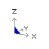
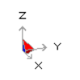

Die Orientierung des Modells wird durch ein Orientierungssymbol in der unteren linken Ecke der Anzeige angezeigt. Dieses Symbol zeigt die Richtung der Achsen (X für Osten, Y für Norden und Z nach oben).

In der obigen Ansicht zeigt die Y-Achse überwiegend in den Bildschirm hinein und etwas nach rechts, die X-Achse zeigt überwiegend nach rechts und etwas aus dem Bildschirm heraus, und die Z-Achse zeigt senkrecht nach oben. Beachten Sie, dass die Rückseite des Symbols blau schattiert ist.

In der obigen Ansicht zeigt die Y-Achse überwiegend nach rechts und etwas in den Bildschirm hinein, die X-Achse zeigt überwiegend aus dem Bildschirm heraus und etwas nach rechts, und die Z-Achse zeigt senkrecht nach oben. Beachten Sie, dass die Innenseite des Symbols rot schattiert ist.

Es stehen drei Rotationsmodelle zur Auswahl:

1. Rotationen können auf die aktuelle Geometrie angewendet werden. Dieser Modus ermöglicht nicht horizontale Horizonte

2. Rotationen können so angewendet werden, dass der Horizont stets horizontal bleibt, wobei die Z+-Achse nach oben zeigt (Tools > Global Transform Z+ up). Dadurch erfolgt die Rotation mit der Maus in umgekehrter Richtung wie bei Tools > Global Transform Z- up.

3. Rotationen können so angewendet werden, dass der Horizont stets horizontal bleibt, wobei die Z-Achse nach oben zeigt (Tools > Global Transform Z- up).

Dadurch erfolgt die Rotation mit der Maus in umgekehrter Richtung wie bei Tools > Global Transform Z+ up. Sie können das Modell drehen, indem Sie die linke Maustaste gedrückt halten und warten, bis der Zeiger zum Ziehen

erscheint, und dann das Orientierungssymbol in die gewünschte Position ziehen. Ziehen nach oben oder unten dreht das Modell nach oben oder unten. Nahe dem unteren Bildschirmrand dreht Ziehen nach links oder rechts das Modell nach links oder rechts. Nahe dem oberen Bildschirmrand dreht Ziehen nach links oder rechts das Modell gegen den Uhrzeigersinn oder im Uhrzeigersinn. Dieser Vorgang lässt sich über Tools > Rotation Toolbar anpassen.

Das Modell kann auch über Touchscreen-Steuerung gedreht werden, indem Sie einen oder zwei Finger über den Bildschirm ziehen, und mit einer Kneifgeste gezoomt werden. Dieser Vorgang lässt sich über Tools > Rotation Toolbar anpassen.

Hinweise:

Bevor Sie das Modell drehen, sollten Sie den gewünschten Drehpunkt festlegen

#### View > Centre

Sie können die Wartezeit für das Ziehen anpassen mit

#### Tools > Drag Wait Time

Rotations- und Verschiebungsvorgänge können automatisch wiederholt werden, indem Sie vor der Auswahl des Vorgangs n# eingeben. Um beispielsweise eine animierte Darstellung einer Spannungsdarstellung zu erzeugen, legen Sie fest

Plot > Options > Persist Plot > Stress > Sigma:1 View > Rotation Increment > 10 geben Sie über die Tastatur 35# ein

wählen Sie „Nach rechts drehen“ (entweder in der Rotations-Symbolleiste oder mit der Taste Bild ab)

Drücken Sie die Esc-Taste, um die Animation abzubrechen.

Die Eingabe von 0# wiederholt den Vorgang unbegrenzt. Drücken Sie die Esc-Taste, um ihn zu beenden.

Verwandte Themen:

Modell verschieben Spezielle Ansichtspositionen auswählen

#### Index

#### - 0 -

001 002 ... Dateien     510, 600

**- 3 -**

3D-Hohlraumformen     27, 29, 30

#### - A -

Abbrechen einer Map3D-Analyse     461 Über Map3D     2 Absolute Dehnung     223, 299 Absolute Spannung     209, 299 Genauigkeit     45, 308, 381, 462, 482 AG - Gitterabstand     45, 300, 301, 302, 308, 381, 462 AL - Elementgröße     45, 300, 301, 308, 381, 462 Abweichende Materialzonen     30

Analysis-Dialogfeld     172, 308, 328, 381, 461, 462, 463, 464, 465, 489, 490

Analysis-Options-Dialogfeld     329, 465, 466, 467, 468, 469, 471, 473, 477, 478, 482, 484, 485, 486, 487, 489

Analyseergebnisse     164, 171, 172, 173, 186, 510, 524, 600

Analysezeit     45, 308, 381, 462 Animation     184, 508 Anwendungen von Map3D     11 Bestandsmodelle     27 Automatische Diskretisierung     45, 300, 301, 302, 308, 381, 462 Mittelwert der Konturpunkte     317

#### - B -

Versatz einbringen     30, 33, 477, 487 Stapelverarbeitung von Analysen     466

BEM-Analyse     317, 390, 433, 461, 462, 465, 466, 467, 469, 471, 473, 477, 478, 482, 484, 485, 486, 487, 489, 490, 569, 594, 595, 597, 598

Bitmap-Ausgabe des Bildschirms     173, 174, 184, 185, 508 Blockmodelle     29, 30 BMP     173, 174, 184, 508 Boolesche Schnitte     467 Randelementmethode     12, 13, 477, 482, 487, 570

Build-Symbolleiste     331, 335, 341, 348, 358, 360, 362, 364, 365, 366, 367, 368, 369, 436, 494, 507 Erstellen von 3D-FF-Blöcken     331, 335, 341, 348, 364, 365, 366, 367, 368, 369, 390, 394, 395, 397, 398, 400, 402, 407, 408, 410, 412, 413, 415, 416, 418, 421, 423 Erstellen von Konstruktionslinien     362, 364, 365, 366, 367, 368, 369, 498

Erstellen von DD-Ebenen     331, 335, 341, 348, 364, 365, 366, 367, 368, 369, 390, 394, 395, 397, 398, 400, 402, 407, 408, 410, 412, 413, 415, 416, 418, 421, 423

Erstellen von Feldpunkt-Gitterlinien     358, 360 Erstellen von Feldpunkt-Gitterebenen     358, 360, 364, 365, 366, 367, 368, 369, 494, 496

Erstellen von Feldpunkt-Linien und -Ebenen     364, 365, 366, 367, 368, 369

Erstellen von Tunneln     331, 335, 341, 348, 364, 365, 366, 367, 368, 369 Bulk-Mining – Tutorial zur Modellerstellung     85

#### - C -

CAD     426, 427, 428, 429 CAD > Build     331, 335, 341, 348, 358, 360, 362, 364, 365, 366, 367, 368, 369 CAD > Build menu     494, 507

CAD > Edit     390, 394, 395, 397, 398, 400, 402, 407, 408, 410, 412, 413, 415, 416, 418, 421, 423 CAD > Edit menu     495, 496, 498 CAD > Properties     308, 317, 381, 390 CAD > Properties menu     313, 314, 386, 387 CAD > Propertiesu     313, 386 CAD > Snap     369, 370, 371, 372, 373, 376, 377, 378, 379

CAD > Snap menu     494 CAD menu     303, 425 CAD-Symbolleiste     436, 494, 507

Kartesische Dehnung     221 Kartesische Spannung     208 Löschen von Konstruktionslinien-Daten     169 Löschen von Modelldaten     165 Prüfung auf Schließung und Überlappung     467 Koeffizientenmatrix     471, 484, 485, 487 Häufige Probleme beim Modellaufbau     39 Inaktive Blöcke     39 Beenden der aktuellen Analyse     489, 490 Durchführen einer BEM-Spannungsanalyse     462 Durchführen einer Map3D-Analyse     328 Konfigurieren von Symbolleisten     196, 432, 433, 434, 435, 436 Konsolenmodus     466 Konstruktionslinien-Daten     169, 170, 171, 508, 510, 511 Konturdarstellungsoptionen     304 Konturbereich     302 Konturen-Symbolleiste     432, 433, 594, 595, 597, 598 Kopieren von Modelldaten     397 Elasto-viskoplastisches Kriechen     469 Benutzerdefinierte Schaltflächenschrift     439 Benutzerdefinierte Farben     437, 438, 439

**- D -**

DD-Ebenendicke     496 DD-Ebenen     27, 35, 36 Tiefenpuffer     440, 441 Deswick     511 Digitalisierer-Unterstützung     426, 502 Diskretisierungsanalyse     462, 484, 485, 569 Diskretisierung und Lumping     45, 300, 301, 302, 308, 381, 462 Anzeige der diskretisierten Ansicht     600 Diskretisieren eines Modells     462 Test der Festplattenleistung     441 Speicherplatzbedarf     45, 308, 381, 462, 484, 485 Verschiebungskomponenten     224 Verschiebungsdiskontinuitätselemente     27, 35, 36 Verschiebungs-Symbolleiste     224 Anzeige eines gespeicherten Bildschirmbilds     184, 185, 508

Divergente Lösungen     45, 300, 301, 308, 381, 462 DOC - Matrix-Lumping     45, 300, 301, 308, 381, 462 DOE - Element-Lumping     45, 308, 381, 462 DOG - Gitter-Lumping     45, 308, 381, 462 DOL - Lösungsgenauigkeit     45, 300, 301, 302, 308, 381, 462 DON - Matrixkonditionierung     45, 300, 301, 308, 381, 462 DOR - Elementseitenverhältnis     45, 308, 381, 462 Rotation des Modells durch Ziehen     431, 601 Verschiebung des Modells durch Ziehen     431, 599 Zoomen des Modells durch Ziehen     431, 599 Drucker-Prager in 3D FF Blocks     232, 238, 240, 243, 246, 248, 251, 254, 256, 533 Ausgabe der Analyseergebnisse     175, 180 Ausgabe des Bildschirmbilds     173, 174, 175, 508 DXF-Dateiformat für Konstruktionslinien     510, 511 DXF-Ausgabe des Bildschirms     174 DXF-Modelldateiformat     511, 525 DXF-Dateiformat für Bildschirmbilder     174

**- E -** Edit-Symbolleiste     390, 394, 395, 397, 398, 400, 402, 407, 408, 410, 412, 413, 415, 416, 418, 421, 423, 436, 495, 496, 498, 499, 501 Bearbeiten von Modelldaten     390, 430, 495, 496, 498, 499, 501 Effektive Spannung     209 Elastische Dehnung     222, 298 Elasto-viskoplastisches Kriechen     469 Element-Lumping     45, 300, 301, 308, 381, 462 Elementgröße     45, 300, 301, 308, 381, 462 Berechnung der Energiefreisetzungsrate     478 Löschen von Modelldaten     394 ESS     200, 202, 203, 205 EVP-Dateien     443, 446 Überschüssige Spannung     232, 238, 240, 243, 246, 248, 251, 254, 256, 259, 263, 265, 266, 268, 272, 276, 526, 531, 533, 535, 547, 556, 595 Expansionskoeffizient und Leitfähigkeit     568 EXTENDED ENTITY DATA     511 Extrudieren von Ebenen zu Blöcken     365

#### - F -

Versagenskriterium     232, 238, 240, 243, 246, 248, 251, 254, 256, 259, 263, 265, 266, 268, 272, 276, 526, 531, 533, 535, 547, 556, 595

Festlegung des Fernfeld-Spannungszustands     503, 505 Störungsflächen     36 Fault-Gouge in DD Planes     259, 263, 265, 266, 268, 272, 276, 535

Fiktive-Kraft-Elemente     27, 29 File > Output menu     173, 174, 175, 180 File menu     164, 165, 166, 167, 168, 169, 170, 171, 172, 173, 184, 185, 186, 507, 508, 524, 525 Suchen eines bestimmten Koordinatenpunkts im Modell     195 Fließregeln     526, 535, 547, 556, 568 Flow-Symbolleiste     230 Fluid-/thermische Strömungsanalyse     568 Strömungskomponenten     230 Freihandskizzen – Tutorial zur Modellerstellung     60

Hyperbolic-Backfill in DD Planes     259, 263, 265, 266, 268, 272, 276, 556

#### - I -

In-situ-Spannungszustand, Festlegung     503, 505 Inaktive Blöcke     39 Induzierte Dehnung     223, 299 Induzierte Spannung     209, 299 Anfangsspannungszustand, Festlegung     503, 505 Alle Ansichtsparameter initialisieren     195 INP-Modelldateiformat     515, 525

In der Ebene     259, 263, 265, 266, 268, 272, 276 Dehnung in der Ebene     213, 215, 216, 218 Spannung in der Ebene     200, 202, 203, 205 Interpretation der Ergebnisse     15, 23, 478 Schnittanalyse     464, 467, 468, 485, 569 Einführung     2

#### - J -

#### - G -

GIF     173, 174, 184, 508

Wechsel zur Grafik in der aktuellen Analysephase     463 Wechsel zur Phase Modellaufbau und Bearbeitung     463 Gitter-Lumping     45, 300, 301, 302, 308, 381, 462 Gitterauswahl     303, 425, 436

Gitterabstand     45, 300, 301, 302, 308, 381, 462 Geländeoberfläche     35 Gruppieren von Modelldaten     408

#### - H -

Help menu     456, 457

Verdeckte-Flächen-Entfernung     440, 441 Hide-Block-Colours-Symbolleiste     189, 190, 196, 435 Hide-Cline-Colours-Symbolleiste     190 Hide-Construction-Line-Colours-Symbolleiste     190, 196, 435 Hide-Symbolleiste     186, 196, 435 Ausblenden verschiedener Modellteile     186 Hoek-Brown in 3D FF Blocks     232, 238, 240, 243, 246, 248, 251, 254, 256, 531

JPEG     173, 174, 184 JPG     173, 174, 184

#### - L -

Leasing von Map3D     2

Einschränkungen und Defizite     15

Laden eines Modells aus einer Datei     164, 165, 167, 464, 507, 525

Laden von Analyseergebnissen aus einer zuletzt verwendeten Datei     186

Laden von Analyseergebnissen aus einem zuletzt verwendeten Verzeichnis 524

Laden von Analyseergebnissen aus einer Restart-Datei     164, 171 Laden von Konstruktionslinien-Daten aus einer Datei     169, 170 Laden von Modelldaten aus einem zuletzt verwendeten Verzeichnis 524

Laden von Modelldaten aus einer zuletzt verwendeten Datei     186 Berechnung der Systemsteifigkeit bei Belastung     478 Berechnung der lokalen Energiefreisetzungsrate     478 Lumping und Diskretisierung     45, 300, 301, 302, 308, 381, 462

#### - M -

Map3D     2, 9, 11, 12, 13, 569, 570 Map3D-Analyseoptionen     329 Map3Di     314, 387, 453 Materialcodes     33 Festlegung der Materialeigenschaften     313, 386, 464, 503, 505, 526, 531, 533, 535, 547, 556, 568 Matrixkonditionierung     45, 300, 301, 308, 381, 462 Matrix-Lumping     45, 300, 301, 308, 381, 462 Matrixlösung     465, 467, 486 Maximale Scherdehnung     212 Maximale Schubspannung     199 Mittlere Spannung     207 Mittelwert der Konturpunkte     317 Menu Commands - Analysis dialogue box     172, 308, 381, 461, 462, 463, 464, 465, 489, 490 Menu Commands – Analysis dialogue box     328 Menu Commands - Analysis Options dialogue box 465, 466, 467, 468, 469, 471, 473, 477, 478, 482, 484, 485, 486, 487, 489 Menu Commands – Analysis Options dialogue box 329

Menu Commands - CAD     426, 427, 428, 429 Menu Commands - CAD > Build     331, 335, 341, 348, 358, 360, 362, 364, 365, 366, 367, 368, 369 Menu Commands - CAD > Build menu     494, 507 Menu Commands - CAD > Edit     390, 394, 395, 397, 398, 400, 402, 407, 408, 410, 412, 413, 415, 416, 418, 421, 423

Menu Commands - CAD > Edit menu     495, 496, 498 Menu Commands - CAD > Properties     308, 313, 314, 317, 381, 386, 387, 390 Menu Commands - CAD > Snap     369, 370, 371, 372, 373, 376, 377, 378, 379 Menu Commands - CAD > Snap menu     494 Menu Commands - CAD menu     303, 425 Menu Commands  File     169, 170 Menu Commands - File     164, 165, 166, 167, 168, 169, 171, 172, 173, 184, 185, 186 Menu Commands - File > Output     173, 174, 175, 180 Menu Commands - File menu     507, 524, 525 Menu Commands - Help menu     456, 457

Menu Commands - Plot     302 Menu Commands - Plot > Displacement     224 Menu Commands - Plot > Flow     230 Menu Commands - Plot > Miscellaneous     302 Menu Commands - Plot > Properties     308, 313, 317, 381, 386, 390

Menu Commands - Plot > Strain     210, 212, 213, 215, 216, 218, 220, 221, 222, 223, 226, 298, 299 Menu Commands - Plot > Strength Factors     232, 238, 240, 243, 246, 248, 251, 254, 256, 259, 263, 265, 266, 268, 272, 276

Menu Commands - Plot > Stress     198, 199, 200, 202, 203, 205, 207, 208, 209, 226, 299

Menu Commands - Plot > Surface Components     279, 280, 281, 282, 283, 284, 285, 286, 287, 292, 294, 295, 296, 297, 298, 300, 301

Menu Commands - Plot menu     594, 595, 597, 598 Menu Commands – Plot menu     304, 317 Menu Commands - Seismic     443, 446, 453, 456, 492 Menu Commands - Tools     196, 430, 431, 432, 433, 434, 435, 436, 437, 438, 439, 440, 441, 442 Menu Commands – Tools menuMenu Commands - ToolsTools menu     439

Menu Commands - View > Find Coordinate     195 Menu Commands - View > Hide     186 Menu Commands - View > Hide Block Colours     189, 190

Menu Commands - View > Hide Cline Colours     190 Menu Commands - View > Initialize     195 Menu Commands - View > Length     196, 435 Menu Commands - View > Pan     196, 435 Menu Commands - View > Render     192, 194, 600 Menu Commands - View > Zoom     196, 435 Menu Commands - View > Zoom Extents     195 Menu Commands - View menu     196, 197 Menu Commands -File menu     508 Zusammenführen benachbarter Flächen     468 Zusammenführen von Koordinatenpunkten, die nahe beieinander liegen 467 Zusammenführen von Modelldaten     507, 525 Grubenplanung     23 Auswahl des Abbauschritts     173 Abbauschrittfolge     33

Modellaufbau     12, 27, 29, 30, 33, 35, 36, 39, 60, 85, 106, 314, 331, 335, 341, 348, 358, 360, 362, 387, 390, 394, 395, 397, 398, 400, 402, 407, 408, 410, 412, 413, 415, 416, 418, 421, 423, 426, 463, 467, 468, 485, 486, 494, 496, 498, 507, 525 Modelldaten     164, 165, 166, 167, 168, 186, 314, 387, 464, 467, 486, 507, 509, 511, 515, 524, 525, 569 Modellorientierungssymbol     601 Mohr-Coulomb in 3D FF Blocks     232, 238, 240, 243, 246, 248, 251, 254, 256, 526 Mohr-Coulomb in DD Planes     259, 263, 265, 266, 268, 272, 276, 547 Verschieben von Feldpunkten, die sehr nahe an Randflächen liegen     473 Verschieben von Modelldaten     395, 412, 413, 415, 416, 418

#### - N -

Numerische Modellierung     9, 11, 12, 13, 15, 23

#### - O -

OBJ-Ausgabe des Bildschirms     175 OBJ-Dateiformat für Bildschirmbilder     175 Oktaedrische Scherdehnung     220 Oktaedrische Schubspannung     207 Tagebaue     36 OpenGL     440, 441 Erzzonen     27, 29, 30 Überblick über Map3D     9 Überblick über den Modellaufbau     12

#### - P -

Parameterstudien     15 PDF-3D-Ausgabe des Bildschirms     175 PDF-3D-Dateiformat für Bildschirmbilder     175 Größe des Auswahlfelds     442 Plastische Dehnung     222, 298 Plot > Displacement     224 Plot > Flow     230 Plot > Miscellaneous     302 Plot > Properties     308, 313, 317, 381, 386, 390

Plot > Properties menu     313, 386

Plot > Strain     210, 212, 213, 215, 216, 218, 220, 221, 222, 223, 226, 298, 299 Plot > Strength Factors     232, 238, 240, 243, 246, 248, 251, 254, 256, 259, 263, 265, 266, 268, 272, 276 Plot > Stress     198, 199, 200, 202, 203, 205, 207, 208, 209, 226, 299 Plot > Surface Components     279, 280, 281, 282, 283, 284, 285, 286, 287, 292, 294, 295, 296, 297, 298, 300, 301 Plot menu     302, 303, 304, 317, 425, 594, 595, 597, 598 Plotoptionen     304 Darstellung von Oberflächenkomponenten während der Analyse     461, 462 PNG     173, 174, 184, 508 PNT-Dateiformat für Konstruktionslinien     508, 510 PNT-Ausgabe der Analyseergebnisse     175, 180 PNT-Ausgabe des Bildschirms     175, 508 PNT-Modelldateiformat     509, 525 PNT-Dateiformat für Bildschirmbilder     175, 508 Schlecht konditionierte Probleme     45, 300, 301, 308, 381, 462 Hauptdehnungen     210 Hauptspannungen     198 Wahrscheinlichkeit     232, 238, 240, 243, 248, 251, 256, 259, 263, 265, 266, 268, 272, 276 Problemgröße     45, 308, 381, 462

#### - R -

RAM für die Matrixspeicherung     485, 487 Bereich zum Darstellen von Konturen     302 Zuletzt verwendete Verzeichnisse     524 Zuletzt verwendete Dateien     186 Zuverlässigkeit von Modellierungsvorhersagen     15 Rendern der Konturen     304 Rendern des Modells     192, 194 Neunummerierung von Flächen, damit das Volumen positiv ist     486 Alle Ansichtsparameter zurücksetzen     195 Neustart einer Analyse     172 Wiederherstellen einer zuvor gespeicherten Ansichtsposition und eines Konturbereichs     185

Vorhersagen des Gebirgsverhaltens     15, 23, 478 Subtrahieren von Analyseergebnissen     172 Rotieren von Modelldaten     400, 402 Support und Vertrieb     2 Drehen des Modells     197, 431, 601 Einbringen von Ausbau     30, 33, 477, 487 Rotation Toobar     431 Surface-Components-Symbolleiste     279, 280, 281, 282, Ausführen mehrerer aufeinanderfolgender Analysen     466 283, 284, 285, 286, 287, 292, 294, 296, 297, 298, 300, 301, 598 **- S -** Surface-Components-Symbolleiste     295 Oberflächenmodelle     27, 30 Anhalten einer Map3D-Analyse     489 Vertrieb und Support     2

Vertrieb und Support     2 Speichern eines Modells in einer Datei     166 Speichern eines Modells unter einem neuen Dateinamen     166, 168 Speichern von Konstruktionslinien-Daten in einer Datei     171 Speichern von Modelldaten     407 Speichern der aktuellen Ansichtsposition und Konturbereiche 185 Skalieren von Modelldaten     398 Bildschirmausgabe     173, 174, 175, 184, 185, 508 Seismic     443, 446, 453, 456, 492 Seismic menu     443, 446, 453, 456, 492 Seismisches Moment     317 Gleichmäßiges Scrollen im Analysis-Dialogfeld     442 Smooth-Scrolling     442 Snap-Symbolleiste     369, 370, 371, 372, 373, 376, 377, 378, 379, 436, 494, 502 Glätten von Konstruktionslinien     421, 423 Lösungsgenauigkeit     45, 300, 301, 302, 308, 381, 462, 482

#### - T -

Tabularer Abbau – Tutorial zur Modellerstellung     106 Tabulare Abbauzonen     36 Terzaghis Beobachtungsmethode     15 Testen der Festplattenleistung     441 Thermische/Fluidströmungsanalyse     568 Dreidimensionale Hohlraumformen     27, 29, 30 Symbolleisten     431, 433, 436, 594, 595, 597, 598 Tools menu     196, 430, 431, 432, 433, 434, 435, 436, 437, 438, 439, 440, 441, 442 Gesamtdehnung     222, 298 Gesamtspannung     209 Verschieben und Zoomen des Modells     599 Verschieben des Modells     196, 431 Translation-Symbolleiste     431 Tutorial     60, 85, 106

Solve-Symbolleiste     433, 434 Spezielle Ansichtspositionen     197 Stationäre thermische/Fluidströmungsanalyse     568 Strain-Symbolleiste     210, 212, 213, 215, 216, 218, 220, 221, 222, 223, 226, 298, 299, 597 Festigkeitskriterium     232, 238, 240, 243, 246, 248, 251, 254, 256, 259, 263, 265, 266, 268, 272, 276, 526, 531, 533, 535, 547, 556, 595 Strength-Factors-Symbolleiste     232, 238, 240, 243, 246, 248, 251, 254, 256, 259, 263, 265, 266, 268, 272, 276, 595

#### - U -

Ubiquitäre Ebene     259, 263, 265, 266, 268, 272, 276 Dehnung der ubiquitären Ebene     213, 215, 216, 218 Spannung der ubiquitären Ebene     200, 202, 203, 205 Ergebnisdatei aktualisieren     172 Benutzerdefinierte Schaltflächenschrift     439 Benutzerdefinierte Farben     437, 438, 439 Benutzerdefinierte Konturdarstellungen     443, 446, 453, 456, 492 Benutzerdefinierte Ausgabe der Analyseergebnisse     175, 180 Benutzerdefinierte Darstellungen     226 Benutzerdefinierte Punkte für die Spannungsberechnung     473

Stress-Orientation-Icon     599 Stress-Symbolleiste     198, 199, 200, 202, 203, 205, 207, 208, 209, 226, 299, 594 Strecken von Modelldaten     410 Unterteilen nicht ebener Vierecke in Dreiecke 485

#### - V -

View > Hide Block Colours  Menu     189, 190 View > Hide Cline Colours Menu     190 View > Hide Menu     186 View > Render Menu     192, 194, 600 View menu     195, 196, 197, 435 View-Symbolleiste     189, 190, 196, 435 Anzeigen von Gitterebenen     303, 425, 436 Anzeigen von Abbauschritten     173 VRML-Ausgabe des Bildschirms     175 VRML-Dateiformat für Bildschirmbilder     175

#### - W -

WRL-Ausgabe des Bildschirms     175 WRL-Dateiformat für Bildschirmbilder     175 [www.map3d.com/how_to_buy](https://www.map3d.com/how_to_buy)     2

#### - Z -

Z-Buffering     440, 441 Zoomen, sodass alle Objekte sichtbar sind     195 Zoomen des Modells     197, 431
