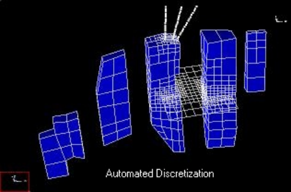
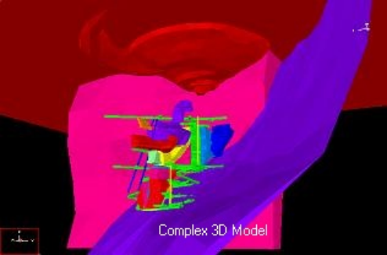
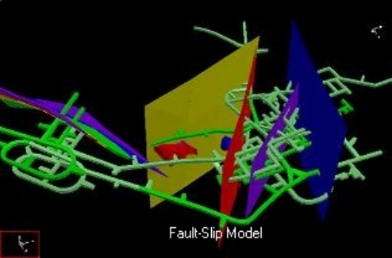
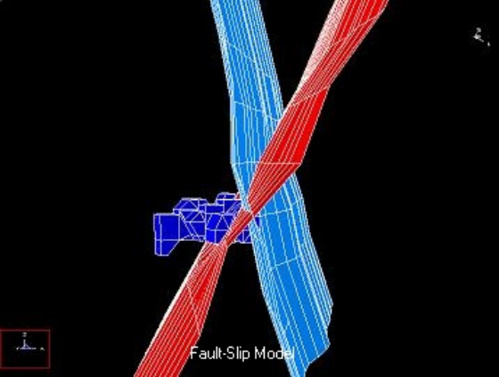
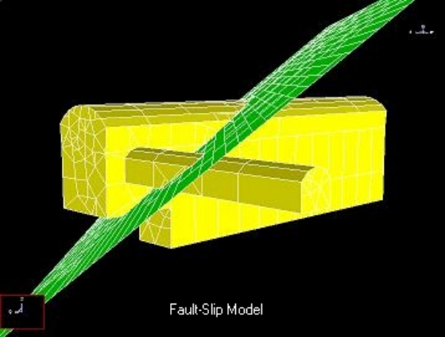

**Map3D Fault-Slip** – Spannungsanalyse für elastisches Gebirge und vollplastischen Störungsschlupf.

Dieses Modul dient der Spannungsanalyse von 3D-Modellen. Die Software wird für Bau-, Geologie- und Bergbauprojekte eingesetzt.

Es umfasst den 3D-CAD-Modellierer (Map3D Modeller), den Ergebnisbetrachter (Map3D Results Viewer) und die visuelle GIS-Datenbank.

Die Spannungsanalyse nutzt die BEM (Randelementmethode) und bietet viele Funktionen:

- Sehr große Problemgrößen. Map3D kann Spannungsanalysen an Modellen mit Tausenden von Hohlräumen durchführen (über eine Million Freiheitsgrade). Dadurch ist eine detaillierte Darstellung der Geometrie möglich, und große Modelle müssen nicht vereinfacht werden (übermäßige Vereinfachung ist eine Hauptfehlerquelle in der Modellierung). Gesamte Grubengebäude lassen sich problemlos simulieren.

- Komplexe, vollständig dreidimensionale Hohlraumformen. Detaillierte Bestandsmodelle und komplexe 3D-Formen lassen sich problemlos analysieren. Da die Spannungsanalyse auf der Randelementmethode (BEM) beruht, müssen nur die Oberflächen der Hohlräume (und anderer Merkmale) angegeben werden. Die Pfeiler zwischen benachbarten Hohlräumen müssen nicht definiert (in Elemente unterteilt) werden. Beliebige Formen lassen sich problemlos zu einem einzigen großen, analysebereiten Modell kombinieren.

- Mehrere elastische Zonen mit unterschiedlichen Moduln (steife Gänge oder weiches Erz). Map3D kann abweichende Materialzonen vollständig berücksichtigen. Dadurch lassen sich steife oder weiche Gesteinsarten einfach berücksichtigen.

- Zonen mit unterschiedlichen Primärspannungszuständen.

- Tabularer Abbau mit nachgiebigen Pfeilern. Diese Näherung ist für große, schmale Gangbergwerke oft geeignet.

- Diskrete, nicht ebene Störungsflächen, die elasto-viskoplastisch gleiten und dilatieren (einschließlich Kriechen). Diese Merkmale werden mit der Verschiebungsdiskontinuitätsmethode umgesetzt. Elasto-viskoplastische Fließregeln berücksichtigen verschiedene Verhaltensarten. Die Analyse des Störungsschlupfs lässt sich sowohl für den Bergbau als auch für die Erdbebensimulation einsetzen.

- Risse und Klüfte können einschließlich der Berechnung der Energiefreisetzungsrate und des Spannungsintensitätsfaktors simuliert werden. Die Rissausbreitung kann als Folge diskreter Schritte simuliert werden.

- Mehrere Abbauschritte sind erforderlich, um Effekte wie das Einbringen von Versatz oder die Rissausbreitung zu berücksichtigen. Map3D erlaubt derzeit 40 Schritte. In jedem Schritt können verschiedene Materialien in Hohlräume oder Klüfte eingesetzt werden.

- Automatische Boolesche Schnitte ermöglichen, dass sich Hohlräume, Störungen und Klüfte kreuzen und überlappen. Ohne diese Fähigkeit wäre die Modellierung sich schneidender Merkmale bei komplexen Modellen praktisch unmöglich. Map3D bewältigt diese Situationen mühelos.

- Automatische Diskretisierung. Modelle können bei Bedarf manuell diskretisiert werden, oder Sie überlassen dies den im Programm integrierten automatischen Routinen. Diese Routinen stellen sicher, dass Elemente nur dort konzentriert werden, wo sie benötigt werden. So wird bei optimierter Analysezeit durchgehend eine hohe Genauigkeit erzielt.

Eine Demoversion von Map3D Fault-Slip ist kostenlos erhältlich. Alle Funktionen sind verfügbar, es dürfen jedoch nur kleine Probleme gerechnet werden. Diese Version eignet sich hervorragend, um die Grundlagen der Modellierung, der Visualisierung und des 3D-CAD zu vermitteln.

Map3Di Integrated Seismicity
