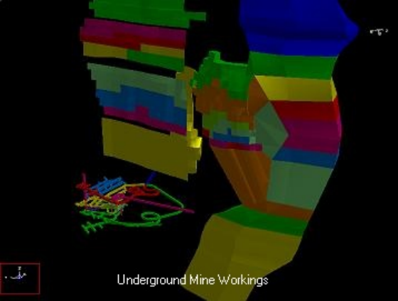
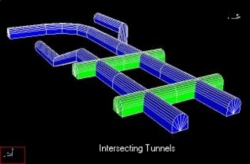
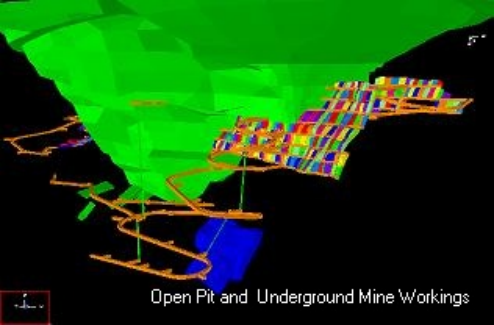
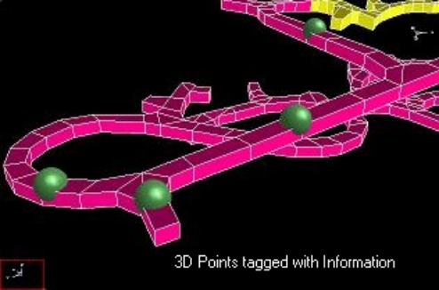
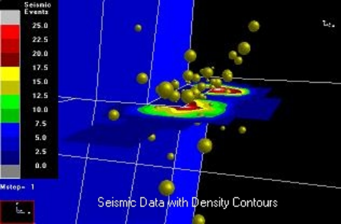

**Map3D Modeller** – 3D-CAD und visuelle GIS-Datenbank.

Dieses Modul dient dem Aufbau und der Visualisierung von 3D-Modellen. Die Software wird für Bau-, Geologie- und Bergbauprojekte eingesetzt.

Das einfach zu bedienende 3D-CAD-System (auf OpenGL basierend) bietet Freihandskizzen, Digitalisieren oder die Auswahl von Objekten, um 5 grundlegende Objekttypen zu erstellen und zu bearbeiten:

- 3D-Blöcke. Mit diesen Objekten werden Strossen, Erzzonen, Gänge und Tunnel aufgebaut. Am einfachsten gelingt der Aufbau, indem Sie eine Reihe von Querschnitten oder Sohlengrundrissen definieren

(jeder kann eine andere Form und eine andere Punktanzahl haben). Map3D kann diese bei Bedarf vereinfachen und anschließend zwischen den Konturen interpolieren, um komplexe 3D-Formen zu erzeugen.

- 2D-Merkmale. Mit diesen Objekten werden Störungen, tabularer Abbau, Geländeoberfläche und Klüfte aufgebaut. Diese Merkmale müssen nicht eben sein. Gekrümmte und versetzte Klüfte und Störungen werden vollständig unterstützt.

- Gitterebenen. Querschnitte können zur Konturdarstellung oder einfach zum Schneiden des Modells definiert werden.

- · Gitterlinien. Diese eignen sich besonders zur Darstellung der Lage von Bohrlöchern und Ausbau. Lage und Orientierung von Instrumenten lassen sich einfach kennzeichnen.

- Konstruktionslinien. Einfache Vermessungsdaten wie Streckenmittellinien lassen sich am einfachsten mit Konstruktionslinien darstellen. Dies ermöglicht den einfachen Import/Export zu anderen CAD-Paketen (volle dxf- und pnt-Unterstützung) sowie eine schnelle Möglichkeit, Liniendaten anzuzeigen.

- Modelle mit Lichtquellenschattierung. Die OpenGL-Lichtquellenschattierung wird für eine verbesserte Modelldarstellung unterstützt.

Ein vollständiger Satz an Bearbeitungsfunktionen ist enthalten, darunter Kopieren, Verschieben, Strecken, Einebnen, Skalieren, Drehen und mehr. Damit lassen sich die oben genannten Objekte einfach grafisch bearbeiten.

Die visuelle GIS-Datenbank kann zum Speichern, Analysieren und Anzeigen einer Datenbank beliebiger Informationen verwendet werden, darunter seismische Daten und geologische Informationen wie Gehalt, Gebirgsqualität usw.

3D-Punkte können mit einer Reihe von Attributen versehen werden:

- numerische Werte (z. B. Farbe, Magnitude, Orientierung, Zeit usw.),

- Schlüsselwörter (zum Filtern),

- Textnachrichten,

- Dateinamen (z. B. Grafikdateien, Dokumente, Tabellenkalkulationen, Zeichnungen usw.).

Die Anzeige dieser Elemente kann auf verschiedene Weise gefiltert werden. Die Lage jedes Punkts kann als farbig schattierte Kugel dargestellt werden, deren Größe und Farbe nach verschiedenen Parameterkombinationen skaliert werden. Die Punktdichte der Magnitude kann nach benutzerdefinierten Dichtefunktionen auf einer Ebene konturiert werden. Konturebenen können benutzerdefiniert oder mittels automatischer linearer Regression angepasst werden.

Map3D Results Viewer
