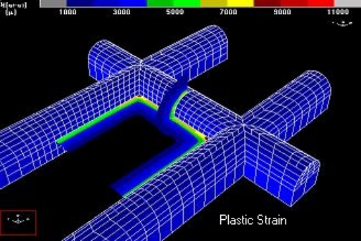
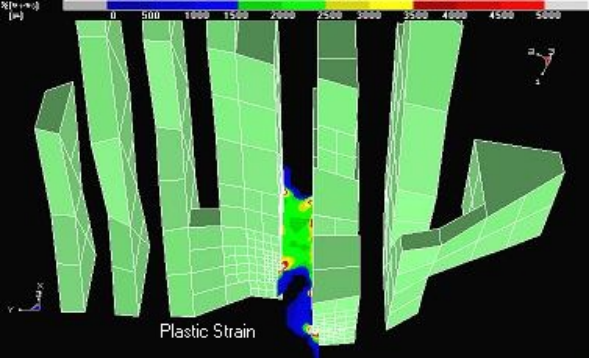
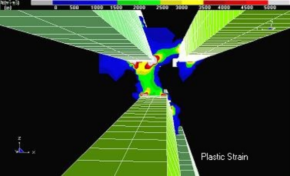
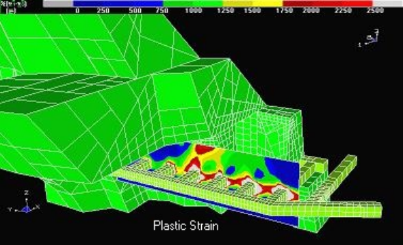

**Map3D Non-Linear** – nichtlineares Gebirgsverhalten.

Umfasst alle Funktionen von Map3D Fault-Slip und ergänzt die Fähigkeit des 3D-Gebirges, Lasten oberhalb der Gesteinsfestigkeit nachzugeben und sich nichtlinear zu verformen, um die überschüssigen Spannungen abzubauen. Diese Funktion eignet sich zur Simulation von mächtigen Flözen, überbeanspruchten Pfeilern, Widerlagern, Versatz und Kriechverhalten. Diese Formulierung löst das nichtlineare Problem auf der Oberfläche der Randelemente und interpoliert diese Effekte zwischen den Rändern. Sie stellt eine erste Näherung der inelastischen Modellierung dar, die den Vorteil großer Problemgrößen und sehr schneller Berechnung bietet.

Map3D Visco-Plastic
