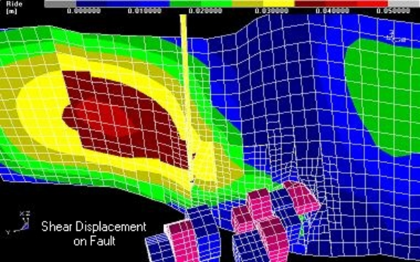
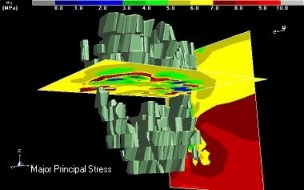
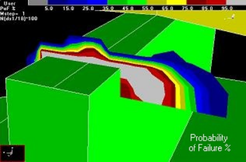
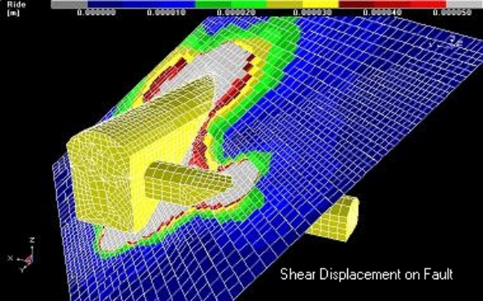
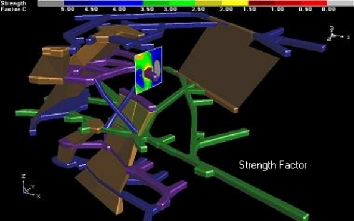

**Map3D Results Viewer** – Anzeige und Auswertung von Spannungsanalyseergebnissen.

Enthält die visuelle GIS-Datenbank, aber nicht das CAD-System.

- zeigt Spannungsanalyseergebnisse an, die von den Map3D-Spannungsanalyse-Codes erzeugt wurden

- stellt Konturen auf Schnittebenen, entlang von Linien und an bestimmten Punkten dar

- benutzerdefinierte Konturfunktionen

- direkter Export nach Excel zum Erstellen von x-y-Diagrammen

- Darstellung von 3D-Trajektorien

- Darstellung aller Spannungs-, Dehnungs-, Verschiebungs- und Festigkeitsparameter einschließlich Hauptkomponenten und Resultierenden auf benutzerdefinierten Ebenen und Linien

- Export im dxf- und pnt-Format zur Kompatibilität mit anderen CAD- und Darstellungssystemen

- Konturen der Versagenswahrscheinlichkeit

- Konturen des Sicherheitsfaktors

- Modelle mit Lichtquellenschattierung

- topografische Konturen

**Map3D Fault-Slip**
