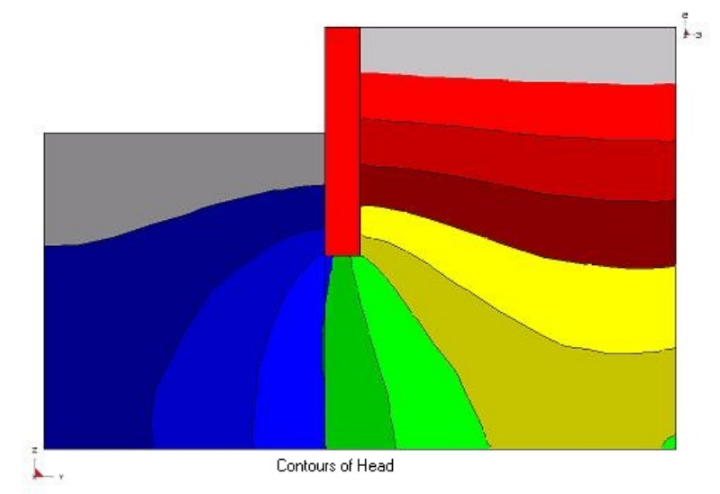
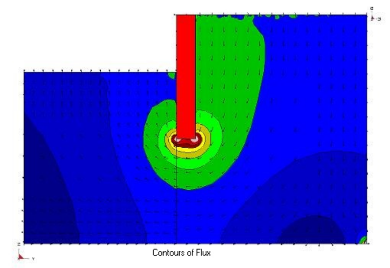

**Map3D Thermal-Fluid Flow** – thermische Spannungs- und Fluidströmungsanalyse.

Umfasst alle Funktionen von Map3D Fault-Slip und ergänzt die gleichzeitige Lösung von stationärer thermischer Spannung und Fluidströmung. Das Programm ist so aufgebaut, dass Sie nur die Randbedingungen für Temperatur bzw. Druckhöhe angeben müssen. Das thermische Spannungsproblem wird dann gleichzeitig gelöst. Diese Funktion eignet sich zur Simulation von Erwärmungs- und Abkühlungseffekten sowie von dräniertem und undräniertem Verhalten.

Map3D Non-Linear
