**Map3D Visco-Plastic** – dreidimensionales elasto-viskoplastisches Gebirgsverhalten (noch in Entwicklung – derzeit nicht kommerziell erhältlich).

Umfasst alle Funktionen von Map3D Fault-Slip und ergänzt die Fähigkeit des 3D-Gebirges, sich elasto-viskoplastisch zu verhalten. Dieses Modell bietet eine vollständige Lösung der nicht assoziierten inkrementellen Plastizitätsgleichungen und ergänzt die Fähigkeit des 3D-Gebirges, Lasten oberhalb der Gesteinsfestigkeit nachzugeben und sich nichtlinear zu verformen, um die überschüssigen Spannungen abzubauen. Diese Simulationsfähigkeit liefert die großen Verschiebungen, die für Untersuchungen der Wechselwirkung von Ausbau und Versatz erforderlich sind. Diese Funktion eignet sich zur Simulation von mächtigen Flözen, überbeanspruchten Pfeilern, Widerlagern, Versatz und Kriechverhalten. Diese Formulierung löst das nichtlineare Problem in den festgelegten Zonen des Gebirges.

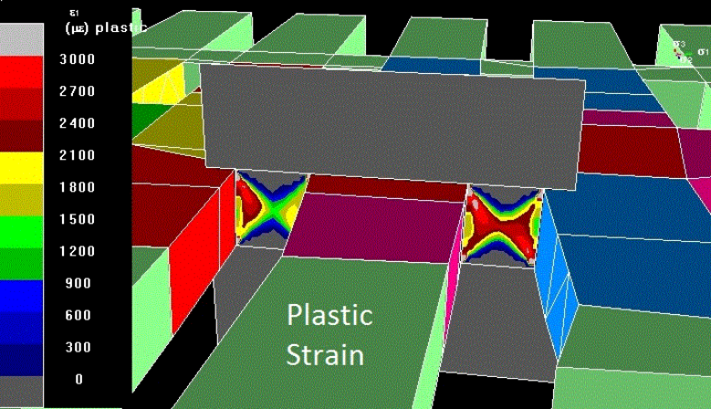

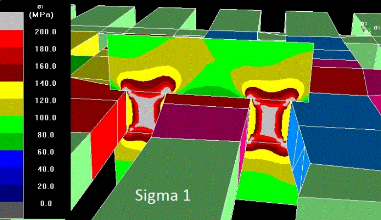

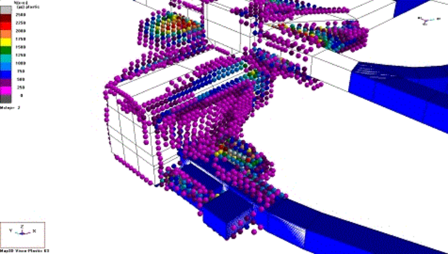

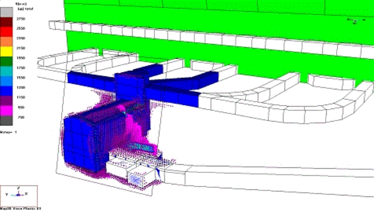

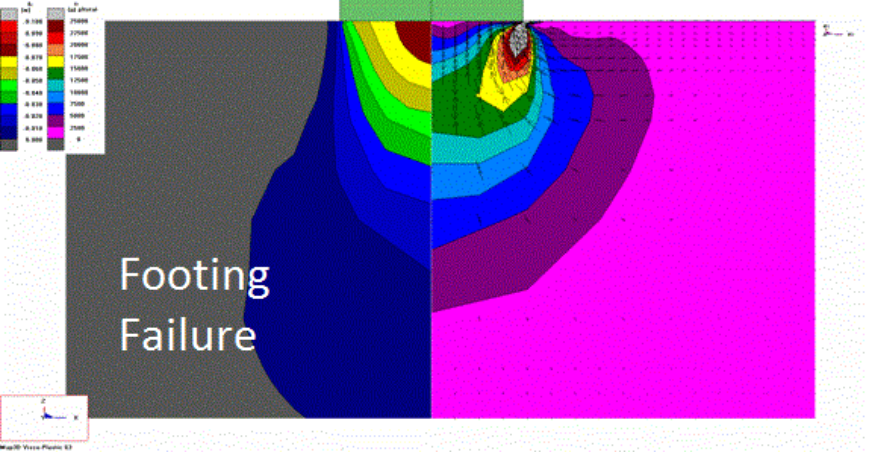

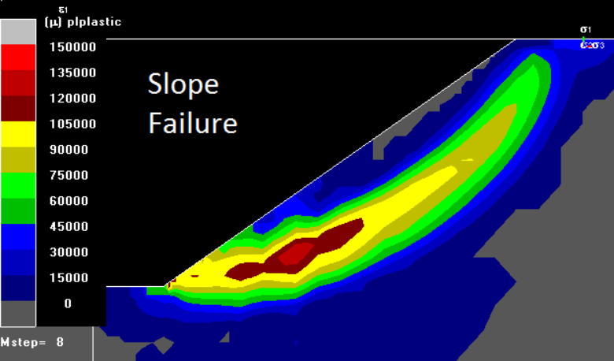

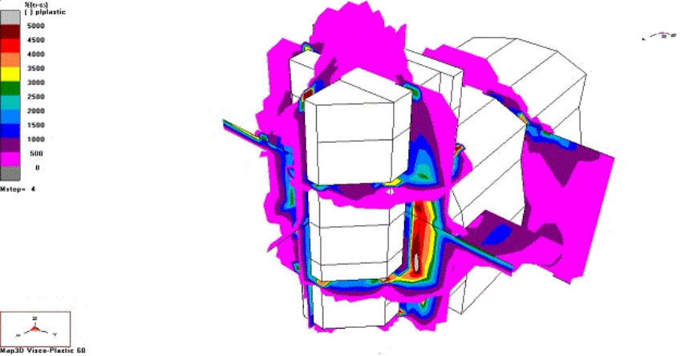

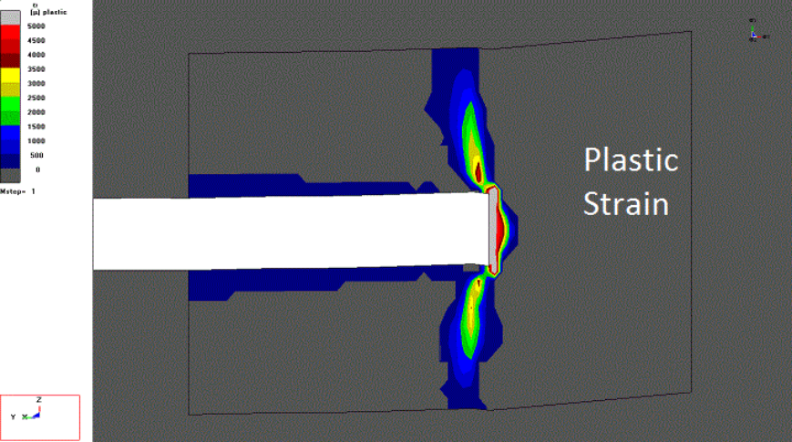

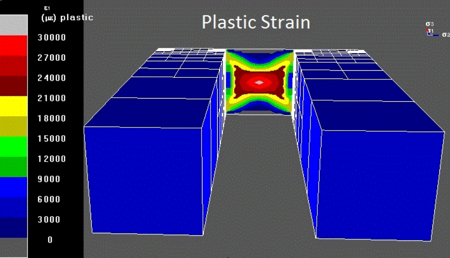

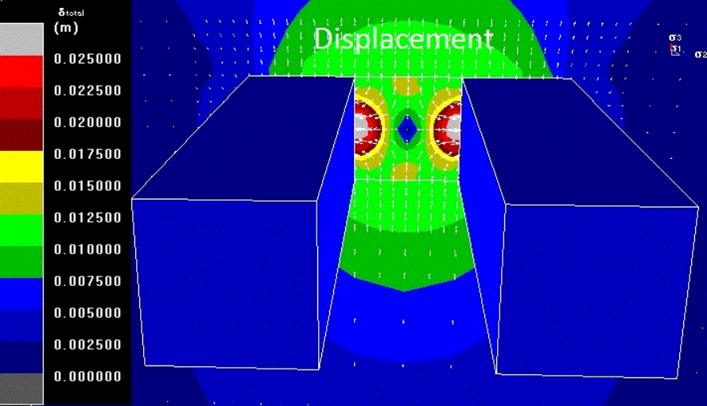

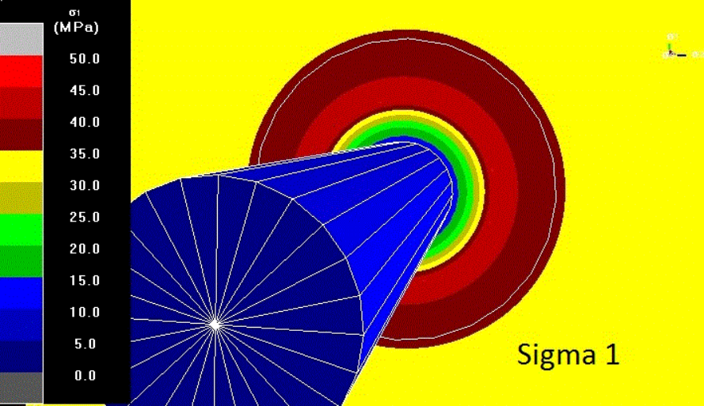

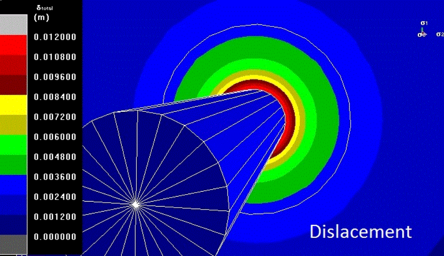

Map3D Overview
