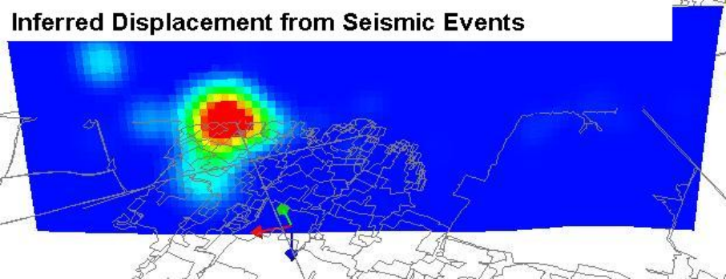
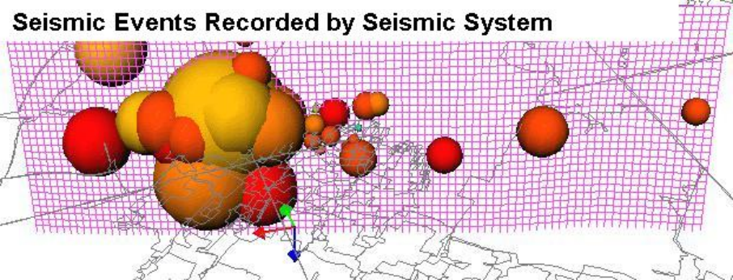
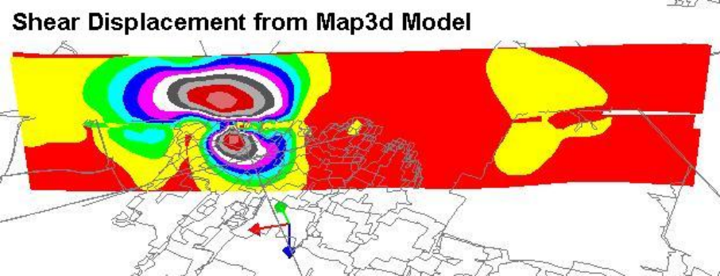

**Map3Di Integrated Seismicity** – Überlagerung externer Feldbelastungseffekte in der Spannungsanalyse.

Umfasst alle Funktionen von Map3D Fault-Slip und ergänzt Feldbelastungseffekte. Die Feldbelastungseffekte können aus jeder Datenbank mit thermischer Erwärmung, Fluiddruck, nichtlinearem Verhalten und durch Seismizität angezeigten Verformungen importiert werden. Diese Effekte können genutzt werden, um 2D- und 3D-Geologiemerkmale zu charakterisieren, wechselnde Lithologie zu berücksichtigen und seismische Belastungseffekte in die Spannungsanalyse einzubeziehen.

Mit numerischer Modellierung lässt sich das Gebirgsverhalten infolge fortschreitender Abbauhohlräume vorhersagen. Während sich der Einfluss geologischer Merkmale wie Störungen oder wechselnder Lithologie leicht in das Modell einbeziehen lässt, sind Lage, Orientierung und Verhaltenseigenschaften solcher Merkmale oft unsicher

. Dies kann zu Modellergebnissen von geringer Zuverlässigkeit und damit begrenztem Nutzen für Grubenbetreiber führen. Mit Map3Di können Sie externe Feldbelastungseffekte dem Map3D-Modell überlagern. Die Feldbelastung kann aus thermischer Erwärmung, Fluiddruck, nichtlinearem Verhalten usw. stammen. Zusätzlich lassen sich diese Effekte aus vielen Formen der In-situ-Überwachung bestimmen, zum Beispiel aus Fluiddrücken (z. B. Brunnenabsenkung, Dämme, Hydrofracturing), Erwärmung (z. B. natürliche Erwärmung, Lagerung nuklearer Abfälle) und Verformungen (z. B. mit Extensometern überwacht).

Eine weitere wichtige Quelle für In-situ-Feldbelastungsinformationen ist die seismische Aktivität. Das Auftreten von Seismizität zeigt per Definition an, dass das Gebirge der Belastung nachgibt und sich somit in irgendeiner Weise verformt. Die Seismizität könnte auf Scherung an einer Störungsfläche oder auf dreidimensionale Materialnichtlinearität hinweisen, die möglicherweise von einem schwachen lithologischen Merkmal herrührt. Mit Map3Di können Sie die durch die Seismizität angezeigten Verformungen Ihrem Map3D-Grubenmodell überlagern. Wenn Ihre Seismizität beispielsweise anzeigt, dass an einer Stelle Scherung auftritt, kann dies im Modell erzwungen werden, sodass die Spannungen umgelagert werden und diesen Effekt berücksichtigen.

Das Konzept hinter Map3Di besteht darin, eine bekannte Feldbelastung zusammen mit den regulären Modellierungsmerkmalen (Primärspannung, Modellgeometrie, Gänge, Störungen usw.) zu überlagern, um eine zusammengesetzte Vorhersage der Spannungen, Dehnungen und Verschiebungen im gesamten Gebirge zu erhalten. Die Integration von numerischer Modellierung und seismischer Überwachung über die Map3Di-Randelementmethode ermöglicht es, die durch die Seismizität angezeigten Verformungen Ihrem numerischen Modell zu überlagern. Dadurch werden geologische Merkmale wirksam charakterisiert und ihr Einfluss auf das Gebirgsverhalten berücksichtigt.

Die Feldbelastungsinformationen laufen auf die Angabe von Folgendem hinaus: Versatz (Ride) und Dilatation an einem Segment einer Gleitfläche und/oder Verformung einer 3D-Zone. Doch woher stammen solche Informationen?

- Angenommen, Sie messen die Temperaturverteilung in Ihrer gesamten Grube und möchten diese Feldbelastung auf ein Map3Di-Modell anwenden. Dazu unterteilen Sie das gesamte Gebirge in kleine 3D-Zonen und geben dann die Temperatur in jeder Zone an. Anschließend müssen Sie die „freie thermische Ausdehnung“ für jede Zone berechnen. Dann weisen Sie Map3Di einfach an, diese Feldbelastung zu verwenden. Map3Di führt die erforderlichen Berechnungen durch, um den Spannungsbeitrag der integrierten Feldbelastung zu bestimmen.

- Angenommen, Sie injizieren schweren Mörtel in eine Kluft, bohren nach dem Abbinden einige Löcher, um das Ausmaß der in der Kluft verursachten Dilatation zu bestimmen, und möchten diese Feldbelastung auf ein Map3Di-Modell anwenden. Dazu unterteilen Sie die Kluft in kleine ebene Zonen und geben dann die Dilatation in jeder Zone an. Dann weisen Sie Map3Di einfach an, diese Feldbelastung zu verwenden. Map3Di führt die erforderlichen Berechnungen durch, um den Spannungsbeitrag der integrierten Feldbelastung zu bestimmen.

- Angenommen, Sie stellen anhand Ihrer Seismizität fest, dass sich Teile Ihres Gebirges verformen und andere nicht. Dazu unterteilen Sie das gesamte Gebirge in kleine 3D-Zonen und berechnen dann die Verformung in jeder Zone. Dann weisen Sie Map3Di einfach an, diese Feldbelastung zu verwenden. Map3Di führt die erforderlichen Berechnungen durch, um den Spannungsbeitrag der integrierten Feldbelastung zu bestimmen.

Beachten Sie, dass das Map3Di-Modell alle regulären Merkmale enthalten kann, darunter Hohlräume, steife Gänge, Störungen usw. Die Effekte der Feldbelastung und all dieser anderen Merkmale werden überlagert, um eine abschließende zusammengesetzte Vorhersage der Spannungen, Dehnungen und Verschiebungen im gesamten Gebirge zu liefern.

Wie hilft uns Map3Di, die Defizite bei der Anwendung von Terzaghis Beobachtungsmethode für die Bemessung zu überwinden? Dieser Ansatz bietet viele mögliche Vorteile:

- Zunächst ist festzuhalten, dass wir bekannte Feldbelastungsbedingungen anwenden wollen, die aus Felddaten gemessen wurden (Seismizität, Temperatur, Fluiddrücke oder Verformungen). Dies lässt sich an sich als Kalibrierung oder Feinabstimmung betrachten, im Gegensatz zu einer Vorhersage. Wir fügen unserem Modell buchstäblich Informationen hinzu.

- Die Fülle an Informationen aus der seismischen Überwachung ist enorm. Die seismische Überwachung liefert Menge und räumliche Verteilung von Informationen zum Gebirgsverhalten, die sich zu vertretbaren Kosten auf keinem anderen Weg gewinnen lassen. Map3Di bietet einen Mechanismus, diese Informationen direkt zur Modellkalibrierung zu nutzen. Aufgrund des Echtzeitcharakters der Seismizität wird es praktikabel, die Schleife aus Abbauen, Überwachen und Neubemessen bei jedem Abbaufortschritt zu durchlaufen. Anstatt Jahre mit visuellen Beobachtungen zu verbringen, um eine Historie des Gebirgsverhaltens aufzubauen, lässt sich Ihr Modell potenziell deutlich schneller kalibrieren.

- Der vielleicht wichtigste Aspekt ist, dass sich damit die Möglichkeit ergibt, sich in Echtzeit an wechselnde Gebirgsbedingungen anzupassen. So lassen sich schnell wechselnde lokale Bedingungen wie Lithologie oder Klüftung erkennen und berücksichtigen. Sie können Ihre Modellkalibrierung aktualisieren, wenn sich die Bedingungen ändern. Dies kann die Zuverlässigkeit der Vorhersagen erheblich verbessern.

- Indem Sie schließlich beispielsweise einen durch Seismizität angezeigten Störungsschlupf einbeziehen, haben Sie die Wirkung dieses Störungsschlupfs tatsächlich charakterisiert und in Ihr Modell integriert. Wenn Ihre Seismizität beispielsweise anzeigt, dass an einer Stelle Scherung auftritt, kann dies im Modell erzwungen werden, sodass die Spannungen umgelagert werden und genau diesen Effekt berücksichtigen.

Map3D Thermal-Fluid Flow
