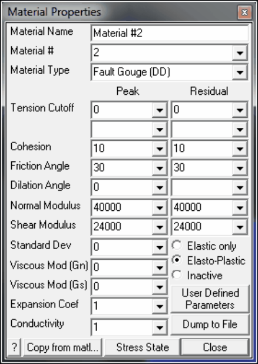
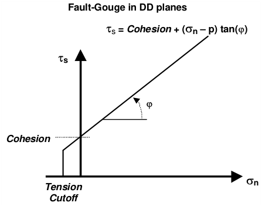
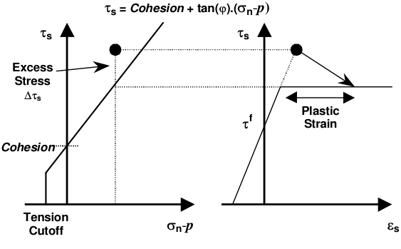
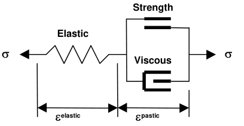

Fault-Gouge-Material kann verwendet werden, um das nichtlineare Verhalten in DD-Ebenen in allen Map3D-Versionen zu beschreiben. Dieses Materialmodell unterstützt plastisches Nachgeben und die Analyse effektiver Spannungen infolge vorgegebenen Wasserdrucks vollständig.

- Material Name – legt einen beschreibenden Namen für das Material fest.

- Material # – legt die Materialnummer fest.

   - Materialnummer 1 ist für das Wirtsmaterial reserviert.

   - Die übrigen Materialnummern dienen zur Definition abweichender Materialzonen wie Erz, Störungsletten, Versatz usw.

Material Type – legt den Materialtyp fest (Mohr-Coulomb, Hoek-Brown, Drucker-Prager, Fault-Gouge, Hyperbolic-Backfill, Quadratic-Backfill, Equilibrated-Gouge, Yielding-Pillar oder none).

- Fault-Gouge – definiert die Bruchhüllkurve als Gerade in gleicher Weise wie Mohr-Coulomb in DD-Ebenen, jedoch ohne _UCS_ .

- Die Festigkeit wird anhand der Schubspannung in der Ebene, der Normalspannungen und des Wasserdrucks wie folgt definiert:

- Tension Cutoff und Cohesion werden in Spannungseinheiten (MPa oder psi) angegeben.

- Friction angle und dilation angle werden in Grad angegeben.

- Cohesion und friction angle definieren das Scherverhalten.

- Der tension cutoff definiert das Verhalten in Richtung senkrecht zur Scherebene.

- Die Spitzenwerte dieser Parameter werden bis zum Versagen verwendet.

- Nach dem Nachgeben werden die Restwerte verwendet, um ein Entfestigungsverhalten zu erzeugen.

- Restwerte werden in elastischen Analysen ignoriert.

- Wird der Fluiddruck als Teil des Stress State angegeben, wird die effektive Normalspannung (sn-p) verwendet (hier ist p der Fluiddruck).

Normal and Shear Modulus – legen die Moduln in Spannungseinheiten (MPa oder psi) fest.

- In DD-Ebenen stehen die auf die Elementoberflächen wirkenden Schub- und Normalspannungen über den Schub- bzw. Normalmodul mit dem elastischen Anteil der Scherverschiebung (Ride) und der Normalverschiebung (Konvergenz) in Beziehung.

- Die Spitzenwerte dieser Parameter werden bis zum Versagen verwendet.

- Nach dem Nachgeben werden die Restwerte verwendet.

Standard Deviation – legt die Standardabweichung in Spannungseinheiten (MPa oder psi) fest.

- Dieser Parameter beschreibt die Unsicherheit der Festigkeitsparameter.

- Dieser Parameter wird nur für die Darstellung der Scherversagenswahrscheinlichkeit verwendet Plot > Strength Factors > InPlane Probability N-distribution.

Viscous Modulus ( _Gn_ und _Gs_ ) – Diese Parameter werden nur in nichtlinearen Analysen verwendet (3D-FF-Blöcke

in Map3D Non-Linear und DD-Ebenen in Map3D Fault-Slip).

- Der viskose Modul beschreibt das Kriechverhalten, wobei der Kriechwiderstand als Kriechkoeffizient _C_ mal plastische Dehnungsrate bestimmt wird.

- Beachten Sie, dass Sie sowohl den Kriechkoeffizienten _C_ als auch die Zeitschrittgröße D _t_ wählen und dann den Quotienten daraus als viskosen Modul _G_ angeben müssen.

- Geben Sie den viskosen Modul in Spannungseinheiten (MPa oder psi) an.

Expansion Coefficient und Conductivity werden nur in Map3D Thermal-Fluid Flow verwendet.

- Mit Map3D Thermal-Fluid Flow lässt sich die stationäre Wärme- bzw. Fluidströmung gekoppelt mit der Spannungsanalyse gleichzeitig lösen.

Elastic only – wenn aktiviert, verhält sich dieses Material nur elastisch, d. h., die Festigkeitsparameter werden nicht verwendet.

- Damit lassen sich Zonen mit unterschiedlichen elastischen Eigenschaften und/oder Anfangsspannungszuständen definieren. Dazu können beispielsweise steife Gänge, weiche Erzzonen, Versatz oder Ausbauelemente gehören.

Elasto-Plastic – wenn aktiviert, verhält sich dieses Material elasto-viskoplastisch, d. h., die Festigkeitsparameter werden als Fließregel verwendet.

- Damit lassen sich Zonen sowohl mit unterschiedlichen elastischen Eigenschaften als auch mit unterschiedlichen Festigkeitsparametern definieren.

- Beachten Sie, dass in Map3D Fault-Slip nur DD-Elemente (d. h. Störungsletten) sich nichtlinear verhalten dürfen.

- In Map3D Non-Linear kann auch das 3D-Gebirge plastisch nachgeben.

Inactive – wenn aktiviert, wird dieses Material in der Spannungsanalyse nicht verwendet und beeinflusst daher die vorhergesagten Spannungen, Dehnungen oder Verschiebungen nicht.

- Damit lassen sich Zonen mit unterschiedlichen Festigkeitsparametern definieren, die beim Erzeugen von Konturen der Festigkeitsfaktoren verwendet werden.

User Defined – ermöglicht die Festlegung benutzerdefinierter Parameter, die bei der Konturdarstellung verwendet werden.

- Für jede Materialnummer werden unterschiedliche Parameter definiert.

      - Plot > Stress > User

   - Diese Parameter werden verwendet mit

- Damit lassen sich Zonen mit unterschiedlichen Festigkeitsparametern definieren, die beim Erzeugen von Konturen der Festigkeitsfaktoren verwendet werden.

Dump to File – ermöglicht es Ihnen, alle Materialeigenschaftsdaten in eine Datei auszugeben, die Sie in Notepad oder Excel ansehen können.

Copy from material ermöglicht es Ihnen, die Materialeigenschaften von einer Materialnummer auf eine andere zu kopieren. Alle Eigenschaften einschließlich des Spannungszustands werden kopiert.

Stress State – legt den Anfangsspannungszustand (Fernfeld) für das Material fest.

- Die meisten Materialien werden in Blöcke mit demselben Spannungszustand (Fernfeld) eingesetzt.

- Materialien wie Stempel oder Versatz werden mit Anfangsspannungen nahe null angesetzt.

- Teil der Spannungszustandsangabe ist der Wasserdruck, der für Berechnungen der effektiven Spannung bzw. Festigkeit verwendet werden kann.

In der elastischen Analyse werden die Schub- und Normalspannungen in der Schwächeebene (auf einer Störung, einer Kluftschar oder einer Schichtfläche) üblicherweise zusammen mit dem Mohr-Coulomb-Festigkeitskriterium verwendet, um das Ausmaß der Schädigung durch Überbeanspruchung abzuschätzen. Man kann erwarten, dass mehr überschüssige Spannung in einer elastischen Analyse im Allgemeinen mit größeren plastischen Dehnungen (Schlupf) in einer nichtlinearen Analyse korreliert. Da diese Parameter richtungsabhängig sind, ist dieses Kriterium repräsentativ für die Standsicherheit eines anisotropen Gebirges.

**Fault-Gouge in DD planes**

Die Überbeanspruchung kann in mehreren Formen dargestellt werden, darunter:

Plot > Strength Factors > dTip In-Plane excess shear stress

Plot > Strength Factors > dTub Ubiquitous-plane excess shear stress

Plot > Strength Factors > SF-ip Strength/Stress

Plot > Strength Factors > SF-ub Strength/Stress

Dagegen können Spannungen in der nichtlinearen Analyse die Festigkeit nie überschreiten, es sei denn, es wird Kriechen verwendet (in diesem Fall kann viskoses Kriechen Spannungszustände oberhalb des Bruchkriteriums zulassen, was auf fehlendes statisches Gleichgewicht hinweist). Daher betrachtet man bei der nichtlinearen Analyse üblicherweise direkt die plastische Dehnung oder die vom Modell vorhergesagte plastische Dehnungsrate als Schädigungsindikator.

In DD-Ebenen werden die elastischen Dehnungen aus den Spannungen bestimmt durch

ts = tf + _Shear Modulus_ eselastic

sn = sf + _Normal Modulus_ enelastic

wobei _Shear Modulus_ und _Normal Modulus_ die elastischen Moduln des Lettenmaterials in Scher- bzw. Normalrichtung darstellen, tf und sf den Anfangsspannungszustand in Scher- bzw. Normalrichtung darstellen und

eselastic =  dselastic / _Thickness_

enelastic =  dnelastic / _Thickness_

wobei dselastic und dnelastic den elastischen Anteil der Scherverschiebung (Ride) bzw. der Normalverschiebung (Konvergenz) darstellen und _Thickness_ die Dicke der DD-Ebene darstellt (d. h. Störungsletten, Flözmächtigkeit, Abbaumächtigkeit oder Pfeilerhöhe). Die Dicke der DD-Ebene wird festgelegt mit

CAD > Build > DDLoop

und kann geändert werden mit

#### CAD > Edit > Entity Properties

Wenn in DD-Elementen die Schubspannung über die Festigkeit steigt, lässt sich die plastische Dehnung durch Begrenzung der Spannung bestimmen

ts - ts° - _C_ Desplastic /D _t_ = _Cohesion_ + tan(j) ( sn - sn° - _C_ Denplastic /D _t_ )

wobei

ts° = _Shear Modulus_ esplastic

sn° = _Normal Modulus_ enplastic

Die akkumulierte plastische Dehnung eplastic wird als Summe der plastischen Kriechinkremente Deplastic über alle Kriechschritte bestimmt.

Fällt die Normalspannung unter die Zugfestigkeitsgrenze, lässt sich die plastische Dehnung durch Begrenzung der Spannung bestimmen

sn - sn° - _C_ Denplastic /D _t_ = _To_

Bei Scherversagen kann die plastische Normaldehnung außerdem eine Dilatationskomponente enthalten

enplastic = tan( _dilation angle_ ) esplastic

Die Gesamtdehnung ist gleich der Summe aus dem elastischen und dem plastischen Anteil.

Das Kriechverhalten wird mit einem linearen (Bingham-)Kriechmodell simuliert.

In jedem Kriechschritt wird der Spannungszustand aller nachgebenden Elemente (Elemente, in denen die Spannung die Festigkeit überschreitet) als Festigkeit plus Kriechwiderstand berechnet

_Strength_ + _C_ Denplastic /D _t_

_C_ = _G_ D _t_

wobei der Kriechwiderstand als Kriechkoeffizient _C_ mal plastische Dehnungsrate bestimmt wird. Beachten Sie, dass Sie sowohl den Kriechkoeffizienten _C_ als auch die Zeitschrittgröße D _t_ wählen und dann den Quotienten daraus als viskosen Modul _G_ angeben müssen. Der Kriechwiderstand kann einfach als Technik zur Dämpfung der nichtlinearen Verformungen oder für eine echte zeitabhängige Kriechsimulation verwendet werden

#### Analysis > Options > Creep

Die Dehnungen, die Scherverschiebung (Ride) und die Normalverschiebung (Konvergenz) können in mehreren Formen dargestellt werden, darunter:

Plot > Surface > Value > Elastic Plot > Surface > Value > Plastic Plot > Surface > Value > Total Plot > Strain > E1 - Major principal strain

Plot > Surface > Es Shear Strain

Plot > Surface > En Normal Strain

Plot > Surface > ds Shear Displacement (Ride)

Plot > Surface > dn Normal Displacement (Closure)

Ebenfalls von Interesse ist das plastische Kriechinkrement Deplastic, der Beitrag des viskosen Elements zum Scherwiderstand

Dts   = _C_ Desplastic /D _t_

Plot > Surface > dEs Incremental Shear Strain

Plot > Surface > dTs Excess Shear Stress

Verwandte Themen:

Mohr-Coulomb in DD planes

Backfill-Hyperbolic in DD planes
