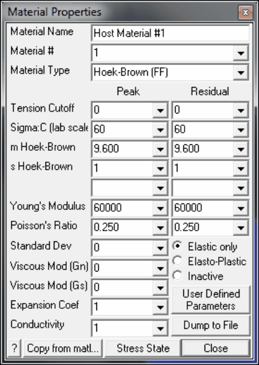
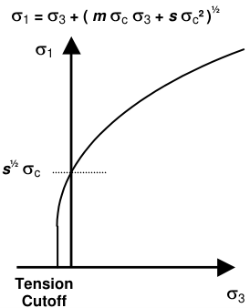

Hoek-Brown-Material kann in Map3D Fault-Slip nur als Versagenskriterium für elastische Analysen verwendet werden.

Material Name – legt einen beschreibenden Namen für das Material fest.

Material # – legt die Materialnummer fest.

- Materialnummer 1 ist für das Wirtsmaterial reserviert.

- Die übrigen Materialnummern dienen zur Definition abweichender Materialzonen wie Erz, Störungsletten, Versatz usw.

Material Type – legt den Materialtyp fest (Mohr-Coulomb, Hoek-Brown, Drucker-Prager, Fault-Gouge, Hyperbolic-Backfill, Quadratic-Backfill, Equilibrated-Gouge, Yielding-Pillar oder none).

- Hoek-Brown – definiert die Bruchhüllkurve als gekrümmte Linie.

- Für 3D-FF-Blöcke definiert das Hoek-Brown-Kriterium die Festigkeit anhand der Hauptspannungen wie folgt:

**Hoek-Brown in 3D FF blocks**

- Tension cutoff und sc werden in Spannungseinheiten (MPa oder psi) angegeben.

- Es werden nur die Spitzenwerte verwendet.

Young's Modulus and Poisson's Ratio – legen den Elastizitätsmodul (Gebirgsmaßstab – Verformung) in Spannungseinheiten (MPa oder psi) fest.

- Es werden nur die Spitzenwerte verwendet.

Standard Deviation – legt die Standardabweichung in Spannungseinheiten (MPa oder psi) fest.

- Dieser Parameter beschreibt die Unsicherheit der Festigkeitsparameter.

- Dieser Parameter wird nur für die Darstellung der Scherversagenswahrscheinlichkeit verwendet Plot > Strength Factors > Rockmass Probability N-distribution.

Viscous Modulus ( _Gn_ und _Gs_ ) – Diese Parameter werden für das Hoek-Brown-Material nicht verwendet.

Expansion Coefficient und Conductivity werden nur in Map3D Thermal-Fluid Flow verwendet. Mit Map3D Thermal-Fluid Flow lässt sich die stationäre Wärme- bzw. Fluidströmung gekoppelt mit der Spannungsanalyse gleichzeitig lösen.

Elastic only – wenn aktiviert, verhält sich dieses Material nur elastisch, d. h., die Festigkeitsparameter werden nicht verwendet.

- Damit lassen sich Zonen mit unterschiedlichen elastischen Eigenschaften und/oder Anfangsspannungszuständen definieren. Dazu können beispielsweise steife Gänge, weiche Erzzonen, Versatz oder Ausbauelemente gehören.

Elasto-Plastic – wenn aktiviert, verhält sich dieses Material elasto-viskoplastisch, d. h., die Festigkeitsparameter werden als Fließregel verwendet.

- Damit lassen sich Zonen sowohl mit unterschiedlichen elastischen Eigenschaften als auch mit unterschiedlichen Festigkeitsparametern definieren.

- Beachten Sie, dass in Map3D Fault-Slip nur DD-Elemente (d. h. Störungsletten) sich nichtlinear verhalten dürfen.

- In Map3D Non-Linear kann auch das 3D-Gebirge plastisch nachgeben.

- Das Fließen von Hoek-Brown-Materialien wird derzeit nicht unterstützt.

Inactive – wenn aktiviert, wird dieses Material in der Spannungsanalyse nicht verwendet und beeinflusst daher die vorhergesagten Spannungen, Dehnungen oder Verschiebungen nicht.

- Damit lassen sich Zonen mit unterschiedlichen Festigkeitsparametern definieren, die beim Erzeugen von Konturen der Festigkeitsfaktoren verwendet werden.

User Defined – ermöglicht die Festlegung benutzerdefinierter Parameter, die bei der Konturdarstellung verwendet werden.

- Für jede Materialnummer werden unterschiedliche Parameter definiert.

      - Plot > Stress > User

   - Diese Parameter werden verwendet mit

- Damit lassen sich Zonen mit unterschiedlichen Festigkeitsparametern definieren, die beim Erzeugen von Konturen der Festigkeitsfaktoren verwendet werden.

Dump to File – ermöglicht es Ihnen, alle Materialeigenschaftsdaten in eine Datei auszugeben, die Sie in Notepad oder Excel ansehen können.

Copy from material – ermöglicht es Ihnen, die Materialeigenschaften von einer Materialnummer auf eine andere zu kopieren. Alle Eigenschaften einschließlich des Spannungszustands werden kopiert.

Stress State – legt den Anfangsspannungszustand (Fernfeld) für das Material fest.

- Die meisten Materialien werden in Blöcke mit demselben Spannungszustand (Fernfeld) eingesetzt.

- Materialien wie Stempel oder Versatz werden mit Anfangsspannungen nahe null angesetzt.

Verwandte Themen:

Mohr_Coulomb in 3D FF blocks

Drucker-Prager in 3D FF blocks
