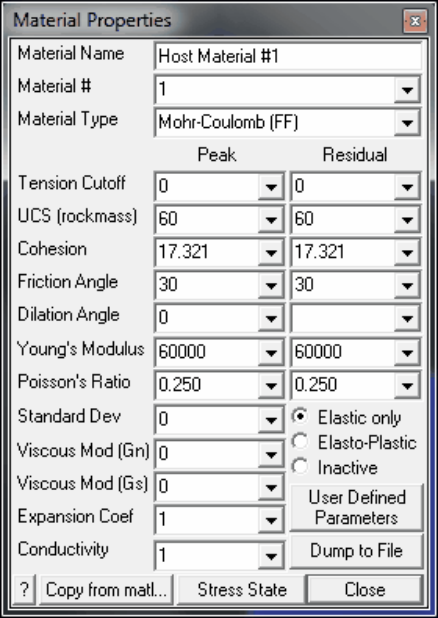
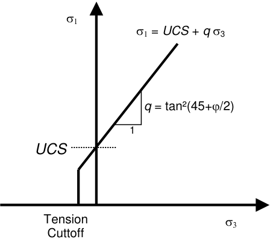
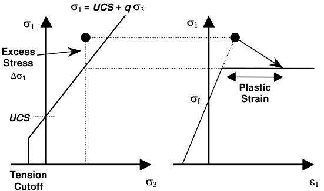
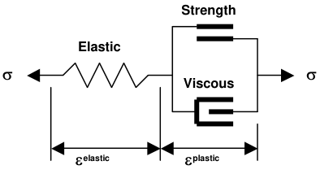

Mohr-Coulomb-Material kann verwendet werden, um das nichtlineare Verhalten in 3D-FF-Blöcken in Map3D NonLinear zu beschreiben. Es kann außerdem als Versagenskriterium für elastische Analysen in Map3D Fault-Slip verwendet werden.

Material Name – legt einen beschreibenden Namen für das Material fest.

Material # – legt die Materialnummer fest.

- Materialnummer 1 ist für das Wirtsmaterial reserviert.

- Die übrigen Materialnummern dienen zur Definition abweichender Materialzonen wie Erz, Störungsletten, Versatz, entfestigte Materialien usw.

Material Type – legt den Materialtyp fest (Mohr-Coulomb, Hoek-Brown, Drucker-Prager, Fault-Gouge, Equilibrated-Gouge, Yielding-Pillar, Hyperbolic-Backfill, Quadratic-Backfill, Softened-Material oder none).

- Mohr-Coulomb – definiert die Bruchhüllkurve als Gerade.

- Für 3D-FF-Blöcke definiert das Mohr-Coulomb-Kriterium die Festigkeit anhand der Hauptspannungen wie folgt:

#### Mohr-Coulomb in 3D FF blocks

- Tension cutoff und _UCS_ werden in Spannungseinheiten (MPa oder psi) angegeben.

- Friction angle und dilation angle werden in Grad angegeben.

- Cohesion steht über die Beziehung _UCS_ =2 _Coh_ tan(45+j/2) mit _UCS_ und dem Reibungswinkel in Zusammenhang. Wird Cohesion angegeben, wird _UCS_ aus dieser Beziehung bestimmt.

- Die Spitzenwerte dieser Parameter werden bis zum Versagen verwendet. Nach dem Nachgeben werden die Restwerte verwendet, um ein Entfestigungsverhalten zu erzeugen.

- Restwerte werden in elastischen Analysen ignoriert.

Young's Modulus and Poisson's Ratio – legen den Elastizitätsmodul (Gebirgsmaßstab – Verformung) in Spannungseinheiten (MPa oder psi) fest.

- Die Spitzenwerte dieser Parameter werden bis zum Versagen verwendet.

- Nach dem Nachgeben werden die Restwerte verwendet. Restwerte werden in elastischen Analysen ignoriert.

Standard Deviation – legt die Standardabweichung in Spannungseinheiten (MPa oder psi) fest.

- Dieser Parameter beschreibt die Unsicherheit der Festigkeitsparameter.

- Dieser Parameter wird nur für die Darstellung der Scherversagenswahrscheinlichkeit verwendet Plot > Strength Factors > Rockmass Probability N-distribution.

Viscous Modulus ( _Gn_ und _Gs_ ) – Diese Parameter werden nur in nichtlinearen Analysen verwendet (3D-FF-Blöcke in Map3D Non-Linear und DD-Ebenen in Map3D Fault-Slip). Für 3D-FF-Blöcke wird nur _Gs_ verwendet.

- Der viskose Modul beschreibt das Kriechverhalten, wobei der Kriechwiderstand als Kriechkoeffizient _C_ mal plastische Dehnungsrate bestimmt wird. Beachten Sie, dass Sie sowohl den Kriechkoeffizienten _C_ als auch die Zeitschrittgröße D _t_ wählen und dann den Quotienten daraus als viskosen Modul _G_ angeben müssen.

- Geben Sie den viskosen Modul in Spannungseinheiten (MPa oder psi) an.

Expansion Coefficient und Conductivity werden nur in Map3D Thermal-Fluid Flow verwendet.

- Mit Map3D Thermal-Fluid Flow lässt sich die stationäre Wärme- bzw. Fluidströmung gekoppelt mit der Spannungsanalyse gleichzeitig lösen.

Elastic only – wenn aktiviert, verhält sich dieses Material nur elastisch, d. h., die Festigkeitsparameter werden nicht verwendet.

- Damit lassen sich Zonen mit unterschiedlichen elastischen Eigenschaften und/oder Anfangsspannungszuständen definieren. Dazu können beispielsweise steife Gänge, weiche Erzzonen, Versatz oder Ausbauelemente gehören.

Elasto-Plastic – wenn aktiviert, verhält sich dieses Material elasto-viskoplastisch, d. h., die Festigkeitsparameter werden als Fließregel verwendet.

- Damit lassen sich Zonen sowohl mit unterschiedlichen elastischen Eigenschaften als auch mit unterschiedlichen Festigkeitsparametern definieren.

- Beachten Sie, dass in Map3D Fault-Slip nur DD-Elemente (d. h. Störungsletten) sich nichtlinear verhalten dürfen.

- In Map3D Non-Linear kann auch das 3D-Gebirge plastisch nachgeben.

Inactive – wenn aktiviert, wird dieses Material in der Spannungsanalyse nicht verwendet und beeinflusst daher die vorhergesagten Spannungen, Dehnungen oder Verschiebungen nicht.

- Damit lassen sich Zonen mit unterschiedlichen Festigkeitsparametern definieren, die beim Erzeugen von Konturen der Festigkeitsfaktoren verwendet werden.

User Defined – ermöglicht die Festlegung benutzerdefinierter Parameter, die bei der Konturdarstellung verwendet werden.

- Für jede Materialnummer werden unterschiedliche Parameter definiert.

   - Plot > Stress > User

- Diese Parameter werden verwendet mit

- Damit lassen sich Zonen mit unterschiedlichen Festigkeitsparametern definieren, die beim Erzeugen von Konturen der Festigkeitsfaktoren verwendet werden.

Dump to File – ermöglicht es Ihnen, alle Materialeigenschaftsdaten in eine Datei auszugeben, die Sie in Notepad oder Excel ansehen können.

Copy from material – ermöglicht es Ihnen, die Materialeigenschaften von einer Materialnummer auf eine andere zu kopieren. Alle Eigenschaften einschließlich des Spannungszustands werden kopiert.

Stress State – legt den Anfangsspannungszustand (Fernfeld) für das Material fest.

- Die meisten Materialien werden in Blöcke mit demselben Spannungszustand (Fernfeld) eingesetzt.

- Materialien wie Stempel oder Versatz werden mit Anfangsspannungen nahe null angesetzt.

In der elastischen Analyse werden die Hauptspannungen üblicherweise zusammen mit dem Festigkeitskriterium nach Mohr-Coulomb oder Hoek-Brown verwendet, um das Ausmaß der Schädigung durch Überbeanspruchung abzuschätzen. Man kann erwarten, dass mehr überschüssige Spannung in einer elastischen Analyse im Allgemeinen mit größeren plastischen Dehnungen in einer nichtlinearen Analyse korreliert. Da keiner der Parameter richtungsabhängig ist, ist dieses Kriterium repräsentativ für die Standsicherheit eines homogenen Gebirges.

#### Mohr-Coulomb in 3D FF blocks

Die Überbeanspruchung kann in mehreren Formen dargestellt werden, darunter:

Plot > Strength Factors > dS1 - Excess Stress

Plot > Strength Factors > dTmax - Excess Stress

Plot > Strength Factor > SF-A - Strength/Stress Plot > Strength Factor > SF-B - Strength/Stress

Plot > Strength Factors > SF-C - Strength/Stress

Dagegen können Spannungen in der nichtlinearen Analyse die Festigkeit nie überschreiten, es sei denn, es wird Kriechen verwendet (in diesem Fall kann viskoses Kriechen Spannungszustände oberhalb des Bruchkriteriums zulassen, was auf fehlendes statisches Gleichgewicht hinweist). Daher betrachtet man bei der nichtlinearen Analyse üblicherweise direkt die plastische Dehnung oder die vom Modell vorhergesagte plastische Dehnungsrate als Schädigungsindikator.

In 3D-FF-Blöcken werden die elastischen Dehnungen aus den Spannungen bestimmt durch

sxx   = sxxf  + [ (1-n) exxelastic + n ( eyyelastic + ezzelastic ) ] _E_ / [ (1+n) (1-2n) ] syy  = syyf + [ (1-n) eyyelastic + n ( ezzelastic + exxelastic  ) ] _E_ / [ (1+n) (1-2n) ] szz   = szzf  + [ (1-n) ezzelastic  + n ( exxelastic + eyyelastic ) ] _E_ / [ (1+n) (1-2n) ] txy  = txyf +  exyelastic _E_ / (1+n) tyz  = tyzf  +  eyzelastic _E_ / (1+n) txz  = txzf  +  exzelastic _E_ / (1+n)

wobei _E_ und n den Elastizitätsmodul (Gebirgsmaßstab – Verformung) bzw. die Poissonzahl darstellen und sf und tf den Anfangsspannungszustand (vor dem Abbau) darstellen

In Map3D Non-Linear lässt sich die plastische Dehnung, wenn die Spannung über die Festigkeit steigt, durch Begrenzung der Spannung bestimmen

wobei

s1 - s1° - _C_ De1plastic /D _t_ = _UCS_ + _q_ ( s3 - s3° - _C_ De3plastic /D _t_ ) s1°  = [ (1-n) e1plastic + n ( e2plastic + e3plastic ) ] _E_ / [ (1+n) (1-2n) ] s2°  = [ (1-n) e2plastic + n ( e3plastic + e1plastic ) ] _E_ / [ (1+n) (1-2n) ] s3°  = [ (1-n) e3plastic + n ( e1plastic + e2plastic ) ] _E_ / [ (1+n) (1-2n) ]

Die akkumulierte plastische Dehnung eplastic wird als Summe der plastischen Kriechinkremente Deplastic über alle Kriechschritte bestimmt.

Fällt die Spannung unter die Zugfestigkeitsgrenze, lässt sich die plastische Dehnung durch Begrenzung der Spannung bestimmen

s3 - s3° - _C_ De3plastic /D _t_ = _To_

Die plastische Volumendehnung kann außerdem eine Dilatationskomponente enthalten

evolume = ( e1plastic + e2plastic + e3plastic ) = tan( _dilation angle_ ) e1plastic

Die Gesamtdehnung ist gleich der Summe aus dem elastischen und dem plastischen Anteil.

Das Kriechverhalten wird mit einem linearen (Bingham-)Kriechmodell simuliert.

In jedem Kriechschritt wird der Spannungszustand aller nachgebenden Elemente (Elemente, in denen die Spannung die Festigkeit überschreitet) als Festigkeit plus Kriechwiderstand berechnet

s = _Strength_ + _C_ Deplastic /D _t_

_C_ = _G_ D _t_

wobei der Kriechwiderstand als Kriechkoeffizient _C_ mal plastische Dehnungsrate bestimmt wird. Beachten Sie, dass Sie sowohl den Kriechkoeffizienten _C_ als auch die Zeitschrittgröße D _t_ wählen und dann den Quotienten daraus als viskosen Modul _G_ angeben müssen. Der Kriechwiderstand kann einfach als Technik zur Dämpfung der nichtlinearen Verformungen oder für eine echte zeitabhängige Kriechsimulation verwendet werden

#### Analysis > Options > Creep

Die Dehnungen können in mehreren Formen dargestellt werden, darunter:

Plot > Strain > Value > Elastic

Plot > Strain > Value > Plastic Plot > Strain > Value > Total

Plot > Strain > E1 - Major principal strain Plot > Strain > E2 - Intermediate principal strain

Plot > Strain > E3 - Minor principal strain

Plot > Strain > Emax - Maximum shear strain

Plot > Strain > Evolume - Volumetric shear strain

Verwandte Themen:

Hoek-Brown in 3D FF blocks

Drucker-Prager in 3D FF blocks
