Entfestigte Materialien können verwendet werden, um das Nachgeben des Gebirges und die daraus resultierenden Spannungsumlagerungseffekte zu simulieren. Obwohl die Plastizitätsmodellierung dafür zweifellos die beste Methode ist, lässt sich auch die Materialentfestigung nutzen, um Gebirgsnachgeben, Spannungsumlagerung und damit die mögliche Auswirkung auf umliegende Bereiche zu simulieren. Der Vorteil dieses Ansatzes besteht darin, dass der Ingenieur nichtlineares Verhalten schnell und einfach untersuchen kann.

Die Theorie hinter der Entfestigung wird ausführlich in **Elastic softening to simulate plastic yielding.pdf** erläutert. Nachfolgend eine kurze Zusammenfassung.

In der numerischen Modellierung erfolgt die Entspannung eines elastischen Gebirges durch das Zulassen plastischer Dehnungen. Diese Dehnungen bauen die durch die elastische Antwort angezeigte überschüssige Spannung ab. Eine alternative Methode zur Erzeugung plastischer Verformungen zeigt die folgende Abbildung. Hier wird der Spannungs-Dehnungs-Modul schrittweise verringert. Es lässt sich beobachten, dass dies zwar technisch die Steifigkeit der elastischen Spannungs-Dehnungs-Antwort verringert, aber als gleichwertig zu Inkrementen (Dep ) der plastischen Dehnung interpretiert werden kann.

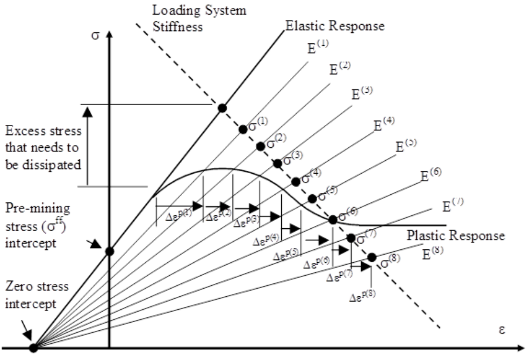

Gebirgsversagen wird im Allgemeinen als Ergebnis von Scherversagen verstanden und lässt sich durch Reduktion des Schubmoduls simulieren, während Volumenänderungen je nach Spannungsbedingungen und Art des Gesteins mit Dilatation oder Kompaktion verbunden sind. Die Reduktion des Schubmoduls kann zur Verringerung der Spannungsdifferenz (s1-s3) verwendet werden, und die Reduktion des Kompressionsmoduls kann zur Steuerung der Volumendehnung

(evolume=e1+e2+e3) verwendet werden. Dies ermöglicht die unabhängige Steuerung des Scherversagensprozesses und des Dilatationsverhaltens. Ob die Entfestigung automatisiert oder manuell erfolgt, es muss offensichtlich darauf geachtet werden, um einen realistischen Betrag zu entspannen, damit der endgültige Spannungszustand in den betroffenen Pfeilern ein gut kalibriertes Festigkeitskriterium erfüllt.

Der nicht entfestigte Kompressionsmodul **_B_** und der Schubmodul **_G_** lassen sich aus dem Elastizitätsmodul **_E_** und der Poissonzahl wie folgt bestimmen:

**_B = E/3/(1-2_** n **_) G = E/2/(1+_** n **_)_**

Der entfestigte Kompressionsmodul **_Bs_** und der entfestigte Schubmodul **_Gs_** werden mit dem Parameter Volume Softening **_b_** und dem Parameter Shear Softening **_g_** in der folgenden Tabelle so bestimmt, dass

**_Bs = B×b Gs = G×g_**

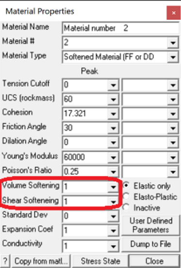

Beispielsweise bedeutet eine Scherentfestigung mit **_g=1_** keine Entfestigung, während eine Scherentfestigung mit **_g=0.5_** eine Verringerung des Schubmoduls um 50 % bedeutet...

Um die Einfachheit des Entfestigungsverfahrens zu demonstrieren, dient ein Beispiel eines überbeanspruchten Tunnels mit nachgebenden Seitenwänden. Beachten Sie, dass das Ziel dieses Beispiels nicht darin besteht, die Ergebnisse der plastischen Modellierung nachzubilden, und man dies auch nicht erwarten sollte. Es demonstriert jedoch Seitenwandentfestigung, Entspannung, Spannungsübertragung und Nachgeben. Hier soll gezeigt werden, dass sich mit Entfestigung:

- Spannungen an umliegende Widerlager abbauen lassen,

- größere Dehnungen und Verschiebungen erzeugen lassen, wie sie mit Plastizität verbunden sind.

#### Ergebnisse des plastischen Modells

Betrachten Sie einen kreisförmigen Tunnel mit 1 m Radius und homogenen Primärspannungen von 30 MPa. Durchgehend wurde ein Mohr-Coulomb-Versagenskriterium mit einer UCS von 11.9 MPa, einem Reibungswinkel von 30°, einem Elastizitätsmodul von 6780 MPa und einer Poissonzahl von 0.21 verwendet. Dieses Modell wurde mit Map3D Visco-Plastic analysiert. Es wurde elastisch/ideal-plastisches Verhalten mit einer auf null gesetzten Dilatationsrate verwendet. Unten ist links die größte Hauptspannung und rechts die Verschiebung dargestellt.

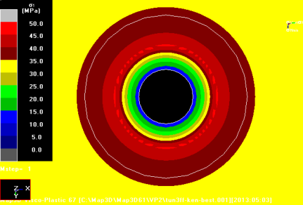

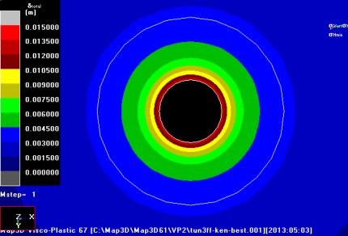

Diese Map3D-Visco-Plastic-Modellergebnisse stimmen gut mit der geschlossenen analytischen Lösung für die plastischen Spannungen und Verschiebungen überein. Zum Vergleich ist auch die elastische analytische Lösung dargestellt.

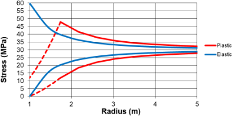

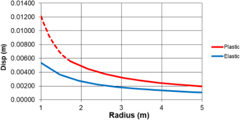

#### Ergebnisse des entfestigten Modells

Um das Obige mit Entfestigung zu modellieren, wurde eine Zone um die Seitenwände des Tunnels entfestigt, wie unten gezeigt, wobei die Strecke blau und die entfestigte Zone violett dargestellt ist. Diese entfestigte Zone wurde so gewählt, dass sie dieselbe Größe wie die oben bestimmte plastische Zone hat (1.74 m Radius).

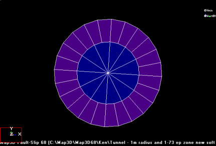

In diesem Fall soll gezeigt werden, dass sich die plastische Konvergenz mit einem einfachen entfestigten Modell nachbilden lässt.

Dabei wurde der elastische Schubmodul um den Faktor **_g=0.2_** entfestigt, während der Kompressionsmodul konstant gehalten wurde. Unten ist links die größte Hauptspannung und rechts die Verschiebung dargestellt.

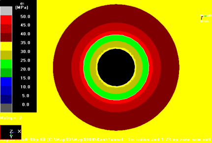

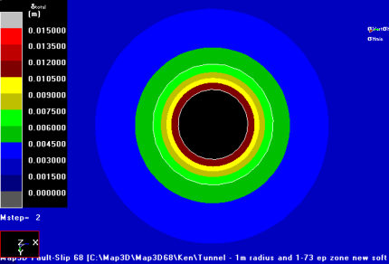

Die entfestigten Ergebnisse stimmen sowohl für die plastische kleinste Hauptspannung als auch für die Verschiebung hervorragend überein. Beachten Sie, dass die tatsächlichen entfestigten Werte der größten Hauptspannung in der Fließzone zwar nicht im Detail mit den plastischen Ergebnissen übereinstimmen, im Mittel aber etwa die richtige Größenordnung haben. Außerdem wurde die Spannung recht genau auf das elastische „Widerlager“ umgelagert, wobei fast genau die erwartete Spannungskonzentration auftritt.

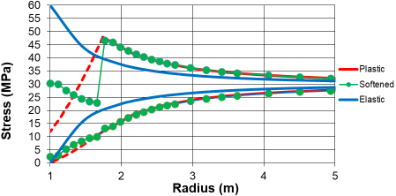

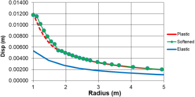

Auch wenn die Ergebnisse der Entfestigung nicht perfekt mit den Ergebnissen der plastischen Analyse übereinstimmen, haben sie das Nachgeben des Seitenwandmaterials offensichtlich simuliert und die elastischen Ergebnisse deutlich näher an diejenigen des plastischen Modells herangeführt. Es scheint, dass sich die Materialentfestigung nutzen lässt, um Gebirgsnachgeben, Spannungsumlagerung und damit die mögliche Auswirkung auf umliegende Bereiche zu simulieren. Der Vorteil dieses Ansatzes besteht darin, dass der Ingenieur im Vergleich zur plastischen Modellierung nichtlineares Verhalten schnell und einfach untersuchen kann. Entfestigte Modelle erfordern im Vergleich zu einfachen elastischen Modellen nur sehr wenig zusätzliche Analysezeit.

Eine ausführlichere Beschreibung und Beispiele finden Sie in **Elastic softening to simulate plastic yielding.pdf** .
