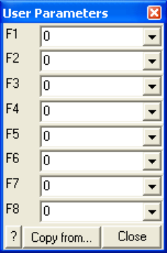

Ermöglicht die Festlegung benutzerdefinierter Parameter, die bei der Konturdarstellung verwendet werden.

#### Plot > Stress > User

Diese Parameter werden verwendet mit

Für jede Materialnummer werden unterschiedliche Parameter definiert. Daher verwenden Analyseergebnisse, die in verschiedenen abweichenden Materialzonen berechnet werden, die jeweils für die Zone passenden benutzerdefinierten Parameter.
