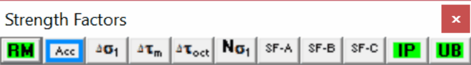
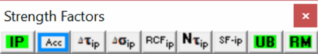
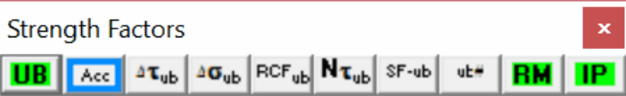

Aktiviert die Symbolleiste für Festigkeitsfaktoren – nach der Map3D-BEM-Analyse.

Diese Symbolleiste soll einen schnellen Zugriff auf die Darstellungen der Versagensarten bieten.

#### Gebirgsfestigkeit

Plot > Strength Factors > Strength Parameters ändert die 3D-Festigkeitsparameter nach Mohr-Coulomb, Hoek-Brown und Drucker-Prager.

Plot > Strength Factors > SF-A stellt das Verhältnis Festigkeit/Spannung nach Methode A als Konturen dar Plot > Strength Factors > SF-B stellt das Verhältnis Festigkeit/Spannung nach Methode B als Konturen dar Plot > Strength Factors > SF-C stellt das Verhältnis Festigkeit/Spannung nach Methode C als Konturen dar

Plot > Strength Factors > SF/A stellt das Verhältnis Spannung/Festigkeit nach Methode A als Konturen dar Plot > Strength Factors > SF/B stellt das Verhältnis Spannung/Festigkeit nach Methode B als Konturen dar Plot > Strength Factors > SF/C stellt das Verhältnis Spannung/Festigkeit nach Methode C als Konturen dar

Plot > Strength Factors > dS1 stellt die überschüssige größte Hauptspannung Ds1 als Konturen dar

Plot > Strength Factors > dTmax stellt die überschüssige maximale Schubspannung Dtmax = D½ ( s1 - s3 ) als Konturen dar

Plot > Strength Factors > dToct stellt die überschüssige oktaedrische Schubspannung Dtoct = D1/3 [(s1 - s2)² + (s2 - s3)² +(s3 - s1)²]½ als Konturen dar

Plot > Strength Factors > Ns1 stellt die Versagenswahrscheinlichkeit, berechnet als N(Ds1/s), als Konturen dar, wobei s die Standardabweichung ist.

Plot > Strength Factors > Acc stellt die akkumulierte Schädigung als Konturen dar.

#### Festigkeit in der Ebene

Plot > Strength Factors > In-plane parameters ändert die Mohr-Coulomb-Festigkeitsparameter in der Ebene

Plot > Strength Factors > SF-ip stellt das Verhältnis Festigkeit/Spannung anhand der Spannungen in der Ebene als Konturen dar Plot > Strength Factors > SF/ip stellt das Verhältnis Spannung/Festigkeit anhand der Spannungen in der Ebene als Konturen dar

Plot > Strength Factors > dTip stellt die überschüssige Schubspannung in der Ebene Dtip als Konturen dar

Plot > Strength Factors > NTip stellt die Versagenswahrscheinlichkeit, berechnet als N(Dtip/s), als Konturen dar, wobei s die Standardabweichung ist.

Plot > Strength Factors > Acc stellt die akkumulierte Schädigung als Konturen dar.

#### Festigkeit der ubiquitären Ebene

Plot > Strength Factors > Ubiquitous Parameters ändert die Mohr-Coulomb-Festigkeitsparameter der ubiquitären Ebene

Plot > Strength Factors > SF-ub stellt das Verhältnis Festigkeit/Spannung anhand der Spannungen in der ubiquitären Ebene als Konturen dar

Plot > Strength Factors > SF/ub stellt das Verhältnis Spannung/Festigkeit anhand der Spannungen in der ubiquitären Ebene als Konturen dar

Plot > Strength Factors > dTub stellt die überschüssige Schubspannung in der ubiquitären Ebene Dtub als Konturen dar

Plot > Strength Factors > NTub stellt die Versagenswahrscheinlichkeit, berechnet als N(Dtip/s), als Konturen dar, wobei s die Standardabweichung ist.

Plot > Strength Factors > Acc stellt die akkumulierte Schädigung als Konturen dar.

#### Hinweise:

Die Symbolleiste für Festigkeitsfaktoren kann erst nach der Phase Modellaufbau – CAD aktiviert werden

#### Map3D-Analysephasen

Jede dieser Komponenten kann bei Bedarf der Konturen-Symbolleiste hinzugefügt werden

Tools > Configure Contouring Toolbar
