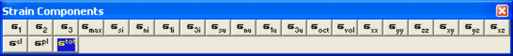

Aktiviert die Dehnungs-Symbolleiste – nach der Map3D-BEM-Analyse.

Diese Symbolleiste soll einen schnellen Zugriff auf die Dehnungskomponenten bieten.

Plot > Strain > E1 Größte Hauptdehnung e1 Plot > Strain > E2 Mittlere Hauptdehnung e2 Plot > Strain > E3 Kleinste Hauptdehnung e3 Plot > Strain > Emax Maximale Scherdehnung emax = ½( e3 - e3 )

Plot > Strain > Esi Maximale Scherdehnung in der Ebene esi Plot > Strain > Eni Normaldehnung in der Ebene eni Plot > Strain > E1i Maximale Dehnung in der Ebene e1i Plot > Strain > E3i Maximale Dehnung in der Ebene e3i Plot > Strain > Esu Maximale Scherdehnung in der ubiquitären Ebene esu Plot > Strain > Enu Normaldehnung in der ubiquitären Ebene enu Plot > Strain > E1u Maximale Dehnung in der ubiquitären Ebene e1u Plot > Strain > E3u Maximale Dehnung in der ubiquitären Ebene e3u Plot > Strain > Eoct Oktaedrische Scherdehnung eoct = 1/3 [(e1 - e2)² + (e2 - e3)² +(e3 - e1)²]½ Plot > Strain > Evol Volumendehnung evol = (e1 + e2 + e3) Plot > Strain > Exx Kartesische Dehnungskomponente exx Plot > Strain > Eyy Kartesische Dehnungskomponente eyy Plot > Strain > Ezz Kartesische Dehnungskomponente ezz Plot > Strain > Exy Kartesische Dehnungskomponente exy Plot > Strain > Eyz Kartesische Dehnungskomponente eyz Plot > Strain > Exz Kartesische Dehnungskomponente exz Plot > Strain > Value > Elastic eelastic Plot > Strain > Value > Plastic eplastic Plot > Strain > Value > Total etotal

Hinweise:

Die Dehnungs-Symbolleiste kann erst nach der Phase Modellaufbau – CAD aktiviert werden

Map3D-Analysephasen.

Jede dieser Komponenten kann bei Bedarf der Konturen-Symbolleiste hinzugefügt werden

Tools > Configure Contouring Toolbar
