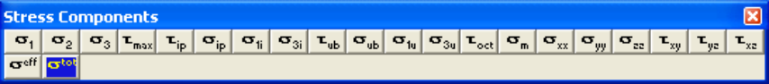

Aktiviert die Spannungs-Symbolleiste – nach der Map3D-BEM-Analyse.

Diese Symbolleiste soll einen schnellen Zugriff auf die Spannungskomponenten bieten.

Plot > Stress > S1 Größte Hauptspannung s1 Plot > Stress > S2 Mittlere Hauptspannung s2 Plot > Stress > S3 Kleinste Hauptspannung s3 Plot > Stress > Tmax Maximale Schubspannung ½(s1 - s3)

Plot > Stress > Tip Schubspannung in der Ebene tip Plot > Stress > Sip Normalspannung in der Ebene sip Plot > Stress > S1i Maximale Spannung in der Ebene si1 Plot > Stress > S3i Minimale Spannung in der Ebene si3 Plot > Stress > Tub Schubspannung in der ubiquitären Ebene tub Plot > Stress > Sub Normalspannung in der ubiquitären Ebene sub Plot > Stress > S1u Maximale Spannung in der ubiquitären Ebene s1u Plot > Stress > S3u Minimale Spannung in der ubiquitären Ebene s3u Plot > Stress > Toct Oktaedrische Schubspannung toct = 1/3 [(s1 - s2)² + (s2 - s3)² +(s3 - s1)²]½ Plot > Stress > Smean Mittlere Spannung smean = 1/3 (s1 + s2 + s3)

Plot > Stress > Sxx Kartesische Spannungskomponente sxx Plot > Stress > Syy Kartesische Spannungskomponente syy Plot > Stress > Szz Kartesische Spannungskomponente szz Plot > Stress > Txy Kartesische Spannungskomponente txy Plot > Stress > Tyz Kartesische Spannungskomponente tyz

Plot > Stress > Txz Kartesische Spannungskomponente txz

Plot > Stress > Value > Seff Effektive Spannung seff

Plot > Stress > Value > Stotal Gesamtspannung stotal

Hinweise:

Die Spannungs-Symbolleiste kann erst nach der Phase Modellaufbau – CAD aktiviert werden

Map3D-Analysephasen

Jede dieser Komponenten kann bei Bedarf der Konturen-Symbolleiste hinzugefügt werden

Tools > Configure Contouring Toolbar
