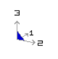
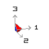

Die Orientierung des Hauptspannungszustands im Fernfeld wird durch das Symbol für die Spannungsorientierung in der oberen rechten Ecke der Anzeige angezeigt.

In der obigen Ansicht zeigt die s1-Achse überwiegend in den Bildschirm hinein und etwas nach rechts, die s2-Achse zeigt überwiegend nach rechts und etwas aus dem Bildschirm heraus, und die s3-Achse zeigt senkrecht nach oben. Beachten Sie, dass die Rückseite des Symbols blau schattiert ist.

In der obigen Ansicht zeigt die s1-Achse überwiegend nach rechts und etwas in den Bildschirm hinein, die s2-Achse zeigt überwiegend aus dem Bildschirm heraus und etwas nach rechts, und die s3-Achse zeigt senkrecht nach oben. Beachten Sie, dass die Innenseite des Symbols rot schattiert ist.

Beachten Sie, dass die Länge der Achsen nach der Größe der Hauptspannungskomponenten skaliert ist.

Die Hauptspannungskomponenten vor dem Abbau werden über "CAD > Properties > Material Properties > Stress State" festgelegt.
