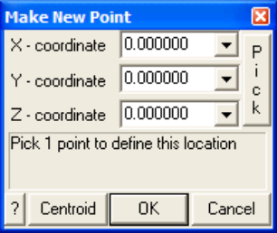

Erstellt einen neuen Visualisierungspunkt. Eine Beschreibung der in Map3D verfügbaren Visualisierungsroutinen finden Sie unter Visualization.

Visualisierungspunkte können als lichtquellenschattierte Kugeln dargestellt werden, deren Durchmesser und/oder Farbe mit der Magnitude variiert, und auf einer Ebene konturiert werden, um z. B. die Dichte darzustellen.

Jeder Punkt kann mit einer Reihe von Attributen versehen werden:

- numerische Werte (z. B. Farbe, Magnitude, Orientierung usw.)

- Textnachrichten

- Dateinamen (z. B. Grafikdateien, Dokumente, Tabellenkalkulationen usw.)

Ein Linksklick auf einen Punkt zeigt Lage, Magnitude und Textnachricht in der Statusleiste an.

Ein Rechtsklick auf einen Punkt aktiviert die Visual Database. Mit dieser Funktion lässt sich eine Datenbank nützlicher geologischer Informationen wie Gehalt, Gebirgsqualität usw. anzeigen.

Beim Aktivieren der Funktion werden Sie aufgefordert, die Koordinaten des neuen Visualisierungspunkts anzugeben.

Beachten Sie: Ist bereits eine Visualisierungsdatei aktiv, wird dieser neue Punkt der Datei hinzugefügt. Ist keine Visualisierungsdatei aktiv, werden Sie aufgefordert, eine zu öffnen, und der neue Punkt wird der Datei hinzugefügt.

X, Y and Z coordinate – legt die Koordinaten des Visualisierungspunkts fest.

Pick – aktiviert das Fadenkreuz des Cursors und ermöglicht die interaktive Auswahl der Koordinaten aus dem Modell.

Um die visuelle Auswahl von Punkten aus dem Modell zu erleichtern, stehen alle Fangfunktionen zur Verfügung.

#### CAD > Snap

Nach der Auswahl werden die Koordinaten des Visualisierungspunkts im Dialogfeld angezeigt.

Centroid – aktiviert den Cursor, sodass Sie ein Objekt aus dem Modell auswählen können. Die Koordinaten werden im Schwerpunkt des ausgewählten Objekts berechnet.

OK – schließt die Bearbeitung der Koordinaten ab und erstellt und zeigt den Visualisierungspunkt an.

Nach dem Erstellen des Visualisierungspunkts können Sie mit einem Rechtsklick auf den Punkt Textnachrichten und/oder Dateinamen hinzufügen.

- Textnachricht und Dateiname werden in der Statusleiste am unteren Bildschirmrand angezeigt, wenn Sie ein Ereignis mit der linken Maustaste auswählen.

- Sie können auch bearbeitet werden, indem Sie ein Ereignis mit der rechten Maustaste auswählen.

- Die Auswahl mit der rechten Maustaste ermöglicht außerdem die Anzeige der Datei, wenn der Dateiname mit einer Anwendung verknüpft wurde (siehe die Windows-Dokumentation zum „Verknüpfen einer Datei mit einem Programm“).
