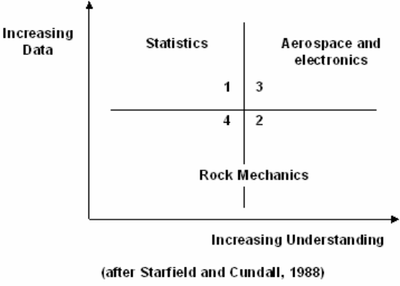
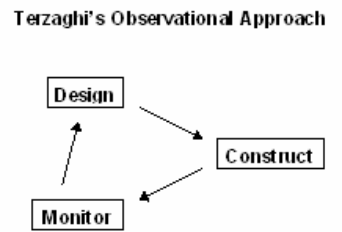
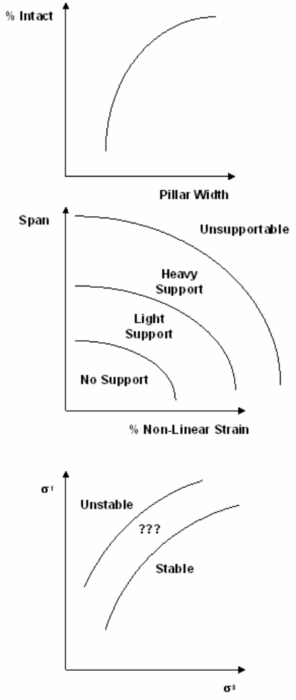
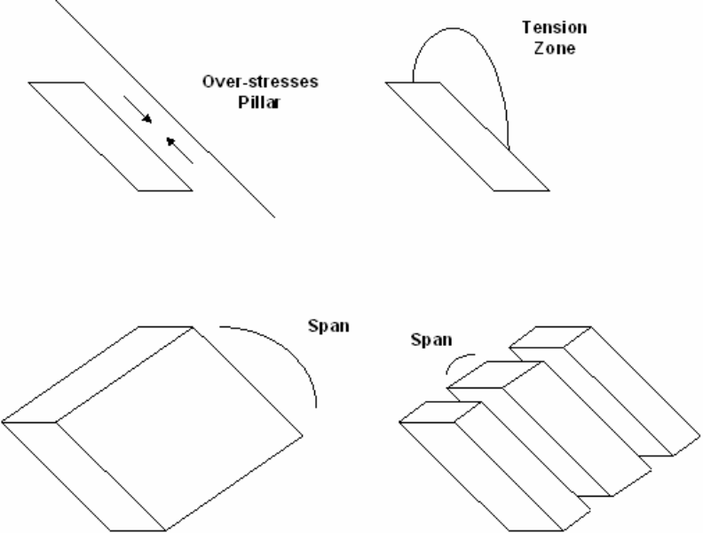
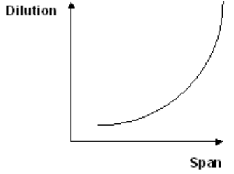
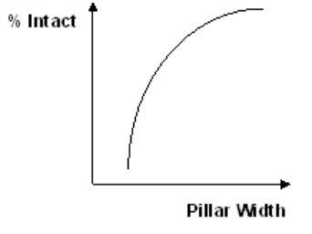
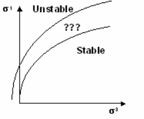
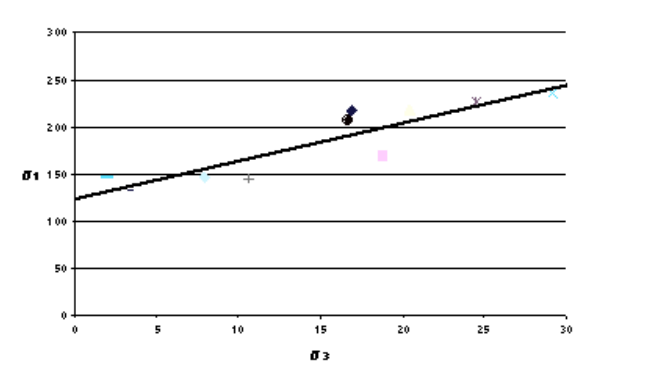

Das einfache Ziel der numerischen Modellierung ist es, (genau und zuverlässig) vorherzusagen, wie das Gebirge auf den Abbau reagiert. Wir legen die Lastbedingungen und die Geometrie fest (dazu können Gänge, Störungen, Schichtung usw. gehören), fordern Gleichgewicht und Kontinuität, nehmen elastisches und/oder nichtlineares Verhalten an und lösen dann diese Gleichungen, um Spannungen, Dehnungen, Verschiebungen usw. im gesamten Gebirge zu ermitteln.

Durch Auswertung der Ergebnisse der Spannungsanalyse lassen sich beispielsweise überbeanspruchte oder fließende Bereiche erkennen. Wir können feststellen, welche Stellen Ausbau benötigen und welche Ausbauart geeignet ist usw.

Das eigentliche Ziel ist es zu wissen, welche Probleme zu erwarten sind und wann und wo sie auftreten. So können Sie alternative Grubenlayouts und Abbaufolgen vergleichen und Strategien für den Umgang mit Problemen entwickeln, wenn sie auftreten. Unerwartete Produktionsunterbrechungen werden vermieden. Sie können konkrete Bemessungswerte für den Ausbaubedarf, bestimmte Pfeilerbreiten, zulässige Abbaukammerhöhen usw. festlegen. Kurz gesagt: Sie erhalten ein Werkzeug, das Sie bei der Planung Ihres Bergwerks unterstützt. Während die numerische Modellierung an sich relativ einfach ist, stellt die Interpretation der Ergebnisse eine wesentlich größere Herausforderung dar. Numerische Modellierung zur Prognose des Gebirgsverhaltens ist keine exakte Wissenschaft. Es wird immer Merkmale des Gebirges geben, die nicht vorhergesehen oder verstanden werden.

Das folgende Zitat von Starfield und Cundall (1988) nennt mehrere Gründe dafür.

_Felsmechanische Modelle gehören zur Klasse der „datenbegrenzten Probleme“: Man weiß selten genug über die Merkmale und das Verhalten des Gebirges, um es eindeutig zu modellieren. Daraus folgt, dass man Modelle in der Felsmechanik nicht auf konventionelle Weise (etwa wie in der Elektrotechnik oder der Luft- und Raumfahrttechnik) einsetzen kann und dass für die felsmechanische Modellierung eine eigene, angemessene Methodik erforderlich ist._

Probleme sind oft schlecht gestellt. Das erschwert die Interpretation der Ergebnisse und wirft die quälende Frage auf, ob überhaupt das richtige Problem modelliert wurde. Der Modellentwurf sollte sich an den Fragen orientieren, die das Modell beantworten soll, und nicht an den Einzelheiten des modellierten Systems. Das hilft, das Modell einfach und beherrschbar zu halten.

Ein Modell ist eine Vereinfachung der Wirklichkeit, keine Nachbildung. Es ist ein gedankliches Werkzeug, das für eine bestimmte Aufgabe entworfen oder ausgewählt werden muss. Das grundlegende Problem ist die Frage der Auflösung. Man fürchtet, das Problem zu stark zu vereinfachen.

Es ist zwecklos zu erwarten, jemals genügend Daten zu haben, um Gebirge auf konventionelle Weise (etwa wie in der Elektrotechnik oder der Luft- und Raumfahrttechnik) zu modellieren. Je mehr Details man einbezieht, desto mehr verliert man die gedankliche Kontrolle über das Modell, sodass es weniger statt mehr leistet.

#### Wie wird numerische Modellierung herkömmlich in der Bergwerksplanung eingesetzt?

In den meisten anderen Ingenieurdisziplinen (Elektrotechnik oder Luft- und Raumfahrttechnik) beruht die numerische Modellierung in der Regel darauf, das Verhalten anhand im Labor gemessener Materialeigenschaften vorherzusagen. Dies funktioniert im Allgemeinen gut, wenn Materialien, Geometrie und Lastbedingungen gut bekannt sind.

Im Gegensatz dazu beruht die herkömmliche Anwendung der numerischen Modellierung in der Bergwerksplanung auf der „Beobachtungsmethode nach Terzaghi“.

Zu Beginn (also vor dem Abbau) können Sie Parameterstudien durchführen. Sie können alternative Entwürfe vergleichen und wichtige Einflussfaktoren auf die Stabilität ermitteln. Möglicherweise stellen Sie fest, dass bestimmte Orientierungen günstiger sind als andere oder dass bestimmte Abbaufolgen die bessere Wahl sind. Sie können grob abschätzen, wie sich Kosten und Nutzen einer höheren Förderung gegenüber einem höheren Instandhaltungs- und Ausbauaufwand verhalten.

Zu wissen, welche Art von Problemen zu erwarten ist und welche Stellen besonders gefährdet sind, ist sicherlich nützlich, da Sie so Strategien für den Umgang mit Problemen entwickeln können, falls und wenn sie auftreten. Wenn Sie die Modellierung jedoch nutzen möchten, um konkrete Bemessungswerte für den Ausbaubedarf, bestimmte Pfeilerbreiten, zulässige Abbaukammerhöhen und tatsächliche Kosten festzulegen, müssen Sie Vertrauen in die Genauigkeit Ihrer Prognosen haben.

Es wäre zum Beispiel sinnlos, eine Pfeilerbreite von 1,2 m auf Grundlage einer Modellprognose festzulegen, wenn Sie keine Vorstellung davon hätten, wie zuverlässig diese Prognose ist. Sie würden Personal niemals unter einer Firste hindurchgehen lassen, nur weil Modellergebnisse sie als sicher ausweisen, es sei denn, Sie wären auch von der Zuverlässigkeit dieser Prognosen überzeugt.

Es ist grundsätzlich notwendig, die Zuverlässigkeit einer Prognose zu kennen, um Risiken zu bewerten und Kosten-Nutzen-Entscheidungen darauf zu stützen.

Es lohnt sich, einen Moment über diese Aussage nachzudenken. Mir fällt kein Beispiel ein, in dem Prognosen unbekannter Zuverlässigkeit irgendeinen Wert hätten. Sie können einräumen, dass die Zuverlässigkeit Ihrer Prognose gering ist und der Fehler ±100 % betragen könnte. Alternativ können Sie Belege dafür haben, dass die Zuverlässigkeit sehr hoch ist und der Fehler unter ±10 % liegt. Jeder Entscheidungsträger muss dies wissen, um es in seine Kosten-Nutzen-Überlegungen einzubeziehen.

Betrachten Sie diese beiden Fragen:

Wenn Sie einen nachweisbaren Beleg dafür hätten, dass die Modellprognosen zu 99 % zuverlässig sind (±1 % Fehler), warum würden Sie sie nicht nutzen?

Wenn Sie einen nachweisbaren Beleg dafür hätten, dass die Modellprognosen nur zu 1 % zuverlässig sind (±99 % Fehler), warum würden Sie sie nutzen?

Der Kern der Sache ist wirklich die Zuverlässigkeit! Wir müssen wissen, wie zuverlässig unsere Prognosen sind, sonst haben wir nichts (Wiles 2006 und Wiles 2007).

Wie erhält man also zuverlässige Entwürfe? Die Lösung ist derselbe bewährte Planungsansatz, den alle Ingenieure anwenden. Das Verfahren zur Ermittlung der Zuverlässigkeit heißt „Beobachtungsmethode nach Terzaghi“ (Terzaghi und Peck, 1967):

- Ein erstes Grubenlayout festlegen – Parameterstudien.

- Mit dem Abbau beginnen.

- Das Gebirgsverhalten überwachen – in der Regel visuell.

- Auf Grundlage des beobachteten Verhaltens neu planen – Modellkalibrierung.

Dieser Prozess stellt die Modellkalibrierung dar. Ob wir modellieren oder nicht – im Grunde ist dies der Ansatz, mit dem wir alle unsere Bergwerke planen.

_Eine Bemessung auf der Grundlage der ungünstigsten Annahmen ist zwangsläufig unwirtschaftlich, aber kein anderes Verfahren gibt dem Planer vor Baubeginn die Gewissheit, dass das im Boden gegründete Bauwerk keine unvorhergesehenen Mängel entwickelt. Lässt das Projekt jedoch Änderungen des Entwurfs während der Bauausführung zu, können erhebliche Einsparungen erzielt werden, indem man auf der Grundlage der wahrscheinlichsten statt der ungünstigsten Möglichkeiten plant. Die Lücken in den verfügbaren Informationen werden durch Planung während der Bauausführung geschlossen, und der Entwurf wird entsprechend den Erkenntnissen angepasst. Diese Planungsgrundlage kann als Beobachtungsmethode bezeichnet werden._

_Um die Beobachtungsmethode im Erdbau anzuwenden, müssen zwei Voraussetzungen erfüllt sein. Erstens müssen das Vorhandensein und die allgemeinen Eigenschaften der Schwächezonen durch die Baugrunderkundung vor Baubeginn aufgedeckt werden. Zweitens müssen besondere Vorkehrungen getroffen werden, um während der Bauausführung quantitative Informationen über die ungünstigen Eigenschaften dieser Zonen zu gewinnen, bevor es zu spät ist, den Entwurf entsprechend den Erkenntnissen anzupassen. Diese Voraussetzungen konnten erst erfüllt werden, als die Mechanik der Wechselwirkung zwischen Boden und Wasser klar verstanden und geeignete Beobachtungsmittel entwickelt worden waren. Je nach Art des Projekts werden die für die Beobachtungsmethode erforderlichen Daten durch Messung von Porenwasserdrücken und Piezometerständen, von Lasten und Spannungen, von horizontalen, vertikalen und Winkelverschiebungen sowie der Sickerwassermenge gewonnen._

Auch wenn dieser Text älter ist, sind die Gedanken richtig. Überträgt man sie auf die Prognose des Gebirgsverhaltens mit numerischer Modellierung, ergeben sich folgende Empfehlungen:

1) Machen Sie sich vor Beginn klar, warum Sie ein Modell erstellen und welche Fragen Sie beantworten wollen. Stellen Sie Hypothesen über mögliche Modellergebnisse und die daraus folgenden Entscheidungen auf. Wenn Sie diese Entscheidungen nicht vor der Modellierung treffen können, werden Sie sie wahrscheinlich auch danach nicht treffen können. Einige Beispiele für ein solches Vorgehen:

   - Die Pfeilerbreite wird so gewählt, dass höchstens 50 % des Pfeilerquerschnitts fließen.

   - Der Versatz muss eingebracht sein, bevor eine Verdünnung von 10 % prognostiziert wird.

   - Eine Gebirgsnachbehandlung ist erforderlich, wenn die nichtlinearen Verformungen 1 % Dehnung überschreiten.

   - Langfristige Gebirgsinstabilität tritt auf, wenn die elastische Überbeanspruchung das 1,6-Fache der Festigkeit überschreitet.

- 2) Setzen Sie das Modell so früh wie möglich im Projekt ein, um sowohl Daten als auch Verständnis zu gewinnen. Modelle helfen oft zu verstehen, was vor sich geht.

3) Suchen Sie nach der maßgebenden Mechanik des Problems. Versuchen Sie, wichtige Mechanismen, Verformungsarten und wahrscheinliche Versagensarten zu erkennen. Nutzen Sie das Modell für „numerische Experimente“, um widersprüchliche Vorstellungen darüber zu klären, was vor Ort geschieht. Einige Beispiele für maßgebende Mechanismen:

- Das Druckfließen des Hangendpfeilers zwischen den Abbaukammern und der Hangendstörung ist die Ursache der Verdünnung.

- Die fehlende Einspannung des Hangenden ist die Ursache der Verdünnung.

- Eine zu große Spannweite ist die Ursache der Verdünnung.

4) Verwenden Sie das einfachste Modell, das die wichtigen Mechanismen zulässt (2D, 3D, elastisch, plastisch, Störungen, Wasser, Wärme, Dynamik usw.). Setzen Sie dieses Modell um und prüfen Sie, ob es mit Ihren Erwartungen übereinstimmt. Falls nicht, ermitteln Sie die Schwachstelle (im Modell oder in Ihren Erwartungen) und passen Sie entsprechend an.

- Zweidimensionale Analysen mögen zu Beginn des Abbaus bei sehr geringen Abbaugraden und am Ende des Abbaus bei sehr hohen Abbaugraden anwendbar sein, in der Regel ist jedoch eine dreidimensionale Analyse erforderlich.

- Gleiten auf einer schwachen Störung kann die Spannungsumlagerung dominieren, sodass Simulationen des Störungsgleitens erforderlich sind.

- Pfeilerfließen kann eine erhebliche Spannungsumlagerung verursachen, sodass eine nichtlineare Analyse erforderlich ist.

5) Wenn Sie aus einfachen Modellen alles gelernt haben, was möglich ist, können Sie komplexere und detailliertere Modelle rechnen, um die Genauigkeit zu verbessern und die in den einfachen Modellen vernachlässigten Aspekte der Geologie und des Gebirgsverhaltens zu untersuchen.

6) Leiten Sie aus den Ergebnissen einfache Trends für Planungszwecke ab. Bewerten Sie die Empfindlichkeit dieser Trends gegenüber den verschiedenen im Modell angenommenen Parametern. Statistik kann hier hilfreich sein, um die Zuverlässigkeit der Prognosen zu bestimmen. Einige nützliche Trends, die dargestellt werden könnten:

- Verdünnungsvolumen in Abhängigkeit von der Spannweite.

- Prozentualer intakter Pfeileranteil in Abhängigkeit von der Pfeilerbreite.

· Gebirgsstabilität in Abhängigkeit vom prognostizierten Spannungszustand.

7) Überwachen Sie das Gebirgsverhalten während des Auffahrens. Prüfen Sie, ob das beobachtete Verhalten hinreichend mit den prognostizierten Ergebnissen übereinstimmt. Modellieren Sie erneut, wenn neue Informationen vorliegen und das Verständnis der Mechanik wächst. Wie gut funktioniert dieser Ansatz?

Der Wert dieses Ansatzes liegt darin, dass Sie mit fortschreitendem Abbau lernen, wie zuverlässig (oder unzuverlässig) Ihr Modell ist. Beachten Sie, dass das Gebirgsverhalten traditionell visuell beobachtet und oft durch wenige, verstreut angeordnete Messgeräte ergänzt wird. Durch die Beobachtung des Gebirgsverhaltens sehen Sie mit der Zeit buchstäblich, wann das Modell funktioniert und wann nicht. Sie lernen, welche Merkmale in das Modell aufgenommen werden müssen (z. B. Störungsflächen, Lithologie, Lastbedingungen usw.). Sie lernen nicht nur, das Modell zur Prognose des Gebirgsverhaltens einzusetzen, sondern gewinnen auch Vertrauen in die Prognosen und erkennen Situationen, in denen die Modellprognosen fragwürdig sind.

Kurz gesagt: Sie lernen, wie zuverlässig (oder unzuverlässig) Ihre Prognosen sind.

Sobald Sie die Zuverlässigkeit ermittelt haben, können Sie Ihren Entwurf feinabstimmen. Ein gut kalibriertes Modell ermöglicht Ihnen einen Blick in die Zukunft: die Vorhersage, wie das Gebirge reagieren wird.

Richtig angewendet ist dieses Verfahren äußerst wertvoll. Sie können Pfeiler verschlanken und den Entwurf mit Zuversicht ändern, sodass Erz nur dort stehen bleibt, wo es nötig ist. Sie vermeiden unerwartete Produktionsunterbrechungen. Sie können mit Zuversicht abbauen.

Zur Veranschaulichung betrachten wir ein reales Beispiel: mehrere heftige Pfeilerbrüche, die über mehrere Abbaujahre auftraten. Für jeden Bruch wurde ein numerisches Modell gerechnet, um den Spannungszustand zum Zeitpunkt und am Ort des Bruchs zu bestimmen. Trägt man alle diese Spannungsprognosen in einem s1-s3-Diagramm auf, ergibt sich Folgendes:

Diese Abbildung zeigt eine starke Korrelation zwischen dem Spannungszustand zum Zeitpunkt jedes Bruchs und einem linearen Festigkeitskriterium. Der Korrelationskoeffizient dieser Daten beträgt 0,90. Anders ausgedrückt: Wenn Sie die Abweichung des Spannungszustands jedes Pfeilers von der Ausgleichsgeraden berechnen und den Mittelwert dieser Abweichungen bilden, beträgt der mittlere Fehler bei der Prognose von s1 etwa 17 MPa. Das ergibt einen Variationskoeffizienten von nur ±9 %.

Für dieses Beispiel zeigt sich, dass der Ansatz sehr gut funktionieren kann: Der aus der numerischen Modellierung prognostizierte Spannungszustand ist ein sehr zuverlässiger Indikator für Zeitpunkt und Ort von Pfeilerbrüchen. Bei Pfeilern mit Spannungszuständen deutlich unterhalb der Ausgleichsgeraden (mehr als 17 MPa) würde man sicherlich keinen Bruch erwarten. Ebenso würde man erwarten, dass Pfeiler deutlich oberhalb der Ausgleichsgeraden (mehr als 17 MPa) bereits in einem früheren Abbauschritt gebrochen sind.

Man darf fragen, ob dies wirklich eine Anwendung der Beobachtungsmethode nach Terzaghi ist. Tatsächlich ist es das. Die Bergwerksbetreiber erprobten in den Jahren dieser Studie viele verschiedene Änderungen am Layout. Die Änderungen orientierten sich an dem Gebirgsverhalten, das sie unter Tage beobachteten. Anfangs stellten sie fest, dass sie Pfeilerbrüche zwar nicht vermeiden, aber erheblich beeinflussen konnten, wann in der Abbaufolge sie auftraten. Schließlich fanden sie heraus, dass sie die Pfeilerbrüche durch Gebirgskonditionierung zu den für sie günstigsten Zeitpunkten auslösen konnten.

Einbindung der Modellierung in den Bergwerksplanungsprozess

#### Welche Schwächen hat dieser Ansatz?

Dieser Ansatz hat einige erhebliche Schwächen. Zunächst sind viele Durchläufe des Zyklus Abbau/Überwachung/Neuplanung nötig, um zu erfahren, wie zuverlässig die Modellprognosen sind. Das erfordert Zeit, Personal und anhaltendes Engagement (viele Grubenfahrten). Die Überwachung des Gebirgsverhaltens ist keine triviale Aufgabe. Es kann mehrere Jahre dauern, bis die Zuverlässigkeit mit einiger Sicherheit feststeht. Nur Sie können entscheiden, ob sich der Aufwand rechtfertigen lässt, also ob es sich lohnt, ihn konsequent zu verfolgen.

Es gibt weitere, weniger offensichtliche Einschränkungen. Möglicherweise gibt es geologische Strukturen, die sich für die Modellierung nicht ausreichend charakterisieren lassen. So sind Lage, Form, Ausdehnung und Zustand verschiedener Störungen oft nicht gut genug bekannt, um sie mit hinreichender Genauigkeit in ein numerisches Modell aufzunehmen. Das Weglassen solcher Strukturen kann die Modellergebnisse ungültig machen. Bei korrekter Anwendung der Beobachtungsmethode nach Terzaghi können Sie feststellen, dass die Modellprognosen nicht zuverlässig sind, und stehen dann vor einer unvorhersagbaren Situation (zumindest mit Ihrem bestehenden Modell). „Geologie rein, Geologie raus.“

Wenn schließlich lokale Bedingungen wie Primärspannungen, Lithologie oder Klüftung von Ort zu Ort stark variieren, kann es unpraktikabel sein, mit ausreichender Auflösung zu überwachen, um die Auswirkungen dieser wechselnden Merkmale zu erkennen. Es gibt Modellierungsbeispiele, in denen diese wechselnden Bedingungen berücksichtigt wurden. Die resultierenden Spannungsanalysen lieferten Prognosen, die bemerkenswert gut mit den beobachteten Verformungen übereinstimmten. Zumindest in diesen Fällen zeigt dies, dass die Streuung der Ergebnisse auf wechselnde lokale Bedingungen und nicht auf Modellfehler zurückzuführen ist.

Diese Art von Schwankungen wird normalerweise nicht berücksichtigt und zeigt sich als große Streuung Ihrer Prognosen, was deren Zuverlässigkeit verringert.

Die Beobachtungsmethode nach Terzaghi ist zwar fundiert, sie dient aber unter Umständen nur dazu, zu zeigen, wie gering die Zuverlässigkeit tatsächlich ist.

Offensichtlich möchten wir einen Weg finden, diese Probleme zu umgehen:

- Wir möchten den Kalibrierzyklus verkürzen.

- Wir möchten geologische Strukturen gut genug charakterisieren können, um sie in die numerische Modellierung aufzunehmen.

- Schließlich möchten wir die Streuung verringern und ein Modell mit hoher Zuverlässigkeit entwickeln.

Wie lassen sich diese Schwächen beheben? Ein vielversprechender Forschungsansatz ist die Verknüpfung der numerischen Modellierung mit der seismischen Überwachung: Map3Di.
