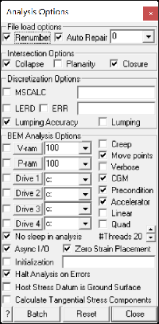

Legt Optionen fest, die verschiedene Programmvorgänge steuern.

#### File Load Options:

Analysis > Options > Renumber Nummeriert Oberflächen neu, sodass das Volumen positiv ist (beim Laden der Datei). Analysis > Options > Auto Repair Versucht, Ihr Modell zu reparieren, indem Lücken gefüllt, Duplikate gelöscht werden usw. (beim Laden der Datei).

#### Intersection Options:

Analysis > Options > Collapse Führt benachbarte Oberflächen zusammen (bei der Schnittanalyse).

Analysis > Options > Planarity Unterteilt nicht ebene Vierecke in Dreiecke (bei der Schnittanalyse).

Analysis > Options > Closure Führt Schließungs- und Überlappungsprüfungen durch und löst boolesche Schnitte auf (bei der Schnittanalyse).

#### Discretization Options:

Analysis > Options > MSCALC Berechnet Ergebnisse an benutzerdefinierten Punkten (bei der Map3D-BEM-Analyse).

Analysis > Options > LERD Berechnet die Energiefreisetzungsrate und die Steifigkeit des Belastungssystems (bei der Map3D-BEM-Analyse).

Analysis > Options > ERR Berechnet die Energiefreisetzungsrate und die Steifigkeit des Belastungssystems (bei der Map3D-BEM-Analyse).

Analysis > Options > Lumping Accuracy

Analysis > Options > Lumping Berechnet die Größe der Koeffizientenmatrix vorab (bei der Diskretisierungsanalyse).

#### Map3D BEM Analysis Options:

Analysis > Options > V-ram Speichert einen Teil der Koeffizientenmatrix im virtuellen RAM (bei der Map3D-BEM-Analyse).

Analysis > Options > P-ram Speichert einen Teil der Koeffizientenmatrix im physischen RAM (bei der Map3D-BEM-Analyse). Analysis > Options > Drive 1 Legt die primären Arbeitslaufwerke für die Koeffizientenmatrix fest (bei der Map3D-BEM-Analyse).

Analysis > Options > Drive 2 Legt das sekundäre Arbeitslaufwerk für die Koeffizientenmatrix fest (bei der Map3D-BEM-Analyse).

Analysis > Options > Drive 3 Legt das dritte Arbeitslaufwerk für die Koeffizientenmatrix fest (bei der Map3D-BEM-Analyse).

Analysis > Options > Drive 4 Legt das vierte Arbeitslaufwerk für die Koeffizientenmatrix fest (bei der Map3D-BEM-Analyse).

Analysis > Options > Creep Führt eine elasto-visko-plastische Kriechanalyse durch.

Analysis > Options > Move Points Verschiebt Feldpunkte, die sehr nahe an Randoberflächen liegen (bei der Map3D-BEM-Analyse).

Analysis > Options > Verbose Schreibt alle Lösungsvektoren und Feldpunktergebnisse in die Protokolldatei (bei der Map3D-BEM-Analyse).

Analysis > Options > CGM Verwendet den Löser mit konjugierten Gradienten (bei der Map3D-BEM-Analyse).

Analysis > Options > Precondition Präkonditioniert die Matrix (bei der Map3D-BEM-Analyse). Analysis > Options > Accelerate Verwendet den Matrixbeschleuniger (bei der Map3D-BEM-Analyse). Analysis > Options > Linear Verwendet Randelemente höherer Ordnung (bei der Map3D-BEM-Analyse).

Analysis > Options > Quad Verwendet Randelemente höherer Ordnung (bei der Map3D-BEM-Analyse).

Analysis > Options > Threads = 8  gibt die Anzahl der aktuell aktiven Threads an.

Analysis > Options > Nosleep in analysis Verwendet asynchrone E/A-Routinen von Windows (bei der Map3D-BEM-Analyse).

Analysis > Options > Async I/O Verwendet asynchrone E/A-Routinen von Windows (bei der Map3D-BEM-Analyse).

Analysis > Options > Zero Strain Placement Wenn einem Block mit CAD > Edit > Entity Properties ein neues Material zugewiesen wird, werden diese Materialien mit dem unter CAD > Properties > Material Properties angegebenen Spannungszustand initialisiert.

Analysis > Options > Initialization Initialisiert das Modell so, dass die Analyse dort fortgesetzt wird, wo eine vorherige Analyse beendet wurde.

Analysis > Options > Halt on Errors Initialisiert das Modell so, dass die Analyse dort fortgesetzt wird, wo eine vorherige Analyse beendet wurde.

Analysis > Options > Host Stress Datum is Ground Surface Behandelt das Bezugsniveau als Geländeoberfläche, sodass allen Oberflächen oberhalb des Bezugsniveaus ein Spannungszustand von null zugewiesen wird.

Analysis > Options > Calculate Tangential Stress Components Bei elastischen Analysen werden Tangentialspannungen nur auf Anforderung berechnet. Sie werden für den Lösungsprozess nicht benötigt und erfordern zusätzliche Analysezeit. Bei plastischen Analysen werden diese Werte standardmäßig berechnet.

#### Miscellaneous Options:

Analysis > Options > Batch Richtet die Analyse-Stapelwarteschlange ein.

Analysis > Options > Reset
