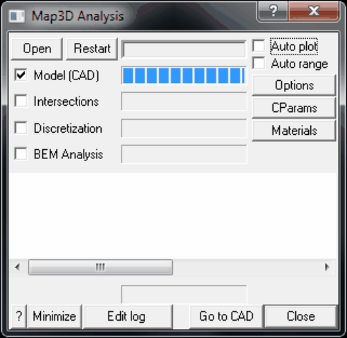

Öffnet das Dialogfeld Map3D Analysis, das alle Funktionen der Spannungsanalyse steuert.

Analysis > Open Lädt ein Modell aus einer Datei.

Analysis > Restart Startet eine Analyse neu, die abgebrochen oder durch einen Stromausfall oder Betriebssystemabsturz unterbrochen wurde.

Analysis > Model (CAD) Lädt ein Modell aus einer Datei.

Analysis > Intersections Führt die Kontakt- und Schnittanalyse durch.

Analysis > Discretization Diskretisierung von Blöcken und Rastern.

Analysis > BEM Analysis BEM-Analyse von Map3D.

Analysis > Auto Plot Stellt ausgewählte Oberflächenkomponenten automatisch dar, während die BEM-Analyse von Map3D fortschreitet.

Analysis > Auto Range Passt den Konturbereich automatisch an, während die BEM-Analyse von Map3D fortschreitet.

Analysis > Options Legt Optionen fest, die verschiedene Programmvorgänge steuern.

Analysis > Cparams Ändert die Analysesteuerparameter während der Analyse.

Analysis > Materials Ändert die Materialeigenschaften während der Analyse.

Analysis > Minimize Minimiert die Grafikanzeige während der Analyse.

Analysis > Edit log Bearbeitet die Protokolldatei. Die Protokolldatei zeichnet alle Meldungen auf, die im Meldungsfenster ausgegeben werden.

Analysis > Go to CAD Wechselt in die Phase des Modellaufbaus und der Modellbearbeitung.

Analysis > Close Schließt das Dialogfeld.

Analysis > Spawn Results Startet eine weitere Instanz von Map3D und lädt die Ergebnisse des ersten Abbauschritts. Dies ist nützlich, um Ergebnisse bereits abgeschlossener Schritte anzusehen, während nachfolgende Schritte noch analysiert werden.

Analysis > Suspend Unterbricht bzw. pausiert die laufende Analyse.

Analysis > Resume Setzt die unterbrochene Analyse fort.
