## 5.5.1.1 Block

Erstellt einen vollständig dreidimensionalen Block vom Typ FF (Fictitious Force). Diese werden für 3D-Hohlräume, Zonen mit abweichendem Material (Erzzonen oder Gänge) und versetzte Zonen verwendet. Die Blockoberflächen werden in einer späteren Programmphase weiter in Randelemente unterteilt. In Map3D Non-Linear können diese Zonen fließen und sich nichtlinear verhalten.

Mehrere Blöcke können zu komplexen 3D-Formen kombiniert werden. Mit der Routine FFLoop ( CAD > Build > FF Loop) lässt sich eine Reihe von 3D-FF-Blöcken aus einer Grundrissebene oder einem Schnitt extrudieren; sie kann auch zur Interpolation zwischen mehreren Grundrissebenen oder Schnitten verwendet werden.

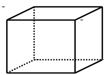

Beim Start der Routine werden Sie aufgefordert, die ersten 4 Eckpunkte auszuwählen, die eine Seite (z. B. die Basis) eines 6-seitigen Blocks definieren. Nach deren Eingabe werden Sie nach 4 weiteren Eckpunkten (Eckpunkte 5, 6, 7 und 8) gefragt, die die gegenüberliegende Seite des Blocks (z. B. die Oberseite) definieren.

Die Eckpunkte können im oder gegen den Uhrzeigersinn angeordnet werden, sofern Ober- und Unterseite in derselben Reihenfolge eingegeben werden und die Eckpunkte 5, 6, 7 und 8 der Oberseite direkt über den Eckpunkten 1, 2, 3 und 4 der Unterseite liegen.

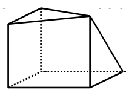

Jeder der Eckpunkte kann wiederholt werden, um dreiseitige Formen und Keile zu definieren.

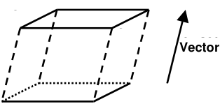

Sobald die Basis definiert ist (Eckpunkte 1, 2, 3 und 4), können die übrigen Eckpunkte (5, 6, 7 und 8) durch Versatz oder Extrusion erzeugt werden

#### CAD > Build > Offset Remaining

Die Koordinaten der Eckpunkte können über die Tastatur eingegeben werden

#### CAD > Build > Enter Point

per Freihandzeichnung ausgewählt, von anderen Objekten (anderen Blöcken oder Konstruktionslinien) übernommen oder digitalisiert werden

#### CAD > Digitizer Setup > Activate

Eine große Auswahl an Zeichenwerkzeugen unterstützt die visuelle Auswahl von Punkten im Modell

#### CAD > Snap

Eckpunkte können abgewählt werden mit

#### CAD > Build > Undo Point

Eckpunkte können erneut ausgewählt werden mit

#### CAD > Build > Redo Point

Der Block gilt als vollständig, wenn der achte Eckpunkt eingegeben wird oder der Benutzer

Nach Abschluss der Blockerstellung werden Sie aufgefordert, die Blockeigenschaften einzugeben. Damit lassen sich verschiedene Parameter festlegen, darunter die Blockfarbe und die Abbaufolge.

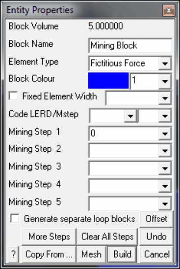

Block Volume - zeigt das Volumen des Blocks an.

Block Name - legt einen beschreibenden Namen für den Block fest.

Element Type - legt den Typ des Randelements fest, das für den Block verwendet wird.

- Fictitious Force - FF-Elemente sollten für dreidimensionale Objekte wie Hohlräume, Zonen mit abweichendem Material, versetzte Abbaue usw. verwendet werden.

- Displacement Discontinuity - DD-Elemente sollten für tabulare Abbauhohlräume, Brüche und Störungsflächen verwendet werden.

- Inaktive Elemente können verwendet werden, um Objekte anzuzeigen, die nur zu Visualisierungszwecken enthalten sind und nicht für die eigentliche Spannungsanalyse verwendet werden sollen.

Block Colour - legt die Farbnummer fest, mit der der Block angezeigt wird.

Legt die Farbnummer fest, die jeder Schaltfläche zugewiesen wird. Für die Anzeige stehen insgesamt 10 Farben zur Verfügung. Sie sind nummeriert mit

1 bis 10, 11 bis 20, 21 bis 30 usw.,

sodass für die Nummern

1, 11, 21..., 2, 22, 32..., 3, 23, 33..., usw.

dieselbe Farbe angezeigt wird.

Fixed Element Width - legt die benutzerdefinierte Elementbreite fest.

Dieser Parameter kann verwendet werden, um eine gleichmäßige Diskretisierung auf ausgewählten Objekten zu erzwingen. Beim Festlegen dieses Werts ist äußerste Vorsicht geboten, da ein kleiner Wert leicht zu einer enormen Problemgröße führen kann.

Im Allgemeinen sollte diese Option nicht verwendet werden (deaktiviert), und die Diskretisierung sollte den Parametern _AL_ und _AG_ überlassen bleiben. Diese setzen Elemente nur dort dicht, wo Analyseergebnisse angefordert werden, wodurch die Elemente optimal genutzt und die Problemgröße minimiert werden. Eine weitere Erläuterung finden Sie unter

#### CAD > Properties Control Parameters

Dieser Parameter kann auch verwendet werden, um bei der Schnittanalyse die Erzeugung von Oberflächen mit größeren Seitenlängen zu vermeiden. Oberflächen, deren Seitenlänge diese Abmessung überschreitet, werden nicht zusammengefasst (collapse)

#### Analysis > Options > Collapse

Während der Diskretisierung wird jede Oberfläche, deren Seitenlänge diese Abmessung überschreitet, unterteilt, damit keine Oberflächen mit größeren Seiten entstehen.

Ein Beispiel für die Verwendung dieses Parameters finden Sie unter Tabular Mining Example

Matl_Code LERD/MStep - legt den Materialcode fest, der für die LERD/LSS-Berechnung in den Block eingesetzt wird.

Das erste Feld ist für den Materialcode.

Das zweite Feld dient zur Angabe der Nummer des Abbauschritts, bei dem die Berechnung erfolgen soll. Bleibt dieses Feld leer, wird die LERD-Berechnung für alle Schritte durchgeführt.

#### Analysis > Options > LERD/LSS.

- Mining Step n - legt den Materialcode fest, der für diesen Block im Abbauschritt n verwendet wird. Im obigen Beispiel existiert der Block in Schritt 1 nicht, enthält in Schritt 2 das Material Nr. 2 (Erz), wird in Schritt 3 abgebaut (Materialcode 0 bedeutet Abbau) und schließlich wird in Schritt 4 das Material Nr. 5 (Versatz) eingesetzt. Bei einer positiven Materialnummer wird das Material mit dem angegebenen Anfangsspannungszustand in den Block eingesetzt und kann sich dann entsprechend den elastischen/plastischen Eigenschaften verformen, die Sie für diese Materialnummer festgelegt haben. Bei einer negativen Materialnummer wird das Material mit dem angegebenen Anfangsspannungszustand in den Block eingesetzt, der Spannungszustand wird jedoch unabhängig von den Verformungen auf diesen Werten gehalten, wodurch eine Spannungsrandbedingung entsteht.

More Steps - ermöglicht die Angabe zusätzlicher Abbauschritte.

Clear All Steps - löscht alle Abbauschritte (1-100).

Undo - wählt den zuletzt eingegebenen Punkt ab und kehrt zur Routine für die Blockerstellung zurück

#### CAD > Build > Undo Point

Copy From… - ermöglicht es, einen anderen Block auszuwählen, von dem die Objekteigenschaften kopiert werden.

Mesh - erstellt den Block mit in kleinere Teile unterteilten Oberflächen im angegebenen Blockrasterabstand.

Build - schließt die Blockerstellung ab und trägt den Block in die Modelldatenbank ein.

Nach Abschluss dieses Vorgangs haben Sie eine letzte Möglichkeit, ihn rückgängig zu machen und diesen Block aus der Modelldatenbank zu entfernen, indem Sie

#### CAD > Build > Undo Build

auswählen. Cancel bricht die Blockerstellung ab.

Beachten Sie, dass sich Blöcke mit dem Volumen null erzeugen lassen, zum Beispiel durch Angabe eines Versatzvektors der Länge null. So können Benutzer bei Bedarf einzelne FF-Oberflächen erstellen. Dies ist zwar zulässig, wird aber nicht empfohlen, da es zu nicht geschlossenen Volumina führen kann.

FF-Blöcke können jederzeit in DD-Ebenen zusammengefasst werden, indem einfach der Elementtyp geändert wird

#### CAD > Edit > Entity Properties

In diesem Fall wird die Basis des Blocks (die durch die Eckpunkte 1, 2, 3 und 4 definierte Seite) zur DD-Ebene, und die übrigen Seiten des Blocks werden verworfen.

Notes:

Für logische Gruppierungen von Blöcken (z. B. für verschiedene Sohlen, Schnitte oder logische Abbaueinheiten wie Vortrieb, Abbau usw.) sollten unterschiedliche Farbnummern verwendet werden. Diese Farben sind benutzerdefinierbar

#### Tools > Custom Colours

Alle Blöcke mit derselben Farbnummer werden von Map3D automatisch zu einzelnen komplexen Formen zusammengefasst.

Da sich die Anzeige bestimmter Blockfarbnummern leicht ein- und ausschalten lässt

#### View > Hide Block Colours

bietet dies eine effiziente Methode zum Arbeiten mit komplexen Modelldaten.

Eine Erläuterung zu Aspekten des Modellaufbaus finden Sie unter:

#### Model Building and Editing

Tutorials zum Modellaufbau finden Sie unter:

#### Model Building Tutorials

Durch Drücken der Leertaste wird automatisch die zuletzt verwendete Erstellungsfunktion aktiviert.

## 5.5.1.2 FF Loop

Erstellt vollständig dreidimensionale Blöcke vom Typ FF (Fictitious Force). Diese werden für 3D-Hohlräume, Zonen mit abweichendem Material (Erzzonen oder Gänge) und versetzte Zonen verwendet. Die Blockoberflächen werden in einer späteren Programmphase weiter in Randelemente unterteilt. In Map3D Non-Linear können diese Zonen fließen und sich nichtlinear verhalten.

Einige Beispiele zu dieser Routine finden Sie unter Model Building Tutorials. Siehe insbesondere

- Video demo of FFLoop model building with multiple loops

- Video demo of FFLoop model simplification using slicing

- FFLoop Drift Example

- FFLoop Stope Example

- Bulk Mining Example

#### FFLoops

Beim Start der Routine werden Sie aufgefordert, die Eckpunkte auszuwählen, die den Umfang einer Reihe von Grundrissen oder Schnitten definieren. Die Richtung, in der Sie jede Schleife durchlaufen, ist unerheblich. Es können gleichzeitig beliebig viele Schleifen definiert werden. Die Anzahl der Punkte muss nicht auf jeder Schleife gleich sein. Start- und Endpunkt jeder Schleife (z. B. die Punkte 1 und 11 auf der ersten Schleife und die Punkte 12 und 22 auf der zweiten) müssen an derselben Stelle liegen, um eine Reihe geschlossener Schleifen zu definieren.

#### Snap > Trace

Einzelne Punkte können nacheinander ausgewählt werden, oder alle Punkte entlang eines Konstruktionsliniensegments können mit der Fangfunktion CAD > Snap > Trace CLoop ausgewählt werden.

#### Snap > Win

Einzelne Punkte können nacheinander ausgewählt werden, oder alle Punkte entlang mehrerer Konstruktionslinien können mit der Fangfunktion CAD > Snap > Window ausgewählt werden.

#### Close

Die Routine FFLoop gilt als abgeschlossen, wenn eine der beiden folgenden Bedingungen erfüllt ist:

- der Benutzer wählt den letzten Schleifenpunkt (d. h. Punkt Nr. 22) ein drittes Mal aus

- CAD > Build > FFLoop

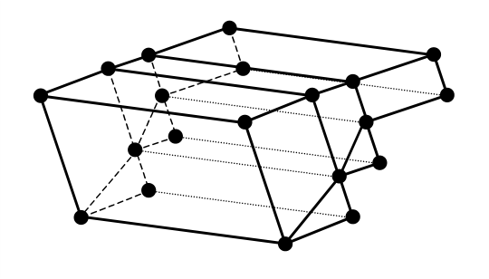

Die Schleifen werden dann in eine Reihe von 3- oder 4-seitigen FF-Elementen unterteilt. Diese Oberflächen werden in einer späteren Programmphase weiter in Randelemente unterteilt. Die Routine, die diese Unterteilung vornimmt, sucht nach Eckpunkten, die nahe beieinander liegen; der Benutzer sollte die Schleife daher so definieren, dass die Verbindungen eindeutig sind. Im obigen Beispiel wird empfohlen, die Punkte 4 und 5 auszuwählen oder zu erzeugen.

#### Guide Lines

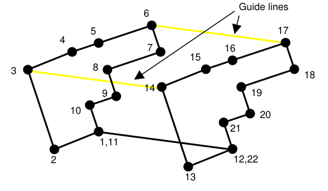

Für komplexere Formen können Führungslinien (gelb dargestellt) definiert werden, die erzwingen, dass die Seiten entlang dieser Linien unterteilt werden. Sie werden einfach als Konstruktionslinien definiert. Ein Beispiel finden Sie unter [https://www.map3d.com/ffloop.htm](https://www.map3d.com/ffloop.htm). Führungslinien dürfen sich nicht schneiden oder kreuzen.

#### Extrusion using Offset

Sobald die erste geschlossene Schleife eingegeben ist, können die übrigen Punkte durch Versatz der übrigen Punkte mit CAD > Build > Offset Remaining erzeugt werden

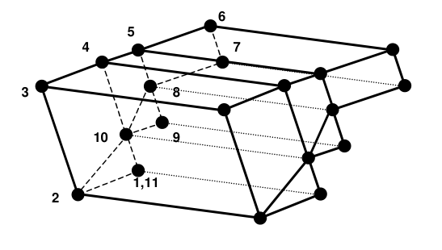

#### Miscellaneous

Die Koordinaten der Eckpunkte können über die Tastatur eingegeben werden

#### CAD > Build > Enter Point

per Freihandzeichnung ausgewählt, von anderen Objekten (anderen Blöcken oder Konstruktionslinien) übernommen oder digitalisiert werden

#### CAD > Digitizer Setup > Activate

Eine große Auswahl an Zeichenwerkzeugen unterstützt die visuelle Auswahl von Punkten im Modell

#### CAD > Snap

Eckpunkte können abgewählt werden mit

#### CAD > Build > Undo Point

Eckpunkte können erneut ausgewählt werden mit

#### CAD > Build > Redo Point

Nach Abschluss der Blockerstellung werden Sie aufgefordert, die Blockeigenschaften einzugeben. Damit lassen sich verschiedene Parameter festlegen, darunter die Blockfarbe und die Abbaufolge.

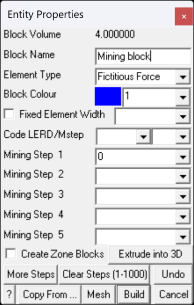

Block Volume - zeigt das Volumen des Blocks an.

Block Name - legt einen beschreibenden Namen für den Block fest.

Element Type - legt den Typ des Randelements fest, das für den Block verwendet wird.

- Fictitious Force - FF-Elemente sollten für dreidimensionale Objekte wie Hohlräume, Zonen mit abweichendem Material, versetzte Abbaue usw. verwendet werden.

- Displacement Discontinuity - DD-Elemente sollten für tabulare Abbauhohlräume, Brüche und Störungsflächen verwendet werden.

- Inaktive Elemente können verwendet werden, um Objekte anzuzeigen, die nur zu Visualisierungszwecken enthalten sind und nicht für die eigentliche Spannungsanalyse verwendet werden sollen.

Block Colour - legt die Farbnummer fest, mit der der Block angezeigt wird.

Legt die Farbnummer fest, die jeder Schaltfläche zugewiesen wird. Für die Anzeige stehen insgesamt 10 Farben zur Verfügung. Sie sind nummeriert mit

1 bis 10, 11 bis 20, 21 bis 30 usw.,

sodass für die Nummern

1, 11, 21..., 2, 22, 32..., 3, 23, 33..., usw.

dieselbe Farbe angezeigt wird.

Fixed Element Width - legt die benutzerdefinierte Elementbreite fest.

Dieser Parameter kann verwendet werden, um eine gleichmäßige Diskretisierung auf ausgewählten Objekten zu erzwingen. Beim Festlegen dieses Werts ist äußerste Vorsicht geboten, da ein kleiner Wert leicht zu einer enormen Problemgröße führen kann.

Im Allgemeinen sollte diese Option nicht verwendet werden (deaktiviert), und die Diskretisierung sollte den Parametern _AL_ und _AG_ überlassen bleiben. Diese setzen Elemente nur dort dicht, wo Analyseergebnisse angefordert werden, wodurch die Elemente optimal genutzt und die Problemgröße minimiert werden. Eine weitere Erläuterung finden Sie unter

#### CAD > Properties Control Parameters

Dieser Parameter kann auch verwendet werden, um bei der Schnittanalyse die Erzeugung von Oberflächen mit größeren Seitenlängen zu vermeiden. Oberflächen, deren Seitenlänge diese Abmessung überschreitet, werden nicht zusammengefasst (collapse)

#### Analysis > Options > Collapse

Während der Diskretisierung wird jede Oberfläche, deren Seitenlänge diese Abmessung überschreitet, unterteilt, damit keine Oberflächen mit größeren Seiten entstehen.

Ein Beispiel für die Verwendung dieses Parameters finden Sie unter Tabular Mining Example

Matl_Code LERD/MStep - legt den Materialcode fest, der für die LERD/LSS-Berechnung in den Block eingesetzt wird.

Das erste Feld ist für den Materialcode.

Das zweite Feld dient zur Angabe der Nummer des Abbauschritts, bei dem die Berechnung erfolgen soll. Bleibt dieses Feld leer, wird die LERD-Berechnung für alle Schritte durchgeführt.

#### Analysis > Options > LERD/LSS.

- Mining Step n - legt den Materialcode fest, der für diesen Block im Abbauschritt n verwendet wird. Im obigen Beispiel existiert der Block in Schritt 1 nicht, enthält in Schritt 2 das Material Nr. 2 (Erz), wird in Schritt 3 abgebaut (Materialcode 0 bedeutet Abbau) und schließlich wird in Schritt 4 das Material Nr. 5 (Versatz) eingesetzt. Bei einer positiven Materialnummer wird das Material mit dem angegebenen Anfangsspannungszustand in den Block eingesetzt und kann sich dann entsprechend den elastischen/plastischen Eigenschaften verformen, die Sie für diese Materialnummer festgelegt haben. Bei einer negativen Materialnummer wird das Material mit dem angegebenen Anfangsspannungszustand in den Block eingesetzt, der Spannungszustand wird jedoch unabhängig von den Verformungen auf diesen Werten gehalten, wodurch eine Spannungsrandbedingung entsteht.

Create Zone Blocks - beim Erstellen von Blöcken mit mehreren Schleifen können Sie festlegen, ob zwischen den einzelnen Blöcken Grenzflächen erzeugt werden, sodass jeder Block als separate Abbaueinheit behandelt werden kann. Jedem dieser Teilbereiche wird eine andere Farbnummer zugewiesen, damit er sich bei der Anzeige mit Hide Block Colours leicht aus- und einblenden lässt. Wenn Sie diese Option nicht angeben, wird ein einzelner großer Block erzeugt.

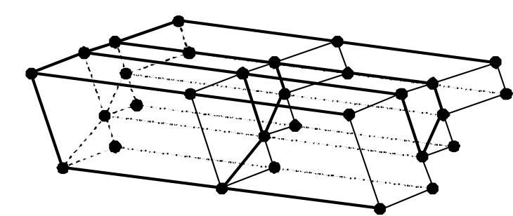

Extrude into 3D - ermöglicht es, eine ebene Schleife zu versetzen, um den Block in eine 3D-Form zu extrudieren. Dieser Vorgang kann auch mit Extrude/Offset Remaining durchgeführt werden.

More Steps - ermöglicht die Angabe zusätzlicher Abbauschritte.

Clear All Steps - löscht alle Abbauschritte (1-1000).

Undo - wählt den zuletzt eingegebenen Punkt ab und kehrt zur Routine für die Blockerstellung zurück

#### CAD > Build > Undo Point

Copy From… - ermöglicht es, einen anderen Block auszuwählen, von dem die Objekteigenschaften kopiert werden.

Mesh - erstellt den Block mit in kleinere Teile unterteilten Oberflächen im angegebenen Blockrasterabstand.

Build - schließt die Blockerstellung ab und trägt den Block in die Modelldatenbank ein.

Nach Abschluss dieses Vorgangs haben Sie eine letzte Möglichkeit, ihn rückgängig zu machen und diesen Block aus der Modelldatenbank zu entfernen, indem Sie

#### CAD > Build > Undo Build

auswählen. Cancel bricht die Blockerstellung ab.

Beachten Sie, dass sich Blöcke mit dem Volumen null erzeugen lassen, zum Beispiel durch Angabe eines Versatzvektors der Länge null. So können Benutzer bei Bedarf einzelne FF-Oberflächen erstellen. Dies ist zwar zulässig, wird aber nicht empfohlen, da es zu nicht geschlossenen Volumina führen kann.

FF-Blöcke können jederzeit in DD-Ebenen zusammengefasst werden, indem einfach der Elementtyp geändert wird

#### CAD > Edit > Entity Properties

In diesem Fall wird die Basis des Blocks (die durch die Eckpunkte 1, 2, 3 und 4 definierte Seite) zur DD-Ebene, und die übrigen Seiten des Blocks werden verworfen.

Notes:

Für logische Gruppierungen von Blöcken (z. B. für verschiedene Sohlen, Schnitte oder logische Abbaueinheiten wie Vortrieb, Abbau usw.) sollten unterschiedliche Farbnummern verwendet werden. Diese Farben sind benutzerdefinierbar

#### Tools > Custom Colours

Alle Blöcke mit derselben Farbnummer werden von Map3D automatisch zu einzelnen komplexen Formen zusammengefasst.

Da sich die Anzeige bestimmter Blockfarbnummern leicht ein- und ausschalten lässt

#### View > Hide Block Colours

bietet dies eine effiziente Methode zum Arbeiten mit komplexen Modelldaten.

Eine Erläuterung zu Aspekten des Modellaufbaus finden Sie unter:

#### Model Building and Editing

Tutorials zum Modellaufbau finden Sie unter:

#### Model Building Tutorials

Durch Drücken der Leertaste wird automatisch die zuletzt verwendete Erstellungsfunktion aktiviert.

## 5.5.1.3 DD Loop

Erstellt Blöcke vom Typ DD (Displacement Discontinuity). Diese werden für tabularen Abbau, dünne Flöze oder Störungsflächen verwendet. In allen Versionen von Map3D können diese Zonen fließen und sich nichtlinear verhalten. Mehrere DD können zu komplexen versetzten und gewellten Formen kombiniert werden.

Einige Beispiele zu dieser Routine finden Sie unter Model Building Tutorials. Siehe insbesondere

- Video demo of DDLoop model building with sub-parallel lines

- Video demo of DDLoop model building with interior loops

- DDLoop Pillar Example

- Tabular Mining Example

#### DDLoop

Beim Start der Routine werden Sie aufgefordert, eine Reihe von Schleifen auszuwählen, die den Umfang der gewünschten Zonen definieren. Die Richtung, in der Sie jede Schleife durchlaufen, ist unerheblich. Start- und Endpunkt jeder Schleife (z. B. die Punkte 1 und 11 oder 12 und 22) müssen an derselben Stelle liegen, um geschlossene Schleifen zu definieren.

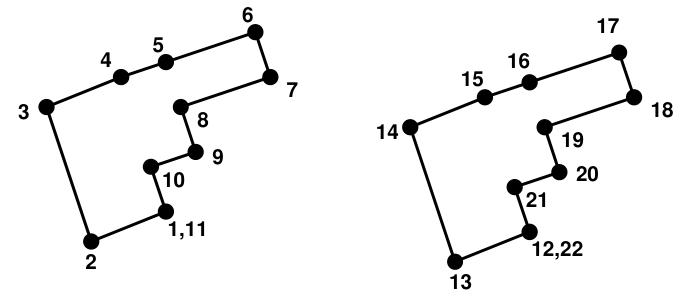

#### Snap > Trace

Einzelne Punkte können nacheinander ausgewählt werden, oder alle Punkte entlang eines Konstruktionsliniensegments können mit der Fangfunktion CAD > Snap > Trace CLoop ausgewählt werden.

#### Snap > Win

Einzelne Punkte können nacheinander ausgewählt werden, oder alle Punkte entlang mehrerer Konstruktionslinien können mit der Fangfunktion CAD > Snap > Window ausgewählt werden.

#### Close

Die Routine DDLoop gilt als abgeschlossen, wenn eine der beiden folgenden Bedingungen erfüllt ist:

- der Benutzer wählt den letzten Schleifenpunkt (d. h. Punkt Nr. 12,22) ein drittes Mal aus

- CAD > Build > DDLoop

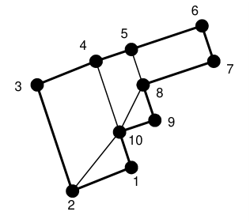

Die Schleifen werden dann in eine Reihe von 3- oder 4-seitigen DD-Elementen unterteilt. Diese Oberflächen werden in einer späteren Programmphase weiter in Randelemente unterteilt. Die Routine, die diese Unterteilung vornimmt, sucht nach Eckpunkten, die nahe beieinander liegen; der Benutzer sollte die Schleife daher so definieren, dass die Verbindungen eindeutig sind. Im obigen Beispiel wird empfohlen, die Punkte 4 und 5 auszuwählen oder zu erzeugen.

Mit der Erstellungsfunktion Mesh (siehe unten) lässt sich der Block mit in kleinere Teile unterteilten Oberflächen im angegebenen Blockrasterabstand erstellen. Diese Routine erzeugt bei Bedarf innere Punkte, um gut geformte Elemente zu erhalten.

#### Guide Lines

Mehrere innere Zonen können gleichzeitig nachgezeichnet werden, indem Führungslinien (gelb dargestellt) definiert werden.

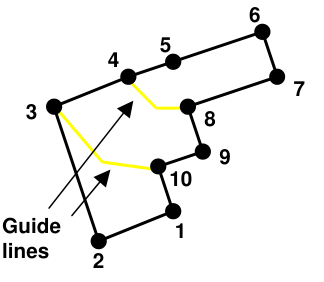

Sie werden einfach als Konstruktionslinien definiert. Ein Beispiel finden Sie unter [https://www.map3d.com/t.htm](https://www.map3d.com/t.htm). Führungslinien müssen die Umfangsschleife von Rand zu Rand durchqueren. Es können mehrere Führungslinien definiert werden, die sich schneiden und so mehrere Zonen festlegen.

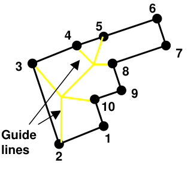

#### Interior Zones

Mehrere innere Zonen (z. B. Pfeiler) können definiert werden, indem ihr Umfang wie unten gezeigt nachgezeichnet wird. Die Richtung, in der Sie die innere Zone durchlaufen, ist unerheblich. Auf diese Weise können beliebig viele innere Zonen definiert werden.

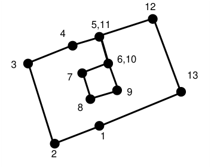

Alternativ lassen sich diese inneren Zonen bequem erstellen, indem der äußere Umfang nachgezeichnet ( CAD > Snap > Trace CLoop) und die gewünschten inneren Formen mit Führungslinien definiert werden.

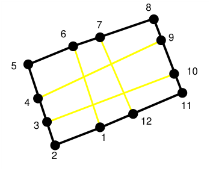

Create Zone Blocks - beim Erstellen von DD-Ebenen mit mehreren Schleifen können Sie festlegen, ob zwischen den einzelnen Teilbereichen Grenzflächen erzeugt werden, sodass jeder Teilbereich als separate Gruppe von DDPlanes behandelt werden kann. Jedem dieser Teilbereiche wird eine andere Farbnummer zugewiesen, damit er sich bei der Anzeige mit Hide Block Colours leicht aus- und einblenden lässt. Wenn Sie diese Option nicht angeben, wird eine einzelne große Gruppe von DDPlanes erzeugt.

#### Extrusion using Offset

Sobald mindestens zwei Punkte eingegeben sind, können die übrigen Punkte durch Versatz der übrigen Punkte mit CAD > Build > Offset Remaining erzeugt werden

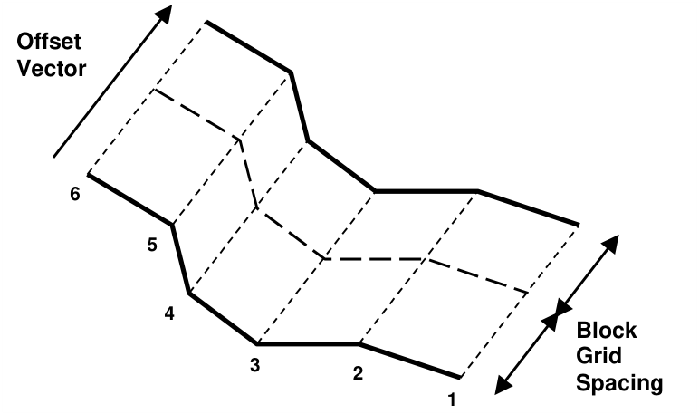

Beachten Sie außerdem, dass DD-Elemente in FF-Zonen extrudiert werden können, indem einfach der Elementtyp von DD auf FF geändert wird.

#### Miscellaneous

Die Koordinaten der Eckpunkte können über die Tastatur eingegeben werden

#### CAD > Build > Enter Point

per Freihandzeichnung ausgewählt, von anderen Objekten (anderen Blöcken oder Konstruktionslinien) übernommen oder digitalisiert werden

#### CAD > Digitizer Setup > Activate

Eine große Auswahl an Zeichenwerkzeugen unterstützt die visuelle Auswahl von Punkten im Modell

#### CAD > Snap

Eckpunkte können abgewählt werden mit

#### CAD > Build > Undo Point

Eckpunkte können erneut ausgewählt werden mit

#### CAD > Build > Redo Point

Nach Abschluss der Blockerstellung werden Sie aufgefordert, die Blockeigenschaften einzugeben. Damit lassen sich verschiedene Parameter festlegen, darunter die Blockfarbe und die Abbaufolge.

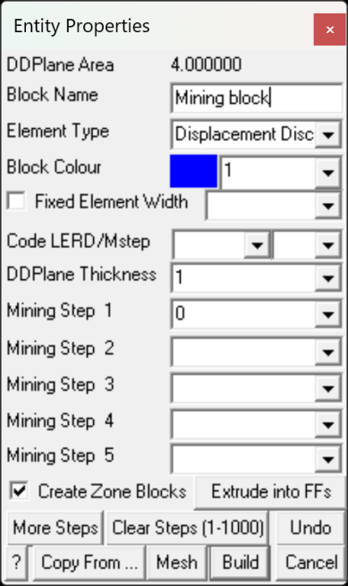

DDPlane Area - zeigt die Gesamtfläche aller im DDLoop enthaltenen DDPlanes an.

Block Name - legt einen beschreibenden Namen für den Block fest.

Element Type - legt den Typ des Randelements fest, das für den Block verwendet wird.

- Displacement Discontinuity - Elemente vom Typ DD sollten für tabulare Abbauhohlräume, Brüche und Störungsflächen verwendet werden.

- Fictitious Force - Elemente vom Typ FF sollten für dreidimensionale Objekte wie Hohlräume, Zonen mit abweichendem Material, versetzte Abbaue usw. verwendet werden.

- Inaktive Elemente können verwendet werden, um Objekte anzuzeigen, die nur zu Visualisierungszwecken enthalten sind und nicht für die eigentliche Spannungsanalyse verwendet werden sollen.

Block Colour - legt die Farbnummer fest, mit der der Block angezeigt wird.

Legt die Farbnummer fest, die jeder Schaltfläche zugewiesen wird. Für die Anzeige stehen insgesamt 10 Farben zur Verfügung. Sie sind nummeriert mit

1 bis 10, 11 bis 20, 21 bis 30 usw.,

sodass für die Nummern

1, 11, 21..., 2, 22, 32..., 3, 23, 33..., usw.

dieselbe Farbe angezeigt wird.

Fixed Element Width - legt die benutzerdefinierte Elementbreite fest.

Dieser Parameter kann verwendet werden, um eine gleichmäßige Diskretisierung auf ausgewählten Objekten zu erzwingen. Beim Festlegen dieses Werts ist äußerste Vorsicht geboten, da ein kleiner Wert leicht zu einer enormen Problemgröße führen kann.

Im Allgemeinen sollte diese Option nicht verwendet werden (deaktiviert), und die Diskretisierung sollte den Parametern _AL_ und _AG_ überlassen bleiben. Diese setzen Elemente nur dort dicht, wo Analyseergebnisse angefordert werden, wodurch die Elemente optimal genutzt und die Problemgröße minimiert werden. Eine weitere Erläuterung finden Sie unter

#### CAD > Properties Control Parameters

Dieser Parameter kann auch verwendet werden, um bei der Schnittanalyse die Erzeugung von Oberflächen mit größeren Seitenlängen zu vermeiden. Oberflächen, deren Seitenlänge diese Abmessung überschreitet, werden nicht zusammengefasst (collapse)

#### Analysis > Options > Collapse

Während der Diskretisierung wird jede Oberfläche, deren Seitenlänge diese Abmessung überschreitet, unterteilt, damit keine Oberflächen mit größeren Seiten entstehen.

Ein Beispiel für die Verwendung dieses Parameters finden Sie unter Tabular Mining Example

Matl_Code LERD/MStep - legt den Materialcode fest, der für die LERD/LSS-Berechnung in den Block eingesetzt wird.

Das erste Feld ist für den Materialcode.

Das zweite Feld dient zur Angabe der Nummer des Abbauschritts, bei dem die Berechnung erfolgen soll. Bleibt dieses Feld leer, wird die LERD-Berechnung für alle Schritte durchgeführt.

#### Analysis > Options > LERD/LSS.

#### Analysis > Options > LERD/LSS

DDPlane Thickness - legt die Dicke des in das DD-Element eingesetzten Materials fest (d. h. Störungsletten, Flözmächtigkeit, Abbaubreite oder Pfeilerhöhe).

Die Normalverschiebung (Konvergenz) des Objekts im gefüllten Zustand wird auf diese Dicke begrenzt. Außerdem werden Normalverschiebung (Konvergenz) und Scherverschiebung (ride) durch die Dicke geteilt, um die im Füllmaterial auftretende Dehnung zu bestimmen

Fault-Gouge in DD planes

Backfill-Hyperbolic in DD planes Equilibrated-Gouge in DD planes

Mohr-Coulomb in DD planes

Dieser Parameter sollte in denselben Einheiten angegeben werden, die für die Koordinaten verwendet werden (z. B. Meter oder Fuß).

- Mining Step n - legt den Materialcode fest, der für diesen Block im Abbauschritt n verwendet wird. Im obigen Beispiel existiert der Block in Schritt 1 nicht, enthält in Schritt 2 das Material Nr. 2 (Erz), wird in Schritt 3 abgebaut (Materialcode 0 bedeutet Abbau) und schließlich wird in Schritt 4 das Material Nr. 5 (Versatz) eingesetzt. Bei einer positiven Materialnummer wird das Material mit dem angegebenen Anfangsspannungszustand in den Block eingesetzt und kann sich dann entsprechend den elastischen/plastischen Eigenschaften verformen, die Sie für diese Materialnummer festgelegt haben. Bei einer negativen Materialnummer wird das Material mit dem angegebenen Anfangsspannungszustand in den Block eingesetzt, der Spannungszustand wird jedoch unabhängig von den Verformungen auf diesen Werten gehalten, wodurch eine Spannungsrandbedingung entsteht.

Extrude into FFs - ermöglicht es, eine DD-Ebene in einen FF-Block zu extrudieren. Sie werden nach dem Extrusionsvektor gefragt

More Steps - ermöglicht die Angabe zusätzlicher Abbauschritte.

Clear All Steps - löscht alle Abbauschritte (1-1000).

Undo - wählt den zuletzt eingegebenen Punkt ab und kehrt zur Routine für die Blockerstellung zurück

#### CAD > Build > Undo Point

Copy From… - ermöglicht es, einen anderen Block auszuwählen, von dem die Objekteigenschaften kopiert werden.

Mesh - erstellt den Block mit in kleinere Teile unterteilten Oberflächen im angegebenen Blockrasterabstand. Diese Routine erzeugt bei Bedarf innere Punkte, um gut geformte Elemente zu erhalten.

Build - schließt die Blockerstellung ab und trägt den Block in die Modelldatenbank ein.

Nach Abschluss dieses Vorgangs haben Sie eine letzte Möglichkeit, ihn rückgängig zu machen und diesen Block aus der Modelldatenbank zu entfernen, indem Sie

#### CAD > Build > Undo Build

auswählen. Cancel bricht die Blockerstellung ab.

Beachten Sie, dass sich Blöcke mit dem Volumen null erzeugen lassen, zum Beispiel durch Angabe eines Versatzvektors der Länge null. So können Benutzer bei Bedarf einzelne FF-Oberflächen erstellen. Dies ist zwar zulässig, wird aber nicht empfohlen, da es zu nicht geschlossenen Volumina führen kann.

DD-Blöcke können jederzeit in 3D-FF-Blöcke extrudiert werden, indem einfach der Elementtyp geändert wird

#### CAD > Edit > Entity Properties

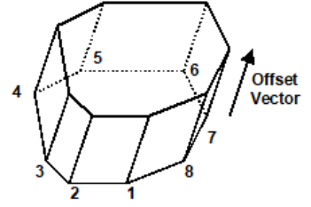

In diesem Fall definieren die Eckpunkte 1 bis 8 die Basis des Blocks. Oberseite und Seiten werden beim Extrudieren automatisch erzeugt.

Beachten Sie, dass sich Blöcke mit dem Volumen null erzeugen lassen, zum Beispiel durch Angabe eines Versatzvektors der Länge null. So können Benutzer bei Bedarf einzelne FF-Oberflächen erstellen. Dies ist zwar zulässig, wird aber nicht empfohlen, da es zu nicht geschlossenen Volumina führen kann.

Notes:

Für logische Gruppierungen von Blöcken (z. B. für verschiedene Sohlen, Schnitte oder logische Abbaueinheiten wie Vortrieb, Abbau usw.) sollten unterschiedliche Farbnummern verwendet werden. Diese Farben sind benutzerdefinierbar

#### Tools > Custom Colours

Alle Blöcke mit derselben Farbnummer werden von Map3D automatisch zu einzelnen komplexen Formen zusammengefasst.

Da sich die Anzeige bestimmter Blockfarbnummern leicht ein- und ausschalten lässt

#### View > Hide Block Colours

bietet dies eine effiziente Methode zum Arbeiten mit komplexen Modelldaten.

Eine Erläuterung zu Aspekten des Modellaufbaus finden Sie unter:

#### Model Building and Editing

Tutorials zum Modellaufbau finden Sie unter:

#### Model Building Tutorials

Durch Drücken der Leertaste wird automatisch die zuletzt verwendete Erstellungsfunktion aktiviert.

## 5.5.1.4 Tunnel

Erstellt einen Tunnel (Block vom Typ FF - Fictitious Force). Damit wird ein 3D-Tunnel konstruiert, indem ein Querschnitt entlang des Tunnelverlaufs extrudiert wird. Die Tunneloberflächen werden in einer späteren Programmphase weiter in Randelemente unterteilt.

#### Tunnel

Der Tunnelaufbau verläuft in drei Schritten:

- 1) Tunnelprofil auswählen;

- 2) Tunnelbezugspunkt auswählen;

- 3) Tunnelverlauf/-anordnung auswählen.

**Stage 1 - Tunnel Profile**

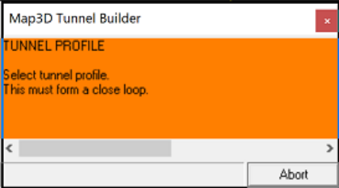

Beim Start der Routine werden Sie aufgefordert, ein Tunnelprofil auszuwählen:

- dieses muss eine geschlossene Schleife bilden

- es kann in beliebiger Orientierung konstruiert werden (x-y, y-z, x-z oder jede benutzerdefinierte Orientierung) `o` beachten Sie: Wird das Profil in der x-y-Ebene konstruiert, gilt die y-Richtung als „oben“ `o` wird das Profil dagegen in der y-z- oder x-z-Ebene konstruiert, gilt die z-Richtung als „oben“

- denken Sie bei der Auswahl daran, dass dieses Tunnelprofil von Ihrem Blickpunkt weg extrudiert wird (wie die roten Pfeile unten zeigen)

- es kann als Reihe von Punkten ausgewählt werden, ähnlich wie Konstruktionslinien ausgewählt werden CAD > Build > Construction Lines

- alternativ kann eine mit Konstruktionslinien vordefinierte Form ausgewählt werden, z. B. mit CAD > Snap > Trace CLoop

- bei der Profilauswahl können alle Fang- und Erstellungsfunktionen verwendet werden, einschließlich CAD > Build > Offset Remaining

Hier ist ein Tunnelprofil grün dargestellt. Die roten Pfeile zeigen die Richtung, in der der Tunnel in Schritt 3 – Tunnelverlauf/-anordnung – extrudiert wird.

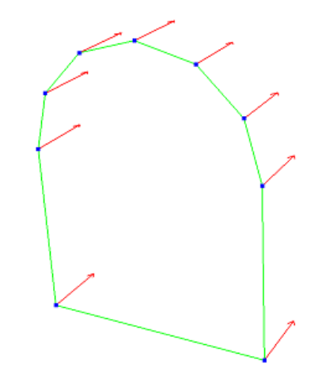

Map3D erkennt ein fertiges Tunnelprofil, wenn die Schleife geschlossen ist. Sie werden dann zu Schritt 2 – Tunnelbezugspunkt – weitergeleitet.

**Stage 2 - Tunnel Reference Point**

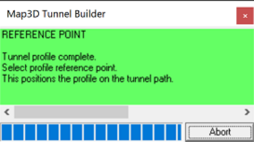

Der Tunnelbezugspunkt stellt die Stelle auf dem Tunnelprofil dar, die zur Positionierung des Profils auf dem Tunnelverlauf/der Tunnelanordnung verwendet wird.

Unten wurde die untere rechte Ecke als Bezugspunkt ausgewählt.

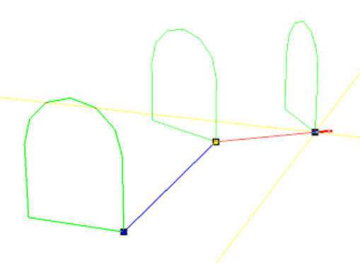

Nach der Auswahl des Bezugspunkts werden Sie zu Schritt 3 – Tunnelverlauf/-anordnung – weitergeleitet.

Beachten Sie: Wurde der falsche Bezugspunkt ausgewählt, machen Sie die Auswahl einfach mit CAD > Build > Undo Build oder durch Drücken der Escape-Taste rückgängig.

**Stage 3 - Tunnel Path/Layout**

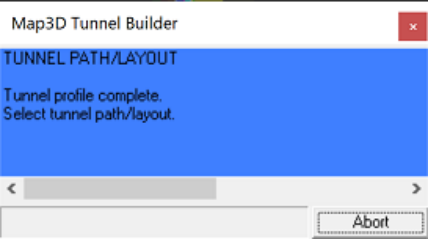

Der Tunnelverlauf/die Tunnelanordnung kann nun ausgewählt werden:

- das oben ausgewählte Profil wird entlang des Verlaufs/der Anordnung extrudiert

- der Verlauf/die Anordnung kann ähnlich ausgewählt werden wie Konstruktionslinien CAD > Build > Construction Lines

- alternativ kann der Verlauf/die Anordnung entlang einer Reihe vordefinierter Konstruktionslinien ausgewählt werden

- geschlossene Tunnelschleifen sind zulässig

- geneigte Tunnelverläufe sind zulässig

- bei der Profilauswahl können alle Fang- und Erstellungsfunktionen verwendet werden, einschließlich CAD > Build > Offset Remaining

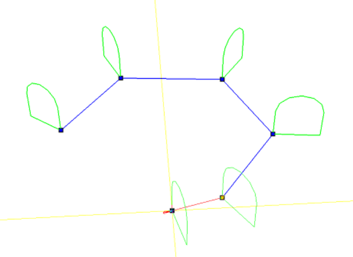

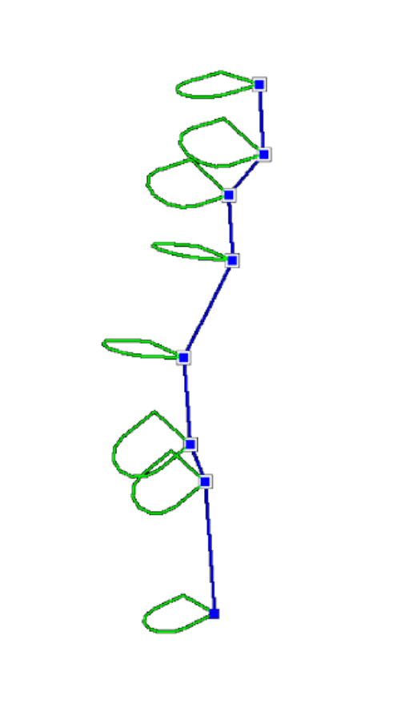

Oben links wurden die ersten beiden Punkte des Verlaufs in der horizontalen Ebene gewählt (mit weniger als 45° Steigung oder Gefälle); der Tunnel wird daher als horizontale Strecke extrudiert, wobei der Querschnitt wie gezeigt vertikal orientiert ist. Rechts werden die ersten beiden Punkte des Verlaufs in der vertikalen Ebene gewählt (mit mehr als 45° Steigung oder Gefälle); der Tunnel wird daher als vertikaler Schacht extrudiert, wobei der Querschnitt wie gezeigt nahezu horizontal orientiert ist.

Der Tunnelverlauf/die Tunnelanordnung gilt als abgeschlossen, wenn eine der beiden folgenden Bedingungen erfüllt ist:

- der Benutzer wählt den letzten Punkt ein zweites Mal aus

- CAD > Build > Tunnel

Nach Abschluss wird der Tunnel wie unten gezeigt konstruiert.

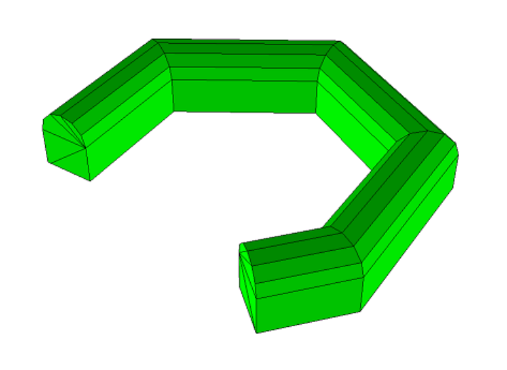

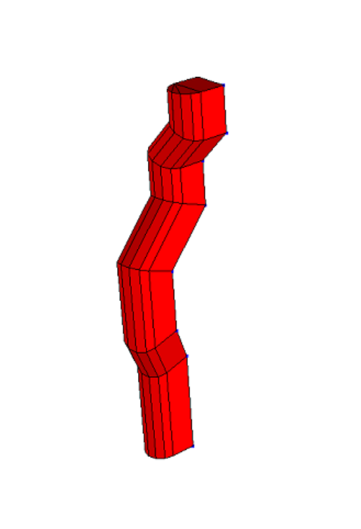

#### Miscellaneous

Die Koordinaten der Eckpunkte können über die Tastatur eingegeben werden

#### CAD > Build > Enter Point

per Freihandzeichnung ausgewählt, von anderen Objekten (anderen Blöcken oder Konstruktionslinien) übernommen oder digitalisiert werden

#### CAD > Digitizer Setup > Activate

Eine große Auswahl an Zeichenwerkzeugen unterstützt die visuelle Auswahl von Punkten im Modell

#### CAD > Snap

Eckpunkte können abgewählt werden mit

#### CAD > Build > Undo Point

Eckpunkte können erneut ausgewählt werden mit

#### CAD > Build > Redo Point

Nach Abschluss der Blockerstellung werden Sie aufgefordert, die Blockeigenschaften einzugeben. Damit lassen sich verschiedene Parameter festlegen, darunter die Blockfarbe und die Abbaufolge.

Block Volume - zeigt das Volumen des Blocks an.

Block Name - legt einen beschreibenden Namen für den Block fest.

Element Type - legt den Typ des Randelements fest, das für den Block verwendet wird.

- Fictitious Force - FF-Elemente sollten für dreidimensionale Objekte wie Hohlräume, Zonen mit abweichendem Material, versetzte Abbaue usw. verwendet werden.

- Inaktive Elemente können verwendet werden, um Objekte anzuzeigen, die nur zu Visualisierungszwecken enthalten sind und nicht für die eigentliche Spannungsanalyse verwendet werden sollen.

Block Colour - legt die Farbnummer fest, mit der der Block angezeigt wird.

Legt die Farbnummer fest, die jeder Schaltfläche zugewiesen wird. Für die Anzeige stehen insgesamt 10 Farben zur Verfügung. Sie sind nummeriert mit

1 bis 10, 11 bis 20, 21 bis 30 usw.,

sodass für die Nummern

1, 11, 21..., 2, 22, 32..., 3, 23, 33..., usw.

dieselbe Farbe angezeigt wird.

Fixed Element Width - legt die benutzerdefinierte Elementbreite fest.

Dieser Parameter kann verwendet werden, um eine gleichmäßige Diskretisierung auf ausgewählten Objekten zu erzwingen. Beim Festlegen dieses Werts ist äußerste Vorsicht geboten, da ein kleiner Wert leicht zu einer enormen Problemgröße führen kann.

Im Allgemeinen sollte diese Option nicht verwendet werden (deaktiviert), und die Diskretisierung sollte den Parametern _AL_ und _AG_ überlassen bleiben. Diese setzen Elemente nur dort dicht, wo Analyseergebnisse angefordert werden, wodurch die Elemente optimal genutzt und die Problemgröße minimiert werden. Eine weitere Erläuterung finden Sie unter

#### CAD > Properties Control Parameters

Dieser Parameter kann auch verwendet werden, um bei der Schnittanalyse die Erzeugung von Oberflächen mit größeren Seitenlängen zu vermeiden. Oberflächen, deren Seitenlänge diese Abmessung überschreitet, werden nicht zusammengefasst (collapse)

#### Analysis > Options > Collapse

Während der Diskretisierung wird jede Oberfläche, deren Seitenlänge diese Abmessung überschreitet, unterteilt, damit keine Oberflächen mit größeren Seiten entstehen.

Ein Beispiel für die Verwendung dieses Parameters finden Sie unter Tabular Mining Example

Matl_Code LERD/MStep - legt den Materialcode fest, der für die LERD/LSS-Berechnung in den Block eingesetzt wird.

Das erste Feld ist für den Materialcode.

Das zweite Feld dient zur Angabe der Nummer des Abbauschritts, bei dem die Berechnung erfolgen soll. Bleibt dieses Feld leer, wird die LERD-Berechnung für alle Schritte durchgeführt.

#### Analysis > Options > LERD/LSS.

- Mining Step n - legt den Materialcode fest, der für diesen Block im Abbauschritt n verwendet wird. Im obigen Beispiel existiert der Block in Schritt 1 nicht, enthält in Schritt 2 das Material Nr. 2 (Erz), wird in Schritt 3 abgebaut (Materialcode 0 bedeutet Abbau) und schließlich wird in Schritt 4 das Material Nr. 5 (Versatz) eingesetzt. Bei einer positiven Materialnummer wird das Material mit dem angegebenen Anfangsspannungszustand in den Block eingesetzt und kann sich dann entsprechend den elastischen/plastischen Eigenschaften verformen, die Sie für diese Materialnummer festgelegt haben. Bei einer negativen Materialnummer wird das Material mit dem angegebenen Anfangsspannungszustand in den Block eingesetzt, der Spannungszustand wird jedoch unabhängig von den Verformungen auf diesen Werten gehalten, wodurch eine Spannungsrandbedingung entsteht.

Generate Separate Loop Blocks - Sie können festlegen, ob zwischen den einzelnen Blöcken Grenzflächen erzeugt werden, sodass jeder Block als separate Abbaueinheit behandelt werden kann (wie unten gezeigt). Wenn Sie diese Option nicht angeben, wird ein einzelner großer Block erzeugt.

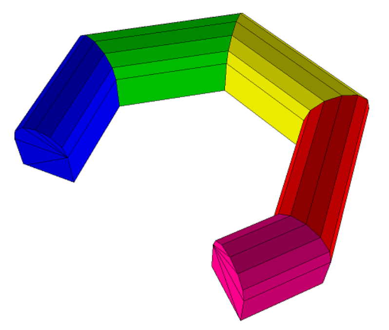

More Steps - ermöglicht die Angabe zusätzlicher Abbauschritte.

Clear All Steps - löscht alle Abbauschritte (1-100).

Undo - wählt den zuletzt eingegebenen Punkt ab und kehrt zur Routine für die Tunnelerstellung zurück

#### CAD > Build > Undo Point

Copy From… - ermöglicht es, einen anderen Block auszuwählen, von dem die Objekteigenschaften kopiert werden.

Mesh - erstellt den Block mit in kleinere Teile unterteilten Oberflächen im angegebenen Blockrasterabstand.

Build - schließt die Blockerstellung ab und trägt den Block in die Modelldatenbank ein.

Nach Abschluss dieses Vorgangs haben Sie eine letzte Möglichkeit, ihn rückgängig zu machen und diesen Block aus der Modelldatenbank zu entfernen, indem Sie

#### CAD > Build > Undo Build

auswählen. Cancel bricht die Blockerstellung ab.

Notes:

Für logische Gruppierungen von Blöcken (z. B. für verschiedene Sohlen, Schnitte oder logische Abbaueinheiten wie Vortrieb, Abbau usw.) sollten unterschiedliche Farbnummern verwendet werden. Diese Farben sind benutzerdefinierbar

#### Tools > Custom Colours

Alle Blöcke mit derselben Farbnummer werden von Map3D automatisch zu einzelnen komplexen Formen zusammengefasst.

Da sich die Anzeige bestimmter Blockfarbnummern leicht ein- und ausschalten lässt

#### View > Hide Block Colours

bietet dies eine effiziente Methode zum Arbeiten mit komplexen Modelldaten.

Eine Erläuterung zu Aspekten des Modellaufbaus finden Sie unter:

#### Model Building and Editing

Tutorials zum Modellaufbau finden Sie unter:

#### Model Building Tutorials

Durch Drücken der Leertaste wird automatisch die zuletzt verwendete Erstellungsfunktion aktiviert.

## 5.5.1.5 Grid Plane

Erstellt eine Rasterebene. Auf diesen Rasterebenen werden die Analyseergebnisse (Spannungen, Dehnungen und Verschiebungen) berechnet. Jede Rasterebene wird in einer späteren Programmphase weiter unterteilt.

Diese Funktion verwendet dieselbe Konstruktionsfunktionalität wie CAD > Build > DDLoop

Beachten Sie, dass Linienraster erstellt werden können mit

CAD > Build > Grid Line.

Beim Start der Routine werden Sie aufgefordert, eine geschlossene Schleife von Eckpunkten auszuwählen, die den Umfang der Rasterebene definieren. Die Rasterebene gilt als abgeschlossen, wenn der letzte ausgewählte Eckpunkt mit dem ersten übereinstimmt oder der Benutzer die Symbolleistenschaltfläche zum Erstellen von GPlane auswählt

CAD > Build > Grid Plane

**Snap > Trace**

Einzelne Punkte können nacheinander ausgewählt werden, oder alle Punkte entlang eines Konstruktionsliniensegments können mit der Fangfunktion CAD > Snap > Trace CLoop ausgewählt werden.

#### Snap > Win

Einzelne Punkte können nacheinander ausgewählt werden, oder alle Punkte entlang mehrerer Konstruktionslinien können mit der Fangfunktion CAD > Snap > Window ausgewählt werden.

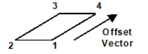

Sobald mindestens zwei Punkte eingegeben sind, können die übrigen Punkte durch Versatz erzeugt werden

#### CAD > Build > Offset Remaining

Die Koordinaten der Eckpunkte können über die Tastatur eingegeben werden

#### CAD > Build > Enter Point

per Freihandzeichnung ausgewählt, von anderen Objekten (anderen Blöcken oder Konstruktionslinien) übernommen oder digitalisiert werden

#### CAD > Digitizer Setup > Activate

Eine große Auswahl an Zeichenwerkzeugen unterstützt die visuelle Auswahl von Punkten im Modell

#### CAD > Snap

Eckpunkte können abgewählt werden mit

#### CAD > Build > Undo Point

Eckpunkte können erneut ausgewählt werden mit

#### CAD > Build > Redo Point

Nach Abschluss der Rasterebenen-Erstellung werden Sie aufgefordert, die Eigenschaften einzugeben. Damit lässt sich ein Name für die Rasterebene festlegen.

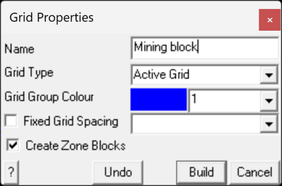

Name - legt einen beschreibenden Namen für das Raster fest.

Grid Type - legt fest, ob das Raster aktiv (in der Spannungsanalyse verwendet) oder inaktiv (in der Spannungsanalyse nicht verwendet) sein soll.

Fixed Grid Spacing - legt den benutzerdefinierten Rasterabstand fest.

Dieser Parameter kann verwendet werden, um auf ausgewählten Rastern eine gleichmäßige Diskretisierung zu erzwingen. Beim Festlegen dieses Werts ist äußerste Vorsicht geboten, da ein kleiner Wert leicht zu einer enormen Problemgröße führen kann.

Im Allgemeinen sollte diese Option nicht verwendet werden (deaktiviert), und die Diskretisierung sollte dem Parameter _AG_ überlassen bleiben. Dieser setzt Elemente nur dort dicht, wo Analyseergebnisse angefordert werden, wodurch die Elemente optimal genutzt und die Problemgröße minimiert werden.

#### CAD > Properties Control Parameters

Create Zone Blocks - beim Erstellen von Rasterebenen mit mehreren Schleifen können Sie festlegen, ob zwischen den einzelnen Teilbereichen Grenzflächen erzeugt werden, sodass jeder Teilbereich als separate Gruppe von GPlanes behandelt werden kann. Jedem dieser Teilbereiche wird eine andere Farbnummer zugewiesen, damit er sich bei der Anzeige mit Hide Grid Colours leicht aus- und einblenden lässt. Wenn Sie diese Option nicht angeben, wird eine einzelne große Gruppe von GPlanes erzeugt.

Undo - wählt den zuletzt eingegebenen Punkt ab und kehrt zur Routine für die Rastererstellung zurück

#### CAD > Build > Undo Point

Build - schließt die Rastererstellung ab und trägt den Block in die Modelldatenbank ein.

Nach Abschluss dieses Vorgangs haben Sie eine letzte Möglichkeit, ihn rückgängig zu machen und dieses Raster aus der Modelldatenbank zu entfernen, indem Sie

#### CAD > Build > Undo Build

auswählen.

Cancel - bricht die Rastererstellung ab.

Beispiele zur Verwendung von Feldpunkt-Rasterebenen finden Sie unter:

#### Model Building Tutorials

Durch Drücken der Leertaste wird automatisch die zuletzt verwendete Erstellungsfunktion aktiviert.

## 5.5.1.6 Grid Line

Erstellt eine Rasterlinie. Auf diesen Rasterlinien werden die Analyseergebnisse (Spannungen, Dehnungen und Verschiebungen) berechnet. Jede Rasterlinie wird in einer späteren Programmphase weiter unterteilt.

#### CAD > Build > Construction Lines

Diese Funktion verwendet dieselbe Konstruktionsfunktionalität wie

#### CAD > Build > Grid Plane.

Beachten Sie, dass Rasterebenen erstellt werden können mit

**2**

**1**

Beim Start der Routine werden Sie aufgefordert, mehrere Eckpunkte auszuwählen, die Punkte entlang der Rasterlinie definieren.

Die Rasterlinie gilt als abgeschlossen, wenn der letzte Eckpunkt zweimal ausgewählt wird oder der Benutzer

CAD > Build > Grid Line

auswählt.

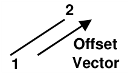

Nachdem der erste Punkt eingegeben wurde, kann der verbleibende Punkt durch Versatz erzeugt werden

#### CAD > Build > Offset Remaining

Die Koordinaten der Eckpunkte können über die Tastatur eingegeben werden

#### CAD > Build > Enter Point

per Freihandzeichnung ausgewählt, von anderen Objekten (anderen Blöcken oder Konstruktionslinien) übernommen oder digitalisiert werden

#### CAD > Digitizer Setup > Activate

Eine große Auswahl an Zeichenwerkzeugen unterstützt die visuelle Auswahl von Punkten im Modell

#### CAD > Snap

Eckpunkte können abgewählt werden mit

#### CAD > Build > Undo Point

Eckpunkte können erneut ausgewählt werden mit

#### CAD > Build > Redo Point

Nach Abschluss der Rasterebenen-Erstellung werden Sie aufgefordert, die Eigenschaften einzugeben. Damit lässt sich ein Name für die Rasterlinie festlegen.

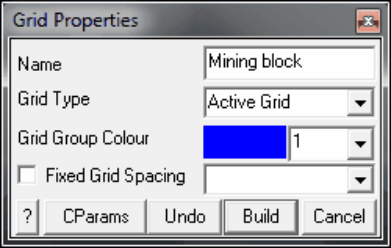

Name - legt einen beschreibenden Namen für das Raster fest.

Grid Type - legt fest, ob das Raster aktiv (in der Spannungsanalyse verwendet) oder inaktiv (in der Spannungsanalyse nicht verwendet) sein soll.

Fixed Grid Spacing - legt den benutzerdefinierten Rasterabstand fest.

Dieser Parameter kann verwendet werden, um auf ausgewählten Rastern eine gleichmäßige Diskretisierung zu erzwingen. Beim Festlegen dieses Werts ist äußerste Vorsicht geboten, da ein kleiner Wert leicht zu einer enormen Problemgröße führen kann.

Im Allgemeinen sollte diese Option nicht verwendet werden (deaktiviert), und die Diskretisierung sollte dem Parameter _AG_ überlassen bleiben. Dieser setzt Elemente nur dort dicht, wo Analyseergebnisse angefordert werden, wodurch die Elemente optimal genutzt und die Problemgröße minimiert werden.

#### CAD > Properties Control Parameters

Undo - wählt den zuletzt eingegebenen Punkt ab und kehrt zur Routine für die Rastererstellung zurück

#### CAD > Build > Undo Point

Build - schließt die Rastererstellung ab und trägt den Block in die Modelldatenbank ein.

Nach Abschluss dieses Vorgangs haben Sie eine letzte Möglichkeit, ihn rückgängig zu machen und dieses Raster aus der Modelldatenbank zu entfernen, indem Sie

#### CAD > Build > Undo Build

auswählen.

Cancel - bricht die Rastererstellung ab.

Beispiele zur Verwendung von Feldpunkt-Rasterebenen finden Sie unter:

#### Model Building Tutorials

Durch Drücken der Leertaste wird automatisch die zuletzt verwendete Erstellungsfunktion aktiviert.

## 5.5.1.7 Construction Lines

Erstellt Konstruktionslinien. Sie sollen die Abbauumrisse darstellen und dienen als Hilfe beim Aufbau Ihres Modells. Konstruktionslinien werden im Allgemeinen von Zeichnungen digitalisiert oder aus anderen CAD-Paketen importiert.

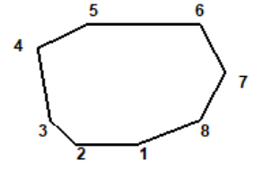

Beim Start der Routine werden Sie aufgefordert, eine Reihe von Eckpunkten auszuwählen, die den Umfang der gewünschten Zone definieren. Die Konstruktionslinie gilt als abgeschlossen, wenn der erste Eckpunkt wiederholt wird oder der Benutzer

CAD > Build > Construction Lines

auswählt.

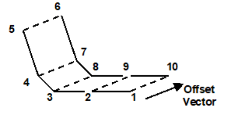

Sobald mindestens zwei Punkte eingegeben sind, können die übrigen Punkte durch Versatz erzeugt werden

#### CAD > Build > Offset Remaining

Die Koordinaten der Eckpunkte können über die Tastatur eingegeben werden

#### CAD > Build > Enter Point

per Freihandzeichnung ausgewählt, von anderen Objekten (anderen Blöcken oder Konstruktionslinien) übernommen oder digitalisiert werden

#### CAD > Digitizer Setup > Activate

Eine große Auswahl an Zeichenwerkzeugen unterstützt die visuelle Auswahl von Punkten im Modell

#### CAD > Snap

Eckpunkte können abgewählt werden mit

#### CAD > Build > Undo Point

Eckpunkte können erneut ausgewählt werden mit

#### CAD > Build > Redo Point

Nach Abschluss der Blockerstellung werden Sie aufgefordert, die Eigenschaften einzugeben. Damit lässt sich die Farbe der Konstruktionslinie festlegen.

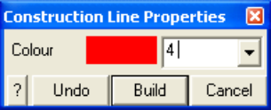

Colour - legt die Farbnummer fest, mit der die Konstruktionslinie angezeigt wird. Für die Anzeige stehen insgesamt 10 Farben zur Verfügung. Sie sind nummeriert mit

1 bis 10, 11 bis 20, 21 bis 30 usw.,

sodass für die Nummern

1, 11, 21..., 2, 22, 32..., 3, 23, 33..., usw.

dieselbe Farbe angezeigt wird.

Undo - wählt den zuletzt eingegebenen Punkt ab und kehrt zur Routine für die Erstellung der Konstruktionslinie zurück.

#### CAD > Build > Undo Point

Build - schließt die Rastererstellung ab und trägt den Block in die Modelldatenbank ein.

Nach Abschluss dieses Vorgangs haben Sie eine letzte Möglichkeit, ihn rückgängig zu machen und dieses Raster aus der Modelldatenbank zu entfernen, indem Sie

#### CAD > Build > Undo Build

auswählen.

Cancel - bricht die Linienerstellung ab.

Notes

Für logische Gruppierungen von Konstruktionslinien (z. B. für verschiedene Sohlen, Schnitte oder logische Abbaueinheiten wie Vortrieb, Abbau usw.) sollten unterschiedliche Farbnummern verwendet werden. Diese Farben sind benutzerdefinierbar

#### Tools > Custom Colours

Da sich die Anzeige bestimmter Konstruktionslinien-Farbnummern leicht ein- und ausschalten lässt

#### View > Hide Block Colours

bietet dies eine effiziente Methode zum Arbeiten mit komplexen Konstruktionsliniendaten.

Beispiele zur Verwendung von Konstruktionslinien beim Modellaufbau finden Sie unter:

#### Model Building Tutorials

Durch Drücken der Leertaste wird automatisch die zuletzt verwendete Erstellungsfunktion aktiviert.

## 5.5.1.8 Enter Point

Die Koordinaten der Eckpunkte können während der Erstellung der folgenden Objekte über die Tastatur eingegeben werden:

#### CAD > Build > Block

CAD > Build > FF Loop

CAD > Build > DD Loop

CAD > Build > Tunnel

CAD > Build > Grid Plane

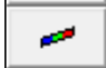

#### CAD > Build > Grid Line

#### CAD > Build > Construction Lines

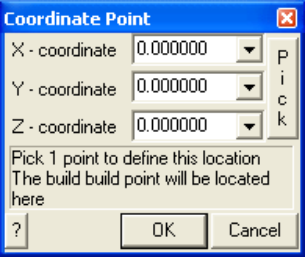

X, Y and Z – coordinate legen die Koordinaten des Punkts fest.

Pick - aktiviert das Cursor-Fadenkreuz, um den Punkt interaktiv aus dem Modell auszuwählen.

Um die visuelle Auswahl von Punkten im Modell zu erleichtern, stehen alle Fangfunktionen zur Verfügung.

#### CAD > Snap

Nach der Auswahl werden die Koordinaten des Punkts im Dialogfeld angezeigt.

## 5.5.1.9 Extrude/Offset Remaining

Extrudiert ein teilweise konstruiertes Objekt, um die übrigen Punkte bei der Erstellung der folgenden Objekte zu erzeugen:

#### CAD > Build > Block

CAD > Build > FF Loop

CAD > Build > DD Loop

CAD > Build > Tunnel

CAD > Build > Grid Plane

CAD > Build > Grid Line

#### CAD > Build > Construction Lines

X, Y and Z – offset legen die Komponenten des Versatzvektors fest. Alle ausgewählten Objekte werden um diesen Betrag verschoben.

Pick - aktiviert das Cursor-Fadenkreuz, um den Versatzvektor interaktiv aus dem Modell auszuwählen. Dazu müssen zwei Punkte zur Definition dieses Vektors ausgewählt werden.

Length, Plunge and Direction - legen die Komponenten des Versatzvektors fest. Alle ausgewählten Objekte werden um diesen Betrag verschoben.

Norm - aktiviert den Cursor, um interaktiv eine Oberfläche auszuwählen, zu der der Versatzvektor normal stehen soll. Dazu müssen zwei Punkte zur Definition dieses Vektors ausgewählt werden. Nach der Auswahl werden die Komponenten des Versatzvektors im Dialogfeld angezeigt.

Um die visuelle Auswahl von Punkten im Modell zu erleichtern, stehen alle Fangfunktionen zur Verfügung.

#### CAD > Snap

Nach der Auswahl werden die Komponenten des Versatzvektors im Dialogfeld angezeigt.

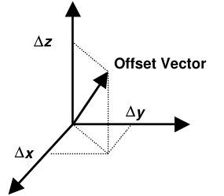

Haben Sie beispielsweise die Basis eines 3D-Blocks konstruiert (Punkte 1, 2, 3 und 4) und möchten die übrigen Punkte (5, 6, 7 und 8) einen Meter über der Basis erzeugen, geben Sie den Versatzvektor einfach als (0,0,1) ein.

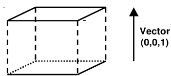

Beachten Sie, dass sich Blöcke mit dem Volumen null erzeugen lassen, zum Beispiel durch Angabe eines Versatzvektors der Länge null. So können Benutzer bei Bedarf einzelne FF-Oberflächen erstellen. Dies ist zwar zulässig, wird aber nicht empfohlen, da es zu nicht geschlossenen Volumina führen kann.

## 5.5.1.10 Undo Point

Bei der Blockerstellung werden Punkte nacheinander ausgewählt. So können Punkte bei der Erstellung der folgenden Objekte abgewählt werden:

CAD > Build > Block

CAD > Build > FF Loop

CAD > Build > DD Loop

CAD > Build > Tunnel

CAD > Build > Grid Plane

CAD > Build > Grid Line

CAD > Build > Construction Lines

Abgewählte Punkte können erneut ausgewählt werden mit

#### CAD > Build > Redo Point

Nach Abschluss der Blockerstellung können Sie diese rückgängig machen und den Block aus der Modelldatenbank entfernen, indem Sie (10 Ebenen für Rückgängig/Wiederholen werden unterstützt)

#### CAD > Build > Undo Build

auswählen. Anschließend können Sie die Blockerstellung wiederholen. So lässt sich jeder Vernetzungsversuch wiederholen.

CAD > Build > Undo Redo

## 5.5.1.11 Redo Point

Bei der Blockerstellung werden Punkte nacheinander ausgewählt. So können abgewählte Punkte bei der Erstellung der folgenden Objekte erneut ausgewählt werden:

CAD > Build > Block

CAD > Build > FF Loop

CAD > Build > DD Loop

CAD > Build > Tunnel

CAD > Build > Grid Plane

CAD > Build > Grid Line

CAD > Build > Construction Lines

Punkte können abgewählt werden mit

#### CAD > Build > Undo Point

Nach Abschluss der Blockerstellung können Sie diese rückgängig machen und den Block aus der Modelldatenbank entfernen, indem Sie (10 Ebenen für Rückgängig/Wiederholen werden unterstützt)

#### CAD > Build > Undo Build

auswählen. Anschließend können Sie die Blockerstellung wiederholen. So lässt sich jeder Vernetzungsversuch wiederholen.

CAD > Build > Undo Redo

## 5.5.1.12 Undo Build

Bei der Blockerstellung werden Punkte nacheinander ausgewählt. So können Punkte bei der Erstellung der folgenden Objekte abgewählt werden:

CAD > Build > Block

CAD > Build > FF Loop

CAD > Build > DD Loop

CAD > Build > Tunnel

CAD > Build > Grid Plane

CAD > Build > Grid Line

CAD > Build > Construction Lines

Abgewählte Punkte können erneut ausgewählt werden mit

#### CAD > Build > Redo Point

Nach Abschluss der Blockerstellung können Sie diese rückgängig machen und den Block aus der Modelldatenbank entfernen, indem Sie (10 Ebenen für Rückgängig/Wiederholen werden unterstützt)

#### CAD > Build > Undo Build

auswählen. Anschließend können Sie die Blockerstellung wiederholen. So lässt sich jeder Vernetzungsversuch wiederholen.

CAD > Build > Undo Redo

## 5.5.1.13 Redo Build

Bei der Blockerstellung werden Punkte nacheinander ausgewählt. So können abgewählte Punkte bei der Erstellung der folgenden Objekte erneut ausgewählt werden:

CAD > Build > Block

CAD > Build > FF Loop

CAD > Build > DD Loop

CAD > Build > Tunnel

CAD > Build > Grid Plane

CAD > Build > Grid Line

CAD > Build > Construction Lines

Punkte können abgewählt werden mit

CAD > Build > Undo Point

Nach Abschluss der Blockerstellung können Sie diese rückgängig machen und den Block aus der Modelldatenbank entfernen, indem Sie (10 Ebenen für Rückgängig/Wiederholen werden unterstützt)

#### CAD > Build > Undo Build

auswählen. Anschließend können Sie die Blockerstellung wiederholen. So lässt sich jeder Vernetzungsversuch wiederholen.

CAD > Build > Undo Redo
