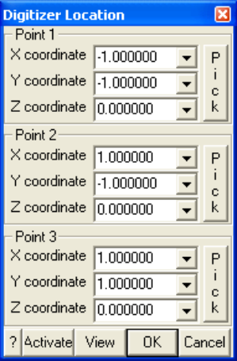

Richtet den Digitalisierer ein.

Die Digitalisierebene wird durch Angabe von 3 Punkten auf der zu digitalisierenden Zeichnung eindeutig skaliert, positioniert und ausgerichtet.

Das Vorgehen:

1. 3 Punkte auf der Zeichnung auswählen,

2. die Koordinaten jedes Punkts eingeben,

3. dann die Punkte mit der Digitalisierlupe abgreifen.

4. Pick aktiviert die Digitalisierlupe, damit jeder Punkt ausgewählt werden kann.

CAD > Digitizer > Activate schaltet den Digitalisierer zum Abgreifen von Punkten aus einer Zeichnung ein oder aus. Diese Schaltfläche kann mit Tools > CAD Toolbar > Configure in der CAD-Symbolleiste platziert werden.

View – richtet die Ansicht so aus, dass die Digitalisierebene über dem Modell zu sehen ist.

Unterstützt wird jeder Digitalisierer, der sich so einrichten lässt, dass er Cursorbewegungen im Absolutmodus steuert (d. h. mit einer eindeutigen Zuordnung zwischen Digitalisierbewegung und Cursorposition). Die meisten neuen Digitalisierer werden mit eigenen Treibern ausgeliefert, die dies unterstützen. Alternativ kann folgende Software verwendet werden, die die meisten Digitalisierer unterstützt:

Virtual Tablet Interface Digitizer Technology Company 16541 Redmond Way, Suite 195C Redmond, Washington USA 98052 Tel: 206 868 3246 Fax: 206 885 7704
