## 5.5.4.1 Objekteigenschaften

Bearbeitet Blocktyp, Farbe, Abbaufolge usw.

Diese Routine kann entweder über die Schaltfläche oder einfach per Rechtsklick auf ein beliebiges Objekt gestartet werden. Beim Start dieser Routine werden Sie zunächst aufgefordert, eine Liste der Objekte zusammenzustellen, die Sie bearbeiten möchten

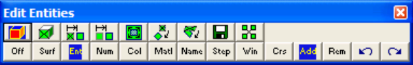

- Ist Tools > Shift-key Selection aktiviert, müssen Sie die Umschalttaste gedrückt halten, um mehrere Objekte auszuwählen.

- Standardmäßig werden ausgewählte Objekte der Liste hinzugefügt; halten Sie jedoch die Strg-Taste gedrückt, werden ausgewählte Objekte aus der Liste entfernt.

- Während Sie die Umschalt- oder Strg-Taste gedrückt halten, können Sie ein Kreuzungsfenster aufziehen.

- Die Verwendung dieser Symbolleiste ist beschrieben unter Build A List of Entities for Editing

- Durch Drücken der Leertaste wird automatisch die zuletzt verwendete Bearbeitungsfunktion aktiviert.

- Wenn Sie beim Rechtsklick die Alt-Taste gedrückt halten, wird automatisch die zuletzt verwendete Bearbeitungsfunktion wiederholt.

Nachdem Sie die gewünschten Objekte ausgewählt haben, können Sie eine der Bearbeiten-Schaltflächen wählen:

CAD > Edit > Entity Properties Edit block type, colour, mining sequence, CAD > Edit > Erase Entities Erase selected entities, CAD > Edit > Move Entities Move selected entities, CAD > Edit > Copy Entities Copy selected entities, CAD > Edit > Scale Entities Scale selected entities, CAD > Edit > Rotate Azimuth Rotate the azimuth of selected entities, CAD > Edit > Rotate Dip Rotate the dip of selected entities,

CAD > Edit > Dump to File Dump selected entities to a file,

CAD > Edit > Group Group selected entities into a single block,

- auf einen beliebigen Eckpunkt doppelklicken, um die hervorgehobene Funktion auszuführen,

- per Rechtsklick eine Liste von Optionen aufrufen.

Wenn eines der Felder im Dialogfeld „Variable“ anzeigt, haben einige der ausgewählten Blöcke unterschiedliche Eigenschaften für dieses Feld. Wenn Sie diese Eigenschaften unverändert lassen möchten (d. h. für jeden Block unterschiedlich), belassen Sie das Feld auf „Variable“. Wenn Sie den Wert dieses Felds für alle ausgewählten Blöcke ändern möchten, geben Sie den gewünschten Wert ein.

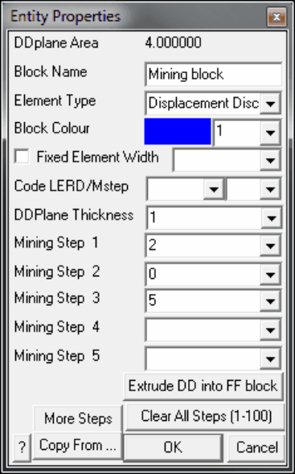

Block Volume - Wenn Sie ausschließlich FF-Blöcke ausgewählt haben, wird das gesamte kombinierte Volumen der Blöcke angezeigt. Wenn Sie ausschließlich FF-Blöcke ausgewählt haben, wird das gesamte kombinierte Volumen der Blöcke angezeigt.

DDPlane Area - Wenn Sie ausschließlich DD-Blöcke ausgewählt haben, wird die Gesamtfläche aller im DDLoop enthaltenen DDPlanes angezeigt.

Block Name - legt einen beschreibenden Namen für den Block fest.

Element Type - legt den Typ des Randelements fest, das für den Block verwendet wird.

- Displacement Discontinuity - Elemente vom Typ DD sollten für tabulare Abbauhohlräume, Brüche und Störungsflächen verwendet werden.

- Fictitious Force - Elemente vom Typ FF sollten für dreidimensionale Objekte wie Hohlräume, Zonen mit abweichendem Material, versetzte Abbaue usw. verwendet werden.

- Inaktive Elemente können verwendet werden, um Objekte anzuzeigen, die nur zu Visualisierungszwecken enthalten sind und nicht für die eigentliche Spannungsanalyse verwendet werden sollen.

- Beachten Sie, dass Elemente vom Typ DD in GPlanes umgewandelt werden können.

Block Colour - legt die Farbnummer fest, mit der der Block angezeigt wird.

- Legt die Farbnummer fest, die jeder Schaltfläche zugewiesen wird. Für die Anzeige stehen insgesamt 10 Farben zur Verfügung. Sie sind nummeriert mit

- 1 bis 10,

11 bis 20,

21 bis 30 usw.,

- sodass für die Nummern 1, 11, 21... dieselbe Farbe angezeigt wird,

- 2, 22, 32...,

- 3, 23, 33..., etc.

Fixed Element Width - legt die benutzerdefinierte Elementbreite fest.

- Dieser Parameter kann verwendet werden, um eine gleichmäßige Diskretisierung auf ausgewählten Objekten zu erzwingen. Beim Festlegen dieses Werts ist äußerste Vorsicht geboten, da ein kleiner Wert leicht zu einer enormen Problemgröße führen kann.

- Im Allgemeinen sollte diese Option nicht verwendet werden (deaktiviert), und die Diskretisierung sollte den Parametern _AL_ und _AG_ überlassen bleiben. Diese setzen Elemente nur dort dicht, wo Analyseergebnisse angefordert werden, wodurch die Elemente optimal genutzt und die Problemgröße minimiert werden. Eine weitere Erläuterung finden Sie unter

CAD > Properties Control Parameters

- Dieser Parameter kann auch verwendet werden, um bei der Schnittanalyse die Erzeugung von Oberflächen mit größeren Seitenlängen zu vermeiden. Oberflächen, deren Seitenlänge diese Abmessung überschreitet, werden nicht zusammengefasst (collapse)

#### Analysis > Options > Collapse

- Während der Diskretisierung wird jede Oberfläche, deren Seitenlänge diese Abmessung überschreitet, unterteilt, damit keine Oberflächen mit größeren Seiten entstehen.

- Ein Beispiel für die Verwendung dieses Parameters finden Sie unter Tabular Mining Example

Matl_Code LERD/MStep - legt den Materialcode fest, der für die LERD/LSS-Berechnung in den Block eingesetzt wird.

Das erste Feld ist für den Materialcode.

Das zweite Feld dient zur Angabe der Nummer des Abbauschritts, bei dem die Berechnung erfolgen soll. Bleibt dieses Feld leer, wird die LERD-Berechnung für alle Schritte durchgeführt.

#### Analysis > Options > LERD/LSS.

DDPlane Thickness - legt die Dicke des in das DD-Element eingesetzten Materials fest (d. h. Störungsletten, Flözmächtigkeit, Abbaubreite oder Pfeilerhöhe).

- Die Normalverschiebung (Konvergenz) des Objekts im gefüllten Zustand wird auf diese Dicke begrenzt. Außerdem werden Normalverschiebung (Konvergenz) und Scherverschiebung (ride) durch die Dicke geteilt, um die im Füllmaterial auftretende Dehnung zu bestimmen

Mohr-Coulomb in DD planes

Fault-Gouge in DD planes Backfill-Hyperbolic in DD planes

- Dieser Parameter sollte in denselben Einheiten angegeben werden, die für die Koordinaten verwendet werden (z. B. Meter oder Fuß).

Mining Step n - legt den Materialcode fest, der für diesen Block im Abbauschritt n verwendet wird.

- Im obigen Beispiel existiert der Block in Schritt 1 nicht, enthält in Schritt 2 das Material Nr. 2 (Erz), wird in Schritt 3 abgebaut (Materialcode 0 bedeutet Abbau) und schließlich wird in Schritt 4 das Material Nr. 5 (Versatz) eingesetzt.

- Bei einer positiven Materialnummer wird das Material mit dem angegebenen Anfangsspannungszustand in den Block eingesetzt und kann sich dann entsprechend den elastischen/plastischen Eigenschaften verformen, die Sie für diese Materialnummer festgelegt haben.

- Bei einer negativen Materialnummer wird das Material mit dem angegebenen Anfangsspannungszustand in den Block eingesetzt, der Spannungszustand wird jedoch unabhängig von den Verformungen auf diesen Werten gehalten, wodurch eine Spannungsrandbedingung entsteht.

Extrude DD into FF blocks - ermöglicht es, eine DD-Ebene in einen FF-Block zu extrudieren. Sie werden nach dem Extrusionsvektor gefragt

More Steps - ermöglicht die Angabe zusätzlicher Abbauschritte.

Clear All Steps - löscht alle Abbauschritte (1-100).

Copy From… - ermöglicht es, einen anderen Block auszuwählen, von dem die Objekteigenschaften kopiert werden.

OK - schließt die Bearbeitung der Blöcke ab und übernimmt alle geänderten Eigenschaften.

Cancel - bricht die Blockbearbeitung ab.

Nach Abschluss eines Bearbeitungsvorgangs haben Sie eine Möglichkeit, die Änderungen rückgängig zu machen, indem Sie

#### Undo

Sie können auch dieselbe Auswahl wiederherstellen und denselben Satz von Objekten erneut ändern, indem Sie

#### Redo

DD-Blöcke können in 3D-FF-Blöcke extrudiert werden, indem einfach der Elementtyp von Displacement Discontinuity auf Fictitious Force geändert wird.

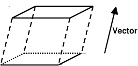

In diesem Fall definieren die Eckpunkte 1 bis 4 die Basis des Blocks. Oberseite und Seiten werden beim Extrudieren automatisch erzeugt. FF-Blöcke können in DD-Ebenen zusammengefasst werden, indem der Elementtyp von Fictitious Force auf Displacement Discontinuity geändert wird. In diesem Fall wird die Basis des Blocks (die durch die Eckpunkte 1, 2, 3 und 4 definierte Seite) zur DD-Ebene, und die übrigen Seiten des Blocks werden verworfen.

Beachten Sie, dass sich Blöcke mit dem Volumen null erzeugen lassen, zum Beispiel durch Angabe eines Versatzvektors der Länge null. So können Benutzer bei Bedarf einzelne FF-Oberflächen erstellen. Dies ist zwar zulässig, wird aber nicht empfohlen, da es zu nicht geschlossenen Volumina führen kann.

Hinweise

Für logische Gruppierungen von Blöcken (z. B. für verschiedene Sohlen, Schnitte oder logische Abbaueinheiten wie Vortrieb, Abbau usw.) sollten unterschiedliche Farbnummern verwendet werden. Diese Farben sind benutzerdefinierbar

#### Tools > Custom Colours

Alle Blöcke mit derselben Farbnummer werden von Map3D automatisch zu einzelnen komplexen Formen zusammengefasst.

Da sich die Anzeige bestimmter Blockfarbnummern leicht ein- und ausschalten lässt

#### View > Hide Block Colours

bietet dies eine effiziente Methode zum Arbeiten mit komplexen Modelldaten.

Die Doppelklickzeit lässt sich einstellen mit

#### Tools > Double Click Time

Eine Erläuterung zu Aspekten des Modellaufbaus finden Sie unter:

#### Model Building and Editing

Tutorials zum Modellaufbau finden Sie unter:

Model Building Tutorials

## 5.5.4.2 Objekte löschen

Löscht die ausgewählten Objekte.

Diese Routine kann entweder über die Schaltfläche oder einfach per Rechtsklick auf ein beliebiges Objekt gestartet werden. Beim Start dieser Routine werden Sie zunächst aufgefordert, eine Liste der Objekte zusammenzustellen, die Sie bearbeiten möchten

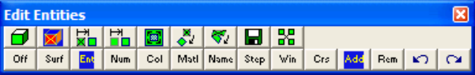

- Ist Tools > Shift-key Selection aktiviert, müssen Sie die Umschalttaste gedrückt halten, um mehrere Objekte auszuwählen.

- Standardmäßig werden ausgewählte Objekte der Liste hinzugefügt; halten Sie jedoch die Strg-Taste gedrückt, werden ausgewählte Objekte aus der Liste entfernt.

- Während Sie die Umschalt- oder Strg-Taste gedrückt halten, können Sie ein Kreuzungsfenster aufziehen.

- Die Verwendung dieser Symbolleiste ist beschrieben unter Build A List of Entities for Editing

- Durch Drücken der Leertaste wird automatisch die zuletzt verwendete Bearbeitungsfunktion aktiviert.

- Wenn Sie beim Rechtsklick die Alt-Taste gedrückt halten, wird automatisch die zuletzt verwendete Bearbeitungsfunktion wiederholt.

Nachdem Sie die gewünschten Objekte ausgewählt haben, können Sie eine der Bearbeiten-Schaltflächen wählen:

CAD > Edit > Entity Properties Edit block type, colour, mining sequence, CAD > Edit > Erase Entities Erase selected entities, CAD > Edit > Move Entities Move selected entities, CAD > Edit > Copy Entities Copy selected entities,

CAD > Edit > Scale Entities Scale selected entities,

CAD > Edit > Rotate Azimuth Rotate the azimuth of selected entities, CAD > Edit > Rotate Dip Rotate the dip of selected entities, CAD > Edit > Dump to File Dump selected entities to a file,

CAD > Edit > Group Group selected entities into a single block,

- auf einen beliebigen Eckpunkt doppelklicken, um die hervorgehobene Funktion auszuführen,

- per Rechtsklick eine Liste von Optionen aufrufen.

Nach Abschluss eines Bearbeitungsvorgangs haben Sie eine Möglichkeit, die Änderungen rückgängig zu machen, indem Sie

#### Undo

Sie können auch dieselbe Auswahl wiederherstellen und denselben Satz von Objekten erneut ändern, indem Sie

#### Redo

Die Doppelklickzeit lässt sich einstellen mit

Tools > Double Click Time

## 5.5.4.3 Objekte verschieben

Verschiebt die ausgewählten Objekte.

Diese Routine kann entweder über die Schaltfläche oder einfach per Rechtsklick auf ein beliebiges Objekt gestartet werden. Beim Start dieser Routine werden Sie zunächst aufgefordert, eine Liste der Objekte zusammenzustellen, die Sie bearbeiten möchten

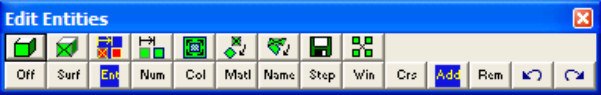

- Ist Tools > Shift-key Selection aktiviert, müssen Sie die Umschalttaste gedrückt halten, um mehrere Objekte auszuwählen.

- Standardmäßig werden ausgewählte Objekte der Liste hinzugefügt; halten Sie jedoch die Strg-Taste gedrückt, werden ausgewählte Objekte aus der Liste entfernt.

- Während Sie die Umschalt- oder Strg-Taste gedrückt halten, können Sie ein Kreuzungsfenster aufziehen.

- Die Verwendung dieser Symbolleiste ist beschrieben unter Build A List of Entities for Editing

- Durch Drücken der Leertaste wird automatisch die zuletzt verwendete Bearbeitungsfunktion aktiviert.

- Wenn Sie beim Rechtsklick die Alt-Taste gedrückt halten, wird automatisch die zuletzt verwendete Bearbeitungsfunktion wiederholt.

Nachdem Sie die gewünschten Objekte ausgewählt haben, können Sie eine der Bearbeiten-Schaltflächen wählen:

CAD > Edit > Entity Properties Edit block type, colour, mining sequence, CAD > Edit > Erase Entities Erase selected entities, CAD > Edit > Move Entities Move selected entities, CAD > Edit > Copy Entities Copy selected entities,

CAD > Edit > Scale Entities Scale selected entities, CAD > Edit > Rotate Azimuth Rotate the azimuth of selected entities, CAD > Edit > Rotate Dip Rotate the dip of selected entities, CAD > Edit > Dump to File Dump selected entities to a file, CAD > Edit > Group Group selected entities into a single block,

- auf einen beliebigen Eckpunkt doppelklicken, um die hervorgehobene Funktion auszuführen,

- per Rechtsklick eine Liste von Optionen aufrufen.

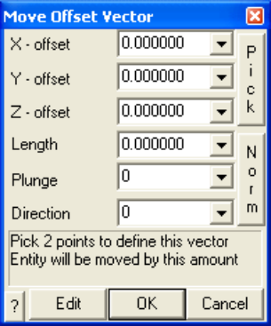

X, Y and Z – offset legen die Komponenten des Versatzvektors fest. Alle ausgewählten Objekte werden um diesen Betrag verschoben.

Pick - aktiviert das Cursor-Fadenkreuz, um den Versatzvektor interaktiv aus dem Modell auszuwählen. Dazu müssen zwei Punkte zur Definition dieses Vektors ausgewählt werden.

Length, Plunge and Direction - legen die Komponenten des Versatzvektors fest. Alle ausgewählten Objekte werden um diesen Betrag verschoben.

Norm - aktiviert den Cursor, um interaktiv eine Oberfläche auszuwählen, zu der der Versatzvektor normal stehen soll.

Um die visuelle Auswahl von Punkten im Modell zu erleichtern, stehen alle Fangfunktionen zur Verfügung.

#### CAD > Snap

Nach der Auswahl werden die Komponenten des Versatzvektors im Dialogfeld angezeigt.

Edit - schließt die Bearbeitung ab und ruft die Bearbeitung der Objekteigenschaften für die ausgewählten Blöcke auf.

OK - schließt die Bearbeitung des Versatzvektors ab und verschiebt die ausgewählten Blöcke.

Cancel - bricht das Verschieben von Objekten ab.

Nach Abschluss eines Bearbeitungsvorgangs haben Sie eine Möglichkeit, die Änderungen rückgängig zu machen, indem Sie

#### Undo

Sie können auch dieselbe Auswahl wiederherstellen und denselben Satz von Objekten erneut ändern, indem Sie

#### Redo

Die Doppelklickzeit lässt sich einstellen mit

Tools > Double Click Time

## 5.5.4.4 Objekte kopieren

Kopiert die ausgewählten Objekte.

Diese Routine kann entweder über die Schaltfläche oder einfach per Rechtsklick auf ein beliebiges Objekt gestartet werden. Beim Start dieser Routine werden Sie zunächst aufgefordert, eine Liste der Objekte zusammenzustellen, die Sie bearbeiten möchten

- Ist Tools > Shift-key Selection aktiviert, müssen Sie die Umschalttaste gedrückt halten, um mehrere Objekte auszuwählen.

- Standardmäßig werden ausgewählte Objekte der Liste hinzugefügt; halten Sie jedoch die Strg-Taste gedrückt, werden ausgewählte Objekte aus der Liste entfernt.

- Während Sie die Umschalt- oder Strg-Taste gedrückt halten, können Sie ein Kreuzungsfenster aufziehen.

- Die Verwendung dieser Symbolleiste ist beschrieben unter Build A List of Entities for Editing

- Durch Drücken der Leertaste wird automatisch die zuletzt verwendete Bearbeitungsfunktion aktiviert.

- Wenn Sie beim Rechtsklick die Alt-Taste gedrückt halten, wird automatisch die zuletzt verwendete Bearbeitungsfunktion wiederholt.

Nachdem Sie die gewünschten Objekte ausgewählt haben, können Sie eine der Bearbeiten-Schaltflächen wählen:

CAD > Edit > Entity Properties Edit block type, colour, mining sequence, CAD > Edit > Erase Entities Erase selected entities, CAD > Edit > Move Entities Move selected entities, CAD > Edit > Copy Entities Copy selected entities, CAD > Edit > Scale Entities Scale selected entities, CAD > Edit > Rotate Azimuth Rotate the azimuth of selected entities, CAD > Edit > Rotate Dip Rotate the dip of selected entities, CAD > Edit > Dump to File Dump selected entities to a file, CAD > Edit > Group Group selected entities into a single block,

- auf einen beliebigen Eckpunkt doppelklicken, um die hervorgehobene Funktion auszuführen,

- per Rechtsklick eine Liste von Optionen aufrufen.

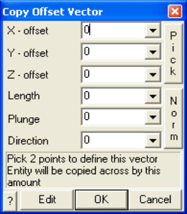

X, Y and Z – offset legen die Komponenten des Versatzvektors fest. Alle ausgewählten Objekte werden an die durch diesen Versatz angegebene Stelle kopiert.

Pick - aktiviert das Cursor-Fadenkreuz, um den Versatzvektor interaktiv aus dem Modell auszuwählen. Dazu müssen zwei Punkte zur Definition dieses Vektors ausgewählt werden.

Length, Plunge and Direction - legen die Komponenten des Versatzvektors fest. Alle ausgewählten Objekte werden an die durch diesen Versatz angegebene Stelle kopiert.

Norm - aktiviert den Cursor, um interaktiv eine Oberfläche auszuwählen, zu der der Versatzvektor normal stehen soll.

Um die visuelle Auswahl von Punkten im Modell zu erleichtern, stehen alle Fangfunktionen zur Verfügung.

#### CAD > Snap

Nach der Auswahl werden die Komponenten des Versatzvektors im Dialogfeld angezeigt.

Edit - schließt die Bearbeitung ab und ruft die Bearbeitung der Objekteigenschaften für die ausgewählten Blöcke auf.

OK - schließt die Bearbeitung des Versatzvektors ab und verschiebt die ausgewählten Blöcke.

Cancel - bricht das Verschieben von Objekten ab.

Nach Abschluss eines Bearbeitungsvorgangs haben Sie eine Möglichkeit, die Änderungen rückgängig zu machen, indem Sie

#### Undo

Sie können auch dieselbe Auswahl wiederherstellen und denselben Satz von Objekten erneut ändern, indem Sie

#### Redo

Die Doppelklickzeit lässt sich einstellen mit

Tools > Double Click Time

## 5.5.4.5 Objekte skalieren

Skaliert die ausgewählten Objekte.

Diese Routine kann entweder über die Schaltfläche oder einfach per Rechtsklick auf ein beliebiges Objekt gestartet werden. Beim Start dieser Routine werden Sie zunächst aufgefordert, eine Liste der Objekte zusammenzustellen, die Sie bearbeiten möchten

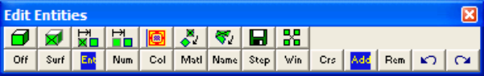

- Ist Tools > Shift-key Selection aktiviert, müssen Sie die Umschalttaste gedrückt halten, um mehrere Objekte auszuwählen.

- Standardmäßig werden ausgewählte Objekte der Liste hinzugefügt; halten Sie jedoch die Strg-Taste gedrückt, werden ausgewählte Objekte aus der Liste entfernt.

- Während Sie die Umschalt- oder Strg-Taste gedrückt halten, können Sie ein Kreuzungsfenster aufziehen.

- Die Verwendung dieser Symbolleiste ist beschrieben unter Build A List of Entities for Editing

- Durch Drücken der Leertaste wird automatisch die zuletzt verwendete Bearbeitungsfunktion aktiviert.

- Wenn Sie beim Rechtsklick die Alt-Taste gedrückt halten, wird automatisch die zuletzt verwendete Bearbeitungsfunktion wiederholt.

Nachdem Sie die gewünschten Objekte ausgewählt haben, können Sie eine der Bearbeiten-Schaltflächen wählen:

CAD > Edit > Entity Properties Edit block type, colour, mining sequence, CAD > Edit > Erase Entities Erase selected entities, CAD > Edit > Move Entities Move selected entities, CAD > Edit > Copy Entities Copy selected entities, CAD > Edit > Scale Entities Scale selected entities,

CAD > Edit > Rotate Azimuth Rotate the azimuth of selected entities, CAD > Edit > Rotate Dip Rotate the dip of selected entities, CAD > Edit > Dump to File Dump selected entities to a file, CAD > Edit > Group Group selected entities into a single block,

- auf einen beliebigen Eckpunkt doppelklicken, um die hervorgehobene Funktion auszuführen,

- per Rechtsklick eine Liste von Optionen aufrufen.

X, Y and Z – coordinates legen die Koordinaten des Skalierungsmittelpunkts fest. Während der Skalierung bleibt dieser Punkt fest. Alle anderen Punkte werden verschoben, um die gewünschte Skalierung zu erreichen.

Pick - aktiviert das Cursor-Fadenkreuz, um den Drehmittelpunkt interaktiv aus dem Modell auszuwählen.

Um die visuelle Auswahl von Punkten im Modell zu erleichtern, stehen alle Fangfunktionen zur Verfügung.

CAD > Snap

Nach der Auswahl werden die Komponenten des Skalierungsmittelpunkts im Dialogfeld angezeigt.

Centroid - berechnet den Mittelpunkt aller ausgewählten Objekte.

OK - schließt die Bearbeitung der Koordinaten ab und fragt nach den Skalierungsfaktoren.

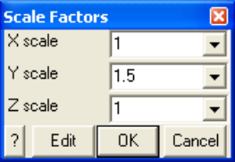

X, Y and Z - scale legt fest, um welchen Faktor die Objekte skaliert werden. Unten wird der Block in y-Richtung um das 1,5-Fache skaliert.

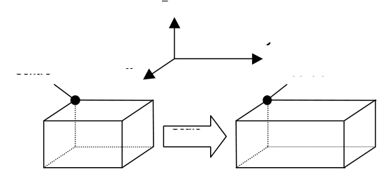

Edit - schließt die Bearbeitung ab und ruft die Bearbeitung der Objekteigenschaften für die ausgewählten Blöcke auf.

OK - schließt die Bearbeitung der Skalierungsfaktoren ab und skaliert die ausgewählten Objekte.

Cancel - bricht das Skalieren von Objekten ab.

Nach Abschluss eines Bearbeitungsvorgangs haben Sie eine Möglichkeit, die Änderungen rückgängig zu machen, indem Sie

#### Undo

Sie können auch dieselbe Auswahl wiederherstellen und denselben Satz von Objekten erneut ändern, indem Sie

Redo

Die Doppelklickzeit lässt sich einstellen mit

Tools > Double Click Time

## 5.5.4.6 Azimut drehen

Dreht den Azimut der ausgewählten Objekte.

Diese Routine kann entweder über die Schaltfläche oder einfach per Rechtsklick auf ein beliebiges Objekt gestartet werden. Beim Start dieser Routine werden Sie zunächst aufgefordert, eine Liste der Objekte zusammenzustellen, die Sie bearbeiten möchten

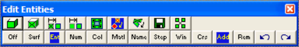

- Ist Tools > Shift-key Selection aktiviert, müssen Sie die Umschalttaste gedrückt halten, um mehrere Objekte auszuwählen.

- Standardmäßig werden ausgewählte Objekte der Liste hinzugefügt; halten Sie jedoch die Strg-Taste gedrückt, werden ausgewählte Objekte aus der Liste entfernt.

- Während Sie die Umschalt- oder Strg-Taste gedrückt halten, können Sie ein Kreuzungsfenster aufziehen.

- Die Verwendung dieser Symbolleiste ist beschrieben unter Build A List of Entities for Editing

- Durch Drücken der Leertaste wird automatisch die zuletzt verwendete Bearbeitungsfunktion aktiviert.

- Wenn Sie beim Rechtsklick die Alt-Taste gedrückt halten, wird automatisch die zuletzt verwendete Bearbeitungsfunktion wiederholt.

Nachdem Sie die gewünschten Objekte ausgewählt haben, können Sie eine der Bearbeiten-Schaltflächen wählen:

CAD > Edit > Entity Properties Edit block type, colour, mining sequence, CAD > Edit > Erase Entities Erase selected entities, CAD > Edit > Move Entities Move selected entities, CAD > Edit > Copy Entities Copy selected entities, CAD > Edit > Scale Entities Scale selected entities, CAD > Edit > Rotate Azimuth Rotate the azimuth of selected entities, CAD > Edit > Rotate Dip Rotate the dip of selected entities, CAD > Edit > Dump to File Dump selected entities to a file, CAD > Edit > Group Group selected entities into a single block,

- auf einen beliebigen Eckpunkt doppelklicken, um die hervorgehobene Funktion auszuführen,

- per Rechtsklick eine Liste von Optionen aufrufen.

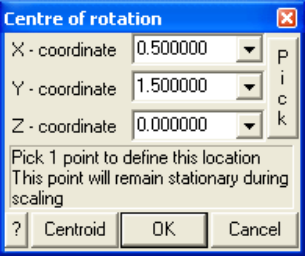

X, Y and Z – coordinates legen die Koordinaten des Drehmittelpunkts fest.

Pick - aktiviert das Cursor-Fadenkreuz, um den Drehmittelpunkt interaktiv aus dem Modell auszuwählen.

Um die visuelle Auswahl von Punkten im Modell zu erleichtern, stehen alle Fangfunktionen zur Verfügung.

#### CAD > Snap

Nach der Auswahl werden die Komponenten des Skalierungsmittelpunkts im Dialogfeld angezeigt.

Centroid - berechnet den Mittelpunkt aller ausgewählten Objekte.

OK - schließt die Bearbeitung der Koordinaten ab und fragt nach den Skalierungsfaktoren.

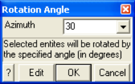

- Azimuth - legt den Winkel (in Grad) fest, um den die ausgewählten Objekte gedreht werden sollen. · Die Drehung erfolgt in der X-Y-Ebene, sodass alle vertikalen Linien vertikal bleiben.

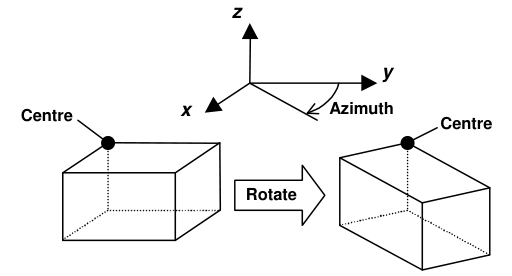

Edit - schließt die Bearbeitung ab und ruft die Bearbeitung der Objekteigenschaften für die ausgewählten Blöcke auf.

OK - schließt die Bearbeitung des Azimuts ab und dreht die ausgewählten Objekte.

Cancel - bricht das Drehen von Objekten ab.

Nach Abschluss eines Bearbeitungsvorgangs haben Sie eine Möglichkeit, die Änderungen rückgängig zu machen, indem Sie

Undo

Sie können auch dieselbe Auswahl wiederherstellen und denselben Satz von Objekten erneut ändern, indem Sie

Redo

Die Doppelklickzeit lässt sich einstellen mit

Tools > Double Click Time

## 5.5.4.7 Einfallen drehen

Dreht das Einfallen der ausgewählten Objekte.

Diese Routine kann entweder über die Schaltfläche oder einfach per Rechtsklick auf ein beliebiges Objekt gestartet werden. Beim Start dieser Routine werden Sie zunächst aufgefordert, eine Liste der Objekte zusammenzustellen, die Sie bearbeiten möchten

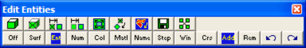

- Ist Tools > Shift-key Selection aktiviert, müssen Sie die Umschalttaste gedrückt halten, um mehrere Objekte auszuwählen.

- Standardmäßig werden ausgewählte Objekte der Liste hinzugefügt; halten Sie jedoch die Strg-Taste gedrückt, werden ausgewählte Objekte aus der Liste entfernt.

- Während Sie die Umschalt- oder Strg-Taste gedrückt halten, können Sie ein Kreuzungsfenster aufziehen.

- Die Verwendung dieser Symbolleiste ist beschrieben unter Build A List of Entities for Editing

- Durch Drücken der Leertaste wird automatisch die zuletzt verwendete Bearbeitungsfunktion aktiviert.

- Wenn Sie beim Rechtsklick die Alt-Taste gedrückt halten, wird automatisch die zuletzt verwendete Bearbeitungsfunktion wiederholt.

Nachdem Sie die gewünschten Objekte ausgewählt haben, können Sie eine der Bearbeiten-Schaltflächen wählen:

CAD > Edit > Entity Properties Edit block type, colour, mining sequence, CAD > Edit > Erase Entities Erase selected entities, CAD > Edit > Move Entities Move selected entities, CAD > Edit > Copy Entities Copy selected entities, CAD > Edit > Scale Entities Scale selected entities, CAD > Edit > Rotate Azimuth Rotate the azimuth of selected entities, CAD > Edit > Rotate Dip Rotate the dip of selected entities,

CAD > Edit > Slice Entities Slice selected entities,

CAD > Edit > Dump to File Dump selected entities to a file, CAD > Edit > Group Group selected entities into a single block,

- auf einen beliebigen Eckpunkt doppelklicken, um die hervorgehobene Funktion auszuführen,

- per Rechtsklick eine Liste von Optionen aufrufen.

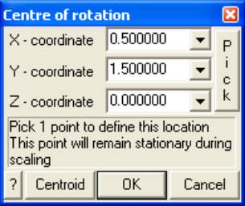

X, Y and Z – coordinates legen die Koordinaten des Drehmittelpunkts fest.

Pick - aktiviert das Cursor-Fadenkreuz, um den Drehmittelpunkt interaktiv aus dem Modell auszuwählen.

Um die visuelle Auswahl von Punkten im Modell zu erleichtern, stehen alle Fangfunktionen zur Verfügung.

#### CAD > Snap

Nach der Auswahl werden die Komponenten des Skalierungsmittelpunkts im Dialogfeld angezeigt.

Centroid - berechnet den Mittelpunkt aller ausgewählten Objekte.

OK - schließt die Bearbeitung der Koordinaten ab und fragt nach den Skalierungsfaktoren.

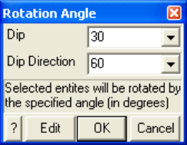

Dip - legt den Winkel (in Grad) fest, um den die ausgewählten Objekte gedreht werden sollen.

Dip Direction - legt den Azimut (in Grad) fest, in dem das Einfallen erfolgen soll. Die Einfallsrichtung liegt 90° zum Streichen der Einfallsebene.

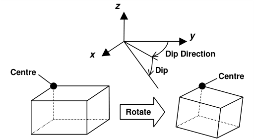

Edit - schließt die Bearbeitung ab und ruft die Bearbeitung der Objekteigenschaften für die ausgewählten Blöcke auf.

OK - schließt die Bearbeitung von Einfallen und Einfallsrichtung ab und dreht die ausgewählten Objekte.

Cancel - bricht das Drehen von Objekten ab.

Nach Abschluss eines Bearbeitungsvorgangs haben Sie eine Möglichkeit, die Änderungen rückgängig zu machen, indem Sie

#### Undo

Sie können auch dieselbe Auswahl wiederherstellen und denselben Satz von Objekten erneut ändern, indem Sie

#### Redo

Die Doppelklickzeit lässt sich einstellen mit

#### Tools > Double Click Time

## 5.5.4.8 Objekte schneiden

Schneidet Objekte.

Alle Objekte können geschnitten werden, einschließlich FF-Blöcken, DD-Ebenen, Rasterebenen, Rasterlinien und Konstruktionslinien.

Video Demo of Model_Simplification_Using_Slicing

Diese Routine kann entweder über die Schaltfläche oder einfach per Rechtsklick auf ein beliebiges Objekt gestartet werden. Beim Start dieser Routine werden Sie zunächst aufgefordert, eine Liste der Objekte zusammenzustellen, die Sie bearbeiten möchten

- Ist Tools > Shift-key Selection aktiviert, müssen Sie die Umschalttaste gedrückt halten, um mehrere Objekte auszuwählen.

- Standardmäßig werden ausgewählte Objekte der Liste hinzugefügt; halten Sie jedoch die Strg-Taste gedrückt, werden ausgewählte Objekte aus der Liste entfernt.

- Während Sie die Umschalt- oder Strg-Taste gedrückt halten, können Sie ein Kreuzungsfenster aufziehen.

- Die Verwendung dieser Symbolleiste ist beschrieben unter Build A List of Entities for Editing

- Durch Drücken der Leertaste wird automatisch die zuletzt verwendete Bearbeitungsfunktion aktiviert.

- Wenn Sie beim Rechtsklick die Alt-Taste gedrückt halten, wird automatisch die zuletzt verwendete Bearbeitungsfunktion wiederholt.

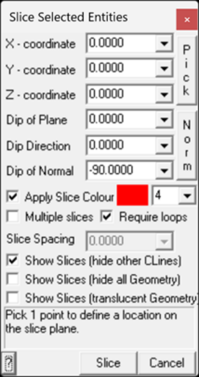

X, Y and Z – coordinate legen einen Punkt der Schnittebene fest.

Pick - aktiviert das Cursor-Fadenkreuz, um den Punkt interaktiv auszuwählen.

Dip of Plane, Dip Direction and Normal - legen die Orientierung der Schnittebene fest.

Norm - aktiviert den Cursor, um interaktiv eine Oberfläche auszuwählen, zu der die Schnittebene parallel sein soll. Einfallen und Einfallsrichtung der Ebene werden normal zur ausgewählten Oberfläche gesetzt.

Apply Slice Colour - wenn aktiviert, legt dies die Farbnummer fest, die den beim Schneiden erzeugten CLines zugewiesen wird; andernfalls wird die Farbe des geschnittenen Objekts verwendet.

Multiple Slices - legt fest, dass im angegebenen Schnittabstand mehrere Schnitte erzeugt werden.

Require Loops - Schnitte können einzelne Linien sein oder optional zu geschlossenen Schleifen geformt werden.

Slice Spacing - legt den optionalen Abstand für mehrere Schnitte fest.

Show Slices (hide other CLines) - blendet automatisch alle bereits vorhandenen CLines aus und zeigt die neu erzeugten CLine-Schnitte an.

Slice Spacing (hide all Geometry) - blendet automatisch die gesamte bereits vorhandene Geometrie aus und zeigt die neu erzeugten CLine-Schnitte an.

Slice Spacing (translucent Geometry) - stellt automatisch die gesamte bereits vorhandene Geometrie durchscheinend dar und zeigt die neu erzeugten CLine-Schnitte an.

- Es stehen mehrere „View > Hide“-Optionen zur Steuerung der Anzeige der verschiedenen Objekte zur Verfügung, darunter:

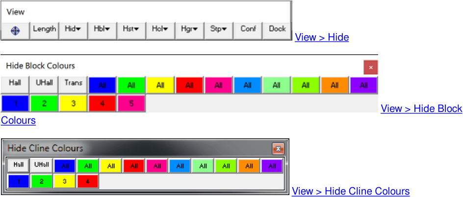

Um die visuelle Auswahl von Punkten im Modell zu erleichtern, stehen alle Fangfunktionen zur Verfügung.

#### CAD > Snap

Nach der Auswahl werden die Komponenten des Versatzvektors im Dialogfeld angezeigt.

Slice - führt den Schneidevorgang für die ausgewählten Blöcke aus.

Cancel - bricht das Schneiden von Objekten ab.

Nach Abschluss eines Bearbeitungsvorgangs haben Sie eine Möglichkeit, die Änderungen rückgängig zu machen, indem Sie

Undo

Sie können auch dieselbe Auswahl wiederherstellen und denselben Satz von Objekten erneut ändern, indem Sie

Redo

Die Doppelklickzeit lässt sich einstellen mit

Tools > Double Click Time

## 5.5.4.9 In Datei ausgeben

Gibt die ausgewählten Objekte in eine Datei aus.

Diese Routine kann entweder über die Schaltfläche oder einfach per Rechtsklick auf ein beliebiges Objekt gestartet werden. Beim Start dieser Routine werden Sie zunächst aufgefordert, eine Liste der Objekte zusammenzustellen, die Sie ausgeben möchten

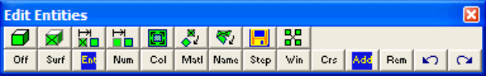

- Ist Tools > Shift-key Selection aktiviert, müssen Sie die Umschalttaste gedrückt halten, um mehrere Objekte auszuwählen.

- Standardmäßig werden ausgewählte Objekte der Liste hinzugefügt; halten Sie jedoch die Strg-Taste gedrückt, werden ausgewählte Objekte aus der Liste entfernt.

- Während Sie die Umschalt- oder Strg-Taste gedrückt halten, können Sie ein Kreuzungsfenster aufziehen.

- Die Verwendung dieser Symbolleiste ist beschrieben unter Build A List of Entities for Editing

- Durch Drücken der Leertaste wird automatisch die zuletzt verwendete Bearbeitungsfunktion aktiviert.

- Wenn Sie beim Rechtsklick die Alt-Taste gedrückt halten, wird automatisch die zuletzt verwendete Bearbeitungsfunktion wiederholt.

Nachdem Sie die gewünschten Objekte ausgewählt haben, können Sie eine der Bearbeiten-Schaltflächen wählen:

CAD > Edit > Entity Properties Edit block type, colour, mining sequence, CAD > Edit > Erase Entities Erase selected entities, CAD > Edit > Move Entities Move selected entities, CAD > Edit > Copy Entities Copy selected entities, CAD > Edit > Scale Entities Scale selected entities, CAD > Edit > Rotate Azimuth Rotate the azimuth of selected entities, CAD > Edit > Rotate Dip Rotate the dip of selected entities, CAD > Edit > Dump to File Dump selected entities to a file,

CAD > Edit > Group Group selected entities into a single block,

- auf einen beliebigen Eckpunkt doppelklicken, um die hervorgehobene Funktion auszuführen,

- per Rechtsklick eine Liste von Optionen aufrufen.

Die Doppelklickzeit lässt sich einstellen mit

Tools > Double Click Time

## 5.5.4.10 Objekte gruppieren

Gruppiert die ausgewählten Objekte zu einem einzelnen Block. Dies ist eine erweiterte Option, die nur von erfahrenen Benutzern verwendet werden sollte.

Gelegentlich müssen einzelne Oberflächen gelöscht oder erstellt und anschließend zu einem einzelnen Block gruppiert werden. Diese Funktion gruppiert Objekte zu einem nahtlosen geschlossenen Block aus einzelnen Oberflächen. Beachten Sie, dass der Benutzer bei dieser Operation sicherstellen muss, dass die gruppierten Oberflächen eine nahtlose, geschlossene Oberflächenhülle ohne innere Oberflächen bilden. Das Vorhandensein innerer Oberflächen kann Fehler verursachen.

Die Gruppierfunktion wurde implementiert, damit fortgeschrittene Benutzer einige Oberflächenelemente löschen und neu aufbauen können. Sie ist auch nützlich, um aus CAD-Paketen übernommene Oberflächen zusammenzufügen. Beachten Sie, dass der Benutzer sicherstellen muss, dass es keine inneren Oberflächen gibt und dass die gruppierten Oberflächen tatsächlich eine nahtlose, geschlossene Oberflächenhülle bilden.

Diese Routine kann entweder über die Schaltfläche oder einfach per Rechtsklick auf ein beliebiges Objekt gestartet werden. Beim Start dieser Routine werden Sie zunächst aufgefordert, eine Liste der Objekte zusammenzustellen, die Sie gruppieren möchten

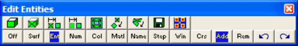

- Ist Tools > Shift-key Selection aktiviert, müssen Sie die Umschalttaste gedrückt halten, um mehrere Objekte auszuwählen.

- Standardmäßig werden ausgewählte Objekte der Liste hinzugefügt; halten Sie jedoch die Strg-Taste gedrückt, werden ausgewählte Objekte aus der Liste entfernt.

- Während Sie die Umschalt- oder Strg-Taste gedrückt halten, können Sie ein Kreuzungsfenster aufziehen.

- Die Verwendung dieser Symbolleiste ist beschrieben unter Build A List of Entities for Editing

- Durch Drücken der Leertaste wird automatisch die zuletzt verwendete Bearbeitungsfunktion aktiviert.

- Wenn Sie beim Rechtsklick die Alt-Taste gedrückt halten, wird automatisch die zuletzt verwendete Bearbeitungsfunktion wiederholt.

Nachdem Sie die gewünschten Objekte ausgewählt haben, können Sie eine der Bearbeiten-Schaltflächen wählen:

CAD > Edit > Entity Properties Edit block type, colour, mining sequence, CAD > Edit > Erase Entities Erase selected entities, CAD > Edit > Move Entities Move selected entities, CAD > Edit > Copy Entities Copy selected entities, CAD > Edit > Scale Entities Scale selected entities, CAD > Edit > Rotate Azimuth Rotate the azimuth of selected entities, CAD > Edit > Rotate Dip Rotate the dip of selected entities,

CAD > Edit > Dump to File Dump selected entities to a file,

CAD > Edit > Group Group selected entities into a single block,

- auf einen beliebigen Eckpunkt doppelklicken, um die hervorgehobene Funktion auszuführen,

- per Rechtsklick eine Liste von Optionen aufrufen.

Wenn eines der Felder im Dialogfeld „Variable“ anzeigt, haben einige der ausgewählten Oberflächen unterschiedliche Eigenschaften für dieses Feld. Um die ausgewählten Objekte zu einem einzelnen Block zu gruppieren, müssen alle Oberflächen in allen Feldern dieselben Einstellungen haben. Verwenden Sie dazu CAD > Edit > Entity Properties.

Nach Abschluss eines Bearbeitungsvorgangs haben Sie eine Möglichkeit, die Änderungen rückgängig zu machen, indem Sie

#### Undo

Sie können auch dieselbe Auswahl wiederherstellen und denselben Satz von Objekten erneut ändern, indem Sie

#### Redo

Die Doppelklickzeit lässt sich einstellen mit

#### Tools > Double Click Time

## 5.5.4.11 Eckpunkte strecken

Fügt den ausgewählten Eckpunkten einen Versatz hinzu.

Diese Routine kann entweder über die Schaltfläche oder einfach per Rechtsklick auf einen beliebigen Eckpunkt gestartet werden. Beim Start dieser Routine werden Sie zunächst aufgefordert, eine Liste der Eckpunkte zusammenzustellen, die Sie strecken möchten

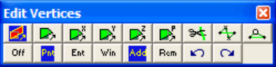

- Ist Tools > Shift-key Selection aktiviert, müssen Sie die Umschalttaste gedrückt halten, um mehrere Objekte auszuwählen.

- Standardmäßig werden ausgewählte Objekte der Liste hinzugefügt; halten Sie jedoch die Strg-Taste gedrückt, werden ausgewählte Objekte aus der Liste entfernt.

- Während Sie die Umschalt- oder Strg-Taste gedrückt halten, können Sie ein Kreuzungsfenster aufziehen.

- Die Verwendung dieser Symbolleiste ist beschrieben unter Build A List of Vertices for Editing

- Durch Drücken der Leertaste wird automatisch die zuletzt verwendete Bearbeitungsfunktion aktiviert.

- Wenn Sie beim Rechtsklick die Alt-Taste gedrückt halten, wird automatisch die zuletzt verwendete Bearbeitungsfunktion wiederholt.

Nachdem Sie die gewünschten Objekte ausgewählt haben, können Sie eine der Bearbeiten-Schaltflächen wählen:

CAD > Edit > Stretch Vertices CAD > Edit > Move Vertices to Point CAD > Edit > Move Vertices to X CAD > Edit > Move Vertices to Y CAD > Edit > Move Vertices to Z CAD > Edit > Move Vertices to Plane CAD > Edit > Subdivide Construction Lines CAD > Edit > Smooth Construction Lines CAD > Edit > Remove Construction Vertex

- auf einen beliebigen Eckpunkt doppelklicken, um die hervorgehobene Funktion auszuführen,

- per Rechtsklick eine Liste von Optionen aufrufen.

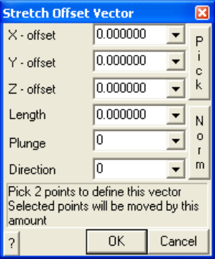

X, Y and Z – offset legen die Komponenten des Streckvektors fest.

- Alle ausgewählten Eckpunkte werden an die durch diesen Versatz angegebene Stelle verschoben.

- Dazu müssen zwei Punkte zur Definition dieses Vektors ausgewählt werden.

- Nach der Auswahl werden die Komponenten des Versatzvektors im Dialogfeld angezeigt.

Pick aktiviert das Cursor-Fadenkreuz, um den Versatzvektor interaktiv aus dem Modell auszuwählen. Dazu müssen zwei Punkte zur Definition dieses Vektors ausgewählt werden.

Length, Plunge and Direction - legen die Komponenten des Versatzvektors fest. Alle ausgewählten Eckpunkte werden um diesen Betrag verschoben.

Norm - aktiviert den Cursor, um interaktiv eine Oberfläche auszuwählen, zu der der Versatzvektor normal stehen soll.

Um die visuelle Auswahl von Punkten im Modell zu erleichtern, stehen alle Fangfunktionen zur Verfügung.

#### CAD > Snap

Nach der Auswahl werden die Komponenten des Versatzvektors im Dialogfeld angezeigt.

OK - schließt die Bearbeitung des Versatzvektors ab und streckt die ausgewählten Eckpunkte.

Cancel - bricht das Strecken von Eckpunkten ab.

Nach Abschluss eines Bearbeitungsvorgangs haben Sie eine Möglichkeit, die Änderungen rückgängig zu machen, indem Sie

#### Undo

Sie können auch dieselbe Auswahl wiederherstellen und denselben Satz von Objekten erneut ändern, indem Sie

#### Redo

Die Doppelklickzeit lässt sich einstellen mit

#### Tools > Double Click Time

## 5.5.4.12 Eckpunkte auf einen Punkt verschieben

Verschiebt ausgewählte Eckpunkte auf einen Punkt.

Diese Routine kann entweder über die Schaltfläche oder einfach per Rechtsklick auf einen beliebigen Eckpunkt gestartet werden. Beim Start dieser Routine werden Sie zunächst aufgefordert, eine Liste der Eckpunkte zusammenzustellen, die Sie verschieben möchten.

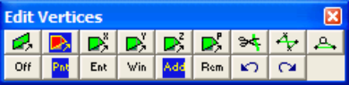

- Ist Tools > Shift-key Selection aktiviert, müssen Sie die Umschalttaste gedrückt halten, um mehrere Objekte auszuwählen.

- Standardmäßig werden ausgewählte Objekte der Liste hinzugefügt; halten Sie jedoch die Strg-Taste gedrückt, werden ausgewählte Objekte aus der Liste entfernt.

- Während Sie die Umschalt- oder Strg-Taste gedrückt halten, können Sie ein Kreuzungsfenster aufziehen.

- Die Verwendung dieser Symbolleiste ist beschrieben unter Build A List of Vertices for Editing

- Durch Drücken der Leertaste wird automatisch die zuletzt verwendete Bearbeitungsfunktion aktiviert.

- Wenn Sie beim Rechtsklick die Alt-Taste gedrückt halten, wird automatisch die zuletzt verwendete Bearbeitungsfunktion wiederholt.

Nachdem Sie die gewünschten Objekte ausgewählt haben, können Sie eine der Bearbeiten-Schaltflächen wählen:

CAD > Edit > Stretch Vertices CAD > Edit > Move Vertices to Point CAD > Edit > Move Vertices to X CAD > Edit > Move Vertices to Y CAD > Edit > Move Vertices to Z CAD > Edit > Move Vertices to Plane CAD > Edit > Subdivide Construction Lines CAD > Edit > Smooth Construction Lines CAD > Edit > Remove Construction Vertex

- auf einen beliebigen Eckpunkt doppelklicken, um die hervorgehobene Funktion auszuführen,

- per Rechtsklick eine Liste von Optionen aufrufen.

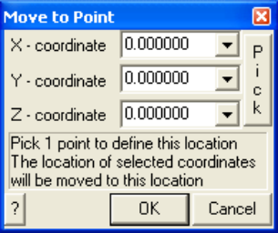

X, Y and Z – coordinate legen die Koordinaten des Punkts fest. Alle ausgewählten Eckpunkte werden auf diesen Punkt verschoben.

Pick - aktiviert das Cursor-Fadenkreuz, um den Punkt interaktiv aus dem Modell auszuwählen.

Um die visuelle Auswahl von Punkten im Modell zu erleichtern, stehen alle Fangfunktionen zur Verfügung.

#### CAD > Snap

Nach der Auswahl werden die Komponenten des Versatzvektors im Dialogfeld angezeigt.

OK - schließt die Bearbeitung des Versatzvektors ab und streckt die ausgewählten Eckpunkte.

Cancel - bricht das Strecken von Eckpunkten ab.

Nach Abschluss eines Bearbeitungsvorgangs haben Sie eine Möglichkeit, die Änderungen rückgängig zu machen, indem Sie

#### Undo

Sie können auch dieselbe Auswahl wiederherstellen und denselben Satz von Objekten erneut ändern, indem Sie

Redo

Die Doppelklickzeit lässt sich einstellen mit

#### Tools > Double Click Time

## 5.5.4.13 Eckpunkte auf X verschieben

Verschiebt die X-Koordinate der ausgewählten Eckpunkte.

Diese Routine kann entweder über die Schaltfläche oder einfach per Rechtsklick auf einen beliebigen Eckpunkt gestartet werden. Beim Start dieser Routine werden Sie zunächst aufgefordert, eine Liste der Eckpunkte zusammenzustellen, die Sie verschieben möchten.

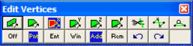

- Ist Tools > Shift-key Selection aktiviert, müssen Sie die Umschalttaste gedrückt halten, um mehrere Objekte auszuwählen.

- Standardmäßig werden ausgewählte Objekte der Liste hinzugefügt; halten Sie jedoch die Strg-Taste gedrückt, werden ausgewählte Objekte aus der Liste entfernt.

- Während Sie die Umschalt- oder Strg-Taste gedrückt halten, können Sie ein Kreuzungsfenster aufziehen.

- Die Verwendung dieser Symbolleiste ist beschrieben unter Build A List of Vertices for Editing

- Durch Drücken der Leertaste wird automatisch die zuletzt verwendete Bearbeitungsfunktion aktiviert.

- Wenn Sie beim Rechtsklick die Alt-Taste gedrückt halten, wird automatisch die zuletzt verwendete Bearbeitungsfunktion wiederholt.

Nachdem Sie die gewünschten Objekte ausgewählt haben, können Sie eine der Bearbeiten-Schaltflächen wählen:

CAD > Edit > Stretch Vertices CAD > Edit > Move Vertices to Point CAD > Edit > Move Vertices to X CAD > Edit > Move Vertices to Y CAD > Edit > Move Vertices to Z

CAD > Edit > Move Vertices to Plane

CAD > Edit > Subdivide Construction Lines CAD > Edit > Smooth Construction Lines

CAD > Edit > Remove Construction Vertex

- auf einen beliebigen Eckpunkt doppelklicken, um die hervorgehobene Funktion auszuführen,

- per Rechtsklick eine Liste von Optionen aufrufen.

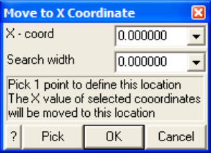

X – coordinate legt die X-Koordinate des Punkts fest. Die X-Koordinate aller ausgewählten Eckpunkte (d. h. der Eckpunkte in der Liste) wird auf diesen Wert verschoben.

Search width alle Koordinaten, die innerhalb des Suchbreitenabstands vom angegebenen x-Koordinatenwert liegen, werden verschoben, auch wenn sie nicht in der Liste stehen.

Pick aktiviert das Cursor-Fadenkreuz, um den Punkt interaktiv aus dem Modell auszuwählen. Um die visuelle Auswahl von Punkten im Modell zu erleichtern, stehen alle Fangfunktionen zur Verfügung

Um die visuelle Auswahl von Punkten im Modell zu erleichtern, stehen alle Fangfunktionen zur Verfügung.

#### CAD > Snap

Nach der Auswahl werden die Komponenten des Versatzvektors im Dialogfeld angezeigt.

OK - schließt die Bearbeitung des Versatzvektors ab und streckt die ausgewählten Eckpunkte.

Cancel - bricht das Strecken von Eckpunkten ab.

Nach Abschluss eines Bearbeitungsvorgangs haben Sie eine Möglichkeit, die Änderungen rückgängig zu machen, indem Sie

#### Undo

Sie können auch dieselbe Auswahl wiederherstellen und denselben Satz von Objekten erneut ändern, indem Sie

#### Redo

Die Doppelklickzeit lässt sich einstellen mit

#### Tools > Double Click Time

## 5.5.4.14 Eckpunkte auf Y verschieben

Verschiebt die Y-Koordinate der ausgewählten Eckpunkte.

Diese Routine kann entweder über die Schaltfläche oder einfach per Rechtsklick auf einen beliebigen Eckpunkt gestartet werden. Beim Start dieser Routine werden Sie zunächst aufgefordert, eine Liste der Eckpunkte zusammenzustellen, die Sie verschieben möchten.

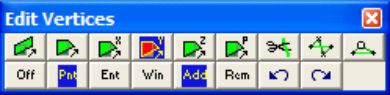

- Ist Tools > Shift-key Selection aktiviert, müssen Sie die Umschalttaste gedrückt halten, um mehrere Objekte auszuwählen.

- Standardmäßig werden ausgewählte Objekte der Liste hinzugefügt; halten Sie jedoch die Strg-Taste gedrückt, werden ausgewählte Objekte aus der Liste entfernt.

- Während Sie die Umschalt- oder Strg-Taste gedrückt halten, können Sie ein Kreuzungsfenster aufziehen.

- Die Verwendung dieser Symbolleiste ist beschrieben unter Build A List of Vertices for Editing

- Durch Drücken der Leertaste wird automatisch die zuletzt verwendete Bearbeitungsfunktion aktiviert.

- Wenn Sie beim Rechtsklick die Alt-Taste gedrückt halten, wird automatisch die zuletzt verwendete Bearbeitungsfunktion wiederholt.

Nachdem Sie die gewünschten Objekte ausgewählt haben, können Sie eine der Bearbeiten-Schaltflächen wählen:

CAD > Edit > Stretch Vertices CAD > Edit > Move Vertices to Point CAD > Edit > Move Vertices to X CAD > Edit > Move Vertices to Y CAD > Edit > Move Vertices to Z CAD > Edit > Move Vertices to Plane CAD > Edit > Subdivide Construction Lines CAD > Edit > Smooth Construction Lines CAD > Edit > Remove Construction Vertex

- auf einen beliebigen Eckpunkt doppelklicken, um die hervorgehobene Funktion auszuführen,

- per Rechtsklick eine Liste von Optionen aufrufen.

Y – coordinate legt die Y-Koordinate des Punkts fest. Die Y-Koordinate aller ausgewählten Eckpunkte (d. h. der Eckpunkte in der Liste) wird auf diesen Wert verschoben.

Search width alle Koordinaten, die innerhalb des Suchbreitenabstands vom angegebenen y-Koordinatenwert liegen, werden verschoben, auch wenn sie nicht in der Liste stehen.

Pick aktiviert das Cursor-Fadenkreuz, um den Punkt interaktiv aus dem Modell auszuwählen. Um die visuelle Auswahl von Punkten im Modell zu erleichtern, stehen alle Fangfunktionen zur Verfügung

Um die visuelle Auswahl von Punkten im Modell zu erleichtern, stehen alle Fangfunktionen zur Verfügung.

#### CAD > Snap

Nach der Auswahl werden die Komponenten des Versatzvektors im Dialogfeld angezeigt.

OK - schließt die Bearbeitung des Versatzvektors ab und streckt die ausgewählten Eckpunkte.

Cancel - bricht das Strecken von Eckpunkten ab.

Nach Abschluss eines Bearbeitungsvorgangs haben Sie eine Möglichkeit, die Änderungen rückgängig zu machen, indem Sie

#### Undo

Sie können auch dieselbe Auswahl wiederherstellen und denselben Satz von Objekten erneut ändern, indem Sie

Redo

Die Doppelklickzeit lässt sich einstellen mit

Tools > Double Click Time

## 5.5.4.15 Eckpunkte auf Z verschieben

Verschiebt die Z-Koordinate der ausgewählten Eckpunkte.

Diese Routine kann entweder über die Schaltfläche oder einfach per Rechtsklick auf einen beliebigen Eckpunkt gestartet werden. Beim Start dieser Routine werden Sie zunächst aufgefordert, eine Liste der Eckpunkte zusammenzustellen, die Sie verschieben möchten.

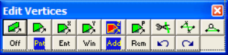

- Ist Tools > Shift-key Selection aktiviert, müssen Sie die Umschalttaste gedrückt halten, um mehrere Objekte auszuwählen.

- Standardmäßig werden ausgewählte Objekte der Liste hinzugefügt; halten Sie jedoch die Strg-Taste gedrückt, werden ausgewählte Objekte aus der Liste entfernt.

- Während Sie die Umschalt- oder Strg-Taste gedrückt halten, können Sie ein Kreuzungsfenster aufziehen.

- Die Verwendung dieser Symbolleiste ist beschrieben unter Build A List of Vertices for Editing

- Durch Drücken der Leertaste wird automatisch die zuletzt verwendete Bearbeitungsfunktion aktiviert.

- Wenn Sie beim Rechtsklick die Alt-Taste gedrückt halten, wird automatisch die zuletzt verwendete Bearbeitungsfunktion wiederholt.

Nachdem Sie die gewünschten Objekte ausgewählt haben, können Sie eine der Bearbeiten-Schaltflächen wählen:

CAD > Edit > Stretch Vertices CAD > Edit > Move Vertices to Point CAD > Edit > Move Vertices to X CAD > Edit > Move Vertices to Y

CAD > Edit > Move Vertices to Z

CAD > Edit > Move Vertices to Plane

CAD > Edit > Subdivide Construction Lines

CAD > Edit > Smooth Construction Lines

CAD > Edit > Remove Construction Vertex

- auf einen beliebigen Eckpunkt doppelklicken, um die hervorgehobene Funktion auszuführen,

- per Rechtsklick eine Liste von Optionen aufrufen.

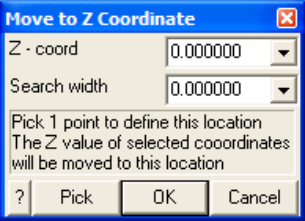

Z – coordinate legt die Z-Koordinate des Punkts fest. Die Z-Koordinate aller ausgewählten Eckpunkte (d. h. der Eckpunkte in der Liste) wird auf diesen Wert verschoben.

Search width alle Koordinaten, die innerhalb des Suchbreitenabstands vom angegebenen z-Koordinatenwert liegen, werden verschoben, auch wenn sie nicht in der Liste stehen.

Pick aktiviert das Cursor-Fadenkreuz, um den Punkt interaktiv aus dem Modell auszuwählen. Um die visuelle Auswahl von Punkten im Modell zu erleichtern, stehen alle Fangfunktionen zur Verfügung

Um die visuelle Auswahl von Punkten im Modell zu erleichtern, stehen alle Fangfunktionen zur Verfügung.

#### CAD > Snap

Nach der Auswahl werden die Komponenten des Versatzvektors im Dialogfeld angezeigt.

OK - schließt die Bearbeitung des Versatzvektors ab und streckt die ausgewählten Eckpunkte.

Cancel - bricht das Strecken von Eckpunkten ab.

Nach Abschluss eines Bearbeitungsvorgangs haben Sie eine Möglichkeit, die Änderungen rückgängig zu machen, indem Sie

#### Undo

Sie können auch dieselbe Auswahl wiederherstellen und denselben Satz von Objekten erneut ändern, indem Sie

#### Redo

Die Doppelklickzeit lässt sich einstellen mit

#### Tools > Double Click Time

## 5.5.4.16 Eckpunkte auf eine Ebene verschieben

Verschiebt die ausgewählten Eckpunkte auf eine Ebene. Die Eckpunkte werden in Richtung der Normalen zur Ebene (oder in einer vom Benutzer angegebenen Richtung) verschoben.

Diese Routine kann entweder über die Schaltfläche oder einfach per Rechtsklick auf einen beliebigen Eckpunkt gestartet werden. Beim Start dieser Routine werden Sie zunächst aufgefordert, eine Liste der Eckpunkte zusammenzustellen, die Sie verschieben möchten.

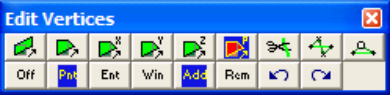

- Ist Tools > Shift-key Selection aktiviert, müssen Sie die Umschalttaste gedrückt halten, um mehrere Objekte auszuwählen.

- Standardmäßig werden ausgewählte Objekte der Liste hinzugefügt; halten Sie jedoch die Strg-Taste gedrückt, werden ausgewählte Objekte aus der Liste entfernt.

- Während Sie die Umschalt- oder Strg-Taste gedrückt halten, können Sie ein Kreuzungsfenster aufziehen.

- Die Verwendung dieser Symbolleiste ist beschrieben unter Build A List of Vertices for Editing

- Durch Drücken der Leertaste wird automatisch die zuletzt verwendete Bearbeitungsfunktion aktiviert.

- Wenn Sie beim Rechtsklick die Alt-Taste gedrückt halten, wird automatisch die zuletzt verwendete Bearbeitungsfunktion wiederholt.

Nachdem Sie die gewünschten Objekte ausgewählt haben, können Sie eine der Bearbeiten-Schaltflächen wählen:

CAD > Edit > Stretch Vertices CAD > Edit > Move Vertices to Point CAD > Edit > Move Vertices to X CAD > Edit > Move Vertices to Y CAD > Edit > Move Vertices to Z CAD > Edit > Move Vertices to Plane CAD > Edit > Subdivide Construction Lines CAD > Edit > Smooth Construction Lines CAD > Edit > Remove Construction Vertex

- auf einen beliebigen Eckpunkt doppelklicken, um die hervorgehobene Funktion auszuführen,

- per Rechtsklick eine Liste von Optionen aufrufen.

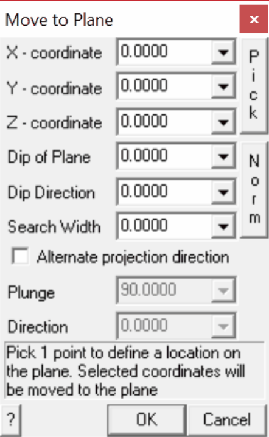

X Y Z – coordinate legen die Koordinaten eines beliebigen Punkts der Ebene fest.

Pick aktiviert das Cursor-Fadenkreuz, um die x-y-z-Koordinaten des Punkts auf der Ebene interaktiv aus dem Modell auszuwählen. Um die visuelle Auswahl von Punkten im Modell zu erleichtern, stehen alle Fangfunktionen zur Verfügung

Dip of Plane legt das Einfallen der Ebene fest (nach unten positiv, in Grad).

Dip Direction legt den Azimut des Einfallsvektors fest (Grad).

Norm - aktiviert den Cursor, um interaktiv eine Oberfläche auszuwählen, zu der die Ebene parallel sein soll. Einfallen und Einfallsrichtung der Ebene werden normal zur ausgewählten Oberfläche gesetzt.

Search width alle Koordinaten, die innerhalb des Suchbreitenabstands von der angegebenen Ebene liegen, werden verschoben, auch wenn sie nicht in der Liste stehen.

Alternate projection direction - ist diese Option nicht aktiviert, werden alle Punkte in Richtung der Normalen zur Ebene auf die ausgewählte Ebene projiziert. Ist sie aktiviert, kann der Benutzer die gewünschte Projektionsrichtung selbst angeben.

Plunge - vom Benutzer angegebene Projektionsrichtung.

Direction - vom Benutzer angegebene Projektionsrichtung.

Um die visuelle Auswahl von Punkten im Modell zu erleichtern, stehen alle Fangfunktionen zur Verfügung.

#### CAD > Snap

Nach der Auswahl werden die Komponenten des Versatzvektors im Dialogfeld angezeigt.

OK - schließt die Bearbeitung des Versatzvektors ab und streckt die ausgewählten Eckpunkte.

Cancel - bricht das Strecken von Eckpunkten ab.

Nach Abschluss eines Bearbeitungsvorgangs haben Sie eine Möglichkeit, die Änderungen rückgängig zu machen, indem Sie

#### Undo

Sie können auch dieselbe Auswahl wiederherstellen und denselben Satz von Objekten erneut ändern, indem Sie

Redo

Die Doppelklickzeit lässt sich einstellen mit

Tools > Double Click Time

## 5.5.4.17 Kanten unterteilen

#### CAD > Edit > Remove

Fügt Eckpunkte auf Block- oder Konstruktionslinienkanten ein (siehe auch Construction Vertex).

Diese Routine kann entweder über die Schaltfläche oder einfach per Rechtsklick auf eine beliebige Kante gestartet werden. Beim Start dieser Routine werden Sie zunächst aufgefordert, eine Liste der Stellen zusammenzustellen, an denen Eckpunkte eingefügt werden sollen.

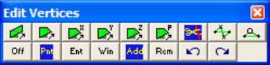

- Ist Tools > Shift-key Selection aktiviert, müssen Sie die Umschalttaste gedrückt halten, um mehrere Objekte auszuwählen.

- Standardmäßig werden ausgewählte Objekte der Liste hinzugefügt; halten Sie jedoch die Strg-Taste gedrückt, werden ausgewählte Objekte aus der Liste entfernt.

- Während Sie die Umschalt- oder Strg-Taste gedrückt halten, können Sie ein Kreuzungsfenster aufziehen.

- Die Verwendung dieser Symbolleiste ist beschrieben unter Build A List of Vertices for Editing

- Durch Drücken der Leertaste wird automatisch die zuletzt verwendete Bearbeitungsfunktion aktiviert.

- Wenn Sie beim Rechtsklick die Alt-Taste gedrückt halten, wird automatisch die zuletzt verwendete Bearbeitungsfunktion wiederholt.

Nachdem Sie die gewünschten Objekte ausgewählt haben, können Sie eine der Bearbeiten-Schaltflächen wählen:

CAD > Edit > Stretch Vertices CAD > Edit > Move Vertices to Point CAD > Edit > Move Vertices to X CAD > Edit > Move Vertices to Y

#### CAD > Edit > Move Vertices to Z

CAD > Edit > Move Vertices to Plane

CAD > Edit > Subdivide Construction Lines

CAD > Edit > Smooth Construction Lines

CAD > Edit > Remove Construction Vertex

- auf einen beliebigen Eckpunkt doppelklicken, um die hervorgehobene Funktion auszuführen,

- per Rechtsklick eine Liste von Optionen aufrufen.

Nach Abschluss eines Bearbeitungsvorgangs haben Sie eine Möglichkeit, die Änderungen rückgängig zu machen, indem Sie

#### Undo

Sie können auch dieselbe Auswahl wiederherstellen und denselben Satz von Objekten erneut ändern, indem Sie

#### Redo

Die Doppelklickzeit lässt sich einstellen mit

#### Tools > Double Click Time

Hinweise:

- Die Lage aller Punkte entlang der Konstruktionslinien lässt sich anzeigen, indem Sie den Parameter View > Render > Cline dot radius setzen.

- Vor der Verwendung dieser Glättungsfunktion für Verläufe sollten die Konstruktionslinien mit der Funktion CAD > Pack and Renumber Clines bereinigt werden.

- Die Doppelklickzeit lässt sich mit Tools > Double Click Time einstellen.

## 5.5.4.18 Konstruktionslinien glätten

Glättet Konstruktionslinien, indem Eckpunkte entfernt werden (siehe auch Construction Vertex).

#### CAD > Edit > Remove

Diese Routine kann entweder über die Schaltfläche oder einfach per Rechtsklick auf einen beliebigen Eckpunkt gestartet werden. Beim Start dieser Routine werden Sie zunächst aufgefordert, eine Liste der Eckpunkte zusammenzustellen, die Sie glätten möchten.

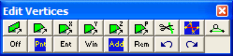

- Ist Tools > Shift-key Selection aktiviert, müssen Sie die Umschalttaste gedrückt halten, um mehrere Objekte auszuwählen.

- Standardmäßig werden ausgewählte Objekte der Liste hinzugefügt; halten Sie jedoch die Strg-Taste gedrückt, werden ausgewählte Objekte aus der Liste entfernt.

- Während Sie die Umschalt- oder Strg-Taste gedrückt halten, können Sie ein Kreuzungsfenster aufziehen.

- Die Verwendung dieser Symbolleiste ist beschrieben unter Build A List of Vertices for Editing

- Durch Drücken der Leertaste wird automatisch die zuletzt verwendete Bearbeitungsfunktion aktiviert.

- Wenn Sie beim Rechtsklick die Alt-Taste gedrückt halten, wird automatisch die zuletzt verwendete Bearbeitungsfunktion wiederholt.

Nachdem Sie die gewünschten Objekte ausgewählt haben, können Sie eine der Bearbeiten-Schaltflächen wählen:

CAD > Edit > Stretch Vertices

CAD > Edit > Move Vertices to Point CAD > Edit > Move Vertices to X CAD > Edit > Move Vertices to Y CAD > Edit > Move Vertices to Z CAD > Edit > Move Vertices to Plane CAD > Edit > Subdivide Construction Lines CAD > Edit > Smooth Construction Lines CAD > Edit > Remove Construction Vertex

- auf einen beliebigen Eckpunkt doppelklicken, um die hervorgehobene Funktion auszuführen,

- per Rechtsklick eine Liste von Optionen aufrufen.

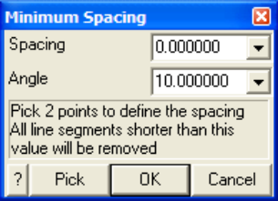

Der Wert Spacing begrenzt den Mindestabstand zwischen Punkten. Wurde Spacing beispielsweise mit 2 m angegeben und betrug die Verlaufslänge zwischen den Punkten 4 und 5 in der folgenden Abbildung 1,5 m, würde Punkt 4 entfernt und durch eine gerade Linie zwischen den Punkten 3 und 5 ersetzt.

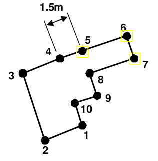

Ein Wert von null für diesen Parameter bedeutet, dass er nicht verwendet wird.

Der Wert Angle begrenzt den Mindestwinkel zwischen aufeinanderfolgenden Liniensegmenten. Wurde Angle beispielsweise mit 10° angegeben und wich die Richtung des Liniensegments 3-4 um 7° von der Richtung des

Liniensegments 4-5 in der folgenden Abbildung ab, würde Punkt 4 entfernt und durch eine gerade Linie zwischen den Punkten 3 und 5 ersetzt.

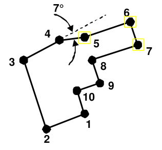

Ein Wert von null für diesen Parameter bedeutet, dass er nicht verwendet wird.

OK - schließt die Bearbeitung des Versatzvektors ab und streckt die ausgewählten Eckpunkte.

Cancel - bricht das Strecken von Eckpunkten ab.

Nach Abschluss eines Bearbeitungsvorgangs haben Sie eine Möglichkeit, die Änderungen rückgängig zu machen, indem Sie

#### Undo

Sie können auch dieselbe Auswahl wiederherstellen und denselben Satz von Objekten erneut ändern, indem Sie

#### Redo

Die Doppelklickzeit lässt sich einstellen mit

#### Tools > Double Click Time

Hinweise:

- Die Lage aller Punkte entlang der Konstruktionslinien lässt sich anzeigen, indem Sie den Parameter View > Render > Cline dot radius setzen.

- Vor der Verwendung dieser Glättungsfunktion für Verläufe sollten die Konstruktionslinien mit der Funktion CAD > Pack and Renumber Clines bereinigt werden.

- Die Doppelklickzeit lässt sich mit Tools > Double Click Time einstellen.

## 5.5.4.19 Konstruktionslinien-Eckpunkt entfernen

Glättet Konstruktionslinien, indem einzelne Eckpunkte entfernt werden (siehe auch Construction Lines).

#### CAD > Edit > Smooth

Diese Routine kann entweder über die Schaltfläche oder einfach per Rechtsklick auf einen beliebigen Eckpunkt gestartet werden. Beim Start dieser Routine werden Sie zunächst aufgefordert, eine Liste der Eckpunkte zusammenzustellen, die Sie entfernen möchten.

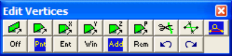

- Ist Tools > Shift-key Selection aktiviert, müssen Sie die Umschalttaste gedrückt halten, um mehrere Objekte auszuwählen.

- Standardmäßig werden ausgewählte Objekte der Liste hinzugefügt; halten Sie jedoch die Strg-Taste gedrückt, werden ausgewählte Objekte aus der Liste entfernt.

- Während Sie die Umschalt- oder Strg-Taste gedrückt halten, können Sie ein Kreuzungsfenster aufziehen.

- Die Verwendung dieser Symbolleiste ist beschrieben unter Build A List of Vertices for Editing

- Durch Drücken der Leertaste wird automatisch die zuletzt verwendete Bearbeitungsfunktion aktiviert.

- Wenn Sie beim Rechtsklick die Alt-Taste gedrückt halten, wird automatisch die zuletzt verwendete Bearbeitungsfunktion wiederholt.

Nachdem Sie die gewünschten Objekte ausgewählt haben, können Sie eine der Bearbeiten-Schaltflächen wählen:

CAD > Edit > Stretch Vertices CAD > Edit > Move Vertices to Point CAD > Edit > Move Vertices to X CAD > Edit > Move Vertices to Y CAD > Edit > Move Vertices to Z CAD > Edit > Move Vertices to Plane CAD > Edit > Subdivide Construction Lines CAD > Edit > Smooth Construction Lines CAD > Edit > Remove Construction Vertex

- auf einen beliebigen Eckpunkt doppelklicken, um die hervorgehobene Funktion auszuführen,

- per Rechtsklick eine Liste von Optionen aufrufen.

Nach Abschluss eines Bearbeitungsvorgangs haben Sie eine Möglichkeit, die Änderungen rückgängig zu machen, indem Sie

#### Undo

Sie können auch dieselbe Auswahl wiederherstellen und denselben Satz von Objekten erneut ändern, indem Sie

#### Redo

Die Doppelklickzeit lässt sich einstellen mit

#### Tools > Double Click Time

Hinweise:

- Die Lage aller Punkte entlang der Konstruktionslinien lässt sich anzeigen, indem Sie den Parameter View > Render > Cline dot radius setzen.

- Vor der Verwendung dieser Glättungsfunktion für Verläufe sollten die Konstruktionslinien mit der Funktion CAD > Pack and Renumber Clines bereinigt werden.

- Die Doppelklickzeit lässt sich mit Tools > Double Click Time einstellen.
