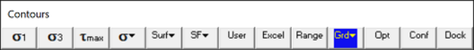
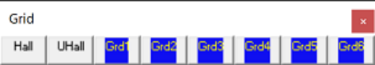
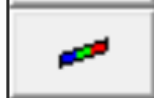

Wählt ein Feldpunktraster zur Anzeige aus.

Diese Routine kann über die Schaltfläche in der Kontur-Symbolleiste gestartet werden

Diese Symbolleiste kann in eine senkrechte Ausrichtung gebracht werden, indem man sie an den rechten oder linken Rand des Hauptfensters zieht.

Zurück in die waagerechte Ausrichtung gelangt sie, indem man sie an den oberen oder unteren Rand des Hauptfensters zieht.

Analyseergebnisse (Spannungen, Dehnungen und Verschiebungen) können als Konturen auf Elementoberflächen und auf Feldpunktrastern dargestellt werden.

Mit aktiviertem OpenGL (Tools > OpenGL) können alle Raster gleichzeitig angezeigt werden. Ohne OpenGL können nur zwei Raster gleichzeitig angezeigt werden.

Hide All – blendet alle Raster aus.

Unhide All – blendet alle Raster ein.

Der Benutzer kann mehrere Feldpunkt-Rasterebenen erstellen mit

CAD > Build > Grid Plane

CAD > Build > Grid Line

Bei Bedarf können einzelne Rasterauswahl-Schaltflächen in der Ansichts-Symbolleiste platziert werden mit

Tools > View Toolbar Configure
