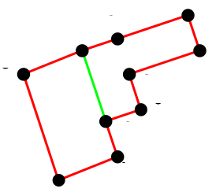
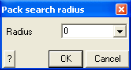

Packt alle Konstruktionslinien und nummeriert sie neu.

Koordinatenpunkte, die sehr nahe beieinander liegen, werden zusammengeführt. Eckpunkte von Konstruktionslinien an derselben Position verwenden dieselbe Koordinatenpunktnummer und bewegen sich daher bei jeder Koordinatenbearbeitung (Cad > Edit) gemeinsam. Diese Funktion ist nützlich, um kleine Lücken und Überlappungen zwischen benachbarten Konstruktionslinien zu beseitigen.

Alle Konstruktionsliniensegmente derselben Farbe werden, soweit möglich, zu durchgehenden Linien zwischen Schnittpunkten verbunden.

**6**

In diesem Beispiel werden 3 Liniensegmente aus den folgenden Punktgruppen gebildet

- Liniensegment 1:  10, 1, 2, 3, 4.

- Liniensegment 2:  4, 5, 6, 7, 8, 9, 10.

- Liniensegment 3:  4, 10.

Wenn Sie diese Funktion starten, werden Sie aufgefordert, einen Suchradius für das Packen anzugeben

Radius – dieser Wert wird verwendet, um nahe beieinander liegende Punkte zusammenzuführen. Ein Wert von null für diesen Parameter bedeutet, dass er nicht verwendet wird; stattdessen führt Map3D Punkte zusammen, die innerhalb eines Suchradius von 1/1000 der Kantenlänge von der Linie liegen. Seien Sie äußerst vorsichtig, wenn Sie für diesen Parameter einen Wert ungleich null angeben, da große Werte durch das Zusammenführen zu vieler Punkte mehr Probleme verursachen können, als sie beheben.

Nicht verwendete Koordinatennummern werden aus der Koordinatenliste entfernt.

Diese Funktion sollte vor der Funktion CAD > Edit > Smooth Construction lines verwendet werden.

Diese Funktion sollte vor der Funktion CAD > Snap > Trace Cline Snap verwendet werden.

Konstruktionslinien können mit der Funktion CAD > Unpack Clines wieder entpackt werden.
