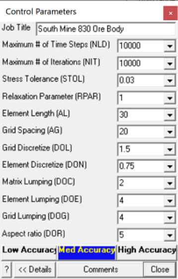
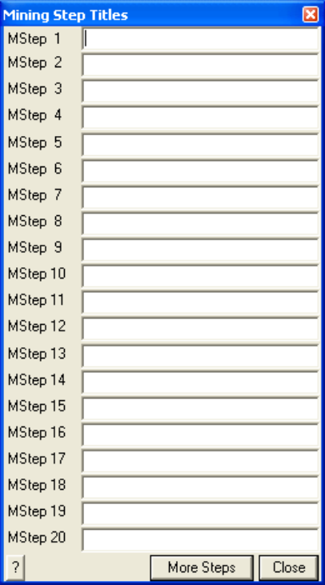

## 5.5.3.1 Steuerparameter

Festlegung der Steuerparameter der Analyse.

**Job Title** - legt einen beschreibenden Projekttitel fest.

**Maximum # of Time Steps (** **_NLD_ )** - legt die maximale Anzahl an Schritten fest, die während der Analyse verwendet werden. Dieser Parameter ist nur relevant, wenn Sie eine nichtlineare Kriechanalyse durchführen

#### Analysis > Options > Creep

bei der er die tatsächliche Anzahl der Zeitschritte begrenzt.

Wird dieser Parameter überschritten, hält das Programm an und der Benutzer wird gefragt, wie fortgefahren werden soll. Dieser Parameter kann während der Lösung geändert werden.

Sofern der Benutzer keinen besonderen Grund hat, die Anzahl der Zeitschritte zu begrenzen, sollte dieser Parameter auf eine beliebig große Zahl gesetzt werden.

**Maximum # of Iterations (** **_NIT_ )** - legt die maximale Anzahl an Iterationen fest, die bei der Matrixlösung verwendet werden.

Wird dieser Parameter überschritten, hält das Programm an und der Benutzer wird gefragt, wie fortgefahren werden soll. Dieser Parameter kann während der Lösung geändert werden.

Sofern der Benutzer keinen besonderen Grund hat, die Anzahl der Zeitschritte zu begrenzen, sollte dieser Parameter auf eine beliebig große Zahl gesetzt werden.

**Stress Tolerance (** **_STOL_ )** - legt die erforderliche Genauigkeit der Matrixlösung fest.

Während der Matrixlösung verbessert sich die Genauigkeit mit jeder Iteration schrittweise. Sobald der maximale Spannungsfehler unter diesen Wert fällt, kann die Matrix als gelöst betrachtet werden.

Der empfohlene Wert für diesen Parameter beträgt 0,1 % des Fernfeld-Spannungszustands in der interessierenden Teufe. _STOL_ sollte in denselben Einheiten wie der Fernfeld-Spannungszustand angegeben werden (z. B. MPa oder psi).

**Relaxation Parameter (** **_RPAR_ )** - legt den maximalen Relaxationswert fest, der bei der Matrixlösung verwendet wird.

Während der Matrixlösung passt das Programm den Relaxationsparameter fortlaufend an, um mit möglichst wenigen Iterationen Konvergenz zu erreichen. Dieser Parameter begrenzt den maximal verwendeten Wert.

Für gut konditionierte Probleme wird der Wert 1,2 empfohlen. Für schlecht konditionierte Probleme sollte ein Wert von 0,8 verwendet werden.

**Element Length (** **_AL_ )** - legt die minimale Elementlänge fest.

Während der Diskretisierung werden alle Modelloberflächen (Oberflächen von FF-Blöcken und DD-Ebenen) in Randelemente mit der Seitenlänge

_Lelem = Delem/DON_

unterteilt, wobei _Delem_ von Map3D als kleinster Abstand zwischen benachbarten Modelloberflächen bestimmt wird. Da der Abstand _Delem_ an manchen Stellen null sein kann, muss die minimale Elementseitenlänge _AL_ angegeben werden.

_AL_ sollte gleich der doppelten Breite des kleinsten Pfeilers oder Abbaus gesetzt werden. Es sollten dieselben Einheiten wie bei den Koordinaten verwendet werden (z. B. Meter oder Fuß).

Nach Abschluss der Diskretisierung kann der Abstand _Delem_ dargestellt werden mit

Plot > Miscellaneous > Delem distance to nearest element on surfaces.

Beachten Sie, dass dieses Verhalten bei Bedarf element- für elementweise überschrieben werden kann, indem für jedes Element die maximale Breite angegeben wird

#### CAD > Edit > Entity Properties > Maximum Width

So können Benutzer auf Oberflächen in Bereichen ohne Rasterebenen eine feine, gleichmäßige Diskretisierung erzwingen.

**Grid Spacing (** **_AG_ )** - legt den minimalen Rasterabstand fest.

Während der Diskretisierung werden alle Feldpunktraster und Modelloberflächen in Elemente mit der Seitenlänge

_Lgrid = Dgrid/DOL_

unterteilt, wobei _Dgrid_ von Map3D als kleinster Abstand zwischen Modelloberflächen und Rasterebenen bestimmt wird. Da der Abstand _Dgrid_ an manchen Stellen null sein kann, muss der minimale Rasterabstand _AG_ angegeben werden. Dasselbe Verfahren wird zur Diskretisierung von Modelloberflächen (Oberflächen von FF-Blöcken und DD-Ebenen) verwendet, die nahe an Feldpunktrastern liegen.

_AG_ sollte gleich der kleinsten interessierenden Abmessung gesetzt werden. Muss der Benutzer beispielsweise die Spannungsverteilung über einen 2 m breiten Pfeiler sehen, ergäbe ein Wert für _AG_ von 0,5 eine ausreichende Anzahl von Feldpunkten für eine genaue Konturdarstellung. Es sollten dieselben Einheiten wie bei den Koordinaten verwendet werden (z. B. Meter oder Fuß).

Nach Abschluss der Diskretisierung kann der Abstand _Dgrid_ auf Modelloberflächen dargestellt werden mit

Plot > Surface Components > Dgird distance to nearest grid

oder auf Rastern mit

Plot > Miscellaneous > Delem distance to nearest element on grids.

Beachten Sie, dass dieses Verhalten bei Bedarf raster- für rasterweise überschrieben werden kann, indem für jedes Raster der maximale Abstand angegeben wird

#### CAD > Edit > Entity Properties > Maximum Width

So können Benutzer auf Rastern eine feine, gleichmäßige Diskretisierung erzwingen.

**Grid Discretize (** **_DOL_ ) -** legt das gewünschte Verhältnis von Abstand zu Elementlänge fest, das zur Bestimmung des Rasterabstands verwendet wird, aus

_Lgrid = Dgrid/DOL_

wobei _Dgrid_ von Map3D als kleinster Abstand zwischen Modelloberflächen und Rasterebenen bestimmt wird.

Ein Wert von 1,0 für _DOL_ ist im Allgemeinen ausreichend und liefert erwartungsgemäß Lösungen mit 10-20 % Fehler. Ist höhere Genauigkeit erforderlich, sollte ein Wert von 2,0 für _DOL_ 5-10 % Fehler ergeben. Verwenden Sie einen Wert von 4,0 für weniger als 5 % Fehler. Höhere Werte von _DOL_ erzeugen zwar mehr Randelemente und damit längere Rechenzeiten, aber dies ist für höhere Genauigkeit notwendig.

Nach Abschluss der Diskretisierung kann das Verhältnis _Dgrid/Lelem_ auf Modelloberflächen dargestellt werden mit

Plot > Miscellaneous > Dgrid/Lelem _DOL_ ratio on surfaces

oder das Verhältnis _Dgrid/Lgrid_ auf Rastern mit

Plot > Miscellaneous > Dgrid/Lgrid _DOL_ ratio on grids.

**Element Discretize (** **_DON_ ) -** legt das gewünschte Verhältnis von Abstand zu Elementlänge fest, das zur Bestimmung der Elementseitenlänge verwendet wird

_Lelem = Delem/DON_

wobei _Delem_ den Abstand zur nächsten Modelloberfläche darstellt.

Ein Wert von 0,5 für _DON_ ist im Allgemeinen für alle Probleme ausreichend, außer bei sehr schmalen Hohlräumen oder Pfeilern. In diesem letzteren Fall wird ein Wert von 1,0 für _DON_ empfohlen. Höhere Werte von _DON_ erzeugen zwar mehr Randelemente und damit längere Rechenzeiten, aber dies ist notwendig, um bei sehr schmalen Hohlräumen oder Pfeilern ein gut konditioniertes, lösbares Problem zu erhalten.

Nach Abschluss der Diskretisierung kann das Verhältnis _Delem/Lelem_ dargestellt werden mit

Plot > Miscellaneous > Delem/Lelem _DON_ ratio on surfaces.

**Matrix Lumping (** **_DOC_ ) -** legt das gewünschte Verhältnis von Abstand zu Elementlänge fest. Beim Matrixaufbau werden alle Elemente, die in die Abmessung

#### _Delem/DOC_

passen, zusammengefasst (Lumping). _Delem_ stellt den Abstand zur nächsten Modelloberfläche dar.

Wie bei _DOL_ ist ein Wert von 1,0 für _DOC_ im Allgemeinen ausreichend und liefert erwartungsgemäß Lösungen mit 10-20 % Fehler. Ist höhere Genauigkeit erforderlich, sollte ein Wert von 2,0 für _DOC_ 5-10 % Fehler ergeben. Verwenden Sie einen Wert von 4,0 für weniger als 5 % Fehler. Höhere Werte von _DOC_ führen zwar zu größeren Koeffizientenmatrizen und damit längeren Rechenzeiten, aber dies ist für höhere Genauigkeit notwendig.

Nach Abschluss der Diskretisierung kann der Abstand _Delem_ dargestellt werden mit

Plot > Miscellaneous > Delem distance to nearest element on surfaces.

**Element Lumping (** **_DOE_ ) -** legt das gewünschte Verhältnis von Abstand zu Elementlänge fest. Beim Rasteraufbau werden alle Elemente, die in die Abmessung

#### _Dgrid/DOE_

passen, zusammengefasst (Lumping). _Dgrid_ stellt den Abstand zur nächsten Feldpunktrasterfläche dar.

Ein Wert von 2,0 für _DOE_ ist im Allgemeinen ausreichend und liefert erwartungsgemäß Lösungen mit 10-20 % Fehler. Ist höhere Genauigkeit erforderlich, sollte ein Wert von 4,0 für _DOE_ 5-10 % Fehler ergeben. Verwenden Sie einen Wert von 8,0 für weniger als 5 % Fehler. Höhere Werte von _DOE_ verlängern zwar die Rechenzeiten, aber dies ist für höhere Genauigkeit notwendig.

Nach Abschluss der Diskretisierung kann der Abstand _Dgrid_ auf Rastern dargestellt werden mit

Plot > Miscellaneous > Delem distance to nearest element on grids.

**Grid Lumping (** **_DOG_ ) -** legt das gewünschte Verhältnis von Abstand zu Elementlänge fest. Beim Rasteraufbau werden alle Rasterpunkte, die in die Abmessung

#### _Dgrid/DOG_

passen, zusammengefasst (Lumping). _Dgrid_ stellt den Abstand zur nächsten Feldpunktrasterfläche dar.

Ein Wert von 2,0 für _DOG_ ist im Allgemeinen ausreichend und liefert erwartungsgemäß Lösungen mit 10-20 % Fehler. Ist höhere Genauigkeit erforderlich, sollte ein Wert von 4,0 für _DOG_ 5-10 % Fehler ergeben. Verwenden Sie einen Wert von 8,0 für weniger als 5 % Fehler. Höhere Werte von _DOG_ verlängern zwar die Rechenzeiten, aber dies ist für höhere Genauigkeit notwendig.

Nach Abschluss der Diskretisierung kann der Abstand _Dgrid_ auf Rastern dargestellt werden mit

Plot > Miscellaneous > Delem distance to nearest element on grids.

**Aspect Ratio (** **_DOR_ ) -** legt das gewünschte Seitenverhältnis der Elemente fest. Ein Wert von 5,0 für _DOR_ wird für alle Probleme empfohlen, außer wenn der Benutzer schmale Elemente in gleichmäßigere Formen unterteilen möchte.

Setzt _DON_ =0,5, _DOL=DOC_ =1, _DOE=DOG_ =2 für 10-20 % Fehler. Setzt _DON_ =0,5, _DOL=DOC_ =2, _DOE=DOG_ =4 für 5-10 % Fehler. Setzt _DON_ =1, _DOL=DOC_ =4, _DOE=DOG_ =8 für &lt; 5 % Fehler.

**Comments -** ermöglicht es, Kommentare anzugeben, die mit dem Lauf gespeichert werden.

#### Summary:

- _STOL_ sollte gleich 0,1 % des Fernfeld-Spannungszustands in der interessierenden Teufe gesetzt werden. Verwenden Sie dieselben Einheiten wie beim Fernfeld-Spannungszustand (z. B. MPa oder psi).

- _AL_ sollte gleich der doppelten Breite des kleinsten Pfeilers oder Abbaus gesetzt werden. Verwenden Sie dieselben Einheiten wie bei den Koordinaten (z. B. Meter oder Fuß).

- _AG_ sollte gleich der kleinsten interessierenden Abmessung gesetzt werden. Verwenden Sie dieselben Einheiten wie bei den Koordinaten (z. B. Meter oder Fuß).

- Elemente werden mit einer Seitenlänge diskretisiert, die dem kleineren Wert von _Delem/DON_ und _Dgrid/DOL_ entspricht, sodass sie nicht kleiner als _AL_ und nicht größer als die maximale Breite sein kann.

- Raster werden mit einem aus _Dgrid/DOL_ bestimmten Abstand diskretisiert, sodass er nicht kleiner als _AG_ und nicht größer als der maximale Abstand sein kann.

- Beim Matrixaufbau werden alle Elemente, die in die Abmessung _Delem/DOC_ passen, zusammengefasst (Lumping).

- Beim Rasteraufbau werden alle Elemente, die in die Abmessung _Dgrid/DOE_ passen, zusammengefasst (Lumping).

- Beim Rasteraufbau werden alle Rasterpunkte, die in die Abmessung _Dgrid/DOG_ passen, zusammengefasst (Lumping).

#### Notes:

Eine ausführlichere Erläuterung zu Diskretisierung und Zusammenfassung (Lumping) finden Sie unter

- Discretization and Lumping.

## 5.5.3.2 Titel der Abbauschritte

Festlegung eines beschreibenden Titels für jeden Abbauschritt.

## 5.5.3.3 Materialeigenschaften

Festlegung der Materialeigenschaften.

Je nach gewähltem Materialtyp erscheinen verschiedene Dialogfelder: Mohr-Coulomb, Hoek-Brown, Drucker-Prager, Backfill Hyperbolic und None.

Mohr-Coulomb in 3D-FF-Blöcken kann in Map3D Non-Linear und Map3D Visco-Plastic als Fließregel für nichtlineares Materialverhalten verwendet werden. Es kann auch als Bruchkriterium in 3D-FF-Blöcken oder im Nebengestein (host) in Map3D Fault-Slip verwendet werden.

Hoek-Brown in 3D-FF-Blöcken kann als Bruchkriterium in 3D-FF-Blöcken oder im Nebengestein in Map3D Fault-Slip verwendet werden.

Drucker-Prager in 3D-FF-Blöcken kann als Bruchkriterium in 3D-FF-Blöcken oder im Nebengestein in Map3D Fault-Slip verwendet werden.

Fault-Gouge in DD-Ebenen kann als Fließregel in DD-Ebenen in Map3D Fault-Slip, Map3D Non-Linear oder Map3D Visco-Plastic verwendet werden.

Equilibrated-Gouge in DD-Ebenen kann als Fließregel in DD-Ebenen in Map3D Fault-Slip, Map3D Non-Linear oder Map3D Visco-Plastic verwendet werden.

Yielding-Pillar in DD-Ebenen kann als Fließregel in DD-Ebenen in Map3D Fault-Slip, Map3D Non-Linear oder Map3D Visco-Plastic verwendet werden.

Hyperbolic-Backfill in DD-Ebenen kann als Fließregel in DD-Ebenen in Map3D Fault-Slip, Map3D Non-Linear oder Map3D Visco-Plastic verwendet werden.

Quadratic-Backfill in DD-Ebenen kann als Fließregel in DD-Ebenen in Map3D Fault-Slip, Map3D Non-Linear oder Map3D Visco-Plastic verwendet werden.

Softened Material in 3D-FF-Blöcken oder DD-Ebenen kann verwendet werden, um ein elastisches Material zu erweichen und so das Fließen des Gebirges und die daraus folgenden Spannungsumlagerungseffekte zu simulieren.

Stress State legt den Spannungszustand vor dem Abbau fest.

Bei elastischen Analysen wird das Bruchkriterium nur für die Berechnung von Festigkeitsfaktoren und die Konturdarstellung verwendet und hat keinen Einfluss auf die Analyseergebnisse.

Bei nichtlinearen Analysen (3D-FF-Blöcke in Map3D Non-Linear, 3D-FF-Blöcke in Map3D Visco-Plastic und DD-Ebenen in Map3D Fault-Slip) wird das Bruchkriterium als Fließregel zur Steuerung von Fließen und nichtlinearen Verformungen verwendet.

## 5.5.3.4 Map3Di-Einrichtung

Richtet die Map3Di-Analyse ein.

Mit Map3Di lassen sich äußere Feldbelastungseffekte dem Map3D-Modell überlagern. Einzelheiten zu dieser Funktion finden Sie unter Map3Di.

Wenn Sie eine Map3Di-Belastungsdatei zur Verwendung prüfen, werden Sie aufgefordert, einen Dateinamen und Speicherort zu suchen. Ist die Suche erfolgreich, wird die Datei geprüft.

Die Map3Di-Belastungsdatei wird im Polylinien-Dateiformat angegeben. Einzelheiten zur Erzeugung einer Map3Di-Belastungsdatei finden Sie unter Contour Plane Options.

Kommentarzeilen müssen in Spalte 1 mit einem Sternchen „*“ beginnen.

2D-Ebenen werden als Reihe von dreieckigen oder viereckigen Polylinien wie folgt gespeichert:

x1 y1 z1 3 values1 x2 y2 z2 2 values2 x3 y3 z3 2 values3 x4 y4 z4 2 values4 ...

3D-Blöcke werden als Reihe von tetraedrischen oder hexaedrischen Polylinien wie folgt gespeichert:

x1 y1 z1 3 values1 x2 y2 z2 2 values2 x3 y3 z3 2 values3 x4 y4 z4 2 values4 x5 y5 z5 1 values5 x6 y6 z6 1 values6

x7 y7 z7 1 values7

x8 y8 z8 1 values8

wobei **xi yi zi** die Koordinaten jedes Punkts darstellen.

- 3 gibt an, dass dieser Punkt der Beginn einer neuen Polylinie ist.

- 2 gibt an, dass dieser Punkt Teil der Basis des Blocks ist.

- 1 gibt an, dass dieser Punkt Teil der Oberseite des Blocks ist. Dieser Eintrag wird nur zur Definition von 3D-Blockformen verwendet.

Weitere Polylinien werden durch Wiederholen der Sequenz angegeben (d. h. durch Beginnen einer neuen Polylinie mit der Zahl **3** ).

Jeder der Punkte kann wiederholt oder übersprungen werden, um dreieckige Seiten oder Tetraeder anzugeben.

- valuesi gibt die Größe der Feldbelastung im Mittelpunkt oder an jeder Ecke an. Wird nur values1 angegeben (d. h. values2 … bleiben leer), wird dieser Wert gleichmäßig auf das gesamte Objekt angewendet.

- Werden valuesi für alle Ecken angegeben, wird die Feldbelastung nach einer Polynomverteilung höherer Ordnung angewendet.

Für 2D-Oberflächendreiecke wird eine lineare Verteilung verwendet

_a_ + _b x_ + _c y_

Für 2D-Vierecke wird die folgende Verteilung verwendet

_a_ + _b x_ + _c y_ + _d x y_

Für 3D-Blockformen werden so viele Terme der Verteilung wie möglich verwendet

_a_ + _b x_ + _c y_ + _d z_ + _e x y_ + _f y z_ + _g z x_ + _h x y z_

Die tatsächlichen Feldbelastungseffekte können auf mehrere Arten angegeben werden.

#### 2D Planes

2D-Ebenen definieren eine Verschiebungsdiskontinuität mit angegebener Normalverschiebung (Konvergenz) dn und Scherverschiebung (ride) ds, sodass valuesi entweder als

dn ds oder dn ds1 ds2

angegeben werden kann.

Werden nur dn ds angegeben, wird die Scherverschiebung (ride) parallel zur maximalen Schubspannung in der Ebene der 2D-Ebene angewendet.

Werden alle dn ds1 ds2 angegeben, wird die Komponente der Scherverschiebung (ride) ds1 parallel zur ersten Seite angewendet (d. h. der durch x1 y1 z1 – x2 y2 z2 definierten Seite). ds2 wird senkrecht zu ds1 in Richtung der zweiten Seite angewendet (d. h. der durch x2 y2 z2 - x3 y3 z3 definierten Seite).

Scherverschiebung (ride) und Normalverschiebung (Konvergenz) werden in Verschiebungseinheiten angegeben (d. h. in denselben Einheiten wie die Geometrie (Meter)).

Scherverschiebung (ride) und Normalverschiebung (Konvergenz) können aus In-situ- oder Labormessungen von Scherung, Konvergenz und/oder Rissöffnung oder aus einem anderen numerischen Modellierungsprogramm wie einem Lagerstätten- oder Hydrofrac-Simulator bestimmt werden. Sie können auch aus seismischen Überwachungsdaten abgeschätzt werden.

#### 3D Blocks

3D-Blöcke definieren eine Zone mit angegebener Dehnung e, entweder als

e1 e2 e3 oder exx eyy ezz exy eyz ezx

Werden nur e1 e2 e3 angegeben, werden diese Hauptdehnungen parallel zu den Hauptspannungen angewendet. Die Dehnungen werden verwendet, um die Anfangsspannung s° zu bestimmen mit

s1° = [ ( _1-_ n) e1 + n ( e2 + e3 ) ] _E_ / [ ( _1+_ n) ( _1-2_ n) ] s2° = [ ( _1-_ n) e2 + n ( e3 + e1 ) ] _E_ / [ ( _1+_ n) ( _1-2_ n) ] s3° = [ ( _1-_ n) e3 + n ( e1 + e2 ) ] _E_ / [ ( _1+_ n) ( _1-2_ n) ]

Werden alle exx eyy ezz exy eyz ezx angegeben, werden diese Dehnungen als kartesische Komponenten angewendet. Die Dehnungen werden verwendet, um die Anfangsspannung s° zu bestimmen mit

sxx°  = [ ( _1-_ n) exx + n ( eyy + ezz ) ] _E_ / [ ( _1+_ n) ( _1-2_ n) ] syy° = [ ( _1-_ n) eyy + n ( ezz + exx ) ] _E_ / [ ( _1+_ n) ( _1-2_ n) ] szz°  = [ ( _1-_ n) ezz + n ( exx + eyy ) ] _E_ / [ ( _1+_ n) ( _1-2_ n) ] txy° = exy _E_ / ( _1+_ n) tyz° = eyz _E_ / ( _1+_ n) tzx° = ezx _E_ / ( _1+_ n)

Dehnungen werden in dimensionslosen Dehnungseinheiten angegeben (d. h. 0,001 entspricht 1000 Mikrodehnungen).

_E_ und n stehen für den Elastizitätsmodul (Gebirgsmaßstab – Verformungsmodul) nach Young bzw. die Poissonzahl. Map3D bestimmt automatisch, in welchem Material die Ecke des 3D-Blocks liegt, und verwendet die zugehörigen Materialeigenschaften.

Die Dehnungen können aus In-situ- oder Labormessungen von Temperatur oder Fluiddruck oder aus einem anderen numerischen Modellierungsprogramm wie einem thermischen Analysecode bestimmt werden. Sie können auch aus seismischen Überwachungsdaten abgeschätzt werden.

Die anzuwendenden Dehnungen lassen sich über einen Ausdehnungskoeffizienten _A_ aus der Temperatur bestimmen, wobei die Temperaturänderung oder Fluiddruckänderung (gegenüber dem Hintergrundwert) die Anfangsspannungen hervorruft

s1° **=** s2° **=** s3° = _A_ D _T_

Bei Strömungsproblemen sollte der Ausdehnungskoeffizient _A_ für gesättigte Medien auf eins (positiv eins) gesetzt werden. Bei thermischen Problemen sollte der Ausdehnungskoeffizient als negative Größe angegeben werden, gegeben durch

_A_ = a _E /(1-2_ n _)_

wobei a den thermischen Ausdehnungskoeffizienten darstellt (d. h. die lineare Ausdehnungszahl).

#### Notes

Diese Funktion muss vor der Map3D-BEM-Analyse eingerichtet werden

Analysis > BEM Analysis.

CAD > Properties > Map3Di Setup > View ermöglicht die Anzeige der Map3Di-Daten.

## 5.5.3.5 Modellinformationen

Zeigt die aktuelle Anzahl der folgenden Modellparameter an:

- Anzahl der zur Definition der Geometrie verwendeten Oberflächen,

- Anzahl der zur Definition der Oberflächen verwendeten Koordinaten,

- Anzahl der Abbauschritte.

Die folgenden Parameter werden erst nach Abschluss der Diskretisierungsanalyse (Analysis > Discretization) angezeigt:

- Anzahl der Randelemente,

- Anzahl der Randknoten (nur bei Elementen höherer Ordnung verwendet (Analysis > Options > Linear),

- Anzahl der Feldpunkte auf benutzerdefinierten Rastern.
